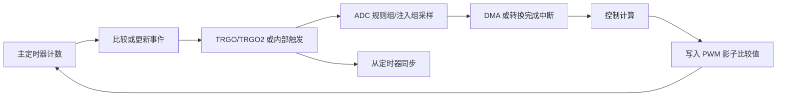

# 定时器、触发网络与 PWM

STM32 定时器不仅生成周期中断。计数器、捕获比较通道、主从触发、重复计数器、刹车输入和 ADC 触发可以组成几乎不依赖软件抖动的硬件时序链。

## 先确认定时器类别和实例能力

| 类别 | 常见能力 |
|---|---|
| 基本定时器 | 时基、更新事件、DAC 触发，通常没有外部通道 |
| 通用定时器 | 捕获、比较、PWM、编码器、外部计数和同步 |
| 高级控制定时器 | 互补输出、死区、刹车、重复计数和更完整的电机控制能力 |
| 高分辨率定时器 | 更细的时序、复杂波形、故障输入和多单元同步，部分系列提供 |
| 低功耗定时器 | 在低功耗时钟域继续计数和唤醒，能力因系列而异 |

同名 `TIM2` 在不同系列的位宽、通道和触发映射也可能不同。选型和代码都要回到对应实例。

## 频率计算的边界

常见向上计数更新频率为：

$$
f_{update}=\frac{f_{TIM}}{(PSC+1)(ARR+1)}
$$

边沿对齐 PWM 常见占空关系近似为 $CCR/(ARR+1)$，具体端点行为取决于 PWM 模式、极性和比较条件。中心对齐会在上下计数期间产生事件，更新频率、触发位置和重复计数器需要一起分析。

使用整数搜索 PSC 与 ARR 时，应同时检查频率误差、分辨率、计数器位宽和更新安全性，不只追求公式得到整数。

## 影子寄存器决定何时生效

预装载使 ARR、CCR 等新值在更新事件统一生效，避免一个周期中途改变比较点。控制系统要区分：

- CPU 何时写入寄存器；
- 写入的是活动寄存器还是影子寄存器；
- 哪个事件把影子值转入活动值；
- 错过更新窗口后会延迟几个周期。

## 用内部触发构建确定链路

触发名称和路由矩阵因系列而异，CubeMX 展示的可选项应与参考手册触发表交叉核对。软件启动 ADC 再用 `HAL_Delay` 等待，无法替代硬件同步采样。

## 互补 PWM 和保护

驱动半桥时要同时设计：

- 高低侧极性、互补关系和死区；
- 更新、换相和输出使能顺序；
- Break 输入来源、滤波、极性和锁存策略；
- 复位、调试暂停和软件失控时的输出状态；
- 栅极驱动器传播延迟与硬件最小脉宽；
- 示波器差分测量和功率级安全条件。

软件清除故障前，应先保存原因并确认功率级已经安全。快速过流保护应尽量走比较器、定时器刹车和栅极驱动器硬件链路。

## 输入捕获和编码器

输入捕获保存边沿到达时的计数值，适合频率、脉宽和时间戳测量。要处理计数器溢出、输入滤波、极性和低频超时。编码器模式由两个通道决定方向和计数，仍需处理机械零位、计数回绕、非法跳变和速度估算窗口。

## 验证方法

- 输出已知频率并用示波器或计数器测量；
- 在触发点翻转诊断 GPIO，确认 ADC 与 PWM 相位；
- 扫描占空比和死区边界，检查极窄脉冲；
- 注入 Break，测量从故障输入到输出关闭的延迟；
- 在最高中断负载下确认更新窗口不丢失。

## 继续学习

- [[008-ADC、DAC与片上模拟外设]]
- [[14-FOC-电机控制/00-README|FOC 电机控制]]
