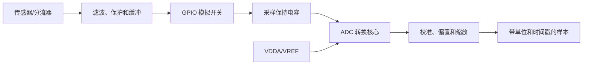

# ADC、DAC 与片上模拟外设

ADC 配置不能只写分辨率和通道数。输入源要在采样窗口内给内部采样电容充到允许误差，参考电压、电源噪声、触发抖动和通道切换都会进入结果。

## 一次转换的信号链

## 采样时间由源阻抗和精度决定

输入源与采样电容形成充电时间常数。源阻抗较高、目标分辨率较高或前一级运放建立较慢时，需要更长采样时间；代价是最大采样率下降。通道切换还可能保留前一通道的电荷，扫描顺序和前端阻抗应一起验证。

ST 的 [AN2834](https://www.st.com/resource/en/application_note/an2834-how-to-optimize-the-adc-accuracy-in-the-stm32-mcus-stmicroelectronics.pdf)给出了采样时间、源阻抗和误差的分析方法，具体参数仍以当前料号数据手册为准。

## 分辨率、量程和参考电压

对理想 N 位单极性 ADC，常用码值换算为：

$$
V_{in}\approx code\cdot\frac{V_{ref}}{2^N}
$$

实际系统还要处理增益误差、偏置、非线性、量化、参考电压误差和前端比例。把常数 `3.3` 写进回调不能代表真实 VDDA；可测量参考源、使用内部参考通道或在生产标定中获得比例系数，并记录温度和负载条件。

## 触发和序列决定样本时刻

规则组、注入组、队列、过采样和多 ADC 模式随系列不同。实时控制通常由定时器在 PWM 安静窗口触发，软件要确认：

- 触发事件到实际采样的延迟；
- 每个通道的采样和转换顺序；
- 整个序列是否在下一控制截止点前完成；
- DMA 缓冲中的数据顺序与宽度；
- 过载、溢出和遗漏触发怎样报告。

DMA 只负责搬运结果，不保证样本属于同一物理时刻，也不自动处理缓存一致性。

## 校准、内部通道和模拟看门狗

ADC 校准流程、稳压器启动和差分模式要求因系列而异。内部温度传感器、VREFINT 和 VBAT 通道通常有最小采样时间与启用等待，应查数据手册。

模拟看门狗可在码值越界时产生硬件事件或中断，适合快速检测，但阈值必须基于参考电压、前端比例和故障安全状态。关键过流保护还应评估片上比较器直接连接定时器 Break 的更短路径。

## DAC、比较器和运放

- DAC 输出受参考电压、输出缓冲、负载、建立时间和码阶毛刺限制；
- 比较器需要考虑输入范围、迟滞、传播延迟和消隐；
- 片上运放要检查带宽、压摆率、输入输出范围和与 ADC 的内部连接；
- CORDIC/FMAC 是数字加速器，不属于模拟信号链，使用范围看具体系列。

## 验证清单

- 用已知低阻信号扫描全量程，检查偏置、增益和噪声。
- 改变采样时间和通道顺序，观察高阻源与串扰。
- 用示波器确认定时器触发相对 PWM 和模拟波形的位置。
- 检查 VDDA、VREF、地回流和前端建立时间。
- 在目标温度、电源和采样率下重复标定与边界测试。

## 继续学习

- [[009-通信外设、DMA与缓存一致性]]
- [[01-Foundations/06-ADC与DAC基础/000-ADC与DAC基础|ADC 与 DAC 基础]]
