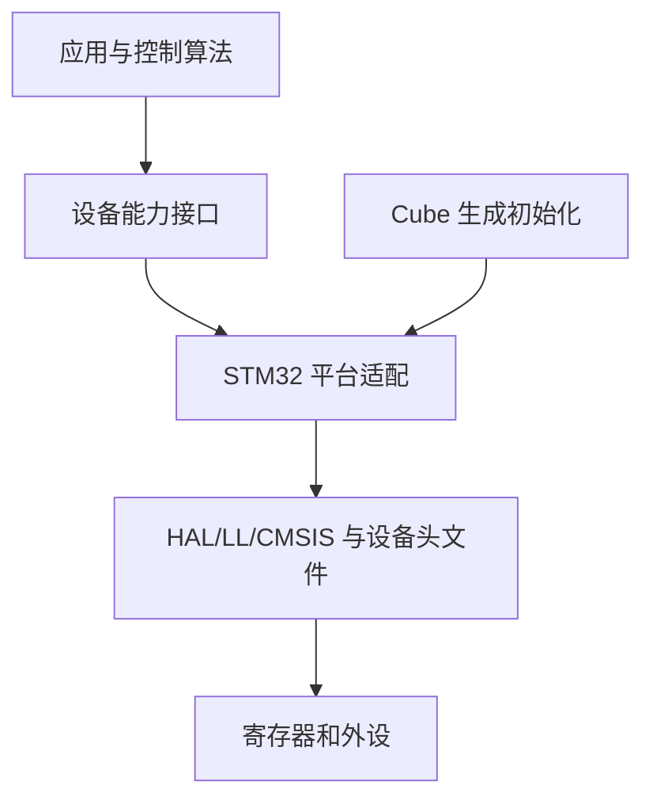

# HAL、LL、寄存器与驱动分层

HAL、LL 和直接寄存器访问解决的是不同层次的问题。选择哪一层取决于时序、可移植性、软件包质量和团队验证能力，不能简单归纳为 HAL 慢、寄存器快。

## 各层提供什么

| 层级 | 优势 | 主要代价 |
|---|---|---|
| CMSIS 与设备头文件 | 内核接口、寄存器结构、位定义和启动基础 | 平台相关，缺少完整外设状态机 |
| LL | 接近寄存器的内联接口，意图比裸位操作清楚 | 系列差异明显，状态管理由调用方负责 |
| HAL | 句柄、初始化、轮询、中断、DMA 和回调框架 | 状态和调用开销较多，跨系列并非无条件兼容 |
| 自建驱动接口 | 能围绕设备能力隔离平台和支持测试 | 需要维护契约、适配和错误路径 |

HAL 的开销是否影响系统，应在目标优化配置中测量。大多数初始化和低频管理路径无需为几条指令放弃可读性；控制 ISR 等关键路径可使用 LL、寄存器或专用函数，但仍应藏在平台接口后面。

## 分层方式

应用更适合依赖 `pwm_submit()`、`current_sample_get()`、`serial_send_async()` 这类能力，而不是 `TIM1`、`ADC1` 和全局 HAL 句柄。平台适配层负责把能力映射到具体实例、DMA 和引脚。

## 同一寄存器只能有清楚的所有者

HAL 会维护句柄状态，也可能在中断处理或启动停止函数中重写寄存器。如果业务代码同时直接操作同一外设，容易产生：

- HAL 状态与硬件实际状态不一致；
- 清标志和中断使能被另一层覆盖；
- 重新初始化丢失手工配置；
- 升级固件包后行为改变。

混合使用可以成立，但要明确哪些寄存器和状态由哪一层拥有，并把手工修改集中在可审查的位置。

## 初始化和运行期接口分开

Cube 生成的 `MX_*_Init` 适合建立初始硬件状态，运行期驱动还需要自己的契约：

- 是否支持重复启动和停止；
- 调用上下文是任务还是 ISR；
- 同步、异步和超时语义；
- 缓冲区在何时归还；
- 错误、取消和外设复位怎样恢复；
- 功耗模式切换后由谁重建配置。

## 代码生成后的差异审查

重新生成代码时重点检查：

- 时钟源、PLL、Flash 延迟和外设内核时钟；
- GPIO 模式、AF、默认输出电平和速度；
- NVIC 优先级与 RTOS 约束；
- DMA 请求、宽度、模式和中断；
- 链接脚本、启动文件和中间件版本；
- 用户代码区域之外的手工修改是否被覆盖。

## 测试边界

纯算法和状态机应能在主机测试。平台层可用寄存器桩、伪时钟或目标板测试验证。HAL 返回错误、DMA 超时、外设忙和迟到回调需要主动注入，不能只测试正常启动。

## 检查清单

- 抽象层选择有测量或维护理由，不靠印象决定。
- 应用不直接持有寄存器地址和 Cube 全局句柄。
- 同一外设寄存器只有一个清楚的所有者。
- 生成代码与手写模块分开，重新生成后审查完整差异。
- 异步接口定义缓冲区、取消、超时和回调上下文。

## 继续学习

- [[011-板级初次上电、调试与验证]]
- [[01-Foundations/08-嵌入式C编程/004-寄存器访问、volatile与硬件抽象|寄存器访问与硬件抽象]]
