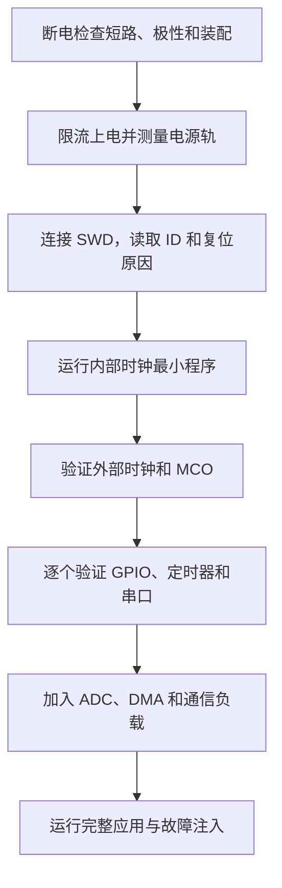

# 板级初次上电、调试与验证

初次上电的目标是逐步证明供电、复位、调试、时钟、引脚和外设链路成立。一次加载完整应用后再排错，会把焊接、时钟、生成配置、中断和业务状态混在一起。

## 分阶段建立证据

## 上电前

- 核对 MCU 方向、封装、焊盘和未装器件；
- 测量各电源轨对地电阻，检查稳压器反馈和输出电容；
- 确认 NRST、BOOT、SWD、晶振和所有专用电源引脚；
- 断开电机、栅极驱动使能和高能量负载；
- 准备限流电源、万用表和可访问的测试点。

## 第一次连接调试器

先使用较低 SWD 时钟并连接 NRST。能够读取器件 ID 和 Flash 不代表外部时钟、RAM、模拟电源和所有引脚正确，但能把问题缩小到供电、复位、SWD 和芯片装配这一层。

若无法连接，依次尝试复位下连接、BOOT 到系统存储器、降低 SWD 时钟和全片擦除。读保护或安全生命周期可能限制这些操作，不要在未知状态下反复改选项字节。

## 最小固件

最小固件只使用内部时钟，完成：

- 保存并输出复位原因；
- 翻转一个确认没有外部冲突的 GPIO；
- 用定时器或 MCO 输出可测频率；
- 不启用 RTOS、DMA、复杂中间件和低功耗；
- 保留 HardFault 和断言的最小记录。

确认最小程序后再启用 HSE/LSE 和 PLL。MCO 或定时器输出可以把时钟树变成可测信号。

## 外设验证模板

每个外设按同一格式记录：

1. 前置条件，包括时钟、引脚和外部电路；
2. 最小配置与预期寄存器状态；
3. 可测输入和输出；
4. 超时、错误和恢复路径；
5. 在中断、DMA 或高负载下的边界；
6. 测量截图、固件版本和硬件版本。

## 常见现象怎样缩小范围

| 现象 | 优先检查 |
|---|---|
| 上电限流 | 焊接短路、芯片方向、电源轨、VCAP 和外设反灌 |
| SWD 连接不稳 | 参考电压、地、NRST、线长、SWD 时钟和固件低功耗 |
| 主频不对 | HSE 值、PLL、Flash 等待周期、MCO 和时钟状态位 |
| GPIO 不翻转 | 端口时钟、模式、AF、板级占用和有源电平 |
| 中断只进一次 | 清标志语义、NVIC、外设使能和共享 IRQ |
| DMA 数据异常 | 请求映射、宽度、RAM 可达性、缓存和所有权 |
| ADC 偏差大 | VDDA/VREF、源阻抗、采样时间、前端和校准 |

## 调试测量不能改变结论

断点会暂停内核，但定时器、看门狗、外设和另一个内核是否暂停取决于调试冻结配置。阻塞日志会改变中断和控制时序。实时问题更适合用 GPIO 打点、周期计数器、SWO/追踪或异步二进制事件，再用示波器和逻辑分析仪交叉验证。

## 发布前

- 无调试器冷启动和多次复位；
- 发布优化与真实链接脚本；
- 最高通信、DMA 和中断负载；
- 掉电、欠压、时钟失败和外设无响应；
- 看门狗、故障快照和连续复位保护；
- 温度、电压和长期运行边界；
- 生产下载、校验、选项字节和版本追溯。

## 继续学习

- [[09-Debugging-Tools/01-调试工具概述/002-调试方法论|调试方法论]]
- [[09-Debugging-Tools/02-示波器使用/003-基本操作|示波器基本操作]]
- [[04-Microcontrollers/08-STM32测验题|STM32 测验题]]
