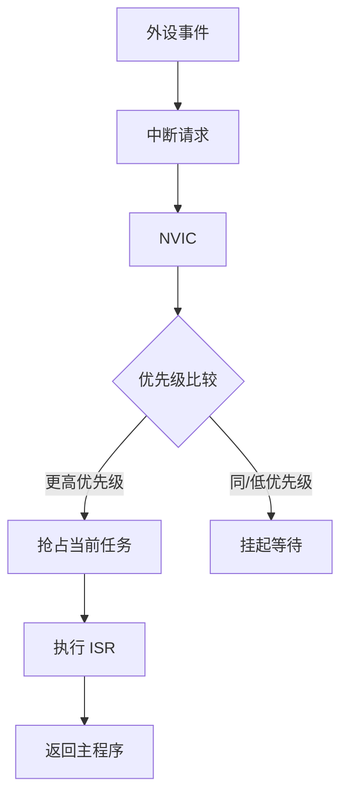

# 中断系统

## Cortex-M NVIC

### 关键概念
- **抢占优先级**：可打断其他中断
- **子优先级**：仅在相同抢占优先级内比较响应顺序
- **中断延迟**：从事件发生到 ISR 第一条指令执行的时间，Cortex-M 约 12 个时钟周期
- **尾链（Tail-chaining）**：连续中断之间减少状态保存开销

### 中断使用原则
1. ISR 越短越好，避免复杂计算和阻塞
2. 不要在中断中调用可能阻塞的 API（如 printf、malloc）
3. 使用标志位或消息队列将工作交给主循环/任务
4. 注意共享数据的保护（关中断、临界区、原子操作）

---

