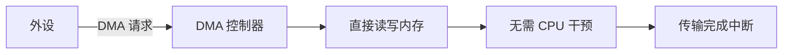
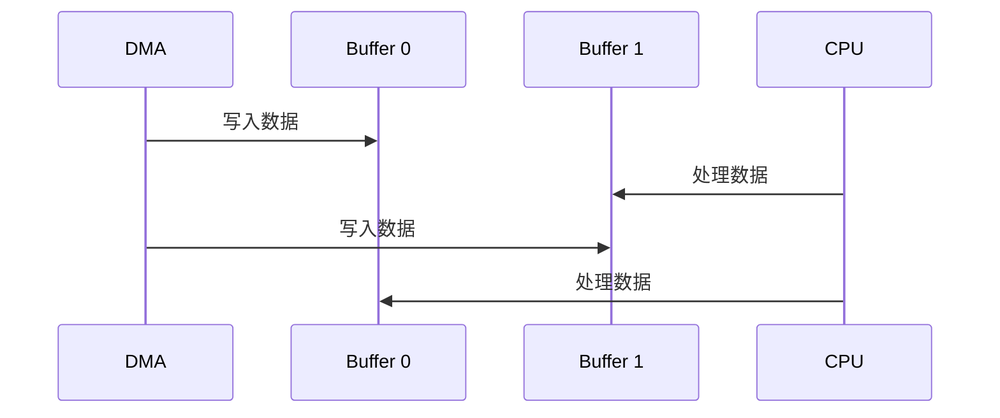

# DMA 直接存储器访问

## DMA 基本模型

### DMA 传输参数
- **源地址/目标地址**：外设寄存器或内存地址
- **传输方向**：外设→内存、内存→外设、内存→内存
- **数据宽度**：Byte、Half-word、Word
- **传输数量**：单次传输数据个数
- **模式**：单次、循环（Circular）、双缓冲

### 双缓冲模式
- 使用两个缓冲区交替读写
- 一个缓冲区在被 DMA 填充时，CPU 处理另一个缓冲区
- 适用于：音频采集、高速 ADC、串口流式传输

---

