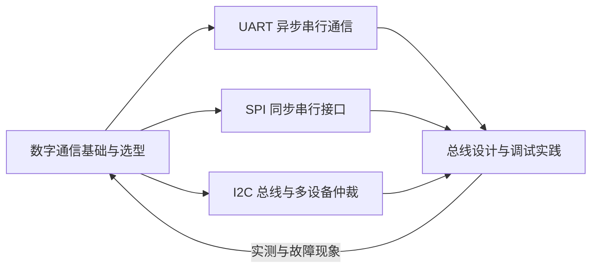

# I2C / SPI / UART

UART、SPI、I²C 是同一块 PCB 上两颗芯片之间最常见的三条数据通路，但三者解决的问题并不在同一层。UART 只定义"一个字节怎样在两根线上成形"，电气与距离由 RS-232、RS-422、RS-485 这类外部标准补齐；SPI 用共享时钟和片选把速率推到几十 MHz，代价是引脚数与拓扑自由度；I²C 用两根开漏线换来地址寻址与多主仲裁，代价是速率、总线电容预算和上拉电阻计算。把它们当成"三种可以互换的接口"是最常见的误判起点。

本目录按"先建立共同语言、再单协议深挖、最后回到总线设计与调试"的顺序组织：共同语言决定你是否看得懂时序图与电气参数，单协议深挖决定你能否读懂数据手册的时序表，总线设计与调试决定你能否把三根线跑起来并解释失败原因。

## 1. 学习路线

### 建立共同语言

1. [[05-Communication/02-I2C-SPI-UART/001-数字通信基础与选型|数字通信基础与选型]]：把单端与差分、推挽与开漏、同步与异步、位序与编码这些物理层与链路层词汇先对齐，否则后面三篇的时序图无从读起。
2. [[05-Communication/02-I2C-SPI-UART/005-总线设计与调试实践|总线设计与调试实践]]中的协议对比总表可以提前看一遍，先记住三者在速率、距离、线数、拓扑四个维度上的数量级差异。

### 单协议深挖

3. [[05-Communication/02-I2C-SPI-UART/002-UART异步串行通信|UART 异步串行通信]]：逐位拆帧、16 倍过采样与三取二表决、波特率误差预算、流控、RS-232/422/485 电平扩展，以及 printf 重定向、NMEA、Modbus 承载等实际用法。
4. [[05-Communication/02-I2C-SPI-UART/003-SPI同步串行接口|SPI 同步串行接口]]：主从移位寄存器模型、CPOL/CPHA 四模式、建立与保持时间对最高 SCK 的限制、多从机片选与菊花链、高速下的信号完整性。
5. [[05-Communication/02-I2C-SPI-UART/004-I2C总线与多设备仲裁|I2C 总线与多设备仲裁]]：开漏线与逻辑、START/STOP/重复 START、7 位与 10 位地址、ACK/NACK 语义、逐位仲裁与时钟拉伸、上拉电阻与总线电容计算。

### 总线设计与调试

6. [[05-Communication/02-I2C-SPI-UART/005-总线设计与调试实践|总线设计与调试实践]]：上电与联调检查清单、逻辑分析仪与示波器的分工、协议解码判读要点、I²C 扫描与自测问答。

## 2. 与相邻目录的边界

| 内容 | 主要位置 |
|---|---|
| 分层模型、协议分类与选型方法论 | [[05-Communication/01-通信协议概述/000-通信协议概述\|通信协议概述]] |
| RS-485 差分物理层与 Modbus 应用层 | [[05-Communication/04-RS-485与Modbus/001-RS-485物理层与终端\|RS-485 物理层与终端]]、[[05-Communication/04-RS-485与Modbus/003-Modbus协议详解\|Modbus 协议详解]] |
| CAN 总线仲裁、帧格式与高层协议 | [[05-Communication/03-CAN总线/000-CAN总线\|CAN 总线]] |
| MCU 外设寄存器、DMA 与缓存一致性 | [[04-Microcontrollers/02-STM32系列/009-通信外设、DMA与缓存一致性\|通信外设、DMA 与缓存一致性]] |
| 差分阻抗、终端匹配、走线与地平面 | [[06-PCB-Design/02-信号完整性基础/02-信号完整性基础\|信号完整性基础]]、[[06-PCB-Design/03-PCB层叠与阻抗设计/003-受控阻抗\|受控阻抗]] |
| 逻辑分析仪、示波器与串口日志工具 | [[09-Debugging-Tools/03-逻辑分析仪/004-使用技巧\|逻辑分析仪使用技巧]]、[[09-Debugging-Tools/02-示波器使用/003-基本操作\|示波器基本操作]] |
| 传感器如何挂到这些总线上 | [[08-Sensors-Actuators/01-传感器接口/003-数字传感器接口\|数字传感器接口]] |
| 三种协议的帧时序、电气计算与故障定位 | 本目录 |

## 3. 协议对比总表

| 特性 | UART | SPI | I²C |
|---|---|---|---|
| 信号线 | 2（TX/RX），加 GND | 4（SCK/MOSI/MISO/CS），每增一从机加一根 CS | 2（SCL/SDA），加 GND |
| 同步方式 | 异步，靠起始位同步 | 同步，共享 SCK | 同步，共享 SCL |
| 双工 | 全双工 | 全双工 | 半双工 |
| 拓扑 | 点对点 | 一主多从，片选选择 | 多主多从，地址寻址 |
| 典型速率 | 9600 ~ 921600 bps | 1 ~ 50 MHz 量级 | 100 kHz ~ 3.4 MHz |
| 典型距离 | TTL 板上 < 2 m，RS-485 可至约 1200 m | 板内几厘米到几十厘米 | 板内，受总线电容限制 |
| 时钟容差 | 严格，收发合计通常需 < 2%~3% | 由主机时钟决定，从机需满足建立/保持 | 由主机 SCL 与从机时钟拉伸共同决定 |
| 寻址 | 无，靠物理连线区分 | 无，靠片选 | 7 位或 10 位地址 |
| 硬件开销 | 低 | 引脚数随从机数增长 | 需上拉电阻与总线电容预算 |
| 错误检测 | 校验位、帧错误、噪声、溢出 | 无内建机制，通常靠协议层 CRC | ACK/NACK、总线错误、仲裁丢失 |
| 典型用途 | 调试打印、GPS、蓝牙模块、Modbus 承载 | Flash、SD 卡、TFT/OLED、高速 ADC 与 IMU | 温度/湿度/气压/光照传感器、EEPROM、RTC、IO 扩展 |
| 常见器件 | HC-05/06、各类 GPS 模块 | nRF24L01、LoRa 模块 | DS3231、PCF8563、SSD1306、AT24Cxx、PCF8574、MCP23017 |

## 4. 推荐资料

| 资源 | 内容 |
|---|---|
| Jan Axelson《Serial Port Complete》 | UART、RS-232、RS-485 的工程细节 |
| Jan Axelson《USB Complete》 | USB 协议，同一作者的延伸阅读 |
| NXP《I²C-bus Specification and User Manual》UM10204 | I²C 官方规范，仲裁、时钟拉伸与电气参数的权威来源 |
| Motorola《SPI Block Guide》 | SPI 原始规范，CPOL/CPHA 命名与移位模型的出处 |
| Ben Eater | 用面包板和示波器演示 UART、SPI 的逐位实现 |
| DeepBlue Embedded | STM32 I²C/SPI/UART 外设编程 |
| Andreas Spiess | I²C 扫描、地址冲突与上拉电阻计算 |
| SparkFun Tutorials | Serial Communication 系列入门教程 |
| Microchip University、NXP Academy | I²C/SPI 官方在线课程 |
| AllAboutCircuits | UART/I²C/SPI 教程 |

[[05-Communication/01-通信协议概述/000-通信协议概述|通信协议概述]]负责协议分类与选型框架，[[05-Communication/04-RS-485与Modbus/001-RS-485物理层与终端|RS-485 物理层与终端]]负责差分长线物理层，本目录只覆盖芯片间近距离总线的帧、时序、电气计算与调试。
