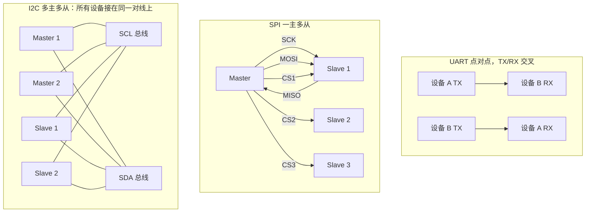
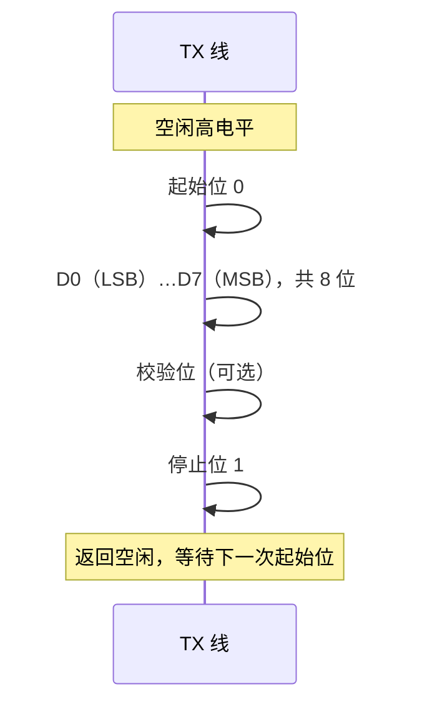
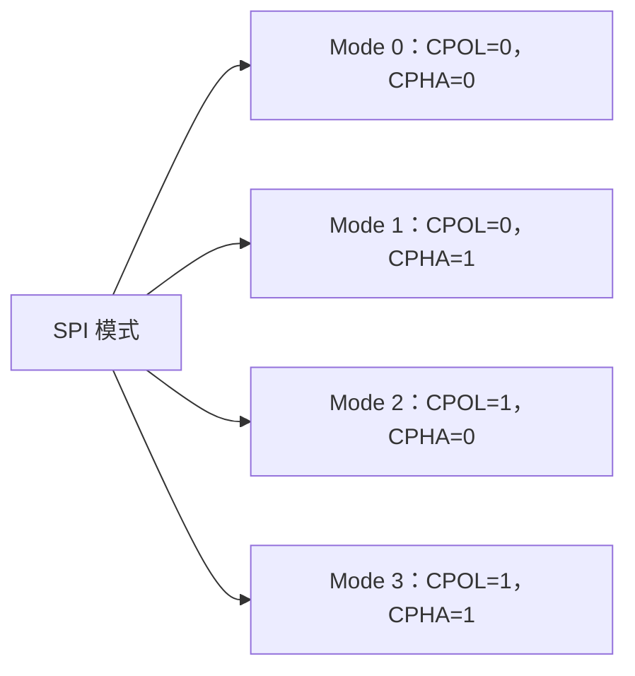
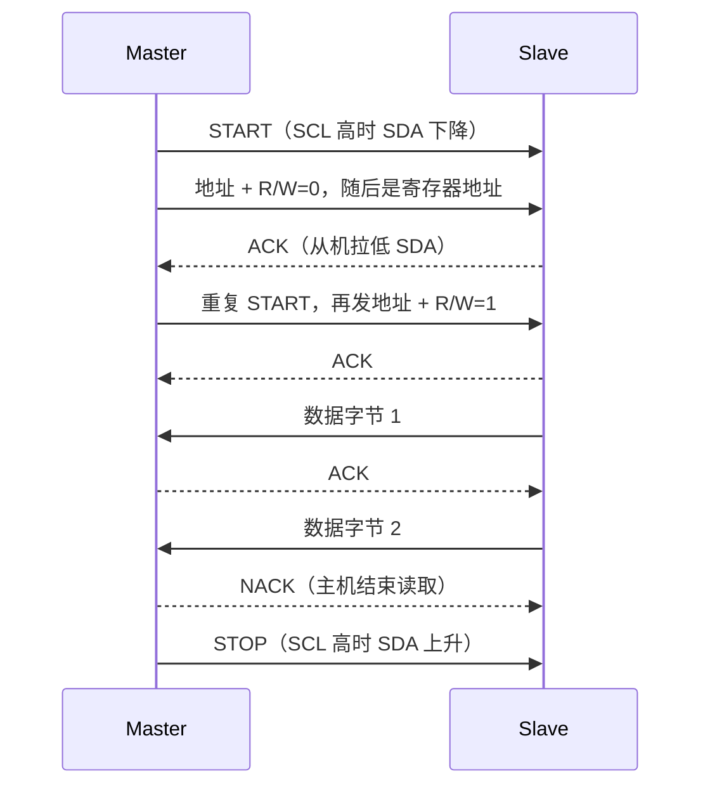

# 总线设计与调试实践

三篇单协议笔记分别讲清了帧、时序与电气计算，真实项目里的失败却往往发生在交界处：时钟配到了从机时序上限之外，上拉电阻抄错了速率档，逻辑分析仪的解码设置与实际位序不一致，或者两块板子没有共地。本篇把三种协议放在一起对照，给出拓扑与帧的可视化、工具的判读要点、上电联调清单和自测问题。

## 1. 三协议对比总表

| 特性 | UART | SPI | I²C |
|---|---|---|---|
| 信号线 | 2（TX/RX） | 4（SCK/MOSI/MISO/CS），每增一从机加一根 CS | 2（SCL/SDA） |
| 同步/异步 | 异步 | 同步 | 同步 |
| 双工 | 全双工 | 全双工 | 半双工 |
| 速度 | < 1 Mbps（TTL） | 10 ~ 50 MHz 量级 | 100 k ~ 3.4 MHz |
| 多设备 | 点对点 | 多从机（片选线） | 多主多从（地址） |
| 布线 | 简单 | 较复杂（CS 线多） | 最简单（2 线 + 上拉） |
| 距离 | 短（TTL）；配 RS-485 可长 | 短（PCB 内） | 短（PCB 内） |
| 电气基础 | 推挽 | 推挽 | 开漏 + 上拉 |
| 错误检测 | 校验位、帧错误、溢出 | 无内建机制 | ACK/NACK、总线错误、仲裁丢失 |
| 时钟容差与典型用途 | 时钟容差严，用于调试、蓝牙、GPS | 从机受建立/保持时间限制，用于存储器、显示屏、高速传感器 | 允许从机时钟拉伸，用于传感器、EEPROM、RTC、IO 扩展 |

## 2. 拓扑与协议时序可视化

三种协议的拓扑差异：

I²C 子图只能表达"接在同一对线上"这一事实，线与逻辑与上拉电阻无法用节点图表达：每个设备对 SCL/SDA 都只做开漏拉低，总线电平由全部设备与上拉共同决定。

UART 帧的逐位结构：

SPI 四种模式的划分：

I²C 一次完整传输（含重复 START 的寄存器读取）：

## 3. 工具用法与判读要点

逻辑分析仪与示波器分工明确：逻辑分析仪按阈值把电压量化成 0/1 并做协议解码，适合回答"发了什么、有没有 ACK、位序对不对"；示波器看模拟波形，适合回答"上升沿够不够快、有没有振铃、电平幅度是否正常"。两者都用时要注意探头与排线的寄生电容，接上去本身就可能改变边沿。

逻辑分析仪的关键设置：采样率至少是被测信号最高频率的四倍以上，解码时钟类信号时裕量要更大；阈值电压按实际电平域设置（1.8 V / 2.5 V / 3.3 V / 5 V），设错会解码出看似合理但完全错误的数据；输入通道必须与被测系统共地。协议解码方面，I²C 需要指定 SCL/SDA 通道并核对地址、读写位、ACK/NACK 与重复 START 的位置，SPI 需要指定时钟、数据线、片选以及模式与位序，片选不接时解码器会把空闲时钟当成数据，UART 需要指定波特率与帧格式，波特率设错时解码文本全乱，这本身就是一个判据。

示波器用于电气问题：观察静态电平（确认上拉是否有效）、上升时间（与所选速率档的上限比较）、过冲与振铃（判断是否需要源端匹配），以及 SDA 是否被某个器件长期拉低。串口助手用于 UART 端点验证，建议先用回环测试确认 PC 与转接模块本身正常；I²C 扫描程序逐个地址寻址并检查 ACK，用于确认在线设备与地址冲突，扫描输出的地址是 7 位值还是 8 位值取决于实现。详细操作见 [[09-Debugging-Tools/03-逻辑分析仪/004-使用技巧|逻辑分析仪使用技巧]]、[[09-Debugging-Tools/02-示波器使用/003-基本操作|示波器基本操作]]和 [[09-Debugging-Tools/04-串口与日志调试/006-串口调试技巧|串口调试技巧]]。

## 4. 上电与联调检查清单

按顺序做，每一步只引入一个变量，出错时就能确定原因：

1. 断电检查连线：UART 的 TX 是否接到对端 RX、是否共地；SPI 的 CS 极性是否正确、MISO 是否只由一个器件驱动；I²C 是否两端都有上拉、上拉阻值与目标速率是否匹配。
2. 上电但不通信，测静态电平：UART 空闲应为高；SPI 的 CS 应为无效电平；I²C 的 SCL 与 SDA 都应被上拉到接近 VDD。同时检查供电与去耦，从机发送瞬间的电流尖峰会在地线上造成跳变，表现为只在某些操作下出错。
3. 用最慢的速率做第一次通信：UART 从 9600 起、I²C 用 100 kHz、SPI 降到几百 kHz。先在慢速下把地址、模式、位序确认正确，再逐级提速。
4. 抓一次完整事务并逐字段核对：地址对不对、读写位对不对、ACK 有没有、数据长度对不对、停止条件有没有正常发出。
5. 只有在功能正确之后才提速与加长走线，并把每次改动记录为一次实验；提速失败时优先怀疑上升时间、走线长度和探头负载，而不是先改软件。故障现象与仪表证据一起记录成可检索的故障库，做法见 [[01-Foundations/09-学习方法与工具/008-错题、故障记录与工程复盘|错题、故障记录与工程复盘]]。

## 5. 自测问答

SPI 相比 I²C 的主要优势与代价是什么？

优势是全双工、速率高、协议简单，没有地址与仲裁开销，也没有总线电容与上拉电阻的电气约束；代价是每个从机一根片选线，引脚数随从机数增长，且没有 ACK 与错误检测，协议层必须自己加校验。

为什么 I²C 的两根线必须用开漏而不是推挽？

因为总线上允许任何设备拉低、并且需要让设备观察到别人是否在拉低同一条线。开漏实现线与逻辑，使 ACK 应答、逐位仲裁和时钟同步成为可能；推挽输出会在两个设备输出相反电平时形成短路电流，并且无法实现仲裁。

某主机发送地址后读回 NACK，可能有哪些原因？

总线上没有该地址的器件；器件未上电或未被复位释放；上拉电阻过弱导致高电平建立不起来；速率超出总线电容允许范围；地址的 7 位/8 位表示搞错；器件被配置在另一个地址（部分器件通过引脚改变地址）。

400 kHz 总线上读数据偶发错位，上拉电阻该如何排查？

先测上升时间：用示波器或逻辑分析仪看 SDA 从低到高的实际时间，与 400 kHz 档的上升时间上限（约 300 ns）比较。若超出，用 `t_r ≈ 0.847·R·C` 反推：要么减小上拉电阻，要么降低总线电容。同时确认每个模块板载上拉是否并联、等效电阻是否已低到灌电流超标的程度。

UART 收到数据但全是乱码，按什么顺序排查？

先确认两端波特率与帧格式（数据位、校验、停止位）一致；再用逻辑分析仪同时解码 TX 与 RX，测量实际位宽并与理论值对比，判断是波特率不匹配还是时钟误差；然后检查是否共地、电平域是否匹配、TX/RX 是否交叉；最后才怀疑软件缓冲与中断处理。8 MHz 时钟配 115200 时，整数分频的误差可达约 0.6%，叠加对端误差与晶振温漂后可能累积到停止位出错。

SPI 读回恒为 0xFF 或恒为 0x00，分别指向什么问题？

恒为 0xFF 通常说明 MISO 一直为高：可能未连接、从机未驱动 MISO、或从机未被选中；恒为 0x00 通常说明 MISO 一直被拉低，或者从机未上电、处于复位、片选极性配置错误。两者都应先用示波器确认 MISO 在传输期间是否有跳变。逻辑分析仪解码正确只说明数字层面的 0/1 时序符合设置，不代表电气层合格——探头电容、电平裕量不足、建立/保持余量不够都可能被解码器掩盖，这类问题要用示波器在真实负载下测量。

相关测验见 [[05-Communication/08-I2C-SPI-UART测验题|I2C-SPI-UART 测验题]]，闪卡复习见 [[00-Index/07-闪卡复习库|闪卡复习库]]。
