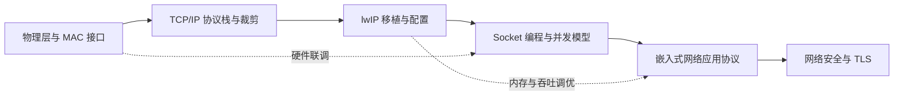

# 以太网与 TCP/IP

以太网定义了从双绞线电气特性、帧格式到 MAC 寻址的链路层规范，TCP/IP 在其上提供可路由的端到端传输。嵌入式设备接入以太网要同时解决三件事：PHY 与 MAC 的硬件接口能否稳定建链、协议栈在几十 KB RAM 内如何裁剪、以及应用层协议与安全机制如何落位。本目录按"物理层与接口 → 协议栈与实现 → 应用与安全"的顺序展开。

## 1. 学习路线

### 物理层与接口

1. [[05-Communication/06-以太网与TCP-IP/001-以太网物理层与MAC接口|以太网物理层与 MAC 接口]]：帧结构、双绞线标准、MII/RMII/RGMII 选型、PHY 寄存器与建链故障排查。

### 协议栈与实现

2. [[05-Communication/06-以太网与TCP-IP/002-TCP-IP协议栈与嵌入式裁剪|TCP/IP 协议栈与嵌入式裁剪]]：各层职责、ARP/DHCP/DNS 的触发时机、MTU 与分片、TCP 与 UDP 的取舍。
3. [[05-Communication/06-以太网与TCP-IP/003-lwIP移植与配置|lwIP 移植与配置]]：三种 API、`lwipopts.h` 关键选项、内存堆与内存池、网卡驱动接口与零拷贝。
4. [[05-Communication/06-以太网与TCP-IP/004-Socket编程与并发模型|Socket 编程与并发模型]]：阻塞/非阻塞写法、TCP echo 骨架、多连接处理方式对比、超时与字节序。

### 应用与安全

5. [[05-Communication/06-以太网与TCP-IP/005-嵌入式网络应用协议|嵌入式网络应用协议]]：HTTP、MQTT、CoAP、Modbus TCP、TFTP/SNMP、NTP 的语义与开销对照。
6. [[05-Communication/06-以太网与TCP-IP/006-网络安全与TLS|网络安全与 TLS]]：TLS 的 RAM/Flash/算力代价、证书校验、密钥存储、安全启动与攻击面收敛。

## 2. 与相邻目录的边界

| 内容 | 主要位置 |
|---|---|
| 任务、信号量、邮箱与 lwIP 线程模型的集成 | [[10-RTOS与系统/02-FreeRTOS/02-FreeRTOS\|FreeRTOS]] |
| 嵌入式 Linux 的完整网络栈、netfilter、socket 选项全集 | [[10-RTOS与系统/05-嵌入式Linux入门/05-嵌入式Linux入门\|嵌入式 Linux 入门]] |
| RJ45 差分对布线、变压器下方净空、阻抗与回流 | [[06-PCB-Design/03-PCB层叠与阻抗设计/004-差分对设计\|差分对设计]] |
| 高速信号反射、串扰与 EMC 整改 | [[06-PCB-Design/04-信号完整性与EMC/04-信号完整性与EMC\|信号完整性与 EMC]] |
| 无线替代方案与协议选型 | [[05-Communication/07-无线通信-BLE-WiFi-Matter/000-无线通信\|无线通信 BLE/WiFi/Matter]] |
| 串行总线的电气层与时序 | [[05-Communication/02-I2C-SPI-UART/000-I2C-SPI-UART\|I2C / SPI / UART]] |
| RS-485 物理层与 Modbus RTU | [[05-Communication/04-RS-485与Modbus/000-RS-485与Modbus\|RS-485 与 Modbus]] |
| 以太网帧、PHY 接口、协议栈裁剪、应用协议与 TLS | 本目录 |

## 3. 典型场景与带宽需求

| 场景 | 典型协议组合 | 有效负载特征 | 常见起点 |
|---|---|---|---|
| 设备状态网页与参数配置 | HTTP（静态 + CGI/SSI） | 突发数 KB，秒级刷新 | 100BASE-TX，lwIP Socket |
| 传感器数据上云 | MQTT over TCP | 数十字节/条，分钟级 | 100BASE-TX，QoS 1 |
| 电池供电低功耗节点 | CoAP over UDP + DTLS | 小报文，需休眠 | 10/100BASE-TX，No-Sys |
| PLC/HMI 数据交换 | Modbus TCP，端口 502 | 固定寄存器块，10~100 ms 周期 | 100BASE-TX，多连接 |
| 固件升级与日志回传 | TFTP 或 HTTP POST | 数百 KB~数 MB，长连接 | 100/1000BASE-T |
| 工业相机、图像传输 | 自定义 TCP/UDP 流 | 数 MB/s 持续带宽 | 1000BASE-T，RGMII |
| 时间同步 | NTP 或 PTP | 数十字节，周期性 | 需独立时钟源评估 |
| 网关协议转换 | Modbus TCP ↔ Modbus RTU | 双向代理，低延迟 | 双 UART + 以太网 |

带宽估算按有效负载加协议开销计算：以太网每帧有 14 字节头 + 4 字节 FCS + 20 字节 IFG/前导开销，TCP/IP 头合计 40 字节（不含选项），实际可用带宽通常只有线速的 70%~90%。

## 4. 使用本目录的顺序

硬件联调阶段先做最小验证：MDIO 读到正确的 PHY ID、链路能 UP、MAC 统计里无 CRC 错误，再进入协议栈调试。跳过这一步直接调 lwIP，会把 PHY 建链问题误判成协议栈配置问题。

协议栈阶段的最小闭环是 `ping` 通、DHCP 拿到地址、UDP echo 往返正常，然后才是 TCP 连接与吞吐测试。应用与安全阶段应在上面的稳定性得到验证之后进行，TLS 握手失败、MQTT 掉线等问题的根因常在下层。

每一层都要留下可复现的验证手段：MDIO 寄存器快照、MAC 错误计数器、`ping` 往返时延与丢包率、抓包记录。无法复现的现象在嵌入式网络调试中占比很高，现场抓包往往比代码审查更快定位问题。

## 5. 推荐资料

- W. Richard Stevens，《TCP/IP Illustrated, Vol 1》——协议行为与报文格式的权威参考。
- lwIP 官方文档与源码（savannah.nongnu.org/projects/lwip/）——`lwipopts.h` 选项说明与 `doc/` 目录下的移植指南。
- Ben Eater 网络协议系列、Practical Networking 图解系列，可结合本章分层图对照网络抓包。
- 所用 PHY 与 MAC 的数据手册、参考手册中的以太网章节，以及厂商的 lwIP 移植应用笔记。
