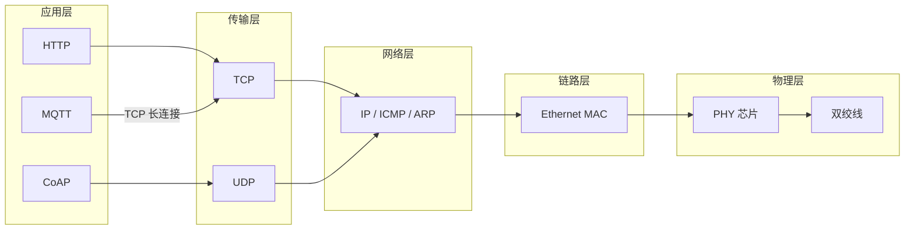

# TCP/IP 协议栈与嵌入式裁剪

嵌入式协议栈面对的不是"实现全部 RFC"，而是在有限 RAM 与可预测的实时性之间取舍：哪些层必须完整、哪些机制可以简化、哪些选项必须关闭。理解每层的实际职责与触发时机，才能判断一个配置项删掉之后会失去什么。

## 1. 分层与各层职责

| 层级 | 协议 | 嵌入式实现 |
|------|------|------------|
| 应用层 | HTTP、MQTT、CoAP、FTP、TFTP | 轻量库 |
| 传输层 | TCP、UDP | lwIP / FreeRTOS+TCP |
| 网络层 | IP、ICMP、ARP | lwIP |
| 链路层 | Ethernet、MAC、VLAN | MAC 控制器 + PHY |
| 物理层 | 双绞线/光纤 | PHY 芯片 |

上图与常见的分层图相比做了两处修正：MQTT 走 TCP 而非"轻量 UDP"，CoAP 才是 UDP 上的方案；ARP 归入网络层一侧但不使用 IP 承载，它是链路层地址解析，调用关系上位于 IP 发送路径的前置步骤。

分层在实现中并非严格隔离：lwIP 的 `ip4_output` 会直接调用 ARP 解析并缓存结果，TCP 发送路径会查询路由表与 netif 的 MTU，应用层通过 `pbuf` 与协议栈共享缓冲区。裁剪时必须按调用关系核对，而不是按层名判断依赖。

## 2. ARP、ICMP、DHCP、DNS 的触发时机

- ARP：发送 IP 包前查询目的 IP 对应的 MAC。缓存表项有老化时间（lwIP 默认 `ARP_TMR_INTERVAL` 相关参数可配），表项不足或表满时会丢弃待发包或排队。静态 IP 场景下 ARP 表大小直接影响同时通信的对端数量；网关 MAC 是表中最常驻的条目。
- ICMP：除 `ping` 应答外，嵌入式关心的还有目的不可达、端口不可达与分片需求（ICMP 需回传 DF 位导致的不可达）。若产品要求响应 `ping`，需确认 ICMP 回显已启用；反之关闭可略微减小攻击面。ICMP 报文的源地址选择依赖路由表，单网口场景一般无需配置。
- DHCP：上电后以广播方式发送 DISCOVER，经 OFFER/REQUEST/ACK 四步获取地址、掩码、网关、DNS 与租期。租期过半时单播续租（REQUEST），租期到 87.5% 时转为广播重新申请。lwIP 的 DHCP 在拿到地址后会回调 netif 状态变化，应用不应在 DHCP 完成前发起基于主机名的连接。
- DNS：把主机名解析为 IP，通常是阻塞式查询或异步回调。无 DNS 服务器时解析会超时，因此在无网络环境下应避免主机名解析路径被反复触发。

## 3. IP 分片与 MTU

以太网 MTU 为 1500 字节，指 IP 数据报的最大净荷。加上 20 字节 IP 头上限共 1520 字节，加 14 字节以太网头与 4 字节 FCS 恰好落在 1518 字节帧长内，与最大帧长一致。

- MSS 是 TCP 净荷上限，IPv4 下为 MTU 减去 20 字节 IP 头与 20 字节 TCP 头，即 1460 字节（不含 TCP 选项）；
- 路径 MTU 可能小于链路 MTU（如经过隧道或 PPPoE），出现大于路径 MTU 且设置 DF 位的数据报时，路由器回 ICMP 不可达，TCP 应据此减小 MSS；
- 分片会增加重组缓冲需求并降低传输效率，嵌入式实现通常倾向发送端限制 MSS 而非接收端支持分片重组；
- UDP 无需分片重组能力时，可把 `IP_REASSEMBLY` 关闭以节省缓冲，但此时收到分片报文的丢弃行为必须明确。

发送大块数据时应由应用按 MSS 或 MTU 切分，不要在协议栈已关闭分片重组的情况下依赖 IP 自动分片。

## 4. TCP 的最小必要机制

- 三次握手：SYN → SYN/ACK → ACK，同时交换初始序列号与 MSS。半开连接（对端消失）会占用连接控制块直到重传超时。
- 四次挥手：FIN → ACK → FIN → ACK。主动关闭方会进入 TIME_WAIT 并保持约 2 倍报文最大生存时间，嵌入式端若连接建立频繁可能耗尽连接控制块。
- 滑动窗口：接收方通过窗口字段告知可用缓冲，发送窗口取接收窗口与拥塞窗口的较小值。窗口过小会导致吞吐受限于往返时延而非带宽。
- 超时重传：基于往返时延估计动态调整，重传次数上限决定连接多久被判为断开。
- 拥塞控制：慢启动、拥塞避免、快速重传与快速恢复。嵌入式常使用简化的算法变体，长肥管道下的吞吐表现与算法实现相关。
- Nagle 算法：把小于 MSS 的短数据攒到前一段被确认后再发，减少小包数量；与延迟确认同时启用会产生数十毫秒级延迟。实时控制报文应通过 `TCP_NODELAY` 关闭。

## 5. UDP 与 TCP 的取舍

必须用 UDP 的场合：实时周期性数据（重传已无意义）、一对多或多对一（多播、广播）、极低开销的单次请求响应、以及无法承受握手与连接状态的超大规模并发。

| 维度 | TCP | UDP |
|---|---|---|
| 连接状态 | 每连接一个控制块与收发缓冲 | 无 |
| 可靠性 | 重传、排序、去重 | 无，由应用负责 |
| 报文边界 | 流式，需应用自行分帧 | 保留数据报边界 |
| 多播/广播 | 不支持 | 支持 |
| 内存占用 | 高（与连接数成正比） | 低 |

选择 UDP 后必须自行处理丢包、乱序与重复；选择 TCP 后必须处理连接数上限与 TIME_WAIT 积累。

## 6. 多播、广播与组播管理

广播（目的 MAC 全 F）只在同一广播域内传播，ARP 请求与 DHCP 属于此类。多播使用目的 MAC `01:00:5E` 前缀加 IP 多播地址低 23 位映射，需通过 IGMP 向交换机声明加入组，否则交换机会把多播帧泛洪或丢弃。嵌入式端加入多播组通常需要两步：把对应多播 MAC 写入 MAC 接收过滤器，并调用协议栈的 IGMP 加入接口。

## 7. Keep-alive 与掉线检测

TCP Keep-alive 通过周期性发送探测段检测对端存活，间隔由协议栈参数决定，空闲判定时间通常以小时计，不适合快速掉线检测。工程上更常用两种手段：应用层心跳（固定间隔发送小报文，连续 N 次无响应判定断开）与发送超时（依赖 TCP 重传耗尽）。

检测时间 ≈ 心跳间隔 × 允许丢失次数 + 单次超时时间。心跳间隔需与对端超时策略一致，否则会出现一端判定断开而另一端仍在等待的"半死"状态。NAT 与防火墙的空闲超时通常为几分钟，心跳间隔应小于该值以维持映射。

## 8. 协议栈内存与缓冲区占用

嵌入式栈的 RAM 主要消耗在四类结构：pbuf/收发缓冲区池、TCP 与 UDP 控制块（与最大并发连接数成正比）、内存堆中的动态分配、以及各层的定时器与路由/ARP 表。

经验上，一个 TCP 连接的发送与接收缓冲各按数 KB 计，`TCP_SND_BUF`/`TCP_WND` 取值直接决定单连接吞吐上限：

$$
\text{吞吐}_{max}\approx\frac{\text{窗口字节数}}{\text{往返时延}}.
$$

100 ms 往返时延下要跑满 10 Mbps 需要约 125 KB 窗口，这已超出多数 MCU 的可用 RAM。因此 MCU 上的 TCP 吞吐通常由窗口与时延共同限制，而不是由 MAC 速率限制；提高窗口前应先确认 RAM 余量与丢包重传是否才是真正瓶颈。RAM 与 Flash 的实测占用、内存耗尽故障的排查见 [[05-Communication/06-以太网与TCP-IP/003-lwIP移植与配置|lwIP 移植与配置]]。
