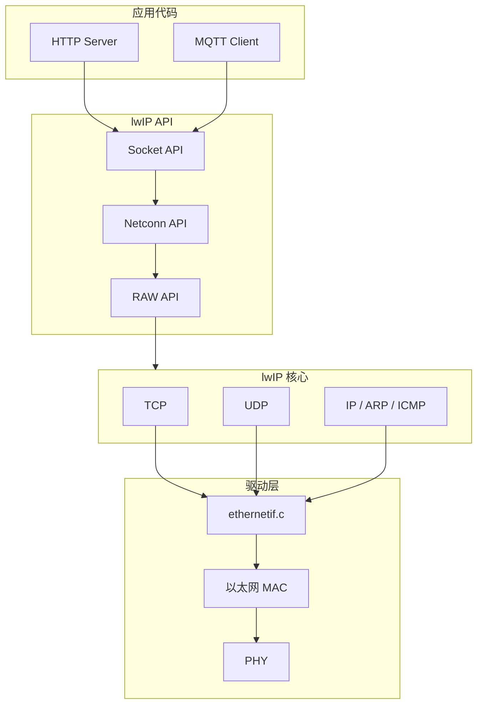

# lwIP 移植与配置

lwIP 是专为嵌入式设计的开源 TCP/IP 栈：在不含操作系统的裸机环境下可只保留回调式 API，在 RTOS 下可提供与 BSD 兼容的 socket 接口。移植工作分为三块——选定 API 与内存模型、实现网卡驱动接口、通过 `lwipopts.h` 裁剪功能与资源。多数现场问题出在第三块的默认值与实际负载不匹配。

## 1. 三种 API 与线程模型

| API | 运行环境 | 线程/上下文 | 适用场景 |
|---|---|---|---|
| RAW / Callback | 裸机或 RTOS | 在协议栈上下文或被投递的上下文回调，无阻塞 | 无 OS、资源最紧、单连接或少量连接 |
| Netconn | 需 OS | 应用线程阻塞调用，内部用信号量/邮箱同步 | 多任务应用、需要结构化收发流程 |
| Socket | 需 OS | BSD 风格，阻塞或非阻塞 | 需移植既有代码、生态库依赖 socket |

RAW API 的回调在协议栈内部上下文执行，回调中不能长时间阻塞或调用会等待协议栈自身的接口，否则会死锁或造成丢包。Netconn 与 Socket 在应用线程中阻塞，协议栈把事件投递到该线程的邮箱；二者底层仍调用 RAW 回调，只是加了一层同步。混用两类 API 时，注意 RAW 层的 `tcp_recv` 回调与阻塞式 `recv` 对同一连接不能同时接管。

lwIP 核心本身不是线程安全的：只有一个 `tcpip_thread` 处理大部分协议状态。应用通过 `tcpip_callback` 或 API 层封送进入协议栈上下文，直接跨线程操作 PCB 属于未定义行为。多线程写入同一 socket 需要应用层加锁。

## 2. 常用集成方式

- STM32：STM32Cube 集成 lwIP，FreeRTOS + Netconn/Socket，CubeMX 生成 `lwipopts.h` 模板，PHY 驱动与 ETH 初始化由 HAL 提供；
- ESP32：ESP-IDF 内置 lwIP，DHCP、DNS、Wi-Fi 与以太网接口自动配置，多数选项通过 `sdkconfig` 暴露；
- 其他 MCU：自行移植 `ethernetif.c` 与 `sys_arch.c`（RTOS 适配层），读取 `doc/` 下的移植指南。

图中补充了原图缺少的 `ethernetif.c` 驱动桥接层，并标明 Socket 与 Netconn 实际建立在 RAW API 之上——这解释了为什么 Socket 层的错误码与资源限制最终由 RAW 层参数决定。

## 3. lwipopts.h 的关键选项类别

| 类别 | 代表选项 | 影响 |
|---|---|---|
| 内存池总量 | `MEM_SIZE` | 内存堆大小，决定 `mem_malloc` 能分配多少 |
| pbuf 池 | `PBUF_POOL_SIZE`、`PBUF_POOL_BUFSIZE` | 接收路径可同时持有的包数量与单包容量 |
| 各对象池数量 | `MEMP_NUM_TCP_PCB`、`MEMP_NUM_UDP_PCB`、`MEMP_NUM_TCP_SEG`、`MEMP_NUM_PBUF`、`MEMP_NUM_NETBUF`、`MEMP_NUM_SYS_TIMEOUT` | 并发连接数、可排队报文段数、超时定时器数 |
| TCP 参数 | `TCP_MSS`、`TCP_SND_BUF`、`TCP_WND`、`TCP_SND_QUEUELEN` | 单连接吞吐、内存占用、可排队的段数 |
| 应用协议 | `LWIP_DHCP`、`LWIP_DNS`、`LWIP_ICMP`、`LWIP_UDP`、`LWIP_TCP`、`LWIP_IGMP` | 功能开关，关闭即省代码与缓冲 |
| 线程模式 | `NO_SYS`、`LWIP_NETCONN`、`LWIP_SOCKET`、`LWIP_TCPIP_CORE_LOCKING` | 是否需 OS、暴露哪层 API |
| 网卡接口 | `LWIP_NETIF_STATUS_CALLBACK`、`LWIP_NETIF_LINK_CALLBACK`、`LWIP_NETIF_HOSTNAME`、`LWIP_NETIF_TX_SINGLE_PBUF` | 链路状态回调、零拷贝发送 |
| 校验和 | `CHECKSUM_BY_HARDWARE`、`CHECKSUM_GEN_IP`、`CHECKSUM_CHECK_TCP` 等 | 硬件卸载开关，配置错误会导致所有包被丢弃 |

`TCP_SND_QUEUELEN` 必须与 `TCP_SND_BUF` 匹配（约为后者的 MSS 份额），偏小会在大量发送时误报内存不足。`MEMP_NUM_TCP_SEG` 不足则表现为发送阻塞在队列等待，而非报错。具体默认值与推荐关系以所用 lwIP 版本的 `opt.h` 注释为准。

## 4. 内存堆与内存池

lwIP 有两套分配器：内存堆（`mem_malloc`/`mem_free`，可分配任意大小，会产生碎片）与内存池（`memp_malloc`/`memp_free`，固定大小对象，无碎片但数量固定）。协议栈内部对象（PCB、pbuf、报文段）用内存池，应用数据缓冲常用内存堆。

"内存耗尽"的典型表现是 `mem_malloc` 返回空、`pbuf_alloc` 失败或 `tcp_write` 返回 `ERR_MEM`。排查顺序：

1. 确认是堆不足还是池不足——池耗尽表现为同类对象反复申请失败，堆耗尽表现为大小不定的申请失败；
2. 检查是否有连接未关闭导致 PCB 泄漏，或发送队列长期未清空；
3. 检查 `MEM_SIZE` 是否被应用自身的大块分配（如 HTTP 响应缓冲）占用过多；
4. 用 `mem_trim`、内存统计钩子或高水位记录确认峰值，再决定加总量还是改设计。

单纯放大 `MEM_SIZE` 会掩盖泄漏；`MEM_SIZE` 之外的静态池总量才是链接后 RAM 占用的主要部分，应以 `arm-none-eabi-size` 之类工具的实测结果为准，而非文档中给出的典型值。

## 5. 网卡驱动需要实现的接口

移植的核心是 `ethernetif.c`，需要提供：

- `low_level_init`：初始化 MAC、PHY、DMA 描述符环，设置 netif 的 MAC 地址、MTU 与接口标志，创建接收同步量（信号量或邮箱），使能收发中断；
- `low_level_output`：把 pbuf 链中的数据拷贝或映射到发送 DMA 描述符并启动发送，返回成功或 `ERR_MEM`/`ERR_IF`；
- `low_level_input`：从接收 DMA 描述符取出帧，分配 pbuf 并拷贝数据，释放描述符给硬件；
- `ethernetif_input`：调用 `low_level_input` 得到 pbuf 后交给 `netif->input`。在 RTOS 模式下通常由独立任务等待信号量后循环执行，在裸机模式下由轮询或中断后直接调用；
- 链路状态：周期性通过 MDIO 读取 PHY 状态，变化时更新 `netif_set_link_up/down` 并触发 `LWIP_NETIF_LINK_CALLBACK`。

中断与任务的协作原则是：中断只做最小工作（置标志、释放信号量），由任务完成 pbuf 分配与协议栈投递；在中断上下文中直接调用 `netif->input` 会进入协议栈上下文，功能可行但会拉长中断时间并增加重入风险，是否允许取决于所用版本与 `NO_SYS` 配置。

## 6. 零拷贝与 pbuf 链

pbuf 有四种类型：`PBUF_RAM`（堆中连续缓冲，用于发送）、`PBUF_POOL`（池中小块，接收路径的首选）、`PBUF_ROM`/`PBUF_REF`（仅引用外部数据，不拷贝）。多个 pbuf 可组成链，一个以太网帧可能跨多个池块。

零拷贝的两个方向：接收侧用 `pbuf_alloc` 直接指向 DMA 缓冲（`PBUF_REF`），发送侧让 MAC 的 scatter-gather DMA 直接读取 pbuf 链（`LWIP_NETIF_TX_SINGLE_PBUF` 关闭时）。零拷贝能显著降低大流量下的 CPU 占用，但要求缓冲对齐、生命周期管理与 DMA 缓存一致性（带 D-Cache 的 MCU 需在收发前后做 cache 维护操作），代价是调试难度上升。

## 7. 常见问题定位

| 现象 | 常见原因 |
|---|---|
| 高流量下丢包、`ping` 时通时断 | `PBUF_POOL_SIZE` 偏小或 `low_level_input` 处理慢于到达速率；接收任务优先级过低 |
| TCP 吞吐远低于链路速率 | `TCP_WND`/`TCP_SND_BUF` 过小、`TCP_MSS` 未按 MTU 设置、Nagle 与延迟确认叠加 |
| DHCP 拿不到地址 | 未使能 `LWIP_DHCP`、广播发送路径被 MAC 过滤、`MEMP_NUM_SYS_TIMEOUT` 不足导致 DHCP 定时器无法注册、网卡未 `netif_set_up` |
| 链路已 UP 但协议栈不通信 | PHY 状态未上报 netif，或 `netif_set_link_up` 未调用，导致发送路径认为接口不可用 |
| 所有包被丢且无错误上报 | 硬件校验和卸载已启用但 MAC 未实际计算，或 `CHECKSUM_*` 开关与实际硬件能力不符 |
| 端口号或长度字段异常 | 字节序转换遗漏（`htons`/`htonl`）、结构体打包对齐错误 |
| 运行一段时间后内存不足 | 连接未释放、`tcp_close` 未等待或未处理 `ERR_MEM` 导致数据堆积 |

Socket 层的写法、多连接并发与超时语义见 [[05-Communication/06-以太网与TCP-IP/004-Socket编程与并发模型|Socket 编程与并发模型]]；协议栈各层机制见 [[05-Communication/06-以太网与TCP-IP/002-TCP-IP协议栈与嵌入式裁剪|TCP/IP 协议栈与嵌入式裁剪]]。
