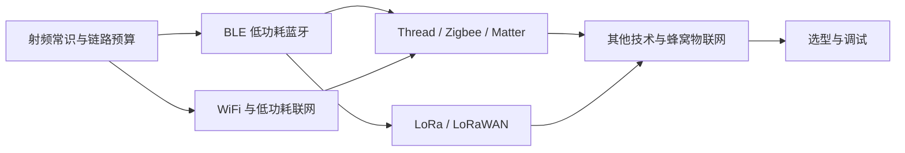
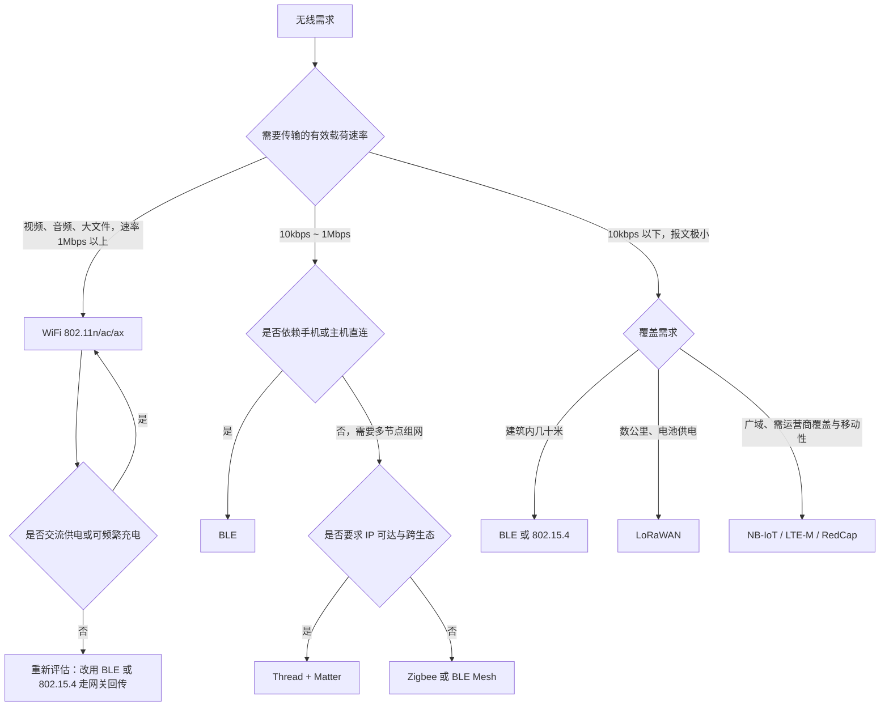

# 无线通信

无线连接把发射功率、天线效率、链路预算、频谱法规、协议栈和电池容量绑成一个联合约束：任何一项单独优化都可能被另一项吃掉。2.4GHz 的 BLE 能做到纽扣电池跑数年，代价是几十米覆盖和低于 2Mbps 的吞吐；LoRaWAN 能把 20 字节送上 10km 外的网关，代价是空中时间以秒计、下行只能在固定接收窗口到达。这一层目录的目标不是罗列协议名词，而是建立"带宽需求 → 功耗预算 → 覆盖与拓扑 → 法规与认证"这条可复算的推导链。

## 学习路线

### 无线基础与射频常识

1. [[05-Communication/07-无线通信-BLE-WiFi-Matter/001-无线通信基础与射频常识|无线通信基础与射频常识]]：频段划分、链路预算算法、灵敏度与调制方式、天线与认证，是后面所有协议章节的公共前提；先把这一篇的算式跑一遍，后面的"距离短、功耗高、丢包多"才有可比较的解释框架。

### 主流协议深挖

2. [[05-Communication/07-无线通信-BLE-WiFi-Matter/002-BLE低功耗蓝牙|BLE 低功耗蓝牙]]：从广播包、连接参数到 GATT 吞吐与配对，把"低功耗"落实到可计算的占空比。
3. [[05-Communication/07-无线通信-BLE-WiFi-Matter/003-WiFi与低功耗联网|WiFi 与低功耗联网]]：802.11 各代的速率来源、省电模式代价、配网方式与 MCU 上的 TCP/TLS 开销。
4. [[05-Communication/07-无线通信-BLE-WiFi-Matter/004-Thread-Zigbee与Matter|Thread、Zigbee 与 Matter]]：802.15.4 之上的两张网状协议栈，以及 Matter 如何用应用层标准把它们统一到 IP 之上。
5. [[05-Communication/07-无线通信-BLE-WiFi-Matter/005-LoRa与LoRaWAN|LoRa 与 LoRaWAN]]：扩频因子与空中时间的权衡，Class A/B/C 的接收窗口机制和入网流程。
6. [[05-Communication/07-无线通信-BLE-WiFi-Matter/006-其他无线技术与蜂窝物联网|其他无线技术与蜂窝物联网]]：NFC、RFID、Z-Wave、UWB 与 NB-IoT/LTE-M/RedCap 的定位。

### 选型与工程落地

7. [[05-Communication/07-无线通信-BLE-WiFi-Matter/007-无线协议选型与调试|无线协议选型与调试]]：把需求换算成平均带宽和占空比，再给出认证清单、可靠性设计与故障排查表。

## 无线协议选型决策图

原决策图把"远距离"挂在"低功耗"分支下，隐含了"远距离必然低功耗"的错误前提：NB-IoT 同样覆盖数公里，却与 LoRa 的功耗曲线完全不同；而 WiFi 接高增益定向天线也能覆盖几公里。距离应由链路预算决定，与功耗、带宽是两个独立维度，因此上面的图先按速率分流，再分别判断拓扑和覆盖。

## 与相邻目录的边界

| 内容 | 主要位置 |
|---|---|
| ESP32、nRF52、STM32WB 等具体 MCU 的时钟、外设、SDK 与工程配置 | [[04-Microcontrollers/00-README\|微控制器]] 及对应系列目录 |
| 休眠模式电流、DC-DC 效率、电池寿命建模与测量 | [[07-Power-Management/05-低功耗设计/05-低功耗设计\|低功耗设计]] |
| 天线馈线阻抗、地平面、净空区、屏蔽与 EMC 整改 | [[06-PCB-Design/00-README\|PCB 设计]]、[[06-PCB-Design/04-信号完整性与EMC/003-EMC电磁兼容\|EMC 电磁兼容]] |
| 以太网、TCP/IP 与套接字实现 | [[05-Communication/06-以太网与TCP-IP/000-以太网与TCP-IP\|以太网与 TCP/IP]] |
| 频谱仪、逻辑分析仪、串口日志等仪器操作 | [[09-Debugging-Tools/00-README\|调试工具]] |
| 模组认证标准原文与区域法规清单 | [[12-Resources/05-标准与认证/005-无线与射频认证\|无线与射频认证]] |
| 协议原理、参数取舍、选型推导与无线侧调试 | 本目录 |

## 场景选型表

| 场景 | 推荐方案 | 主要理由与代价 |
|---|---|---|
| 手机直连传感器、手环 | BLE | 手机原生支持、功耗低；吞吐受连接间隔限制，iOS 后台广播受限 |
| 智能家居（插座、灯、白电） | WiFi 或 Matter over WiFi | 无需网关直接入网、带宽充裕；功耗高，必须接市电 |
| 全屋传感器、开关、窗帘 | Thread 或 Zigbee | 网状自愈、低功耗；需要边界路由器或协调器，存在 2.4GHz 共存问题 |
| 跨生态智能家居 | Matter | 应用层统一、本地优先；设备需要认证证书，Thread 设备依赖边界路由器 |
| 广域监测（农田、水表、电表） | LoRaWAN | 数公里覆盖、电池可用数年；速率低、受占空比与下行限额约束 |
| 可穿戴（本地 + 远程） | BLE + LTE-M 或 NB-IoT | BLE 负责与手机交互，蜂窝负责独立上报；模组成本与资费需核算 |
| 视频门铃、摄像头 | WiFi 6 | 上行带宽要求高；持续发射导致功耗与发热显著 |
| 资产追踪（室内外混合） | BLE 或 UWB（室内）+ LTE-M/NB-IoT（室外） | 单一定位技术难以覆盖两种环境 |
| 工业现场短距可靠链路 | 802.15.4 系（Thread/Zigbee）或私有 Sub-GHz | 网状冗余与确定性重传；需要现场频谱勘察 |
| 门禁、支付、快捷配对 | NFC | 厘米级交互、可感应供电；距离极短，不能当数据链路用 |

## 推荐资料

- Andreas Spiess（YouTube）的 BLE、LoRa、Matter 实测对比视频，适合建立量级直觉。观看时关注各视频的频段、场景和功耗测量条件
- Nordic DevZone 与 Nordic DevAcademy：BLE 连接参数、吞吐与功耗的官方问答和课程
- The Things Network 文档与 LoRa Alliance 规范：LoRaWAN 入网、Class 与区域参数
- Connectivity Standards Alliance（CSA）的 Matter 规范与认证文档，以及乐鑫 ESP-Matter 示例仓库
- Bluetooth SIG 的 Core Specification 与 Assigned Numbers 文档：GATT 服务、特征与错误码的权威来源，见 [[12-Resources/02-博客与网站推荐/002-论坛与社区|论坛与社区]]
