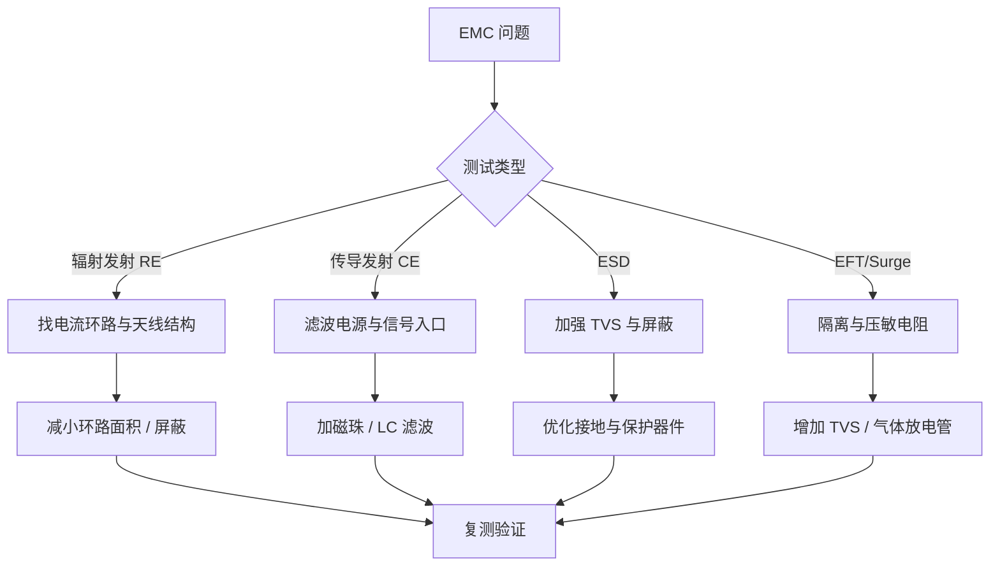

# EMC（电磁兼容）

## EMI（电磁干扰）
- **辐射发射**：设备向空间辐射电磁波，通过天线效应
- **传导发射**：噪声通过电源线/信号线传导出去
- **解决**：
  - 减小电流环路面积
  - 使用屏蔽罩和屏蔽电缆
  - 滤波器（ferrite bead、LC 滤波）
  - 合理分层（信号-地-电源-地-信号）

### EMS（电磁抗扰度）
- 设备抵抗外部电磁干扰的能力
- 测试：ESD、EFT、Surge、CS、RS
- **解决**：
  - 输入保护（TVS、ESD 二极管）
  - 滤波和隔离（光耦、磁隔离、电容隔离）
  - 软件容错（看门狗、校验、重试）

### 设计策略
1. **分层策略**：信号-地-电源-地-信号（四层）
2. **20H 规则**：电源层内缩 20 倍层厚，减少边缘辐射
3. **3W 规则**：线间距 ≥ 3 倍线宽
4. **回流路径**：确保每个信号有完整的参考平面回流路径
5. **分割与桥接**：地平面尽量完整，必要时用磁珠/0Ω 桥接

---

