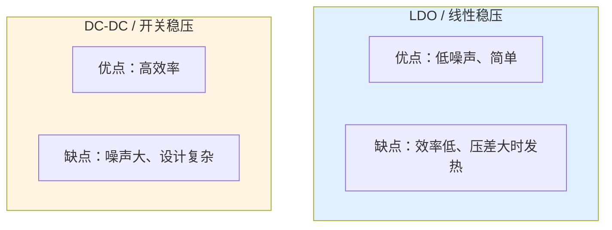

# 可视化：电源类型与选择

## 线性稳压 vs 开关稳压



### 电源选择决策

```mermaid
graph TB
    A[电源需求] --> B{Vin 与 Vout 差值}
    B -->|小 (<1V) 且低噪声| C[LDO]
    B -->|大 或 高效率| D[DC-DC]
    A --> E{是否需要隔离}
    E -->|是| F[隔离 DC-DC]
    E -->|否| G[非隔离 DC-DC / LDO]
    
    style A fill:#e1f0ff
```

---

