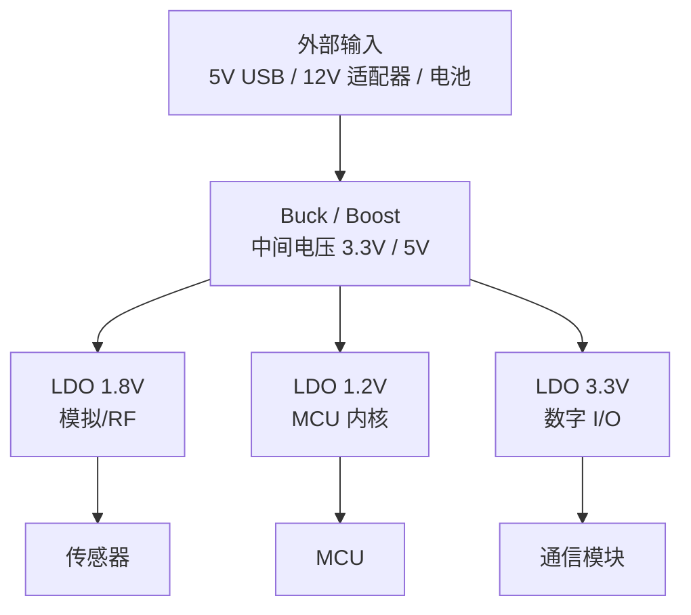

# 供电网络层级

## 典型架构
```
外部输入（5V USB / 12V 适配器 / 电池）
   ↓
一级转换（Buck/Boost）→ 中间电压（如 3.3V、5V）
   ↓
二级转换（LDO）→ 敏感电压（如 1.8V、1.2V、2.5V 模拟）
   ↓
负载（MCU、FPGA、传感器、通信模块）
```

### 设计原则
- **先粗后细**：大功率用 DC-DC，敏感电路用 LDO
- **电压分区**：模拟电源和数字电源分开，最终单点连接
- **电流回路**：电源去路和返回路径最小化，减少 EMI
- **热管理**：大电流 DC-DC 和 LDO 需要散热考虑
- **时序**：复杂系统（FPGA、处理器）需要上电时序控制



---

