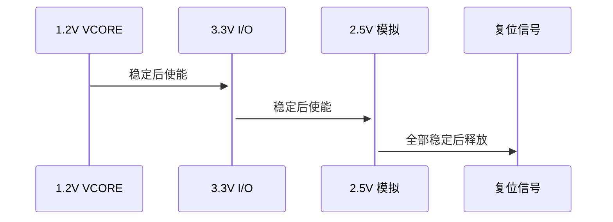

# 电源树设计要点

## 负载分析
- 列出每个器件的电压、电流、纹波要求、启动电流
- 计算总功率和峰值功率
- 确定每路电源的额定电流（至少 1.2 倍余量）

### 转换效率
- 输入功率 = 输出功率 / 效率
- 总效率 = 各级效率的乘积
- 线性电源效率低（尤其输入输出压差大时），但噪声低
- 开关电源效率高，但噪声大

### 噪声与隔离
- 数字噪声（开关电源、高速 MCU）不要污染模拟电源
- 方法：独立 DC-DC、LDO 隔离、磁珠滤波、分区铺铜
- 模拟电源和数字电源在单点连接（通常是 ADC 参考地）

### 上电时序
- 核心电压先上，I/O 后上，避免 latch-up
- 使用电源监控 IC（Supervisor）或复位 IC（如 TPS3837、MAX809）
- 确保所有电压稳定后再释放复位信号

---

