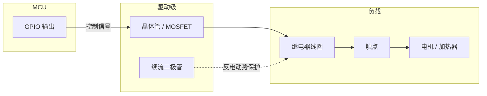

# 继电器与接触器

## 电磁继电器
- 线圈通电产生磁场，吸合机械触点
- 触点类型：常开（NO）、常闭（NC）、转换（CO）
- 驱动：线圈需要额定电流（如 5V/70mA），MCU 无法直接驱动，需晶体管或专用驱动芯片
- **关键**：线圈两端必须并联续流二极管（反电动势保护）！
- 类型：功率继电器（PCB 安装）、信号继电器（小信号）、固态继电器（SSR，无触点）

### 固态继电器（SSR）
- 光耦 + 晶闸管/MOSFET，无机械触点
- 优点：无磨损、无电弧、快速、静音
- 缺点：有导通压降（发热）、漏电流、过零开关限制
- 应用：加热控制、灯光调光、工业开关

### 接触器
- 大功率继电器，用于电机、加热器、配电
- 需要互锁和过载保护（热继电器）

---

