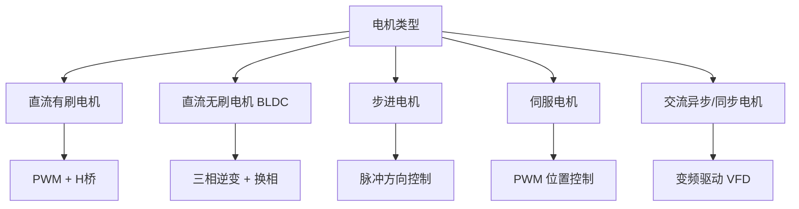

# 电机类型与控制需求

## 直流有刷电机
- 控制最简单：PWM 调节电压即可调速
- 换向靠机械电刷，成本低、易驱动
- 适用：小功率、低速、对寿命要求不高的场景

### 直流无刷电机（BLDC）
- 电子换相，效率高、寿命长、噪声低
- 需要三相逆变器和换相逻辑
- 可用六步换相或 FOC 矢量控制

### 步进电机
- 开环位置控制，每步固定角度
- 适合定位应用，但高速易失步
- 可加编码器做闭环

### 伺服电机
- 内置驱动器和位置反馈
- PWM 信号控制角度/速度
- 适合舵机、机械臂关节

---

