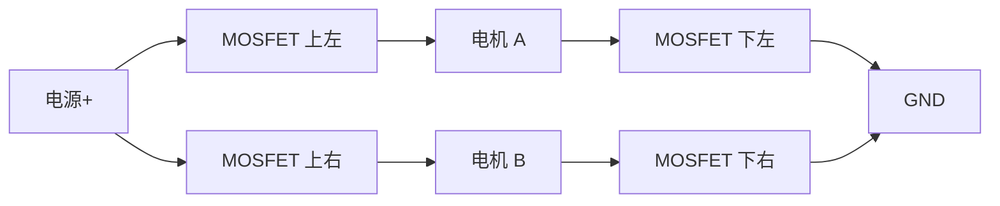

# H 桥驱动

## 基本拓扑

### 控制模式
- **正转**：Q1、Q4 导通
- **反转**：Q2、Q3 导通
- **制动**：Q1、Q2 或 Q3、Q4 同时导通（短接电机）
- **滑行**：四个开关都关断

### 注意事项
- **死区时间**：防止上下桥臂直通短路
- **续流二极管**：电机感性负载产生反电动势
- **电流采样**：常用下桥臂串采样电阻或霍尔传感器

---

