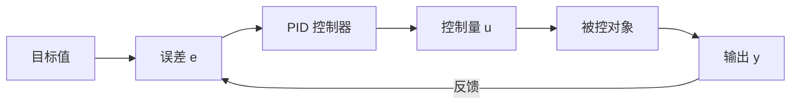

# PID 闭环控制

## 控制框图



### PID 公式

$$u(t) = K_p \cdot e(t) + K_i \int_0^t e(\tau) d\tau + K_d \frac{de(t)}{dt}$$

离散形式（位置式）：

$$u_k = K_p \cdot e_k + K_i \cdot T_s \sum_{j=0}^{k} e_j + K_d \cdot \frac{e_k - e_{k-1}}{T_s}$$

### 参数作用

| 参数 | 作用 | 过大影响 |
|------|------|---------|
| $K_p$ | 比例增益，快速响应 | 超调、振荡 |
| $K_i$ | 积分增益，消除稳态误差 | 积分饱和、响应慢 |
| $K_d$ | 微分增益，抑制超调 | 对噪声敏感 |

### 增量式 PID

$$\Delta u_k = K_p(e_k - e_{k-1}) + K_i \cdot T_s \cdot e_k + K_d \frac{e_k - 2e_{k-1} + e_{k-2}}{T_s}$$

优点：无积分饱和，切换无冲击，适合电机控制。

### 代码示例

```c
typedef struct {
    float Kp, Ki, Kd;
    float setpoint;
    float error, last_error, integral;
    float output;
    float output_min, output_max;
} PID_Controller;

float PID_Update(PID_Controller *pid, float measurement, float dt)
{
    pid->error = pid->setpoint - measurement;
    pid->integral += pid->error * dt;

    // 抗积分饱和
    if (pid->integral > pid->output_max) pid->integral = pid->output_max;
    if (pid->integral < pid->output_min) pid->integral = pid->output_min;

    float derivative = (pid->error - pid->last_error) / dt;
    pid->output = pid->Kp * pid->error
                + pid->Ki * pid->integral
                + pid->Kd * derivative;

    if (pid->output > pid->output_max) pid->output = pid->output_max;
    if (pid->output < pid->output_min) pid->output = pid->output_min;

    pid->last_error = pid->error;
    return pid->output;
}
```

---

