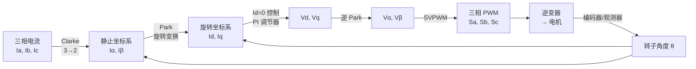
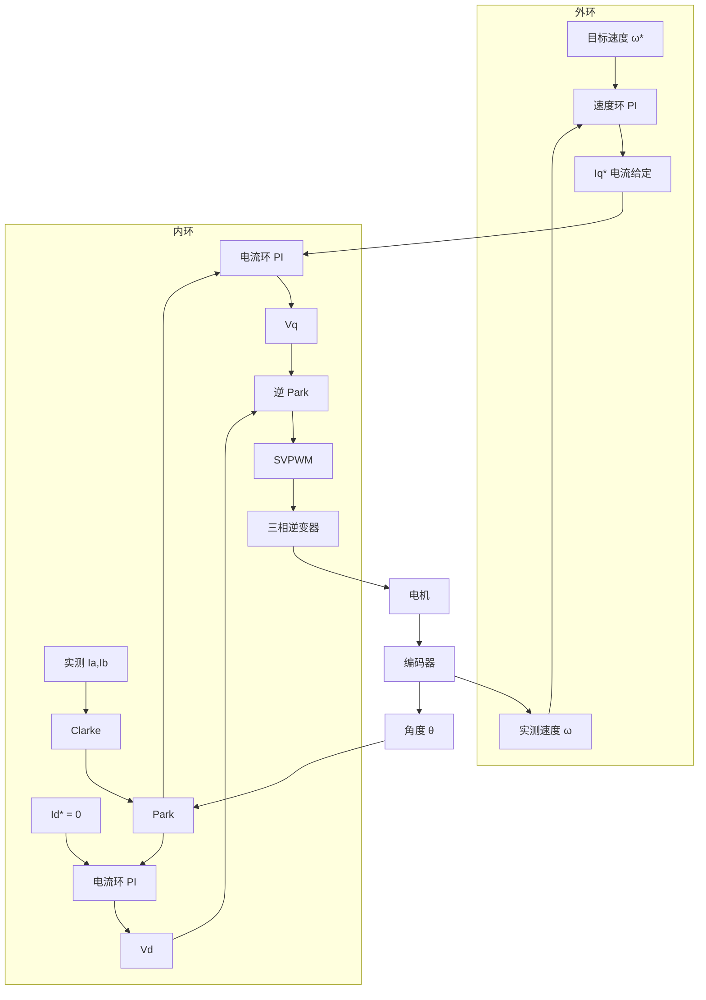

# FOC 磁场定向控制（Field-Oriented Control）

> FOC 是 BLDC / PMSM（永磁同步电机）的"黄金标准"控制算法。它将三相交流量解耦为类似直流电机的直轴/交轴分量，实现像控制直流电机一样控制交流电机，获得最大扭矩电流比、宽速域、高效率和低噪声。

## 为什么需要 FOC

| 控制方式 | 六步换相（梯形波） | FOC（正弦波） |
|----------|------------------|---------------|
| 转矩脉动 | 大（±13%） | 极小（<1%） |
| 低速性能 | 差，易抖动 | 平滑，可低速爬行 |
| 高速性能 | 受反电动势限制 | 弱磁控制可扩速 |
| 效率 | 一般 | 高（最优电流分配） |
| 噪声 | 电磁噪声大 | 安静 |
| 算法复杂度 | 简单 | 复杂（需要 DSP/FPGA/高性能 MCU） |
| 适用 | 无人机、风扇 | 伺服、机器人、电动车、CNC |

### FOC 核心思想：坐标变换

将三相静止坐标系（$a,b,c$）→ 两相静止坐标系（$eta$）→ 两相旋转坐标系（$d,q$）



### 数学变换

#### 1. Clarke 变换（3→2，三相 → 两相静止）

保留幅值不变（Amplitude Invariant）：

$$
I_\alpha = I_a \\
I_\beta = \frac{1}{\sqrt{3}}(I_a + 2I_b)
$$

（利用 $I_a + I_b + I_c = 0$）

#### 2. Park 变换（静止 → 旋转，与转子同步）

$$
I_d = I_\alpha \cos\theta + I_\beta \sin\theta \\
I_q = -I_\alpha \sin\theta + I_\beta \cos\theta
$$

其中 $\theta$ 为转子电角度（来自编码器或观测器）。

- **$I_d$（直轴）**：与转子磁场对齐，产生磁化电流。永磁电机通常设 $I_d = 0$
- **$I_q$（交轴）**：与转子磁场垂直，**直接产生电磁转矩**：$T \propto I_q$

#### 3. 逆变换
- **逆 Park**：$V_d, V_q$ → $V_\alpha, V_\beta$
- **逆 Clarke**：$V_\alpha, V_\beta$ → $V_a, V_b, V_c$（通过 SVPWM 直接生成开关信号）

### 控制环路结构

FOC 通常采用**双环级联**结构：



| 环路 | 带宽 | 周期 | 功能 |
|------|------|------|------|
| **电流环（内环）** | 高（1~10kHz） | 50~100μs | 快速跟踪 $I_d, I_q$ |
| **速度环（外环）** | 中（100~1kHz） | 1~10ms | 稳定速度，输出 $I_q^*$ |
| **位置环（最外环）** | 低（10~100Hz） | 10~100ms | 精确定位，输出 $\omega^*$ |

### SVPWM（空间矢量脉宽调制）

SVPWM 是 FOC 最常用的调制策略，相比正弦 PWM 提高 **15%** 母线电压利用率。

#### 基本思想
- 三相逆变器有 8 种开关状态（$2^3$），对应 8 个电压矢量
- 6 个有效矢量构成正六边形，2 个零矢量（000 和 111）
- 用**相邻两个有效矢量 + 零矢量**的合成来逼近任意目标电压矢量

```
          U4(100)
           |
    U6(110) --|-- U5(101)
       \      |      /
        \  零矢量   /
         \  000   /
    U2(010)-----U1(001)
           |
          U3(011)
```

#### 扇区判断与占空比计算
1. 根据 $V_\alpha, V_\beta$ 判断目标矢量所在扇区（1~6）
2. 计算相邻两个有效矢量的作用时间 $T_1, T_2$
3. 剩余时间插入零矢量（$T_0 = T_s - T_1 - T_2$）
4. 生成三路比较寄存器值，送入定时器

### 无传感器 FOC（Sensorless）

当编码器/霍尔传感器成本过高或安装受限时，可通过观测器估计转子位置。

#### 常用观测器

| 观测器 | 原理 | 低速性能 | 适用 |
|--------|------|----------|------|
| **滑模观测器（SMO）** | 基于电流误差构建滑模面，提取反电动势 | 差（需开环启动） | 中高速、成本低 |
| **龙伯格观测器（Luenberger）** | 线性状态观测器，估计反电动势 | 一般 | 中等复杂度 |
| **扩展卡尔曼滤波（EKF）** | 非线性最优估计，抗噪声强 | 较好 | 高性能、计算资源充足 |
| **高频注入（HFI）** | 注入高频信号，利用凸极效应 | **好**（零速可启动） | 凸极电机（IPMSM）、低速伺服 |

#### 开环启动 → 闭环切换
- 低速时（<10% 额定速度）反电动势太弱，观测器不可靠
- 解决方案：I-F 启动（恒流恒频），强制换相，待速度提高后切入观测器闭环
- 切换条件：反电动势幅值足够、观测器收敛稳定

### 弱磁控制（Field Weakening）

当电机转速超过基速（额定速度）时，反电动势增大，需弱磁扩速：
- 令 $I_d < 0$（负直轴电流），削弱永磁体磁场
- 速度扩展可达 **2~4 倍**基速
- 需 MTPA（最大转矩电流比）+ MTPV（最大转矩电压比）轨迹切换
- 注意：过度弱磁会导致永磁体退磁！

### 代码框架（伪代码）

```c
// FOC 主循环，电流环周期 50~100μs
void FOC_CurrentLoop(float Ia, float Ib, float theta, float Iq_ref)
{
    // 1. Clarke 变换
    Ialpha = Ia;
    Ibeta  = (Ia + 2.0f * Ib) / 1.7320508f;
    
    // 2. Park 变换
    float cos_t = cosf(theta);
    float sin_t = sinf(theta);
    Id =  Ialpha * cos_t + Ibeta * sin_t;
    Iq = -Ialpha * sin_t + Ibeta * cos_t;
    
    // 3. Id=0 控制（或 MTPA 控制）
    float Id_ref = 0.0f;
    float Vd = PI_Update(&pi_Id, Id_ref - Id);
    float Vq = PI_Update(&pi_Iq, Iq_ref - Iq);
    
    // 4. 弱磁补偿（可选）
    if (speed > base_speed) {
        Vd += weak_flux_current;  // Id < 0
    }
    
    // 5. 逆 Park 变换
    Valpha = Vd * cos_t - Vq * sin_t;
    Vbeta  = Vd * sin_t + Vq * cos_t;
    
    // 6. SVPWM 生成
    SVPWM_Generate(Valpha, Vbeta, Vdc, &duty_a, &duty_b, &duty_c);
    
    // 7. 更新 PWM 寄存器
    TIM_SetDuty(TIM1, CH1, duty_a);
    TIM_SetDuty(TIM1, CH2, duty_b);
    TIM_SetDuty(TIM1, CH3, duty_c);
}

// 速度环，周期 1ms
void FOC_SpeedLoop(float speed_measured)
{
    Iq_ref = PI_Update(&pi_speed, speed_target - speed_measured);
    // 限速保护
    if (Iq_ref >  MAX_CURRENT) Iq_ref =  MAX_CURRENT;
    if (Iq_ref < -MAX_CURRENT) Iq_ref = -MAX_CURRENT;
}
```

### 关键调试要点

| 问题 | 可能原因 | 解决方法 |
|------|----------|----------|
| 电机不转，抖动 | 角度不准、相序错误 | 检查编码器方向、对调任意两相线 |
| 高速失步 | 电流环带宽不足 | 提高电流环频率、降低电机电感 |
| 噪声大 | 电流环 PI 参数过激 | 降低 $K_p$，增加滤波 |
| 启动失败 | 无传感器启动参数不对 | 调整开环电流和加速斜率 |
| 过流保护频繁 | 死区时间不足、采样噪声 | 增加死区、硬件 RC 滤波 |
| 低速爬行抖动 | 编码器分辨率不足 | 换高分辨率编码器或改用无传感器 HFI |

### 推荐芯片与工具链

| 芯片/平台 | 特点 | 适用 |
|-----------|------|------|
| **STM32G4 / STM32H7** | 高分辨率定时器、CORDIC、FMAC | 学习、中功率 |
| **TI C2000 / InstaSPIN** | 内置 FOC 库，无传感器算法成熟 | 工业、快速产品化 |
| **ST MCSDK** | STM32 电机控制软件开发套件 | STM32 全系列 |
| **SimpleFOC** | Arduino 开源 FOC 库，极简上手 | 快速原型、学习 |
| **ODrive** | 开源高性能 FOC 驱动器 | 机器人、伺服 |
| **VESC** | 开源滑板/电动车 FOC 电调 | 大功率、低成本 |
| **先楫 HPM5300** | 国产 RISC-V，2μs 电流环 | 国产替代 |
| **ESP32** | SimpleFOC 支持，低成本 WiFi | 轻量 IoT、无人机 |

### 推荐资源

- **SimpleFOC 文档** — 最友好的 FOC 入门（simplefoc.com）
- **TI InstaSPIN 培训** — 工业级 FOC 实现（TI 官网）
- **ST Motor Control Wiki** — STM32 电机控制知识库
- **《Brushless Motors and Controllers》**（Jacek F. Gieras）— 电机控制经典教材
- **《Electric Motor Drives》**（R. Krishnan）— 深入理论
- **YouTube: Ben Katz** — MIT Cheetah 机器人 BLDC 驱动（[[01-YouTube频道推荐]]）
- **YouTube: SimpleFOC** — 开源 FOC 项目教程（[[01-YouTube频道推荐]]）

---

