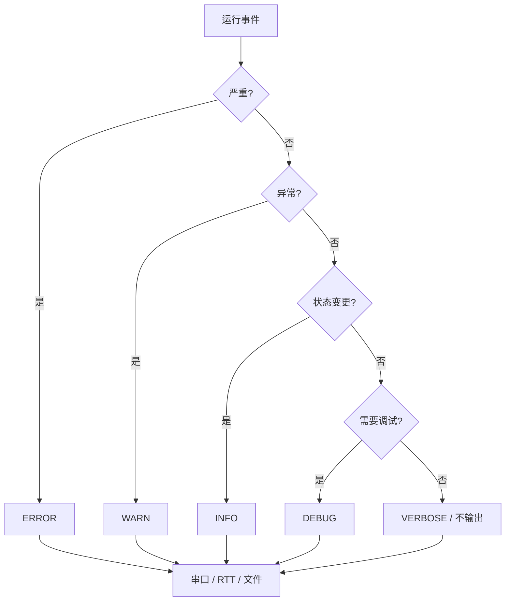

# 日志级别

## 推荐分级
| 级别 | 用途 | 示例 |
|------|------|------|
| ERROR | 严重错误，必须处理 | 传感器离线、通信失败 |
| WARN | 警告，可能的问题 | 电压偏低、缓冲区将满 |
| INFO | 正常运行信息 | 系统启动、模式切换 |
| DEBUG | 调试信息 | 变量值、状态流转 |
| VERBOSE | 详细追踪 | 每个中断、每个数据包 |



### 简易宏实现
```c
#define LOG_LEVEL 3

#define LOG_ERR(fmt, ...)  if(LOG_LEVEL >= 1) printf("[ERR] " fmt "\r\n", ##__VA_ARGS__)
#define LOG_WARN(fmt, ...) if(LOG_LEVEL >= 2) printf("[WARN] " fmt "\r\n", ##__VA_ARGS__)
#define LOG_INFO(fmt, ...) if(LOG_LEVEL >= 3) printf("[INFO] " fmt "\r\n", ##__VA_ARGS__)
#define LOG_DBG(fmt, ...)  if(LOG_LEVEL >= 4) printf("[DBG] " fmt "\r\n", ##__VA_ARGS__)
```

---

