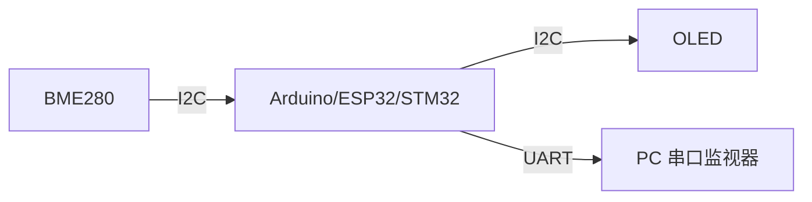

# 完整项目示例：温湿度监测站

## 项目目标
搭建一个能实时采集温湿度并通过串口或 OLED 显示的监测站。

### 硬件清单（BOM）

| 位号 | 器件 | 型号/参数 | 数量 | 备注 |
|------|------|-----------|------|------|
| U1 | 主控 | Arduino Uno / ESP32 / STM32 | 1 | 任选其一 |
| U2 | 温湿度传感器 | BME280 | 1 | I2C 接口 |
| U3 | OLED 显示屏 | SSD1306 128×64 | 1 | I2C 接口 |
| R1~R2 | 上拉电阻 | 4.7 kΩ | 2 | I2C 总线上拉 |
| - | 杜邦线 | 母对母 | 若干 | 连接模块 |

### 系统框图



### 核心代码（Arduino）

```cpp
#include <Wire.h>
#include <Adafruit_BME280.h>
#include <Adafruit_SSD1306.h>

Adafruit_BME280 bme;
Adafruit_SSD1306 display(128, 64, &Wire, -1);

void setup() {
    Serial.begin(115200);
    Wire.begin();
    bme.begin(0x76);
    display.begin(SSD1306_SWITCHCAPVCC, 0x3C);
}

void loop() {
    float t = bme.readTemperature();
    float h = bme.readHumidity();
    float p = bme.readPressure() / 100.0F;

    display.clearDisplay();
    display.setTextSize(1);
    display.setCursor(0, 0);
    display.printf("Temp: %.1f C\n", t);
    display.printf("Hum:  %.1f %%\n", h);
    display.printf("Pres: %.1f hPa\n", p);
    display.display();

    Serial.printf("T:%.1f H:%.1f P:%.1f\n", t, h, p);
    delay(1000);
}
```

### 调试要点
1. **I2C 地址**：BME280 常见地址为 `0x76` 或 `0x77`，可用 I2C 扫描程序确认。
2. **上拉电阻**：若模块未集成上拉，需外接 4.7 kΩ 到 3.3 V。
3. **电源稳定**：传感器和 OLED 对电源噪声敏感，加 100 nF 去耦电容。
4. **串口乱码**：检查波特率是否与 `Serial.begin()` 一致。

### 扩展方向
- 加入 microSD 模块，记录 CSV 数据。
- 用 ESP32 通过 WiFi/MQTT 上传数据到云平台。
- 增加蜂鸣器报警，当温度超过阈值时提醒。

