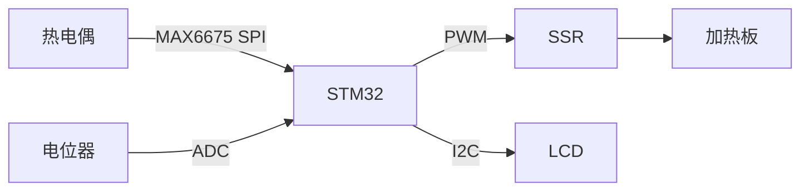

# 进阶项目

> 适合有一定基础的工程师。这些项目涉及闭环控制、多设备通信、数据存储和更复杂的算法，通常需要 2-4 周完成，硬件成本 $20~$100。

---


---

本笔记为**总索引**，各章节的详细内容已拆分为独立笔记。点击下方链接直达具体章节。

---

## 分类导航

- **1. 简易数字示波器** — [[001-1简易数字示波器]]
- **2. 数控电源（Buck）** — [[002-2数控电源Buck]]
- **3. PID 温控系统** — [[003-3PID温控系统]]
- **4. CAN 总线网络** — [[004-4CAN总线网络]]
- **5. GPS 数据记录仪** — [[005-5GPS数据记录仪]]
- **6. 蓝牙低功耗传感器节点** — [[006-6蓝牙低功耗传感器节点]]
- **7. RFID 门禁系统** — [[007-7RFID门禁系统]]
- **8. 电机闭环控制（直流伺服）** — [[008-8电机闭环控制直流伺服]]
- **可视化：进阶项目能力栈** — [[009-可视化进阶项目能力栈]]
- **进阶项目清单** — [[010-进阶项目清单]]
- **完整项目示例：PID 温控系统** — [[011-完整项目示例PID温控系统]]

## 完整项目示例：PID 温控系统

### 项目目标
实现一个基于 SSR 的加热台 PID 温控系统，目标温度可设定，超调小、稳态误差低。

### 硬件清单（BOM）

| 位号 | 器件 | 型号/参数 | 数量 | 备注 |
|------|------|-----------|------|------|
| U1 | 主控 | STM32F103 / Arduino Mega | 1 | 至少 2 路 ADC + PWM |
| U2 | 温度传感器 | MAX6675 + K 型热电偶 | 1 | 高温场景 |
| U3 | 固态继电器 | SSR-40DA | 1 | 过零型，控交流加热器 |
| U4 | 显示屏 | I2C LCD 1602 | 1 | 显示温度与目标值 |
| R1 | 编码器/电位器 | 10 kΩ 电位器 | 1 | 设定目标温度 |
| H1 | 加热板 | 100 W 硅胶加热垫 | 1 | 工作电压 220 VAC |
| - | 散热/绝缘 | 云母片、导热垫 | 若干 | 防止触电和过热 |

### 系统框图



### 核心代码（增量式 PID）

```c
float Kp = 2.0, Ki = 0.5, Kd = 0.1;
float setpoint = 100.0;  // 目标温度
float error, last_error, integral;

float PID_update(float measurement, float dt)
{
    error = setpoint - measurement;
    integral += error * dt;

    // 抗积分饱和
    if (integral > 100) integral = 100;
    if (integral < 0) integral = 0;

    float derivative = (error - last_error) / dt;
    float output = Kp * error + Ki * integral + Kd * derivative;

    if (output > 100) output = 100;
    if (output < 0) output = 0;

    last_error = error;
    return output;  // 0~100 对应 PWM 占空比
}

// 主循环中每 100 ms 调用一次
void loop()
{
    float temp = read_thermocouple();
    float pwm = PID_update(temp, 0.1);
    set_heater_pwm((uint16_t)(pwm * PWM_MAX / 100.0));
    delay(100);
}
```

### 调试要点
1. **SSR 选型**：加热器电流决定 SSR 额定电流，留 1.5 倍余量。
2. **过零触发**：过零型 SSR 配合 PWM 时，PWM 周期应为交流半周期的整数倍（如 100 ms @ 50 Hz）。
3. **PID 调参**：先设 $K_i=K_d=0$，增大 $K_p$ 至临界振荡，再逐步加入积分。
4. **安全保护**：加入超温断电、传感器断线检测、看门狗。
5. **强电隔离**：控制电路与 220 VAC 加热板完全隔离，外壳接地。

### 扩展方向
- 加入 UART/蓝牙，PC 端实时绘制温度曲线。
- 实现多段温度曲线（如回流焊曲线）。
- 用 Fuzzy PID 或自整定算法优化响应。

