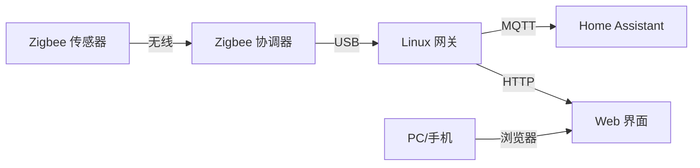

# 高级项目

> 这些项目需要综合运用多个领域的知识，涉及 FPGA、复杂算法、多轴控制、网络协议栈或嵌入式 Linux。每个项目通常需要 1-3 个月完成，硬件成本 $50~$500。

---


---

本笔记为**总索引**，各章节的详细内容已拆分为独立笔记。点击下方链接直达具体章节。

---

## 分类导航

- **1. FPGA 数字钟与数字系统** — [[001-1FPGA数字钟与数字系统]]
- **2. RISC-V 软核处理器** — [[002-2RISCV软核处理器]]
- **3. 四轴飞行器（无人机）** — [[003-3四轴飞行器无人机]]
- **4. 3D 打印机控制器** — [[004-43D打印机控制器]]
- **5. 智能家居网关** — [[005-5智能家居网关]]
- **6. 开源示波器（DScope / DSO）** — [[006-6开源示波器DScopeDSO]]
- **7. 软件定义无线电（SDR）** — [[007-7软件定义无线电SDR]]
- **8. 电池管理系统（BMS）** — [[008-8电池管理系统BMS]]
- **可视化：高级项目技术地图** — [[009-可视化高级项目技术地图]]
- **高级项目清单** — [[010-高级项目清单]]
- **完整项目示例：智能家居网关** — [[011-完整项目示例智能家居网关]]

## 完整项目示例：智能家居网关

### 项目目标
基于嵌入式 Linux 构建一个多协议智能家居网关，能接入 Zigbee 传感器并通过 Web 界面展示状态。

### 硬件清单（BOM）

| 位号 | 器件 | 型号/参数 | 数量 | 备注 |
|------|------|-----------|------|------|
| U1 | 网关主板 | Raspberry Pi 4 / 全志 H3 开发板 | 1 | 运行 OpenWrt/Armbian |
| U2 | Zigbee 协调器 | Sonoff ZBDongle-E | 1 | USB 接入，预烧 Zigbee2MQTT |
| U3 | 温湿度传感器 | Aqara 温湿度传感器 | 2 | Zigbee 协议 |
| U4 | 路由器/交换机 | 家用路由器 | 1 | 提供网络 |
| - | microSD 卡 | 32 GB Class 10 | 1 | 系统盘 |
| - | 电源 | 5V/3A USB-C | 1 | 稳定供电 |

### 系统框图



### 软件栈

| 层级 | 软件 | 作用 |
|------|------|------|
| OS | Armbian / OpenWrt | 嵌入式 Linux 系统 |
| MQTT Broker | Mosquitto | 设备消息总线 |
| Zigbee 桥接 | Zigbee2MQTT | Zigbee ↔ MQTT |
| 智能家居平台 | Home Assistant | 设备管理、自动化、Web UI |
| 容器 | Docker | 部署与隔离 |

### 部署步骤

```bash
# 1. 安装 Docker
curl -fsSL https://get.docker.com | sh

# 2. 启动 Mosquitto
docker run -d --name mosquitto -p 1883:1883 eclipse-mosquitto

# 3. 启动 Zigbee2MQTT（需映射 USB 设备和配置目录）
docker run -d \
  --name zigbee2mqtt \
  --device /dev/ttyUSB0:/dev/ttyUSB0 \
  -v $(pwd)/zigbee2mqtt:/app/data \
  koenkk/zigbee2mqtt

# 4. 启动 Home Assistant
docker run -d \
  --name homeassistant \
  --privileged \
  -p 8123:8123 \
  -v $(pwd)/ha:/config \
  homeassistant/home-assistant:latest
```

### 配置要点
1. **Zigbee2MQTT `configuration.yaml`**：
   - 设置 MQTT 服务器地址
   - 指定串口 `/dev/ttyUSB0`
   - 开启 Permit Join 以允许设备入网
2. **Home Assistant 集成**：
   - 添加 MQTT 集成，自动发现 Zigbee2MQTT 发布的设备
   - 创建 Dashboard 卡片显示温度和湿度
3. **安全**：
   - 修改默认密码
   - 启用 HTTPS 反向代理（Nginx/Caddy）
   - 关闭不必要的端口

### 调试要点
1. **USB 权限**：Linux 下需将用户加入 `dialout` 组，或配置 udev 规则。
2. **Zigbee 信道冲突**：避免与 WiFi 2.4 GHz 信道重叠，常用 Zigbee 信道 11、15、20、25。
3. **设备入网失败**：确认协调器固件版本与 Zigbee2MQTT 兼容，尝试恢复出厂入网。
4. **MQTT 连接问题**：检查防火墙、端口、认证配置。

### 扩展方向
- 接入 BLE 传感器（如小米蓝牙温湿度计）。
- 增加自动化规则：温度高时自动打开风扇。
- 接入 LoRa 远距离传感器，扩展到户外场景。
- 开发自定义 Web 界面替代 Home Assistant。

