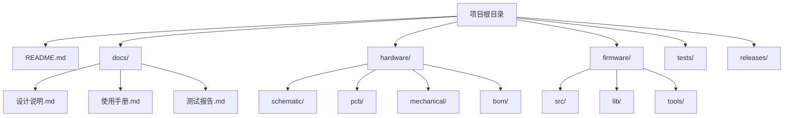

# 项目文档结构

## README.md 必备内容
- 项目名称与一句话简介
- 功能特性
- 硬件清单与连接说明
- 固件编译/烧录方法
- 快速开始指南
- 目录结构说明
- 贡献者/许可证

### BOM 管理
- 使用表格记录：位号、型号、封装、数量、供应商、替代料
- 版本化命名：`BOM_v1.0.xlsx`
- 区分 DNP（不安装）器件
- 推荐工具：KiCad BOM 插件、Octopart、Findchips

---

