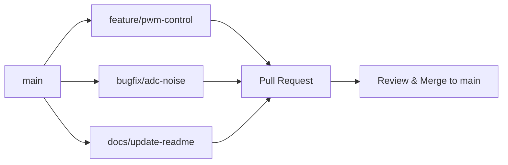

# Git 分支策略

## 推荐模型：GitHub Flow 简化版



### 分支命名
- `main`：稳定主分支
- `feature/xxx`：新功能
- `bugfix/xxx`：Bug 修复
- `docs/xxx`：文档更新
- `hardware/xxx`：硬件改动
- `firmware/xxx`：固件改动

### Commit 规范（Conventional Commits）

```
<type>(<scope>): <subject>

<body>

<footer>
```

常见 type：
- `feat`：新功能
- `fix`：修复
- `docs`：文档
- `style`：格式调整
- `refactor`：重构
- `test`：测试
- `chore`：构建/工具

示例：
```
feat(firmware): add PID speed control loop

- Implement incremental PID update
- Add encoder feedback
- Tune Kp/Ki for 12V DC motor

Closes #12
```

---

