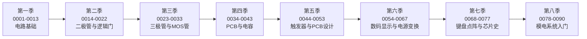

# B 站视频课程推荐：手搓电脑（从欧姆定律到微型计算机）

> 外部资源索引。本页收录值得系统跟学的 B 站课程，标注内容地图与知识库章节的对应关系，方便"看视频 + 查笔记"双轨学习。

## 课程信息

| 项 | 值 |
|---|---|
| UP 主 | [墓中巫人](https://space.bilibili.com/1632504085)（uid 1632504085） |
| 课程 | 《手搓电脑》——从欧姆定律到微型计算机 |
| 规模 | 8 季 91 集（0001–0090 + 课前闲聊），截至 2026-11 仍在更新 |
| 总入口 | [UP 主视频列表页](https://space.bilibili.com/1632504085/lists) |
| 特点 | 不用现成模块，从电阻、二极管、三极管等分立元件一路搭出键盘、显示器和计算机主板；每一集都在面包板上真实搭电路验证，出错也会完整记录分析 |

## 为什么值得放进知识库

这条课程线恰好覆盖知识库三大基础板块（模拟、数字、PCB），且视角互补：

- **知识库的笔记**是"自顶向下"：先给体系框架，再填细节；
- **这门课是"自底向上"**：从欧姆定律出发，每个概念都在面包板上亲手搭出来，把"为什么会这样"讲到物理层面（能带、载流子、介质损耗）。

适合作为 02/03/06 三章的**预习材料和动手实验指导**。

## 内容地图（按季）

### 第一季：电路基础（[合集入口](https://space.bilibili.com/1632504085/lists?sid=1594306)，14 集）

欧姆定律、负数与补码、内存芯片与 SRAM 初识、上拉电阻选择、标称阻值与色环、电源内阻、信号源内阻与戴维南定理、叠加原理与基尔霍夫定律、权电阻网络与 R-2R 梯形 D/A 变换。

→ 对应知识库：[[01-Foundations/00-README|数学与物理基础]]、[[02-Analog-Electronics/00-README|模拟电子]]电路基础部分

### 第二季：二极管与逻辑门（[合集入口](https://space.bilibili.com/1632504085/lists?sid=2831566)，9 集）

晶体二极管初步、LED、限流电阻取值、稳压钳位限幅逻辑电路、用二极管搭与/或/非/异或逻辑门、二极管原理（能级与能带，4 集深挖）。

→ 对应知识库：[[02-Analog-Electronics/00-README|模拟电子]]二极管部分、[[03-Digital-Electronics/00-README|数字电子]]逻辑门部分

### 第三季：三极管与场效应管（[合集入口](https://space.bilibili.com/1632504085/lists?sid=3497742)，11 集）

三极管开关电路、伏安特性与 β、饱和区设计、射极输出开关电路、双向传输与电平变换、双稳态与施密特触发器（用两个三极管构造）、JFET 与 MOSFET 原理。

→ 对应知识库：[[02-Analog-Electronics/00-README|模拟电子]]三极管/MOS 管部分

### 第四季：PCB 与电容（[合集入口](https://space.bilibili.com/1632504085/lists?sid=4029502)，10 集）

印刷电路板简述（4 集）、退耦电容、电容器参数、介质损耗与电解电容、开关和接插件、存储器读写板原理图。

→ 对应知识库：[[06-PCB-Design/00-README|PCB 设计]]入门、[[02-Analog-Electronics/00-README|模拟电子]]电容部分

### 第五季：时序逻辑与 PCB 设计实操（[合集入口](https://space.bilibili.com/1632504085/lists?sid=4623010)，10 集）

计数器芯片应用、按键消抖电路、微分电路、D 触发器应用、移位寄存器与总线驱动器；随后用 Protel 99se 走完画板全流程（前期准备、Gerber 输出、符号与封装库、原理图到 PCB）。

→ 对应知识库：[[03-Digital-Electronics/00-README|数字电子]]时序逻辑部分、[[06-PCB-Design/00-README|PCB 设计]]

### 第六季：数码显示、电源变换与 KiCad（[合集入口](https://space.bilibili.com/1632504085/lists?sid=5339014)，14 集）

十六进制数、74LS247 译码器、数码管动态扫描、计数器与脉冲振荡、双稳态/单稳态/无稳态、继电器与 Boost 升压、射极跟随器与 Buck 降压、PWM 脉宽调制；后半季从 Protel 迁移到 KiCad（概览、库制作、原理图、画板步骤与要点）。

→ 对应知识库：[[03-Digital-Electronics/00-README|数字电子]]、[[02-Analog-Electronics/00-README|模拟电子]]电源部分、[[06-PCB-Design/00-README|PCB 设计]]（KiCad 实操可直接配合 [[kicad]] 技能使用）

### 第七季：输入设备与芯片发展史（[合集入口](https://space.bilibili.com/1632504085/lists?sid=7117459)，10 集）

十六进制键盘（4 集，含完整电路详解与最优方案）、LED 点阵屏驱动（4 集，含硬件实验错误分析、异步 vs 同步）、RTL vs DTL vs TTL 逻辑芯片发展历程、PMOS vs NMOS vs CMOS 发展历程。

→ 对应知识库：[[03-Digital-Electronics/00-README|数字电子]]（这两集芯片史是理解"为什么是 TTL/CMOS"的绝佳材料）

### 第八季：模电系统入门（[合集入口](https://space.bilibili.com/1632504085/lists?sid=8205455)，13 集）

交流电、变压器、半波/全波/倍压整流、稳压电路、LDO 与 DC-DC、开关电源电路结构、偏置与隔直、容抗与感抗、理想与现实、低通/高通滤波器、幅频与相频特性、放大器入门。

→ 对应知识库：[[02-Analog-Electronics/00-README|模拟电子]]核心篇章（放大器、滤波器、电源）

## 使用建议

1. **顺序学习**：课程严格递进（元件 → 电路 → 板 → 系统），不建议跳季；第八季的模电概念依赖前三季的元件功底。
2. **与知识库配合**：看某集前先在对应章节读概念框架，看完再回笔记做测验题（如 [[01-Foundations/13-嵌入式C编程测验题|嵌入式 C 测验题]] 检验第三季之后的理解）。
3. **动手优先**：课程价值在面包板实验，至少跟着搭键盘（第七季）和整流稳压（第八季）两个完整项目。
4. **工具迁移**：第五、六季的 Protel 99se 已过时，画板部分直接套用本知识库已集成的 KiCad 技能，只看电路设计思想。

## 其他 B 站资源

（待补充——发现值得系统学习的新课程时，按本页格式追加小节，保持"内容地图 + 知识库章节对照"的结构。）

## 继续学习

- [[12-Resources/01-YouTube频道推荐/001-入门基础Beginner|YouTube 频道推荐]] — 英文视频资源
- [[12-Resources/03-在线课程与教程/001-免费课程|在线课程与教程]] — 体系化课程
- [[12-Resources/00-README|返回学习资源目录]]
