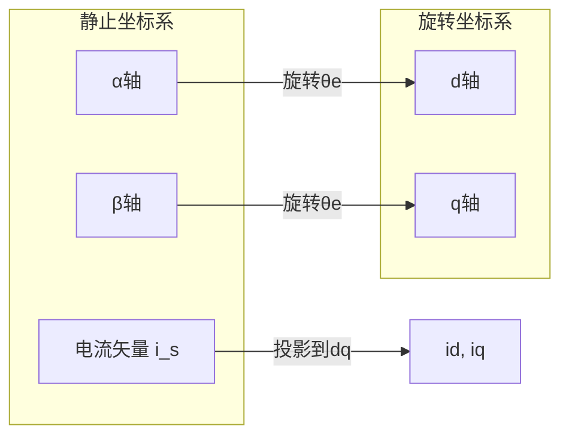

# Park变换与旋转坐标系

> **为什么学？**
> Park 变换是磁场定向控制（FOC, Field-Oriented Control）把“交流跟踪问题”变成“直流控制问题”的关键。如果不理解旋转坐标系的定义、电角度与机械角度的区别、Park 矩阵的符号约定，电流环比例-积分（PI, Proportional-Integral）控制器会跟踪不上正弦电流，$dq$ 轴解耦失败，电机甚至可能反转或失控。
>
> **在 FOC 中的作用**
> 这一节把 $\alpha\beta$ 静止坐标系中的交流量旋转到与转子磁场同步的 $dq$ 坐标系，输出直流量 $i_d, i_q$ 给电流环 PI 控制器；逆 Park 变换则把控制器输出的 $u_d, u_q$ 还原到 $\alpha\beta$ 供空间矢量脉宽调制（SVPWM, Space Vector Pulse Width Modulation）使用。

这张图把 Clarke 和 Park 两级变换连成一条流水线：Clarke 负责把三相交流量降到二维平面，Park 负责让这个平面跟着转子一起转。只有理解 Park 变换是整条链路的“旋转开关”，才能明白为什么必须使用**电角度** $\theta_e$，以及为什么 $i_d、i_q$ 会变成直流量。


*图：Park 变换把 αβ 交流量旋转到与转子同步的 dq 直流量*

![[14-FOC-电机控制/assets/foc_clarke_park_visual.png|1500]]
*图：abc、αβ、dq 三个坐标系的直观关系——Clarke 投影到静止平面，Park 让平面随转子旋转*

Clarke 变换把三相电流变成了两相交流量，但比例-积分（PI, Proportional-Integral）控制器最擅长控制直流量。Park 变换通过让坐标系跟随转子同步旋转，把正弦跟踪问题转化为直流稳态控制问题，是磁场定向控制（FOC, Field-Oriented Control）电流环设计的核心。

## 1. 数学推导

### 1.1 旋转坐标系的定义

**为什么需要旋转坐标系？**  
Clarke 变换把三相基波电流映射到静止的 $\alpha\beta$ 平面，$i_\alpha$、$i_\beta$ 仍随电角度周期变化。Park 变换再把坐标系旋转到与转子磁场同步的 $dq$ 轴，使稳态基波分量在该坐标系中近似为常值。在线性模型、闭环稳定且未饱和时，PI 控制器可对常值指令实现零稳态误差；谐波、参数失配和角度误差仍会在 $dq$ 量中留下纹波。

定义：$d$ 轴（直轴）与转子永磁体磁链方向对齐，$q$ 轴（交轴）超前 $d$ 轴 $90°$ 电角度。旋转坐标系以电角速度 $\omega_e$ 旋转。

### 1.2 从几何旋转推导 Park 矩阵

**为什么要从几何出发？**  
Park 矩阵的每一项都可以从“向量在新坐标轴上的投影”直接读出。死记矩阵容易把 $\sin\theta_e$ 的符号搞反；一旦 $q$ 轴符号错误，电机加正向电压会反向旋转。几何推导能明确每一项的符号来源，并直接解释为什么逆 Park 变换就是正变换的转置。

在 $\alpha\beta$ 平面中，电流矢量 $\vec{i}_s$ 与 $\alpha$ 轴的夹角记为 $\theta_s$（空间角），其分量为

$$
i_\alpha = |\vec{i}_s|\cos\theta_s, \quad i_\beta = |\vec{i}_s|\sin\theta_s.
$$

$dq$ 坐标系相对于 $\alpha$ 轴旋转了电角度 $\theta_e$。$i_d$、$i_q$ 分别是 $\vec{i}_s$ 在 $d$ 轴、$q$ 轴上的投影，因此

$$
i_d = |\vec{i}_s|\cos(\theta_s - \theta_e), \quad i_q = |\vec{i}_s|\sin(\theta_s - \theta_e).
$$

利用三角恒等式 $\cos(A-B)=\cos A\cos B+\sin A\sin B$、$\sin(A-B)=\sin A\cos B-\cos A\sin B$ 展开，并代入 $i_\alpha$、$i_\beta$：

$$
\begin{aligned}
i_d &= |\vec{i}_s|\cos\theta_s\cos\theta_e + |\vec{i}_s|\sin\theta_s\sin\theta_e
    = i_\alpha\cos\theta_e + i_\beta\sin\theta_e, \\[6pt]
i_q &= |\vec{i}_s|\sin\theta_s\cos\theta_e - |\vec{i}_s|\cos\theta_s\sin\theta_e
    = -i_\alpha\sin\theta_e + i_\beta\cos\theta_e.
\end{aligned}
$$

写成矩阵形式，即得到 Park 旋转矩阵。Park 变换本身是二维正交旋转，不再引入幅值缩放；“等幅值/等功率”由前级 Clarke 归一化决定：

$$\begin{bmatrix} i_d \\ i_q \end{bmatrix} = 
\begin{bmatrix} \cos\theta_e & \sin\theta_e \\ -\sin\theta_e & \cos\theta_e \end{bmatrix}
\begin{bmatrix} i_\alpha \\ i_\beta \end{bmatrix}$$

$$C_{\alpha\beta}^{dq} = \begin{bmatrix} \cos\theta_e & \sin\theta_e \\ -\sin\theta_e & \cos\theta_e \end{bmatrix}$$

**逆 Park 变换**（将 $dq$ 映射回 $\alpha\beta$）：

$$C_{dq}^{\alpha\beta} = \begin{bmatrix} \cos\theta_e & -\sin\theta_e \\ \sin\theta_e & \cos\theta_e \end{bmatrix}$$

注意：逆变换矩阵是正变换矩阵的转置，即 $C^{-1} = C^T$，因为旋转变换是正交变换。

### 1.3 从 $abc$ 直接到 $dq$ 的变换

为什么要做这一步：实际 FOC 代码中通常把 Clarke 和 Park 合并成一次计算，直接由三相电流得到 $i_d, i_q$，这样可以减少乘法次数、提高电流采样中断的实时性。

将 Clarke 与 Park 变换串联：

$$\begin{bmatrix} i_d \\ i_q \end{bmatrix} = C_{\alpha\beta}^{dq} \cdot C_{abc}^{\alpha\beta} \begin{bmatrix} i_a \\ i_b \\ i_c \end{bmatrix}$$

直接展开（等幅值）：

$$i_d = \frac{2}{3}\left[ i_a \cos\theta_e + i_b \cos(\theta_e - 120°) + i_c \cos(\theta_e + 120°) \right]$$

$$i_q = -\frac{2}{3}\left[ i_a \sin\theta_e + i_b \sin(\theta_e - 120°) + i_c \sin(\theta_e + 120°) \right]$$

### 1.4 角度同步：电角度 vs 机械角度

电角度 $\theta_e$ 与机械角度 $\theta_m$ 的关系：

$$\theta_e = \operatorname{wrap}_{2\pi}(\sigma p\theta_m+\theta_{e0})$$

其中 $p$ 为电机极对数（pole pairs），$\sigma\in\{+1,-1\}$ 表示传感器计数方向与项目正方向是否一致，$\theta_{e0}$ 为编码器机械零位到转子 $d$ 轴的电角度偏置。电角速度关系为：

$$\omega_e = \sigma p\omega_m$$

**FOC 中角度同步的关键**：Park 变换必须使用经过方向校正、极对数换算和零偏标定的电角度，而非直接使用机械角度。角度误差 $\Delta\theta$ 会让实际电流在 $d$、$q$ 轴间串扰，造成转矩下降、额外直轴电流和转矩脉动。

---

## 2. 几何直观

![[14-FOC-电机控制/assets/park_rotation_geometry.png|1500]]
*图：αβ 是静止坐标系，dq 是以电角度 $\theta_e$ 旋转的坐标系；电流矢量 $\vec{i}_s$ 在 dq 轴上的投影即为 $i_d$、$i_q$*

从上图可以直观理解 Park 变换的物理意义：

- **αβ 坐标系**固定在定子上，电流矢量 $\vec{i}_s$ 在其中以电角速度 $\omega_e$ 旋转，因此 $i_\alpha$、$i_\beta$ 是正弦交流量；
- **dq 坐标系**固定在转子上，d 轴与转子磁链对齐，q 轴超前 d 轴 90°；
- 当观察者“站”在 dq 坐标系上时，电流矢量相对于 dq 轴静止，投影 $i_d$、$i_q$ 不再随时间变化，成为直流量；
- 投影公式就是旋转矩阵：$i_d = |\vec{i}_s|\cos(\theta_s - \theta_e)$，$i_q = |\vec{i}_s|\sin(\theta_s - \theta_e)$。


*图：坐标系旋转后，电流矢量在 dq 轴上的投影即为直流量*

---

## 3. 数值示例

**给定条件**：三相平衡电流，幅值 $I_m = 5\,\text{A}$，角频率 $\omega = 314\,\text{rad/s}$，电角度 $\theta_e = 30° = \pi/6\,\text{rad}$。设 $t = 0$ 时，$\omega t = 0$。

$$i_a = 5\cos(0) = 5\,\text{A}, \quad i_b = 5\cos(-120°) = -2.5\,\text{A}, \quad i_c = 5\cos(120°) = -2.5\,\text{A}$$

**步骤 1：Clarke 变换**

$$i_\alpha = \frac{2}{3}\left[5 - 0.5(-2.5) - 0.5(-2.5)\right] = \frac{2}{3} \times 7.5 = 5\,\text{A}$$
$$i_\beta = \frac{2}{3}\left[\frac{\sqrt{3}}{2}(-2.5) - \frac{\sqrt{3}}{2}(-2.5)\right] = 0\,\text{A}$$

（此时电流矢量恰好与 $\alpha$ 轴对齐）

**步骤 2：Park 变换（$\theta_e = 30°$）**

$$i_d = 5\cos30° + 0\sin30° = 5 \times 0.866 = 4.33\,\text{A}$$
$$i_q = -5\sin30° + 0\cos30° = -5 \times 0.5 = -2.5\,\text{A}$$

**验证**：合成矢量幅值 $\sqrt{4.33^2 + (-2.5)^2} = \sqrt{18.75 + 6.25} = \sqrt{25} = 5\,\text{A}$，与原始幅值一致 ✓

**步骤 3：角度同步验证**

若 $p = 4$（8极电机），编码器测得机械角度 $\theta_m = 7.5°$，则：

$$\theta_e = 4 \times 7.5° = 30°$$

若误用机械角度 $\theta_m = 7.5°$ 进行 Park 变换：

$$i_d = 5\cos7.5° + 0\sin7.5° = 4.96\,\text{A}$$
$$i_q = -5\sin7.5° + 0\cos7.5° = -0.65\,\text{A}$$

此时 $i_d$、$i_q$ 均不为期望值，且随时间变化，控制器无法稳态跟踪。

---

## 4. 代码实现

### C 语言：Park 与逆 Park 变换

```c
#include <math.h>

#define PI 3.14159265359f

/* Park 变换：αβ → dq */
void Park_Transform(float ialpha, float ibeta, float theta_e, float* id, float* iq) {
    float cos_theta = cosf(theta_e);
    float sin_theta = sinf(theta_e);
    *id =  ialpha * cos_theta + ibeta * sin_theta;
    *iq = -ialpha * sin_theta + ibeta * cos_theta;
}

/* 逆 Park 变换：dq → αβ */
void InvPark_Transform(float id, float iq, float theta_e, float* ialpha, float* ibeta) {
    float cos_theta = cosf(theta_e);
    float sin_theta = sinf(theta_e);
    *ialpha = id * cos_theta - iq * sin_theta;
    *ibeta  = id * sin_theta + iq * cos_theta;
}

/* 归一化角度到 [0, 2π) */
float NormalizeAngle(float theta) {
    while (theta >= 2.0f * PI) theta -= 2.0f * PI;
    while (theta < 0.0f) theta += 2.0f * PI;
    return theta;
}

/* 机械角度 → 电角度：direction 取 +1.0f 或 -1.0f */
float MechToElecAngle(float theta_m, int pole_pairs,
                      float direction, float theta_e_offset) {
    return NormalizeAngle(direction * pole_pairs * theta_m + theta_e_offset);
}

/* 完整 abc → dq 变换（等幅值） */
void ABC_to_DQ(float ia, float ib, float ic, float theta_e, float* id, float* iq) {
    float ialpha = (2.0f/3.0f) * (ia - 0.5f*ib - 0.5f*ic);
    float ibeta  = (2.0f/3.0f) * (0.8660254f*ib - 0.8660254f*ic);
    Park_Transform(ialpha, ibeta, theta_e, id, iq);
}

/* dq → abc 逆变换（等幅值） */
void DQ_to_ABC(float id, float iq, float theta_e, float* ia, float* ib, float* ic) {
    float ialpha, ibeta;
    InvPark_Transform(id, iq, theta_e, &ialpha, &ibeta);
    *ia = ialpha;
    *ib = -0.5f*ialpha + 0.8660254f*ibeta;
    *ic = -0.5f*ialpha - 0.8660254f*ibeta;
}
```

### MATLAB 验证

```matlab
% Park 变换验证
theta_e = pi/6; % 30度
ialpha = 5; ibeta = 0;
% Park 变换
id =  ialpha*cos(theta_e) + ibeta*sin(theta_e);
iq = -ialpha*sin(theta_e) + ibeta*cos(theta_e);
% 逆变换验证
ialpha_r = id*cos(theta_e) - iq*sin(theta_e);
ibeta_r  = id*sin(theta_e) + iq*cos(theta_e);
% 应还原为原始值
fprintf('还原误差: %.6f, %.6f\n', ialpha-ialpha_r, ibeta-ibeta_r);
```

---

## 5. 工程实现要点

### 5.1 电角度的来源与同步

Park 变换必须使用**电角度** $\theta_e$，而不能用机械角度。实际系统中 $\theta_e$ 的来源主要有三类：

1. **位置编码器**：光电/磁编码器测量机械角度 $\theta_m$，通过 $\theta_e = p\cdot\theta_m$ 换算。编码器分辨率越高，角度量化误差越小，电流环纹波越低。
2. **霍尔传感器**：无刷直流/永磁同步电机常用三个霍尔元件，只给出 60° 或 120° 电角度的扇区信息。需要在扇区内插值，或用观测器估计连续角度，才能直接用于磁场定向控制（FOC, Field-Oriented Control）。
3. **无传感器观测器**：滑模观测器（SMO, Sliding-Mode Observer）、扩展卡尔曼滤波（EKF, Extended Kalman Filter）、锁相环（PLL, Phase-Locked Loop）等，从反电动势或电流模型中估计 $\theta_e$。成本低，但低速和零速性能受限于信噪比。

无论哪种来源，都要保证电流采样时刻与角度采样时刻同步；延迟超过一个脉宽调制（PWM, Pulse Width Modulation）周期会引入额外的 $d$-$q$ 轴耦合。

### 5.2 角度归一化与查表

代码中的三角函数通常使用查表法或 CORDIC 算法加速。角度必须先归一化到 $[0,2\pi)$ 或 $[-\pi,\pi)$：

```c
float NormalizeAngle(float theta) {
    while (theta >= 2.0f * PI) theta -= 2.0f * PI;
    while (theta < 0.0f)      theta += 2.0f * PI;
    return theta;
}
```

对于定点 DSP/MCU，更常用 $Q15/Q31$ 格式的归一化角度（$2\pi$ 对应满量程），直接查正弦/余弦表，避免浮点运算。

### 5.3 坐标约定一致性

工程中常见两种 $q$ 轴方向约定：

- **约定 A（电机控制常用）**：$q$ 轴超前 $d$ 轴 $90°$ 电角度，对应本文矩阵；正向 $i_q$ 产生正向转矩。
- **约定 B（部分教材/发电机分析）**：$q$ 轴滞后 $d$ 轴 $90°$，矩阵中 $q$ 行符号相反。

同一项目中，Clarke/Park、电流环、速度环、空间矢量脉宽调制（SVPWM, Space Vector Pulse Width Modulation）模块必须采用同一约定，否则转矩方向会反转。

### 5.4 正逆变换配对与系数统一

Park 与逆 Park 必须成对使用。等幅值/等功率的缩放来自 Clarke（或合并后的 $abc\leftrightarrow dq$ 矩阵），Park 只是正交旋转。若电压与电流链路采用不同的变量标度，限幅、前馈和转矩常数会出现 $\sqrt{3/2}$ 的系统性偏差，原有 PI 增益也不再对应预期带宽。

---

## 6. 常见错误

### 错误 1：Park 变换矩阵定义混乱（不同文献定义相反）

**错误表现**：不同教材和文献中 Park 变换矩阵存在两种定义：

- 定义 A（电机控制常用）：$i_d = i_\alpha \cos\theta + i_\beta \sin\theta$，$i_q = -i_\alpha \sin\theta + i_\beta \cos\theta$
- 定义 B（部分教材）：$i_d = i_\alpha \cos\theta + i_\beta \sin\theta$，$i_q = i_\alpha \sin\theta - i_\beta \cos\theta$（即 $q$ 轴方向相反）

若混用两种定义，会导致 $i_q$ 符号相反，转矩方向反转，电机失控。

**纠正方法**：
- 不把某一种符号约定称为唯一“标准”。本知识库采用定义 A：$d$ 轴与永磁磁链对齐，$q$ 轴沿正电角度方向超前 $d$ 轴 $90°$；
- 在代码中明确标注变换方向；
- 验证：当电流矢量恰好与 $q$ 轴对齐时（$\theta_{vector} = \theta_e + 90°$），应有 $i_d = 0$，$i_q > 0$；
- 若发现电机加正向电压却反转，首先检查 Park 变换的 $q$ 轴符号。

### 错误 2：角度单位混淆（弧度 vs 度）

**错误表现**：在 C 语言中 `sin()` 和 `cos()` 使用弧度，但编码器输出或上位机指令可能为度。若直接代入 $30°$ 到 `sin(30)`，实际计算的是 $\sin(30\,\text{rad}) \approx -0.988$，而非 $\sin(30°) = 0.5$。

**纠正方法**：
- 建立严格的单位约定：代码内部所有三角函数使用**弧度**；
- 在接口层进行转换：`theta_rad = theta_deg * PI / 180.0f`；
- 对编码器输出（如 16bit 或 14bit 数字量）统一按 $2\pi$ 满量程映射到弧度；
- 在角度计算链中插入归一化函数 `NormalizeAngle()`，防止角度溢出累积误差。

---

## 7. 自测习题

### 习题 1

给定 $\alpha\beta$ 坐标系电流：$i_\alpha = 3\,\text{A}$，$i_\beta = 4\,\text{A}$，电角度 $\theta_e = 53.13°$（约 $0.9273\,\text{rad}$）。

(1) 计算 $i_d$ 和 $i_q$；
(2) 验证合成电流幅值在变换前后是否守恒；
(3) 若 $\theta_e = 0°$，$i_d$ 和 $i_q$ 应为多少？

**答案**：
(1) $\cos(53.13°) = 0.6$，$\sin(53.13°) = 0.8$

$$i_d = 3 \times 0.6 + 4 \times 0.8 = 1.8 + 3.2 = 5.0\,\text{A}$$
$$i_q = -3 \times 0.8 + 4 \times 0.6 = -2.4 + 2.4 = 0\,\text{A}$$

(2) 变换前：$\sqrt{3^2 + 4^2} = 5\,\text{A}$；变换后：$\sqrt{5^2 + 0^2} = 5\,\text{A}$ ✓

(3) $\theta_e = 0°$ 时：$i_d = i_\alpha = 3\,\text{A}$，$i_q = i_\beta = 4\,\text{A}$

### 习题 2

某 8 极永磁同步电机（PMSM, Permanent Magnet Synchronous Motor）（$p = 4$），编码器分辨率为 1024 脉冲/转（4 倍频后为 4096 计数/转）。当前编码器读数为 512 计数。

(1) 计算对应的机械角度（度）和电角度（度）；
(2) 若电机以 $3000\,\text{rpm}$（revolutions per minute，转/分钟）旋转，计算电角速度（rad/s）；
(3) 解释为什么 FOC 算法必须使用电角度而非机械角度。

**答案**：
(1) 机械角度：$\theta_m = 512 / 4096 \times 360° = 45°$；电角度：$\theta_e = 4 \times 45° = 180°$

(2) 机械角速度：$\omega_m = 3000 \times 2\pi / 60 = 314.16\,\text{rad/s}$；电角速度：$\omega_e = 4 \times 314.16 = 1256.6\,\text{rad/s}$（约 $200\,\text{Hz}$ 电频率）

(3) Park 变换的物理意义是将坐标系旋转到与转子磁场同步。转子磁场每转一圈，磁极对数 $p$ 决定了磁场完成 $p$ 个电周期。因此，电气量（电流、电压、磁链）的周期性由电角度决定，而非机械角度。若使用机械角度，解耦后的 $dq$ 轴电流仍含交流分量，电流环 PI 无法跟踪，导致转矩脉动和失控。

---

> 关键记忆点：Park 变换是正交旋转，逆变换即转置；电角度 = 极对数 × 机械角度；$q$ 轴符号定义必须前后一致，否则转矩反向。


---

## 8. 参考图片

### Park 变换：两相静止 → 两相旋转坐标系

![[14-FOC-电机控制/assets/mathworks_park_transform.gif|1500]]

> **图片来源**：MathWorks官方文档: 磁场定向控制

