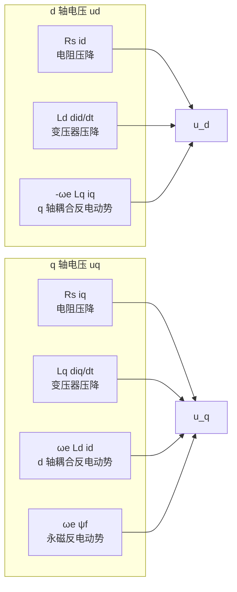
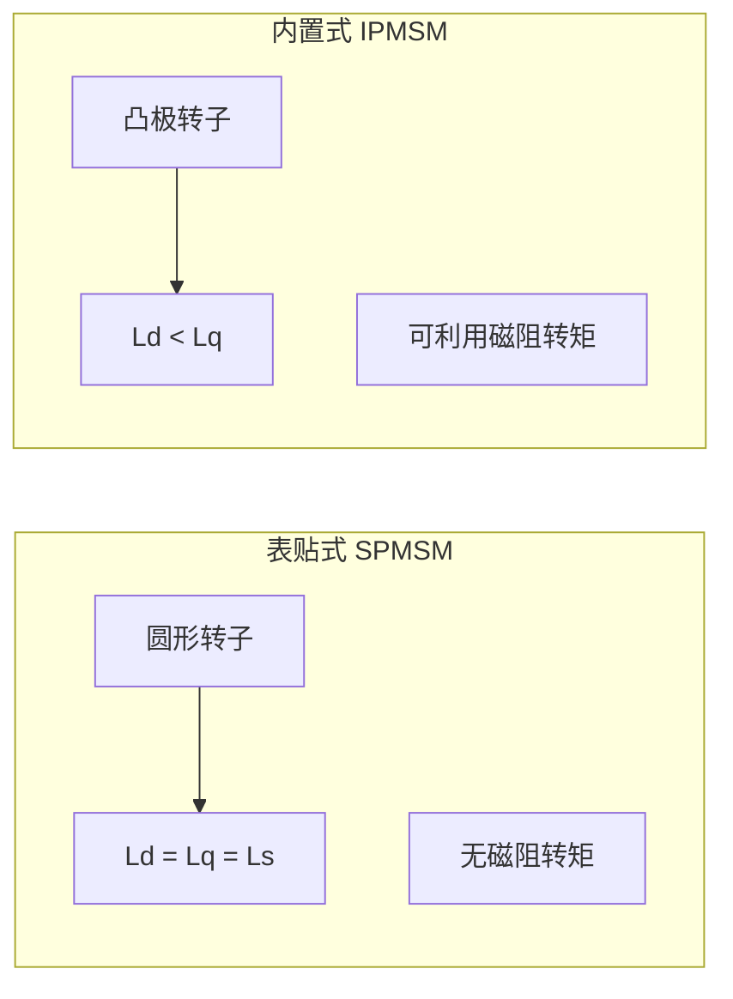

# PMSM电压方程与磁链模型

> **为什么学？**
> 电压方程是 FOC 电流环前馈补偿、电压限幅和弱磁控制的理论依据。如果不理解 $dq$ 轴电感差异、反电动势耦合项和稳态电压约束，设计的前馈电压会偏离实际，高速时电流环饱和、调制比超限，电机无法输出期望转矩。
>
> **在 FOC 中的作用**
> 这一节建立 $dq$ 坐标系下电压-电流-磁链的定量关系；输出用于计算电流环前馈电压、判断是否需要弱磁、估算反电动势，是 SVPWM 输出电压的物理约束来源。

PMSM 的 $dq$ 轴电压方程看起来项很多，但每一项都有明确的物理来源。下图把 $u_d$ 和 $u_q$ 拆成电阻压降、变压器压降、旋转耦合反电动势和永磁反电动势四部分，帮助你在写前馈电压时“对号入座”。



*图：dq 轴电压方程的物理组成*

经过 Clarke 和 Park 变换，我们得到了解耦的 $dq$ 轴电流。但控制器要知道“**给多少电压才能产生期望电流**”，这就需要 $dq$ 轴电压方程；它把电流指令翻译成逆变器需要输出的电压，并揭示高速运行时电压边界在哪里。

## 1. 数学推导

### 1.1 表贴式 vs 内置式 PMSM

为什么要做这一步：电机结构直接决定 $L_d$ 和 $L_q$ 是否相等，进而决定控制策略是简单的 $i_d=0$ 还是需要 MTPA；参数选错会让转矩计算和控制算法完全偏离实际。

永磁同步电机（PMSM）按转子结构分为两类：

- **表贴式（SPMSM, Surface-mounted）**：永磁体贴于转子表面，常在线性基波模型中近似取 $L_d\approx L_q$。
- **内置式（IPMSM, Interior）**：永磁体嵌入转子内部，常见设计具有 $L_d<L_q$ 的凸极特性。饱和、交叉饱和和工作点会改变增量电感，不能把该不等式当作所有工况下的绝对规律。

### 1.2 dq 轴磁链方程

为什么要做这一步：磁链方程把 $dq$ 轴电流与定子磁链联系起来，是推导电压方程和转矩方程的前提；没有它就无法解释反电动势和凸极效应。

在 $dq$ 旋转坐标系中，定子磁链由两部分组成：电流产生的电感磁链和永磁体产生的磁链。

$$\begin{cases}
\psi_d = L_d i_d + \psi_f \\[6pt]
\psi_q = L_q i_q
\end{cases}$$

其中：
- $L_d$、$L_q$ 为 $d$ 轴和 $q$ 轴电感
- $\psi_f$ 为永磁体在 $d$ 轴上的基波磁链；在线性定参数模型中视为常数，实际会随温度和磁饱和变化
- 注意：永磁体磁链仅存在于 $d$ 轴，$q$ 轴方向无永磁体

对于表贴式电机：$L_d = L_q = L_s$，磁链方程简化为：

$$\psi_d = L_s i_d + \psi_f, \quad \psi_q = L_s i_q$$

### 1.3 dq 轴电压方程推导

为什么要做这一步：电压方程告诉我们在 $dq$ 坐标系下，要得到期望电流变化需要施加多少电压；它是电流环前馈、解耦控制和电压限幅的原始公式。

从定子绕组的通用电压方程出发：

$$u = Ri + \frac{d\psi}{dt}$$

在旋转坐标系中，磁链矢量为 $\vec{\psi} = \psi_d + j\psi_q$，其时间导数包含两部分：
- 相对旋转坐标系的变化率：$\frac{d\psi_d}{dt} + j\frac{d\psi_q}{dt}$
- 坐标系旋转引起的附加项：$j\omega_e \vec{\psi}$（由旋转坐标系变换产生）

因此：

$$\vec{u} = R_s \vec{i} + \frac{d\vec{\psi}}{dt} + j\omega_e \vec{\psi}$$

展开为 $d$、$q$ 分量：

$$\begin{cases}
u_d = R_s i_d + \dfrac{d\psi_d}{dt} - \omega_e \psi_q \\[8pt]
u_q = R_s i_q + \dfrac{d\psi_q}{dt} + \omega_e \psi_d
\end{cases}$$

将磁链方程代入：

$$\begin{cases}
u_d = R_s i_d + L_d \dfrac{di_d}{dt} - \omega_e L_q i_q \\[8pt]
u_q = R_s i_q + L_q \dfrac{di_q}{dt} + \omega_e L_d i_d + \omega_e \psi_f
\end{cases}$$

### 1.4 电感矩阵与反电动势模型

为什么要做这一步：反电动势是高速区的主要电压消耗，忽略它会导致电流环输出电压不足；而 $dq$ 轴电感的对角化正是坐标变换带来解耦优势的集中体现。

在 $dq$ 坐标系中，电感矩阵为对角阵：

$$\mathbf{L}_{dq} = \begin{bmatrix} L_d & 0 \\ 0 & L_q \end{bmatrix}$$

这与 $abc$ 坐标系中的满阵电感形成鲜明对比，体现了坐标变换的解耦价值。

反电动势（Back-EMF）定义为旋转坐标系中由磁场运动感应的电压：

$$e_d = -\omega_e \psi_q = -\omega_e L_q i_q$$
$$e_q = \omega_e \psi_d = \omega_e L_d i_d + \omega_e \psi_f$$

在稳态（$di_d/dt = di_q/dt = 0$）且 $i_d = 0$ 时：

$$u_d = -\omega_e L_q i_q$$
$$u_q = R_s i_q + \omega_e \psi_f$$

此时 $q$ 轴永磁反电动势的**相峰值**为 $E_q=\omega_e\psi_f$。若角速度以电角速度 rad/s 表示，则

$$K_{e,\mathrm{phase,pk}}=\frac{E_q}{\omega_e}=\psi_f$$

数据手册常给出线电压 RMS 对机械转速的 $\mathrm{V/krpm}$，这与上式不是同一个基准。正弦反电动势、星形连接时，需要同时考虑线/相、RMS/峰值以及 $\omega_e=p\omega_m$ 后再比较。

---

## 2. 几何直观



```text

  dq轴电压方程的物理意义分解：

      u_d = R*i_d + L_d*di_d/dt  - ω_e*L_q*i_q
            |_____电阻压降_____|  |__变压器压降__|  |__q轴耦合反电动势__|

      u_q = R*i_q + L_q*di_q/dt  + ω_e*L_d*i_d  + ω_e*ψ_f
            |_____电阻压降_____|  |__变压器压降__|  |__d轴耦合__|  |__永磁反电动势__|


  在稳态 Id=0 控制时：
      u_d = -ω_e * L_q * I_q   （负值，用于抵消q轴反电动势投影）
      u_q = R_s * I_q + ω_e * ψ_f  （正值，克服电阻+反电动势）
```

---

## 3. 数值示例

**给定条件**：内置式 PMSM 参数：

- $R_s = 0.5\,\Omega$
- $L_d = 2.0\,\text{mH}$
- $L_q = 4.0\,\text{mH}$
- $\psi_f = 0.1\,\text{Wb}$
- $p = 4$（极对数）
- 转速 $n = 1500\,\text{rpm}$
- 电流指令：$i_d^* = 0$，$i_q^* = 5\,\text{A}$

**步骤 1：计算电角速度**

$$\omega_e = p \cdot \frac{2\pi n}{60} = 4 \times \frac{2\pi \times 1500}{60} = 628.3\,\text{rad/s}$$

**步骤 2：计算磁链**

$$\psi_d = L_d i_d + \psi_f = 0.002 \times 0 + 0.1 = 0.1\,\text{Wb}$$
$$\psi_q = L_q i_q = 0.004 \times 5 = 0.02\,\text{Wb}$$

**步骤 3：计算稳态电压**

$$u_d = R_s i_d - \omega_e \psi_q = 0.5 \times 0 - 628.3 \times 0.02 = -12.57\,\text{V}$$
$$u_q = R_s i_q + \omega_e \psi_d = 0.5 \times 5 + 628.3 \times 0.1 = 2.5 + 62.83 = 65.33\,\text{V}$$

**步骤 4：计算电压幅值与调制比**

$$U_s = \sqrt{u_d^2 + u_q^2} = \sqrt{158.0 + 4278.0} = 66.53\,\text{V}$$

假设直流母线 $U_{dc}=48\,\text{V}$，在本知识库的等幅值相电压空间矢量定义下，SVPWM 线性区上限为 $U_{dc}/\sqrt{3}=27.7\,\text{V}$。由于 $66.53\,\text{V}>27.7\,\text{V}$，该工作点无法在线性调制区实现；可选措施包括降低转速/转矩指令、弱磁、提高母线电压或在评估谐波代价后使用过调制。

**步骤 5：反电动势验证**

$$E = \omega_e \psi_f = 628.3 \times 0.1 = 62.83\,\text{V}$$

与 $u_q$ 计算中的 $62.83\,\text{V}$ 一致，验证了反电动势模型。

---

## 4. 代码实现

### C 语言：PMSM 电压方程计算

```c
#include <math.h>

typedef struct {
    float Rs;      /* 定子电阻 Ω */
    float Ld;      /* d轴电感 H */
    float Lq;      /* q轴电感 H */
    float psi_f;   /* 永磁磁链 Wb */
    int pole_pairs;
} PMSM_Params;

/* 计算dq轴电压（含动态项） */
void PMSM_VoltageEquation(const PMSM_Params* motor, float id, float iq,
                          float did_dt, float diq_dt, float omega_e,
                          float* ud, float* uq) {
    float psid = motor->Ld * id + motor->psi_f;
    float psiq = motor->Lq * iq;
    
    *ud = motor->Rs * id + motor->Ld * did_dt - omega_e * psiq;
    *uq = motor->Rs * iq + motor->Lq * diq_dt + omega_e * psid;
}

/* 稳态电压计算（did/dt = diq/dt = 0） */
void PMSM_SteadyVoltage(const PMSM_Params* motor, float id, float iq,
                        float omega_e, float* ud, float* uq) {
    *ud = motor->Rs * id - omega_e * motor->Lq * iq;
    *uq = motor->Rs * iq + omega_e * (motor->Ld * id + motor->psi_f);
}

/* 反电动势计算 */
float PMSM_BackEMF(const PMSM_Params* motor, float omega_e) {
    return omega_e * motor->psi_f;
}

/* 转速rpm → 电角速度rad/s */
float RPM_to_ElecOmega(float rpm, int pole_pairs) {
    return pole_pairs * 2.0f * 3.14159265f * rpm / 60.0f;
}

/* 计算电压幅值（用于弱磁判断） */
float Voltage_Magnitude(float ud, float uq) {
    return sqrtf(ud*ud + uq*uq);
}

/* 检查是否进入弱磁区：Us > Udc/sqrt(3) */
int Is_FieldWeakeningRequired(float Us, float Udc) {
    float Umax = Udc / 1.7320508f; /* Udc/sqrt(3) */
    return (Us > Umax) ? 1 : 0;
}
```

### MATLAB 仿真验证

```matlab
% PMSM 电压方程验证
Rs = 0.5; Ld = 2e-3; Lq = 4e-3; psi_f = 0.1; p = 4;
n = 1500; omega_e = p * 2*pi*n/60;
id = 0; iq = 5; did_dt = 0; diq_dt = 0;
ud = Rs*id + Ld*did_dt - omega_e*Lq*iq;
uq = Rs*iq + Lq*diq_dt + omega_e*(Ld*id + psi_f);
Us = sqrt(ud^2 + uq^2);
E = omega_e * psi_f;
fprintf('ud = %.2f V, uq = %.2f V, Us = %.2f V\n', ud, uq, Us);
fprintf('反电动势 E = %.2f V\n', E);
```

---

## 5. 常见错误

### 错误 1：忘记反电动势耦合项（$\omega_e \psi_q$ 和 $\omega_e \psi_d$）

**错误表现**：在电流环 PI 控制器设计中，将电压方程简化为纯电阻-电感模型：$u_d = R i_d + L_d \frac{di_d}{dt}$，完全忽略 $-\omega_e L_q i_q$ 耦合项。这导致电流环实际响应与模型严重不符，尤其在高速区，$q$ 轴反电动势投影到 $d$ 轴可达数十伏，使 $d$ 轴电流无法维持为零。

**纠正方法**：
- 高带宽或高速运行时通常应加入交叉耦合与永磁反电动势前馈，并保留 PI 对参数误差的反馈校正；
- $d$ 轴前馈：$u_{d,ff} = -\omega_e L_q i_q$；$q$ 轴前馈：$u_{q,ff} = \omega_e (L_d i_d + \psi_f)$；
- 前馈补偿后，PI 控制器仅需处理电阻-电感的动态误差，大幅减小稳态误差和超调；
- 前馈电流可取指令值、滤波后的测量值或两者组合。指令值噪声小但瞬态失配较大；测量值反映实际状态但会把采样噪声带入电压指令，应结合带宽和延迟选择。

### 错误 2：混淆 $L_d$ 和 $L_q$（凸极效应）

**错误表现**：将具有明显凸极性的 IPMSM 当作 $L_d=L_q$ 处理。这样会使交叉耦合前馈不准确，也会破坏依赖 $L_d-L_q$ 的 MTPA 轨迹。实际 $L_d$、$L_q$ 还可能随电流幅值和相角变化，单一常数只是在限定工作区间内的近似。

**纠正方法**：
- 电机选型后必须确认 $L_d$ 和 $L_q$ 的实测值；
- 对 IPMSM 在代码中分别定义 $L_d$、$L_q$；只有经过验证的近似 SPMSM 模型才共用 $L_s$；
- 参数辨识流程中，需分别测量 $d$ 轴和 $q$ 轴电感（如通过高频注入或电压阶跃响应）；
- 验证：$L_d\neq L_q$ 表示存在产生磁阻转矩的条件；实际磁阻转矩还要求 $i_d i_q\neq0$，并受符号约定与运行象限影响。

---

## 6. 自测习题

### 习题 1

某表贴式 PMSM 参数：$R_s = 0.8\,\Omega$，$L_d = L_q = 5\,\text{mH}$，$\psi_f = 0.08\,\text{Wb}$，$p = 2$。电机运行于 $2000\,\text{rpm}$，电流指令 $i_d = 0$，$i_q = 3\,\text{A}$。

(1) 计算电角速度 $\omega_e$；
(2) 计算稳态 $u_d$ 和 $u_q$；
(3) 若直流母线 $U_{dc} = 24\,\text{V}$，判断是否已超出线性调制区（$U_{max} = U_{dc}/\sqrt{3}$）。

**答案**：
(1) $\omega_e = 2 \times 2\pi \times 2000 / 60 = 418.9\,\text{rad/s}$

(2) $u_d = 0.8 \times 0 - 418.9 \times 0.005 \times 3 = -6.28\,\text{V}$

$u_q = 0.8 \times 3 + 418.9 \times 0.08 = 2.4 + 33.51 = 35.91\,\text{V}$

(3) $U_s = \sqrt{(-6.28)^2 + 35.91^2} = 36.46\,\text{V}$；$U_{max} = 24/\sqrt{3} = 13.86\,\text{V}$。$36.46 > 13.86$，已严重超出线性调制区，必须实施弱磁控制或大幅提高母线电压。

### 习题 2

从电压方程出发，推导表贴式 PMSM 在 $i_d = 0$ 稳态运行时的电流环传递函数（以 $q$ 轴为例）。并说明 $R_s$ 和 $L_q$ 在参数辨识中的重要性。

**答案**：

在固定转速工作点附近，若交叉耦合和永磁反电动势由前馈补偿或视为小信号扰动，$q$ 轴增量电压方程为：

$$\delta u_q=R_s\,\delta i_q+L_q\frac{d\,\delta i_q}{dt}$$

拉普拉斯变换得增量对象：

$$\frac{\delta I_q(s)}{\delta U_q(s)} = \frac{1}{R_s+sL_q}=\frac{1/R_s}{1+s\tau_q}$$

其中 $\tau_q=L_q/R_s$。一种常见整定方法是把 PI 零点放在 $R_s/L_q$ 附近，但数字延迟、PWM/采样保持、电压饱和和参数随温度变化同样限制可实现带宽；参数辨识精度是重要因素，但不是电流环性能的唯一决定因素。

---

> 关键记忆点：在本文符号约定下，$d$ 轴电压方程含 $-\omega_eL_qi_q$，$q$ 轴含 $+\omega_e(L_di_d+\psi_f)$；$E_q=\omega_e\psi_f$ 是相峰值/电角速度基准下的关系；$L_d\approx L_q$ 与 $L_d<L_q$ 分别是常见 SPMSM、IPMSM 的局部模型，不是脱离工作点的绝对分类规则。
