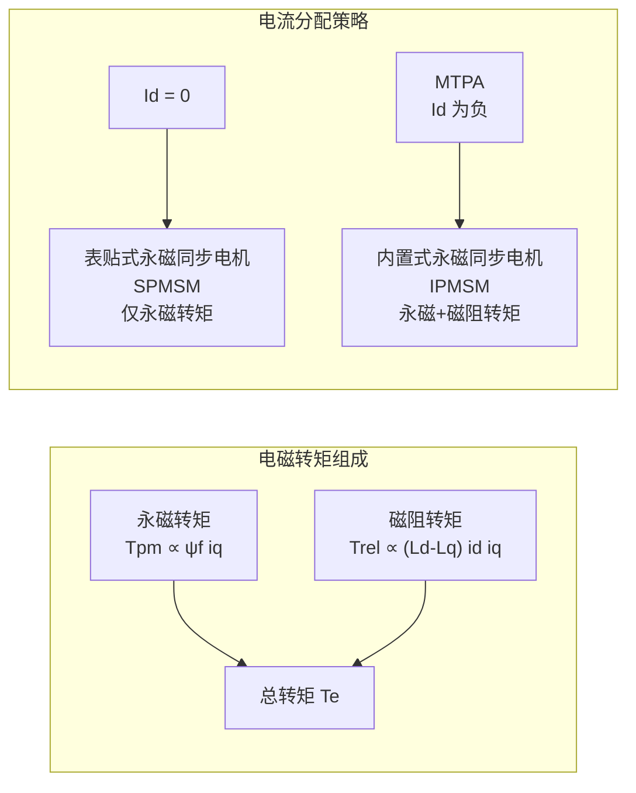
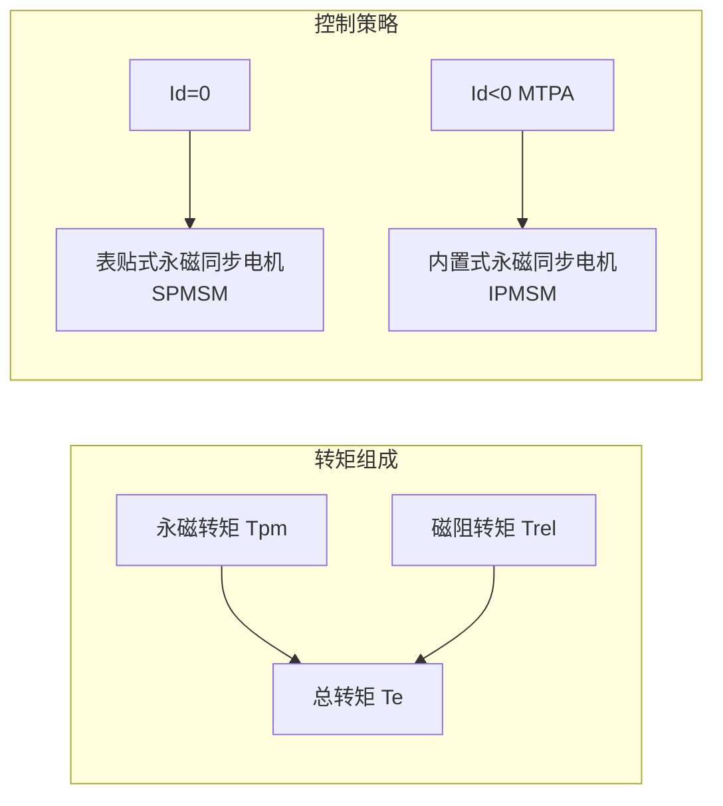

# 转矩方程与机电能量转换

> **为什么学？**
> 转矩方程是磁场定向控制（FOC, Field-Oriented Control）转矩环和电流指令生成的直接依据。如果不理解永磁转矩与磁阻转矩的组成、$I_d=0$ 与最大转矩电流比（MTPA, Maximum Torque Per Ampere）的适用场景，会错误分配 $i_d$ 和 $i_q$，导致同样电流下输出转矩不足、效率低下或电机发热加剧。
>
> **在磁场定向控制（FOC, Field-Oriented Control）中的作用**
> 这一节根据期望转矩计算所需的 $d$、$q$ 轴电流；输出电流指令 $i_d^*, i_q^*$ 给电流环，是实现转矩控制、效率优化（MTPA）和弱磁控制的起点。

电磁转矩可以看成“永磁体与 $q$ 轴电流相互作用”产生的永磁转矩，加上“凸极效应带来的磁阻转矩”两部分。下图同时展示了这两部分与 $i_d、i_q$ 的对应关系，以及工程上常见的两种电流分配策略。



*图：电磁转矩的组成与 Id=0 / MTPA 策略*

FOC 的终极目标是通过控制电流来控制转矩。转矩方程把 $dq$ 轴电流与电磁转矩定量联系起来，让我们能够根据期望转矩反向求出应该注入的电流，实现“转矩指令 → 电流指令 → 电压指令”的完整映射。

## 1. 数学推导

### 1.1 电磁转矩的推导

为什么要做这一步：只有从能量守恒严格推出转矩公式，才能确信 $i_d$ 和 $i_q$ 对转矩的贡献方式，避免工程实现中漏掉 $3/2$、极对数 $p$ 或磁阻项。

本知识库采用**等幅值 Clarke + 正交 Park** 约定，因此 $dq$ 变量的瞬时功率要乘 $3/2$。这里直接从功率平衡推导，避免把不同坐标归一化下的磁共能表达式混在一起。假设三相对称、磁路线性，且 $L_d$、$L_q$、$\psi_f$ 在所分析工作点附近视为常数。

$dq$ 坐标系下的输入电功率：

$$P_{in} = \frac{3}{2}(u_d i_d + u_q i_q)$$

将电压方程代入：

$$P_{in} = \frac{3}{2}\left[ R_s(i_d^2 + i_q^2) + \left(i_d \frac{d\psi_d}{dt} + i_q \frac{d\psi_q}{dt}\right) + \omega_e(\psi_d i_q - \psi_q i_d) \right]$$

括号内前两类项分别对应铜损与磁场能量变化，第三项 $\omega_e(\psi_d i_q-\psi_q i_d)$ 对应机电转换功率。由于 $\omega_e=p\omega_m$，电磁转矩为：

$$T_e = \frac{P_{em}}{\omega_m} = \frac{P_{em}}{\omega_e / p} = \frac{3}{2}p(\psi_d i_q - \psi_q i_d)$$

将磁链方程 $\psi_d = L_d i_d + \psi_f$、$\psi_q = L_q i_q$ 代入：

$$\boxed{T_e = \frac{3}{2}p\left[\psi_f i_q + (L_d - L_q)i_d i_q\right]}$$

### 1.2 转矩分量的物理意义

电磁转矩由两部分组成：

- **永磁转矩**（$T_{pm}$）：由永磁体磁场与 $q$ 轴电流相互作用产生
  $$T_{pm} = \frac{3}{2}p\psi_f i_q$$
  与 $i_q$ 成正比，适用于所有永磁同步电机（PMSM, Permanent Magnet Synchronous Motor）。

- **磁阻转矩**（$T_{rel}$）：由凸极效应（$L_d \neq L_q$）和 $d$ 轴电流共同产生
  $$T_{rel} = \frac{3}{2}p(L_d - L_q)i_d i_q$$
  对于内置式永磁同步电机（IPMSM, Interior Permanent Magnet Synchronous Motor）（$L_q > L_d$），令 $i_d < 0$ 可使磁阻转矩为正，增强总输出。

### 1.3 Id=0 控制时的转矩关系

当 $i_d = 0$（表贴式电机的标准控制策略）：

$$T_e = \frac{3}{2}p\psi_f i_q$$

转矩与 $q$ 轴电流呈线性关系，控制最为简单。此时 $d$ 轴电流不产生转矩，仅用于弱磁（$i_d < 0$）时改变磁链。

### 1.4 MTPA 条件初步推导

为什么要做这一步：在电流容量受限时，MTPA 通过合理分配 $i_d$ 和 $i_q$ 使单位电流产生最大转矩，从而降低给定转矩下的铜损。以下闭式公式只适用于参数恒定、忽略饱和和交叉耦合的线性 IPMSM 模型；实际电机常用标定表或在线修正。

最大转矩电流比（MTPA）要求在定子电流幅值 $I_s = \sqrt{i_d^2 + i_q^2}$ 约束下最大化转矩。

构造拉格朗日函数：

$$\mathcal{L} = T_e + \lambda(I_s^2 - i_d^2 - i_q^2)$$

求偏导并令为零：

$$\frac{\partial T_e}{\partial i_d} = \frac{3}{2}p(L_d - L_q)i_q = 2\lambda i_d$$
$$\frac{\partial T_e}{\partial i_q} = \frac{3}{2}p[\psi_f + (L_d - L_q)i_d] = 2\lambda i_q$$

消去 $\lambda$ 得 MTPA 条件：

$$\boxed{i_d = \frac{\psi_f}{2(L_q - L_d)} - \sqrt{\frac{\psi_f^2}{4(L_q - L_d)^2} + i_q^2}}$$

或更简洁的形式：

$$i_d = \frac{\psi_f - \sqrt{\psi_f^2 + 4(L_q - L_d)^2 i_q^2}}{2(L_q - L_d)}$$

### 1.5 机电能量转换

为什么要做这一步：理解电功率如何分配为铜损、磁能变化和机械功率，有助于评估控制策略的效率边界，解释为什么高速小电流时效率高、低速大转矩时铜损占主导。

若暂不计逆变器损耗，并把铁耗、机械损耗作为附加损耗，可写出一个工作点功率平衡近似：

$$P_{in}\approx T_e\omega_m+\frac{3}{2}R_s(i_d^2+i_q^2)+P_{iron}$$

轴端输出功率应使用 $P_{shaft}=T_{shaft}\omega_m=T_e\omega_m-P_{mech}$，整机效率还要计入逆变器和辅助电源损耗。因此不能直接把 $T_e\omega_m/P_{in}$ 称为轴端效率。低速大转矩区通常以铜损为主；高速区虽然同转矩所需电流可能下降，但铁耗、风摩和开关损耗可能上升，不能笼统断言“高速效率更高”。对理想 SPMSM，给定转矩下 $i_d=0$ 可最小化电流；对 IPMSM，应使用 MTPA 而不是把 $i_d=0$ 当作最小铜损条件。

---

## 2. 几何直观



### 电流空间矢量与转矩分量

永磁转矩来自 $q$ 轴电流与 $d$ 轴永磁磁链的相互作用，方向由 $\psi_f \times i_q$ 决定；磁阻转矩则来自 $d$ 轴去磁电流引起的磁通“偏转”，与 $(L_d - L_q)i_d i_q$ 成正比。下图以 $i_d < 0$、$i_q > 0$ 为例，标出两个电流分量与转矩方向。

![[14-FOC-电机控制/assets/torque_components.png|1500]]
*图：$d$ 轴永磁磁链 $\psi_f$、定子电流 $\vec{i}_s$ 及其 $d/q$ 分量；$T_e$ 为垂直于 $dq$ 平面的输出转矩*

### MTPA 轨迹与恒转矩曲线

对内置式永磁同步电机（IPMSM），最大转矩电流比（MTPA）轨迹是 $i_d$-$i_q$ 平面上的一条曲线；同一转矩可以用不同的 $(i_d, i_q)$ 组合实现，而 MTPA 点正是该转矩曲线上电流幅值最小的点。下图同时画出 MTPA 轨迹、几条恒转矩曲线和电流限制圆。

![[14-FOC-电机控制/assets/mtpa_trajectory.png|1500]]
*图：MTPA 轨迹与恒转矩曲线的交点即为该转矩下的最小电流工作点；$I_d=0$ 只是其中一种特殊策略*

---

## 3. 数值示例

**给定条件**：内置式 IPMSM 参数：

- $p = 4$
- $\psi_f = 0.12\,\text{Wb}$
- $L_d = 3.0\,\text{mH}$
- $L_q = 6.0\,\text{mH}$
- 电流指令：$i_d = -2\,\text{A}$，$i_q = 4\,\text{A}$

**步骤 1：永磁转矩**

$$T_{pm} = \frac{3}{2} \times 4 \times 0.12 \times 4 = 2.88\,\text{N·m}$$

**步骤 2：磁阻转矩**

$$T_{rel} = \frac{3}{2} \times 4 \times (0.003 - 0.006) \times (-2) \times 4$$
$$= 6 \times (-0.003) \times (-8) = 0.144\,\text{N·m}$$

注意：$L_d - L_q = -3\,\text{mH}$，$i_d = -2\,\text{A}$，因此 $T_{rel} > 0$。

**步骤 3：总转矩**

$$T_e = T_{pm} + T_{rel} = 2.88 + 0.144 = 3.024\,\text{N·m}$$

**步骤 4：给定 $i_q$ 时与 $i_d=0$ 对比**

若强制 $i_d = 0$，$i_q = 4\,\text{A}$：

$$T_e = \frac{3}{2} \times 4 \times 0.12 \times 4 = 2.88\,\text{N·m}$$

这个**非最优测试点**带来额外 $0.144\,\text{N·m}$（提升 $5\%$），但总电流幅值也增大：

- $Id=0$：$I_s = 4\,\text{A}$
- 测试点：$I_s = \sqrt{(-2)^2 + 4^2} = 4.47\,\text{A}$

**步骤 5：相同转矩下的电流比较**

若要求 $T_e = 3.024\,\text{N·m}$：
- 上述测试点：$I_s = 4.47\,\text{A}$
- $Id=0$：需要 $i_q = 3.024 / (6 \times 0.12) = 4.2\,\text{A}$，$I_s = 4.2\,\text{A}$

可见，上述 $(-2,4)\,\text{A}$ 并不是 MTPA 点：它甚至比 $i_d=0$ 使用更多电流。MTPA 的比较必须在相同转矩或相同电流幅值下进行，并满足前述最优条件。

**步骤 6：MTPA 轨迹计算**

对上述电机，求 MTPA 条件下的 $i_d$ 与 $i_q$ 关系：

$$i_d = \frac{0.12}{2(0.006 - 0.003)} - \sqrt{\frac{0.12^2}{4(0.003)^2} + i_q^2}$$
$$= 20 - \sqrt{400 + i_q^2}$$

当 $i_q = 4\,\text{A}$ 时：$i_d = 20 - \sqrt{416} = 20 - 20.4 = -0.4\,\text{A}$（最优 $i_d$ 约 $-0.4\,\text{A}$，而非本例的 $-2\,\text{A}$）。

---

## 4. 代码实现

### C 语言：转矩计算与 MTPA 条件

```c
#include <math.h>

typedef struct {
    float p;        /* 极对数 */
    float psi_f;    /* 永磁磁链 Wb */
    float Ld;       /* d轴电感 H */
    float Lq;       /* q轴电感 H */
} Motor_Params;

/* 电磁转矩计算 */
float Calc_Torque(const Motor_Params* motor, float id, float iq) {
    float T_pm = 1.5f * motor->p * motor->psi_f * iq;
    float T_rel = 1.5f * motor->p * (motor->Ld - motor->Lq) * id * iq;
    return T_pm + T_rel;
}

/* Id=0 时的转矩 */
float Calc_Torque_IdZero(const Motor_Params* motor, float iq) {
    return 1.5f * motor->p * motor->psi_f * iq;
}

/* MTPA 条件：给定 iq，求最优 id */
float MTPA_Id(const Motor_Params* motor, float iq) {
    float delta_L = motor->Lq - motor->Ld;  /* 必须 > 0 */
    if (delta_L < 1e-6f) return 0.0f;       /* 表贴式无磁阻转矩 */
    float term = motor->psi_f / (2.0f * delta_L);
    return term - sqrtf(term * term + iq * iq);
}

/* 给定转矩指令，按 MTPA 分解 id, iq */
void MTPA_Currents(const Motor_Params* motor, float T_ref, float* id, float* iq) {
    /* 迭代求解：可用牛顿法或查表 */
    /* 简化：先假设 id=0 估算 iq，再修正 */
    float iq_est = T_ref / (1.5f * motor->p * motor->psi_f);
    *id = MTPA_Id(motor, iq_est);
    /* 根据 id 修正 iq */
    float denominator = 1.5f * motor->p * (motor->psi_f + (motor->Ld - motor->Lq) * (*id));
    *iq = T_ref / denominator;
}

/* 计算总电流幅值 */
float Current_Magnitude(float id, float iq) {
    return sqrtf(id*id + iq*iq);
}
```

### MATLAB 转矩仿真

```matlab
% 转矩与电流关系仿真
p = 4; psi_f = 0.12; Ld = 3e-3; Lq = 6e-3;
iq = 0:0.1:10;
% Id=0 时
T_id0 = 1.5*p*psi_f*iq;
% MTPA 时
id_mtpa = psi_f/(2*(Lq-Ld)) - sqrt((psi_f/(2*(Lq-Ld)))^2 + iq.^2);
T_mtpa = 1.5*p*(psi_f*iq + (Ld-Lq)*id_mtpa.*iq);
figure; plot(iq, T_id0, iq, T_mtpa);
legend('Id=0', 'MTPA'); xlabel('Iq (A)'); ylabel('Torque (N.m)');
```

---

## 5. 常见错误

### 错误 1：转矩方程中漏掉系数 $3/2$ 或极对数 $p$

**错误表现**：不同资料可能采用等幅值、等功率或其他变量归一化；若只复制公式而不核对变换矩阵、峰值/RMS 定义和磁链定义，会产生固定比例误差。极对数 $p$ 的遗漏则会直接造成转矩换算错误。

**纠正方法**：
- 明确约定：本知识库采用**等幅值** $dq$ 变量，故转矩公式为 $T_e=\frac{3}{2}p(\psi_d i_q-\psi_q i_d)$；若采用等功率变量，公式形式不含 $3/2$；
- 代码中检查：给定额定电流和额定转矩，反推计算是否匹配电机铭牌参数；
- 单位验证：$\psi_f$ [Wb] × $i_q$ [A] = [Wb·A] = [N·m]，再乘无量纲的 $3/2$ 和 $p$ 后仍为 [N·m]；
- 在本约定且 $i_d=0$ 时，对 $q$ 轴峰值电流有 $K_{t,q}=\frac{3}{2}p\psi_f$。数据手册的 $K_t$ 可能按相电流 RMS、线电流 RMS 或峰值定义，比较前必须换算到同一电流基准。

### 错误 2：磁阻转矩符号错误

**错误表现**：在 IPMSM 中，磁阻转矩项为 $(L_d - L_q)i_d i_q$。因 $L_q > L_d$（内置式），$(L_d - L_q) < 0$。若错误令 $i_d > 0$（而非 $i_d < 0$），磁阻转矩为负，与永磁转矩相抵消，总转矩下降而非提升。

**纠正方法**：
- 记住凸极比 $\rho = L_q / L_d > 1$；
- 在 $L_q>L_d$ 的常见 IPMSM 正向电动工况中，MTPA 通常取 $i_d<0$、$i_q>0$；再生或反向工况下 $i_q$ 的符号随转矩方向改变；
- 用右手定则判断：$d$ 轴削弱后，磁通“偏向”$q$ 轴，产生正向切向力；
- 在 MTPA 查表或公式中，始终输出负的 $i_d$（或零，但不会为正）。

---

## 6. 自测习题

### 习题 1

某内置式 PMSM：$p = 4$，$\psi_f = 0.15\,\text{Wb}$，$L_d = 2.5\,\text{mH}$，$L_q = 5.0\,\text{mH}$。给定定子电流幅值 $I_s = 6\,\text{A}$，按 MTPA 条件分配 $i_d$ 和 $i_q$。

(1) 计算 MTPA 条件下的 $i_d$ 和 $i_q$；
(2) 计算总转矩 $T_e$；
(3) 若强制 $i_d = 0$，在相同 $I_s = 6\,\text{A}$ 下转矩为多少？

**答案**：
(1) MTPA 条件：$i_d = \frac{\psi_f}{2(L_q - L_d)} - \sqrt{\frac{\psi_f^2}{4(L_q - L_d)^2} + i_q^2}$

设 $i_d^2 + i_q^2 = I_s^2 = 36$，联立求解。令 $A = \frac{\psi_f}{2(L_q - L_d)} = \frac{0.15}{2 \times 0.0025} = 30$。

由 MTPA 条件：$i_d = 30 - \sqrt{900 + i_q^2}$，结合 $i_d^2 + i_q^2 = 36$。

数值求解得到：$i_d\approx-0.588\,\text{A}$，$i_q\approx5.971\,\text{A}$。校验：$\sqrt{i_d^2+i_q^2}\approx6.000\,\text{A}$。

(2) $T_e=6\times[0.15\times5.971+(-0.0025)(-0.588)(5.971)]\approx5.427\,\text{N·m}$

(3) $i_d=0$ 时 $i_q=6\,\text{A}$：$T_e=6\times0.15\times6=5.40\,\text{N·m}$。本组参数下 MTPA 提升约 $0.5\%$；原因是永磁转矩占主导，不能只凭凸极比判断收益。

### 习题 2

从功率平衡出发，严格证明电磁转矩公式 $T_e = \frac{3}{2}p(\psi_d i_q - \psi_q i_d)$。

**答案**：

$dq$ 坐标系输入电功率：$P_{in} = \frac{3}{2}(u_d i_d + u_q i_q)$（系数 $3/2$ 来自等幅值变换的功率关系）。

代入电压方程：

$$P_{in} = \frac{3}{2}\left[ R_s(i_d^2 + i_q^2) + i_d \frac{d\psi_d}{dt} + i_q \frac{d\psi_q}{dt} + \omega_e(\psi_d i_q - \psi_q i_d) \right]$$

各项物理意义：
- 第一项：铜损 $P_{cu} = \frac{3}{2}R_s(i_d^2 + i_q^2)$
- 第二、三项：磁场储能变化率 $dW_m/dt$
- 第四项：电磁功率 $P_{em} = \frac{3}{2}\omega_e(\psi_d i_q - \psi_q i_d)$

电磁转矩：$T_e = P_{em} / \omega_m = P_{em} / (\omega_e / p) = \frac{3}{2}p(\psi_d i_q - \psi_q i_d)$。证毕。

---

> 关键记忆点：转矩 = 永磁转矩 + 磁阻转矩；$T_e = \frac{3}{2}p(\psi_f i_q + (L_d - L_q)i_d i_q)$；IPMSM 的 MTPA 需 $i_d < 0$；系数 $3/2$ 和极对数 $p$ 缺一不可。
