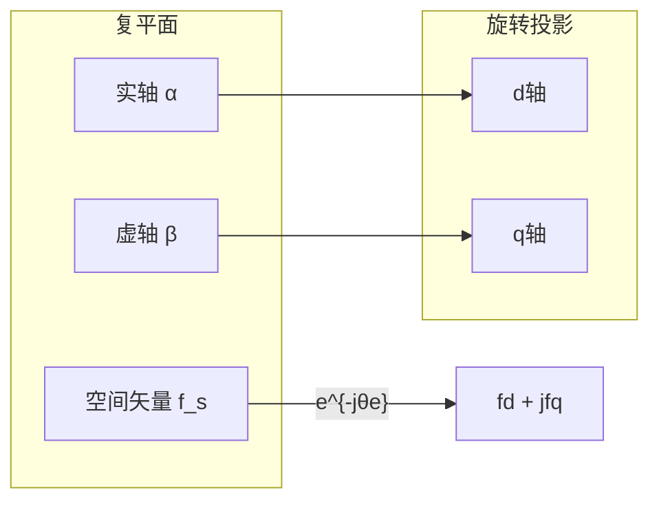

# 坐标变换的复数与矩阵表示

> **为什么学？**
> 复数/矩阵表示是理解 Clarke/Park 变换本质、验证代码实现一致性的工具。如果不理解空间矢量和旋转算子，容易在代码中写错旋转方向、混淆 $2/3$ 与 $\sqrt{2/3}$ 系数，导致 Park 逆变换输出电压反向或功率计算偏差。
>
> **在磁场定向控制（FOC, Field-Oriented Control）中的作用**
> 这一节提供统一的数学语言描述 $abc \to \alpha\beta \to dq$ 的完整变换链；用于推导复合变换矩阵、减少实时运算量，并帮助验证矩阵形式与复数形式代码是否等价。

Clarke、Park 以及它们的复合矩阵，本质上是同一套“坐标系升级”：从三维的 $abc$ 自然坐标系，降到二维静止的 $\alpha\beta$，再旋转到与转子同步的 $dq$。下图标出每一步的维度、变量形式和零序处理方式，方便你对比矩阵形式、复数形式和代码实现是否一致。


*图：坐标变换统一框架——从 abc 到 αβ 再到 dq*

前面的笔记分别介绍了 Clarke 和 Park 变换的公式与代码。复数与矩阵表示把这些碎片统一成一个空间矢量框架，让我们看清“三相交流 → 静止矢量 → 旋转直流”背后的同一套数学结构，也为优化代码和排查符号错误提供依据。

## 1. 数学推导

### 1.1 空间矢量概念

为什么要做这一步：空间矢量是 Clarke/Park 变换的统一数学抽象，掌握它就能一眼看出矩阵形式和复数形式只是同一变换的不同写法，避免被不同教材的符号差异搞混。

三相系统的物理量（电流、电压、磁链）不仅具有时间变化特性，还分布在空间中。Clarke 和 Park 变换的深层本质是构建**空间矢量（Space Vector）**，将三相标量场映射到复平面上的旋转矢量。

定义三相变量 $f_a, f_b, f_c$，空间矢量 $\vec{f}$ 为：

$$\vec{f} = f_\alpha + j f_\beta = \frac{2}{3}\left(f_a + a f_b + a^2 f_c\right)$$

其中 $a = e^{j2\pi/3} = -\frac{1}{2} + j\frac{\sqrt{3}}{2}$ 为 $120°$ 旋转算子，$a^2 = e^{j4\pi/3} = -\frac{1}{2} - j\frac{\sqrt{3}}{2}$，满足 $1 + a + a^2 = 0$。

### 1.2 复数表示的 Clarke 变换

为什么要做这一步：复数 Clarke 变换把三相电流直接合成一个复平面上的矢量，旋转算子 $a = e^{j120°}$ 自动携带了 $120°$ 相位信息，让三相到两相的映射更直观。

将 $a$ 和 $a^2$ 代入空间矢量定义：

$$\vec{f} = \frac{2}{3}\left[f_a + \left(-\frac{1}{2} + j\frac{\sqrt{3}}{2}\right)f_b + \left(-\frac{1}{2} - j\frac{\sqrt{3}}{2}\right)f_c\right]$$

分离实部和虚部：

$$f_\alpha = \frac{2}{3}\left(f_a - \frac{1}{2}f_b - \frac{1}{2}f_c\right)$$
$$f_\beta = \frac{2}{3}\left(\frac{\sqrt{3}}{2}f_b - \frac{\sqrt{3}}{2}f_c\right)$$

这正是 Clarke 等幅值变换的复数形式。可见，复数表示与矩阵变换完全等价。

### 1.3 复数表示的 Park 变换

为什么要做这一步：复数 Park 变换把旋转矩阵简化为乘以 $e^{-j\theta_e}$，旋转方向由指数符号决定；这能帮我们快速判断代码中正变换和逆变换是否写反。

Park 变换在复数域中表现为乘以旋转因子 $e^{-j\theta_e}$：

$$\vec{f}_{dq} = f_d + j f_q = \vec{f}_{\alpha\beta} \cdot e^{-j\theta_e}$$

展开验证：

$$f_d + j f_q = (f_\alpha + j f_\beta)(\cos\theta_e - j\sin\theta_e)$$
$$= (f_\alpha \cos\theta_e + f_\beta \sin\theta_e) + j(f_\beta \cos\theta_e - f_\alpha \sin\theta_e)$$

因此：

$$f_d = f_\alpha \cos\theta_e + f_\beta \sin\theta_e$$
$$f_q = -f_\alpha \sin\theta_e + f_\beta \cos\theta_e$$

与矩阵形式的 Park 变换完全一致。

### 1.4 变换矩阵的张量形式

为什么要做这一步：把 Clarke 和 Park 的矩阵相乘可直接检查符号与归一化是否一致，也便于编译器做常量折叠。是否比两级实现更快取决于具体公式、硬件指令和编译器，应以周期测量为准。

将 Clarke 和 Park 变换统一为复合变换：

$$\begin{bmatrix} f_d \\ f_q \end{bmatrix} = 
\underbrace{\begin{bmatrix} \cos\theta_e & \sin\theta_e \\ -\sin\theta_e & \cos\theta_e \end{bmatrix}}_{C_{\alpha\beta}^{dq}}
\underbrace{\frac{2}{3}\begin{bmatrix} 1 & -\frac{1}{2} & -\frac{1}{2} \\ 0 & \frac{\sqrt{3}}{2} & -\frac{\sqrt{3}}{2} \end{bmatrix}}_{C_{abc}^{\alpha\beta}}
\begin{bmatrix} f_a \\ f_b \\ f_c \end{bmatrix}$$

直接相乘得到 $abc \to dq$ 的复合变换矩阵：

$$C_{abc}^{dq} = \frac{2}{3}\begin{bmatrix} \cos\theta_e & \cos(\theta_e - 120°) & \cos(\theta_e + 120°) \\ -\sin\theta_e & -\sin(\theta_e - 120°) & -\sin(\theta_e + 120°) \end{bmatrix}$$

这与前文直接展开的结果一致。工程代码通常不会调用通用矩阵乘法，而是手工展开并复用 $\sin\theta_e$、$\cos\theta_e$；复合矩阵的主要价值是统一推导和测试基准，性能收益需要在目标 MCU 上验证。

### 1.5 统一变换框架

所有电机坐标变换可统一描述为：

$$\vec{f}_{xyz} = C \cdot \vec{f}_{uvw}$$

对包含零序的 $3\times3$ 等功率 Clarke 矩阵，有 $C^{-1}=C^T$。等幅值 Clarke 的正、逆矩阵应按各自定义成对使用；若省略零序，$2\times3$ 映射本身不是普通方阵，只有把输入限制在 $f_a+f_b+f_c=0$ 的二维子空间后才可逆，不能笼统写成 $C^{-1}=kC^T$。

统一框架下的三种常用坐标系：

| 坐标系 | 维度 | 特点 |
|--------|------|------|
| $abc$ 自然坐标系 | 3 | 物理量直接测量，含零序 |
| $\alpha\beta$ 静止坐标系 | 2 | 零序被单独处理或省略，基波量仍随时间变化 |
| $dq$ 旋转坐标系 | 2 | 零序被单独处理或省略，同步基波量在稳态时近似为常值 |

---

## 2. 几何直观



从复数平面看，空间矢量 $\vec{f}_s$ 就是 $\alpha\beta$ 坐标系中的一个旋转相量；Park 变换相当于把坐标系本身旋转 $-\theta_e$，也就是把 $\vec{f}_s$ 投影到随转子一起转的 $dq$ 轴上。下图把这一投影关系画出来：$d$ 轴与 $\alpha$ 轴夹角为 $\theta_e$，$q$ 轴超前 $d$ 轴 $90°$，矢量在 $dq$ 轴上的投影分别是 $f_d$ 和 $f_q$。

![[14-FOC-电机控制/assets/complex_space_vector.png|1500]]
*图：复数平面中，$\vec{f}_{dq} = \vec{f}_{\alpha\beta} \cdot e^{-j\theta_e}$ 的几何意义——把旋转的 $dq$ 轴当作新坐标轴对 $\vec{f}_s$ 做投影*

三相平衡时，空间矢量 $\vec{f}_s$ 以角速度 $\omega$ 匀速旋转，轨迹为圆。Park 变换将其乘以 $e^{-j\theta_e}$，若 $\theta_e = \omega t$，则 $\vec{f}_{dq} = \vec{f}_s \cdot e^{-j\omega t} = \text{常数}$（静止于复平面）。

这正是 FOC 的核心：将交流跟踪问题转化为直流控制问题。

---

## 3. 数值示例

**给定条件**：三相电流：

$$i_a = 6\cos(314t)\,\text{A}, \quad i_b = 6\cos(314t - 120°)\,\text{A}, \quad i_c = 6\cos(314t + 120°)\,\text{A}$$

取 $t = 0$ 时刻：$i_a = 6$，$i_b = -3$，$i_c = -3$。

**步骤 1：复数 Clarke 变换**

$$\vec{i} = \frac{2}{3}\left[6 + (-\frac{1}{2} + j\frac{\sqrt{3}}{2})(-3) + (-\frac{1}{2} - j\frac{\sqrt{3}}{2})(-3)\right]$$
$$= \frac{2}{3}\left[6 + 1.5 - j\frac{3\sqrt{3}}{2} + 1.5 + j\frac{3\sqrt{3}}{2}\right]$$
$$= \frac{2}{3} \times 9 = 6 + j0$$

即 $i_\alpha = 6\,\text{A}$，$i_\beta = 0$。电流矢量恰好落在实轴上。

**步骤 2：复数 Park 变换（$\theta_e = 0$）**

$$\vec{i}_{dq} = \vec{i}_{\alpha\beta} \cdot e^{-j0} = 6 + j0$$

即 $i_d = 6\,\text{A}$，$i_q = 0$。电流矢量与 $d$ 轴对齐。

**步骤 3：复数 Park 变换（$\theta_e = 90°$）**

$$\vec{i}_{dq} = 6 \cdot e^{-j90°} = 6(\cos90° - j\sin90°) = -j6$$

即 $i_d = 0$，$i_q = -6\,\text{A}$。电流矢量与 $q$ 轴对齐（负方向）。

**步骤 4：零序分量验证**

$$i_0 = \frac{1}{3}(i_a + i_b + i_c) = \frac{1}{3}(6 - 3 - 3) = 0$$

零序为零，空间矢量幅值等于三相合成幅值：$|\vec{i}| = \sqrt{6^2 + 0^2} = 6\,\text{A}$，与 $i_a$ 峰值一致（等幅值变换特性）。

**步骤 5：不平衡情况的零序**

若 $i_a = 6$，$i_b = -3$，$i_c = -2$（故意不平衡）：

$$i_0 = \frac{1}{3}(6 - 3 - 2) = \frac{1}{3} \neq 0$$

$$\vec{i} = \frac{2}{3}\left[6 + (-3)(-\frac{1}{2} + j\frac{\sqrt{3}}{2}) + (-2)(-\frac{1}{2} - j\frac{\sqrt{3}}{2})\right]$$
$$= \frac{2}{3}\left[6 + 1.5 - j\frac{3\sqrt{3}}{2} + 1 + j\sqrt{3}\right] = \frac{2}{3}(8.5 - j0.866) = 5.67 - j0.577$$

此时零序分量被变换排除在空间矢量之外，只保留 $\alpha\beta$ 分量。

---

## 4. 代码实现

### C 语言：复数形式坐标变换

```c
#include <math.h>

/* 复数结构体 */
typedef struct {
    float real;  /* 实部 α 或 d */
    float imag;  /* 虚部 β 或 q */
} Complex;

/* 复数乘法：z = x * y */
Complex Complex_Multiply(Complex x, Complex y) {
    Complex z;
    z.real = x.real * y.real - x.imag * y.imag;
    z.imag = x.real * y.imag + x.imag * y.real;
    return z;
}

/* Clarke 变换（复数形式） */
Complex Clarke_Complex(float ia, float ib, float ic) {
    Complex f;
    /* 利用 1 + a + a^2 = 0，其中 a = -0.5 + j*sqrt(3)/2 */
    const float a_real = -0.5f;
    const float a_imag = 0.8660254f;
    f.real = (2.0f/3.0f) * (ia + a_real*ib + a_real*ic);
    f.imag = (2.0f/3.0f) * (a_imag*ib - a_imag*ic);
    return f;
}

/* Park 变换（复数形式）：f_dq = f_αβ * e^{-jθ} */
Complex Park_Complex(Complex f_ab, float theta_e) {
    Complex rotator;
    rotator.real = cosf(theta_e);   /* cosθ */
    rotator.imag = -sinf(theta_e);  /* -sinθ = sin(-θ) */
    return Complex_Multiply(f_ab, rotator);
}

/* 逆 Park 变换：f_αβ = f_dq * e^{jθ} */
Complex InvPark_Complex(Complex f_dq, float theta_e) {
    Complex rotator;
    rotator.real = cosf(theta_e);   /* cosθ */
    rotator.imag = sinf(theta_e);   /* sinθ */
    return Complex_Multiply(f_dq, rotator);
}

/* 计算复数幅值 */
float Complex_Magnitude(Complex z) {
    return sqrtf(z.real*z.real + z.imag*z.imag);
}

/* 计算复数相角 */
float Complex_Angle(Complex z) {
    return atan2f(z.imag, z.real);
}

/* 完整 abc → dq 复数变换 */
void ABC_to_DQ_Complex(float ia, float ib, float ic, float theta_e, 
                       float* id, float* iq) {
    Complex f_ab = Clarke_Complex(ia, ib, ic);
    Complex f_dq = Park_Complex(f_ab, theta_e);
    *id = f_dq.real;
    *iq = f_dq.imag;
}
```

### MATLAB 复数变换验证

```matlab
% 复数坐标变换验证
ia = 6; ib = -3; ic = -3;
a = exp(j*2*pi/3);
% 复数 Clarke 变换
i_space = (2/3)*(ia + a*ib + a^2*ic);
% 复数 Park 变换
theta_e = pi/6;  % 30度
i_dq = i_space * exp(-j*theta_e);
% 验证与矩阵变换等价
ialpha = 2/3*(ia - 0.5*ib - 0.5*ic);
ibeta = 2/3*(sqrt(3)/2*ib - sqrt(3)/2*ic);
id_m = ialpha*cos(theta_e) + ibeta*sin(theta_e);
iq_m = -ialpha*sin(theta_e) + ibeta*cos(theta_e);
% 复数结果应与矩阵结果一致
abs(id_m - real(i_dq))  % 应接近 0
abs(iq_m - imag(i_dq))  % 应接近 0
```

---

## 5. 常见错误

### 错误 1：复数共轭与逆变换混淆

**错误表现**：在复数 Park 变换中，逆变换应为乘以 $e^{j\theta_e}$（而非 $e^{-j\theta_e}$）。若误将逆 Park 写成 $\vec{f}_{\alpha\beta} = \vec{f}_{dq} \cdot e^{-j\theta_e}$，则角度反向旋转，导致输出电压与期望方向相反，电机反转或失控。

**纠正方法**：
- 正 Park：$\vec{f}_{dq} = \vec{f}_{\alpha\beta} \cdot e^{-j\theta_e}$（静止到旋转，反向旋转）
- 逆 Park：$\vec{f}_{\alpha\beta} = \vec{f}_{dq} \cdot e^{j\theta_e}$（旋转到静止，正向旋转）
- 记忆口诀：正变换“消去”旋转，逆变换“恢复”旋转；
- 验证：逆 Park 后应 Clarke 逆变换回到 $abc$，若 $a$ 相电流方向相反，检查旋转方向。

### 错误 2：空间矢量系数 $2/3$ 与 $\sqrt{2/3}$ 混淆

**错误表现**：复数空间矢量定义中使用 $2/3$（等幅值），但若文献采用等功率变换，系数为 $\sqrt{2/3}$。若在复数域中混用系数，后续功率计算将出错。例如，用等幅值变换得到 $i_\alpha = 6$，却按等功率的 $i_\alpha^2$ 计算功率，结果偏差 $3/2$ 倍。

**纠正方法**：
- 复数空间矢量与矩阵变换必须采用同一系数体系；
- 等幅值复数矢量的功率计算：$P = \frac{3}{2}\text{Re}\{\vec{u} \cdot \vec{i}^*\}$（系数 $3/2$ 补偿等幅值定义）；
- 等功率复数矢量的功率计算：$P = \text{Re}\{\vec{u} \cdot \vec{i}^*\}$（无额外系数）；
- 在代码中统一约定：若使用 $2/3$ 的 Clarke 变换，功率计算必须带 $3/2$。

---

## 6. 自测习题

### 习题 1

给定三相电流：$i_a = 3\,\text{A}$，$i_b = 4\,\text{A}$，$i_c = -7\,\text{A}$。

(1) 用复数 Clarke 变换计算空间矢量 $\vec{i} = i_\alpha + j i_\beta$；
(2) 给定电角度 $\theta_e = 45°$，用复数 Park 变换计算 $i_d + j i_q$；
(3) 验证复数变换结果与矩阵变换结果一致。

**答案**：
(1) $a = -0.5 + j0.866$

$$\vec{i} = \frac{2}{3}\left[3 + (-0.5 + j0.866) \times 4 + (-0.5 - j0.866) \times (-7)\right]$$
$$= \frac{2}{3}\left[3 - 2 + j3.464 + 3.5 + j6.062\right] = \frac{2}{3}(4.5 + j9.526) = 3 + j6.351$$

即 $i_\alpha = 3\,\text{A}$，$i_\beta = 6.351\,\text{A}$。

矩阵验证：$i_\alpha = \frac{2}{3}(3 - 2 + 3.5) = 3$ ✓；$i_\beta = \frac{2}{3}(0.866 \times 4 - 0.866 \times (-7)) = \frac{2}{3} \times 9.526 = 6.351$ ✓

(2) $\theta_e = 45°$，$e^{-j45°} = 0.707 - j0.707$

$$i_d + j i_q = (3 + j6.351)(0.707 - j0.707)$$
$$= (3 \times 0.707 + 6.351 \times 0.707) + j(6.351 \times 0.707 - 3 \times 0.707)$$
$$= 6.612 + j2.369$$

矩阵验证：$i_d=3\cos45°+6.351\sin45°\approx2.121+4.491=6.612$，$i_q=-3\sin45°+6.351\cos45°\approx2.369$，与复数结果一致。

### 习题 2

证明：对于平衡三相量 $f_a = F_m\cos\omega t$，$f_b = F_m\cos(\omega t - 120°)$，$f_c = F_m\cos(\omega t + 120°)$，其空间矢量 $\vec{f} = F_m e^{j\omega t}$，即匀速旋转的恒幅值复数矢量。

**答案**：

$$\vec{f} = \frac{2}{3}F_m\left[\cos\omega t + a\cos(\omega t - 120°) + a^2\cos(\omega t + 120°)\right]$$

利用欧拉公式 $\cos x = \frac{e^{jx} + e^{-jx}}{2}$，以及 $1 + a + a^2 = 0$，$a = e^{j120°}$，$a^2 = e^{j240°}$：

三项中正序分量（$e^{j\omega t}$）叠加：系数为 $\frac{2}{3}F_m \times \frac{3}{2} = F_m$

负序分量（$e^{-j\omega t}$）因 $1 + a^2 + a = 0$ 而抵消。

因此 $\vec{f}=F_m e^{j\omega t}$。在给定的理想平衡正弦条件下，空间矢量以角速度 $\omega$ 匀速旋转，幅值为相峰值 $F_m$；Park 变换乘以 $e^{-j\omega t}$ 后得到常值 $F_m$。实际谐波、不平衡和角度误差会表现为 $dq$ 纹波。

---

> 关键记忆点：复数空间矢量 $\vec{f} = \frac{2}{3}(f_a + a f_b + a^2 f_c)$ 是 Clarke 变换的复数本质；Park 变换等价于乘以 $e^{-j\theta_e}$；正变换逆变换的旋转方向必须相反。
