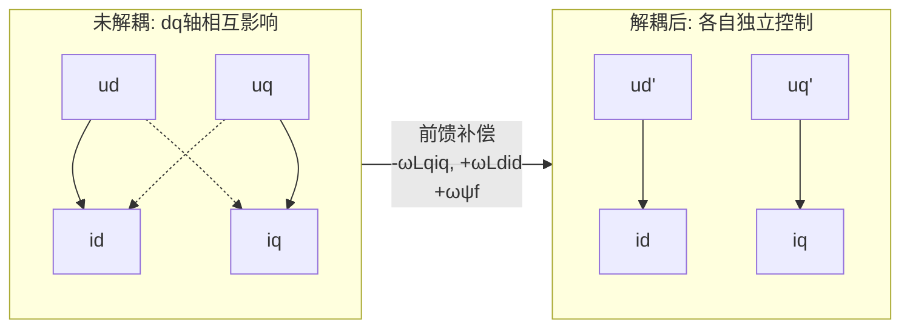

# 解耦思想与Id=0控制

> **为什么学？**
> 如果不把 dq 轴之间的交叉耦合和反电动势从 PI 控制任务中剥离出来，电流环就相当于在“顶着转速相关的强扰动”调电流。高速时 PI 输出会被耦合项和反电动势大量占用，导致 d 轴电流守不住 0、q 轴电流响应迟缓，最终转矩非线性、动态跟踪严重恶化。
>
> **在 FOC 中的作用**
> 这一节位于 Park 变换之后、电流环 PI 之前，负责把旋转坐标系下的耦合电压方程拆成两个独立的一阶 RL 环节。它的输出是补偿后的 d、q 轴电压参考，供逆 Park 变换和 SVPWM 使用。

Park 变换把三相交流量变成了旋转坐标系下的直流量，但 d、q 轴电压方程里仍然相互纠缠；只有先把这些纠缠项抵消掉，后续的电流 PI 才能像控制两个独立电阻-电感回路一样简单地调节 $i_d$ 和 $i_q$，进而把电磁转矩直接映射到 $i_q$ 上。

## 1. 数学推导

### 1.1 PMSM dq轴电压方程回顾

为什么要做这一步：在动手解耦之前，必须先写出旋转坐标系下的电压方程，才能看清 d、q 轴之间究竟有哪些项在相互影响。

在旋转坐标系（dq坐标系）下，表贴式永磁同步电机（SPMSM）的电压方程为：

$$
\begin{cases}
u_d = R_s i_d + L_s \frac{di_d}{dt} - \omega_e L_s i_q \\
u_q = R_s i_q + L_s \frac{di_q}{dt} + \omega_e L_s i_d + \omega_e \psi_f
\end{cases}
$$

其中：
- $u_d, u_q$：dq轴定子电压
- $i_d, i_q$：dq轴定子电流
- $R_s$：定子电阻
- $L_s$：dq轴电感（SPMSM中 $L_d = L_q = L_s$）
- $\omega_e$：电角速度
- $\psi_f$：永磁体磁链

### 1.2 耦合项分析

为什么要做这一步：把电压方程拆成电阻-电感、交叉耦合和反电动势三部分，才能明确 PI 控制器需要对抗的扰动到底来自哪里。

将电压方程重写为：

$$
\begin{cases}
u_d = R_s i_d + L_s \frac{di_d}{dt} \underbrace{- \omega_e L_s i_q}_{\text{交叉耦合项}} \\
u_q = R_s i_q + L_s \frac{di_q}{dt} \underbrace{+ \omega_e L_s i_d}_{\text{交叉耦合项}} + \underbrace{\omega_e \psi_f}_{\text{反电动势项}}
\end{cases}
$$

**关键发现**：d轴电压不仅受 $i_d$ 影响，还受 $i_q$ 通过 $-\omega_e L_s i_q$ 耦合；q轴电压不仅受 $i_q$ 影响，还受 $i_d$ 通过 $+\omega_e L_s i_d$ 耦合。此外，q轴还存在与转速成正比的反电动势项 $\omega_e \psi_f$。

### 1.3 解耦控制推导

为什么要做这一步：工程上无法直接对耦合方程设计两个独立 PI，因此要通过前馈补偿把耦合项和反电动势预先抵消。

若令控制电压为：

$$
\begin{cases}
u_d^* = v_d' - \omega_e L_s i_q \\
u_q^* = v_q' + \omega_e L_s i_d + \omega_e \psi_f
\end{cases}
$$

代入原方程后，得到完全解耦的一阶系统：

$$
\begin{cases}
v_d' = R_s i_d + L_s \frac{di_d}{dt} \\
v_q' = R_s i_q + L_s \frac{di_q}{dt}
\end{cases}
$$

在参数准确、角度正确且前馈未饱和的模型中，交叉项被近似抵消，d、q 轴可分别用 PI 控制器调节。实际系统仍存在参数失配、数字延迟、磁饱和和电压限幅造成的残余耦合。

### 1.4 Id=0控制的物理意义

为什么要做这一步：对表贴式电机，需要证明令 $i_d=0$ 既能简化转矩控制，又能在基速以下获得最小铜损。

SPMSM的电磁转矩方程为：

$$
T_e = \frac{3}{2} p \psi_f i_q + \frac{3}{2} p (L_d - L_q) i_d i_q
$$

对于SPMSM（$L_d = L_q$），转矩简化为：

$$
T_e = \frac{3}{2} p \psi_f i_q
$$

**结论**：当 $i_d = 0$ 时，转矩仅与 $i_q$ 成正比，实现电流到转矩的线性映射，控制最简单直观。

对理想 SPMSM，在给定转矩下 $i_q$ 已由转矩方程确定，额外的 $i_d\neq0$ 会增大 $I_s=\sqrt{i_d^2+i_q^2}$ 和铜损 $P_{cu}=\frac{3}{2}R_s(i_d^2+i_q^2)$。因此在电压未受限、忽略损耗优化和饱和的基速以下模型中，$i_d=0$ 是最小电流/最小铜损策略；该结论不能直接推广到 IPMSM 或弱磁区。

---

## 2. 几何直观



### dq轴电流矢量图

```
           q轴
            ↑
            │    Is
            │   /|
            │  / │
            │ /  │ iq
            │/θ  │
    ────────┼────┼────→ d轴
            │   id
            │

Id=0控制时：电流矢量完全落在q轴上
            ↑
            │    Is = iq
            │
            │
            ┼────→ d轴=0
```

---

## 3. 数值示例

为什么要做这一步：通过具体数字估算耦合项和反电动势的大小，才能判断在实际转速下前馈补偿是否不可忽略。

**给定参数**：
- $R_s = 0.5\,\Omega$
- $L_s = 2.5\,\text{mH}$
- $\psi_f = 0.1\,\text{Wb}$
- $\omega_e = 628\,\text{rad/s}$（对应1000 rpm，极对数p=4）
- 目标电流：$i_d = 0\,\text{A},\; i_q = 5\,\text{A}$

**步骤1：计算耦合项与反电动势**

$$
\omega_e L_s i_q = 628 \times 0.0025 \times 5 = 7.85\,\text{V}
$$

$$
\omega_e \psi_f = 628 \times 0.1 = 62.8\,\text{V}
$$

**步骤2：计算稳态所需电压（令di/dt=0）**

$$
u_d = R_s i_d - \omega_e L_s i_q = 0 - 7.85 = -7.85\,\text{V}
$$

$$
u_q = R_s i_q + \omega_e \psi_f = 0.5 \times 5 + 62.8 = 65.3\,\text{V}
$$

**步骤3：总电压幅值**

$$
U_s = \sqrt{u_d^2 + u_q^2} = \sqrt{(-7.85)^2 + 65.3^2} = 65.77\,\text{V}
$$

**步骤4：转矩输出**

$$
T_e = \frac{3}{2} p \psi_f i_q = \frac{3}{2} \times 4 \times 0.1 \times 5 = 3.0\,\text{N·m}
$$

---

## 4. 代码实现

为什么要做这一步：把解耦公式写成代码时，必须注意是用电流反馈而不是电流指令来计算前馈量，否则动态过程中会过补偿。

### C语言：解耦控制与Id=0控制框架

```c
#include <math.h>

// 电机参数
#define RS          0.5f
#define LS          0.0025f
#define PSIF        0.1f
#define POLE_PAIRS  4

// PI控制器结构体
typedef struct {
    float Kp, Ki;
    float integrator;
    float out_max, out_min;
    float ref, fbk;
    float err;
    float out;
} PI_Controller;

float PI_Update(PI_Controller *pi, float Ts) {
    pi->err = pi->ref - pi->fbk;
    pi->integrator += pi->Ki * pi->err * Ts;
    // 抗饱和
    if (pi->integrator > pi->out_max) pi->integrator = pi->out_max;
    if (pi->integrator < pi->out_min) pi->integrator = pi->out_min;
    
    pi->out = pi->Kp * pi->err + pi->integrator;
    if (pi->out > pi->out_max) pi->out = pi->out_max;
    if (pi->out < pi->out_min) pi->out = pi->out_min;
    return pi->out;
}

// FOC解耦控制主函数
void FOC_Decoupled_Control(float id_ref, float iq_ref, 
                           float id_fbk, float iq_fbk,
                           float omega_e, float Ts,
                           float *vd_out, float *vq_out) {
    static PI_Controller pi_d = {0.5f, 200.0f, 0.0f, 24.0f, -24.0f};
    static PI_Controller pi_q = {0.5f, 200.0f, 0.0f, 24.0f, -24.0f};
    
    pi_d.ref = id_ref;  // Id=0控制时，id_ref = 0
    pi_d.fbk = id_fbk;
    pi_q.ref = iq_ref;
    pi_q.fbk = iq_fbk;
    
    float vd_pi = PI_Update(&pi_d, Ts);
    float vq_pi = PI_Update(&pi_q, Ts);
    
    // 前馈解耦补偿
    float decoupling_d = -omega_e * LS * iq_fbk;
    float decoupling_q =  omega_e * LS * id_fbk + omega_e * PSIF;
    
    *vd_out = vd_pi + decoupling_d;
    *vq_out = vq_pi + decoupling_q;
}

// Id=0控制调用示例
void FOC_IdZero_Control(float iq_ref, float id_fbk, float iq_fbk,
                        float omega_e, float Ts,
                        float *vd_out, float *vq_out) {
    FOC_Decoupled_Control(0.0f, iq_ref, id_fbk, iq_fbk, omega_e, Ts, vd_out, vq_out);
}
```

### MATLAB：解耦验证仿真

```matlab
% 参数
Rs = 0.5; Ls = 2.5e-3; psif = 0.1; p = 4;

% Id=0控制，阶跃iq响应
omega_e = 628;  % rad/s
id_ref = 0; iq_ref = 5;

% 未解耦时（将耦合项视为扰动）
% 解耦后，dq轴为一阶惯性环节：G(s) = 1/(Rs + Ls*s)
% 对应时间常数 tau = Ls/Rs = 5ms

% 验证：解耦后d轴不受q轴影响
t = 0:1e-5:0.02;
G = tf(1, [Ls, Rs]);
[y, t_out] = step(G*5, t);  % iq=5阶跃响应

figure; plot(t_out, y); grid;
xlabel('Time (s)'); ylabel('i_d (A)');
title('Id=0控制下d轴电流响应（解耦后应恒为0）');
```

---

## 5. 常见错误

### 错误1：忽略解耦项，直接用PI输出作为电压指令

**错误做法**：
```c
vd = PI_d.update(id_ref, id_fbk);  // 错误！未补偿耦合项
vq = PI_q.update(iq_ref, iq_fbk);  // 错误！未补偿反电动势
```

**后果**：高速时耦合项和永磁反电动势可能占用大部分可用电压，PI 需要产生相应补偿，电压裕量不足时会出现电流跟踪滞后、d 轴偏移和 q 轴畸变。

**纠正方法**：在目标带宽和速度范围需要时加入前馈解耦，并保留反馈与电压限幅：
```c
vd = PI_d.update(id_ref, id_fbk) - omega_e * Ls * iq_fbk;
vq = PI_q.update(iq_ref, iq_fbk) + omega_e * Ls * id_fbk + omega_e * psif;
```

### 错误2：Id=0控制用于凸极电机（IPMSM）而不加MTPA

**错误认知**：认为 $i_d = 0$ 对所有PMSM都是最优的。

**后果**：对于内置式永磁同步电机（IPMSM），$L_d < L_q$，磁阻转矩项 $\frac{3}{2}p(L_d-L_q)i_d i_q$ 为负值（当 $i_d<0$ 时产生正转矩）。若强行 $i_d = 0$，则浪费磁阻转矩分量，在相同转矩下需要更大的 $i_q$，导致铜损增加、效率降低。

**纠正方法**：
- IPMSM在基速以下应采用MTPA（最大转矩电流比）控制，令 $i_d < 0$ 以利用磁阻转矩。
- SPMSM（$L_d \approx L_q$）才适合 $i_d = 0$ 控制。

---

## 6. 自测习题

### 习题1

某SPMSM参数：$R_s = 1.0\,\Omega$，$L_s = 5\,\text{mH}$，$\psi_f = 0.2\,\text{Wb}$，极对数 $p=2$。在 $n = 1500\,\text{rpm}$（电角速度 $\omega_e = 314\,\text{rad/s}$）下运行，采用Id=0控制，目标 $i_q = 3\,\text{A}$。求：

(1) 稳态时所需的 $u_d$ 和 $u_q$；
(2) 输出电磁转矩；
(3) 若未加解耦补偿，PI控制器d轴输出需额外承担多大扰动？

**答案**：

(1) $u_d = -\omega_e L_s i_q = -314 \times 0.005 \times 3 = -4.71\,\text{V}$

$u_q = R_s i_q + \omega_e \psi_f = 1.0 \times 3 + 314 \times 0.2 = 3 + 62.8 = 65.8\,\text{V}$

(2) $T_e = \frac{3}{2} \times 2 \times 0.2 \times 3 = 1.8\,\text{N·m}$

(3) d轴耦合扰动为 $-\omega_e L_s i_q = -4.71\,\text{V}$，即PI控制器若不补偿，需输出额外约4.71V的电压来抵消该扰动，严重影响动态响应。

### 习题2

为什么SPMSM的Id=0控制是最小铜损策略？请从数学上证明。

**答案**：

在Id=0控制下，$I_s = \sqrt{i_d^2 + i_q^2} = |i_q|$，铜损 $P_{cu} = \frac{3}{2}R_s I_s^2 = \frac{3}{2}R_s i_q^2$。

若 $i_d \neq 0$，令总电流约束为 $I_s^2 = i_d^2 + i_q^2 = C$（常数）。对于SPMSM，$T_e = \frac{3}{2}p\psi_f i_q$，在固定 $I_s$ 下，$i_q$ 最大时转矩最大。由 $i_q = \sqrt{C - i_d^2}$，当 $i_d = 0$ 时 $i_q$ 取最大值 $\sqrt{C}$，即相同转矩下 $I_s$ 最小，铜损最小。证毕。

---

> **延伸阅读**：对于IPMSM的MTPA控制，详见 `005-MTPA最大转矩电流比控制.md`；对于弱磁时 $i_d \neq 0$ 的情况，详见 `006-弱磁控制与电压极限.md`。


---

## 参考图片

### FOC 磁场定向控制完整框图（Clarke→Park→PI→逆Park→SVPWM）

![[14-FOC-电机控制/assets/foc_control_block_diagram.png|1500]]

> **图片来源**：CSDN博客: youcans - 永磁同步电机基本结构与工作原理

### PMSM FOC 架构（MathWorks 官方框图）

![[14-FOC-电机控制/assets/mathworks_pmsm_foc_arch.png|1500]]

> **图片来源**：MathWorks官方文档: 磁场定向控制

