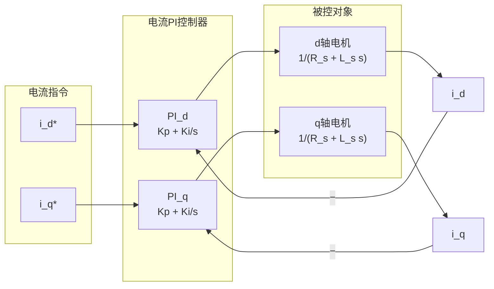
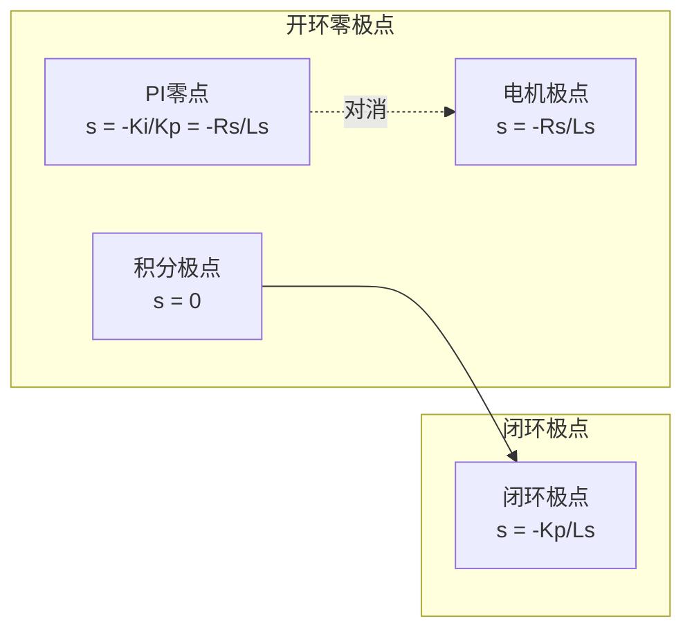

# 电流环PI控制器设计

> **为什么学？**
> 电流环是磁场定向控制（FOC, Field-Oriented Control）最内环，直接决定电机电流能否快速、无超调地跟随指令。如果比例-积分（PI, Proportional-Integral）参数设计不当，轻则响应慢、带宽不足，重则出现振荡、积分饱和甚至失控；而这些参数不能靠“试”，需要建立在电机电气参数和期望带宽之上。
>
> **在 FOC 中的作用**
> 电流环接收来自速度环或转矩分配环节给出的 $i_d^*$、$i_q^*$，输出 d、q 轴电压指令（经解耦后）。它把“电流参考”转换成“电压参考”，是连接上层运动控制与下层逆变器调制之间的桥梁。

把解耦后的 d、q 轴电流环画成两条并行的 PI-电阻电感（RL, Resistor-Inductor）一阶回路，就能明白：电流环设计的本质是给两个独立的 RL 对象配置 PI，带宽由 $K_p$ 直接决定。



*图：解耦后 d、q 轴电流环的并行一阶结构。两个 PI 分别控制两个 RL 对象，零极点对消后闭环为一阶惯性环节。*

前馈解耦已经把 d、q 轴变成两个近似独立的 RL 一阶对象，接下来就要为这两个对象设计 PI 控制器。设计目标很明确：在给定带宽下让电流快速跟踪参考，同时保证离散实现时稳定、不饱和。

## 1. 数学推导

### 1.1 dq轴解耦后的电流模型

为什么要做这一步：设计 PI 之前，必须先把解耦后的电机模型写成标准一阶惯性形式，才能用经典控制理论配置极点。

经过前馈解耦后，dq轴电流回路可视为独立的一阶惯性系统：

$$
G(s) = \frac{I(s)}{V(s)} = \frac{1}{R_s + L_s s} = \frac{1/R_s}{1 + \frac{L_s}{R_s}s}
$$

时间常数：

$$
\tau_e = \frac{L_s}{R_s}
$$

### 1.2 PI控制器传递函数

PI控制器时域表达式：

$$
u(t) = K_p \, e(t) + K_i \int_0^t e(\tau) d\tau
$$

拉普拉斯域：

$$
G_{PI}(s) = K_p + \frac{K_i}{s} = K_p \frac{1 + \frac{K_p}{K_i}s}{\frac{K_p}{K_i}s} = K_p \frac{1 + T_i s}{T_i s}
$$

其中积分时间常数 $T_i = K_p / K_i$。

### 1.3 极点配置法（零极点对消）

为什么要做这一步：把 PI 的零点放在电机极点上，可以把二阶对象降为纯积分，从而用单一参数 $K_p$ 直接决定闭环带宽。

将PI控制器的零点与电机极点对消：

令 $T_i = \tau_e = L_s / R_s$，则：

$$
G_{PI}(s) \cdot G(s) = K_p \frac{1 + \tau_e s}{\tau_e s} \cdot \frac{1/R_s}{1 + \tau_e s} = \frac{K_p}{R_s \tau_e s} = \frac{K_p}{L_s s}
$$

开环传递函数简化为积分器形式。闭环传递函数：

$$
G_{cl}(s) = \frac{G_{PI}(s)G(s)}{1 + G_{PI}(s)G(s)} = \frac{\frac{K_p}{L_s s}}{1 + \frac{K_p}{L_s s}} = \frac{1}{1 + \frac{L_s}{K_p}s}
$$

这是一个一阶系统，其闭环带宽为：

$$
\omega_{bw} = \frac{K_p}{L_s}
$$

由此得到PI参数：

$$
\boxed{K_p = L_s \cdot \omega_{bw}}
$$

$$
\boxed{K_i = R_s \cdot \omega_{bw}}
$$

或等价地：

$$
K_p = L_s \cdot \omega_{bw}, \quad T_i = \frac{L_s}{R_s}, \quad K_i = \frac{K_p}{T_i} = \frac{R_s L_s \omega_{bw}}{L_s} = R_s \omega_{bw}
$$

### 1.4 模量最优近似（Modulus Optimum）

为什么要做这一步：实际数字控制中存在脉宽调制（PWM, Pulse Width Modulation）和采样—更新延迟，模量最优近似把这些小时间常数纳入连续域初始整定。它只适合作为起点，最终仍要用离散模型和实测频响验证。

对于含小时间常数 $\tau_{\sigma}$ 的扩展对象（如 PWM 延迟、采样延迟）：

$$
G_{obj}(s) = \frac{1/R_s}{(1 + \tau_e s)(1 + \tau_{\sigma} s)}
$$

在上述一阶小延迟近似和参数准确的条件下，一组常用整定为：

$$
K_p = \frac{L_s}{2 \tau_{\sigma}}, \quad K_i = \frac{R_s}{2 \tau_{\sigma}}
$$

此时闭环带宽约：

$$
\omega_{bw} \approx \frac{1}{2\tau_{\sigma}}
$$

### 1.5 离散化（后向欧拉法）

为什么要做这一步：控制器运行在离散域，必须把连续域设计好的 $K_p$、$K_i$ 转化为差分方程，否则会出现离散化误差和稳定性问题。

PI控制器的离散实现：

$$
u[k] = K_p \, e[k] + u_i[k]
$$

$$
u_i[k] = u_i[k-1] + K_i \, T_s \, e[k]
$$

其中 $T_s$ 为采样周期（如50μs对应 $T_s = 5 \times 10^{-5}\,\text{s}$）。

---

## 2. 几何直观

### 电流环闭环阶跃响应

零极点对消后，电流环闭环是一个一阶惯性环节。下图中，5 A 阶跃指令下电流按指数规律上升，在时间常数 $\tau = L_s/K_p$ 处达到目标值的约 63%。

![[14-FOC-电机控制/assets/current_loop_step_response.png|1500]]
*图：带宽 1000 Hz 时的电流环阶跃响应，$\tau = L_s/K_p \approx 0.16\,\text{ms}$*

### 极点配置示意图

下图把 s 平面上的零极点关系画出来：PI 控制器引入的零点正好落在电机极点上，两者对消后只剩积分极点与闭环极点，系统退化为容易调节的一阶惯性。

![[14-FOC-电机控制/assets/pi_pole_zero_cancellation.png|1500]]
*图：PI 零点 $s=-R_s/L_s$ 与电机极点对消，闭环极点由 $K_p$ 推到 $s=-K_p/L_s$*



### 开环 Bode 与带宽

把 PI 控制器与电机对象连起来看开环频率特性：由于 PI 零点对消了电机极点，开环幅频曲线以 −20 dB/dec 穿越 0 dB 线，相位在很宽范围内接近 −90°，系统具有充足的相位裕度。0 dB 穿越频率即为设计的电流环带宽 $f_{bw}$。

![[14-FOC-电机控制/assets/current_loop_bode.png|1500]]
*图：电流环开环 Bode 图，1000 Hz 处幅值穿越 0 dB，相位约 −90°*

---

## 3. 数值示例

为什么要做这一步：用一组典型电机参数和带宽目标，把抽象的 $K_p$、$K_i$ 变成具体数值，才能直接写入代码。

**给定参数**：
- $R_s = 0.5\,\Omega$
- $L_s = 2.5\,\text{mH} = 0.0025\,\text{H}$
- 目标电流环带宽：$f_{bw} = 1000\,\text{Hz}$，即 $\omega_{bw} = 2\pi \times 1000 = 6283\,\text{rad/s}$
- 采样周期：$T_s = 50\,\mu\text{s} = 5 \times 10^{-5}\,\text{s}$

**步骤1：计算PI参数**

$$
K_p = L_s \cdot \omega_{bw} = 0.0025 \times 6283 = 15.7\,\Omega
$$

$$
K_i = R_s \cdot \omega_{bw} = 0.5 \times 6283 = 3142\,\Omega/\text{s}
$$

积分时间常数：

$$
T_i = \frac{K_p}{K_i} = \frac{15.7}{3142} = 0.005\,\text{s} = 5\,\text{ms}
$$

验证：$T_i = L_s/R_s = 0.0025/0.5 = 0.005\,\text{s}$ ✓ 零极点对消成功。

**步骤2：验证闭环时间常数**

$$
\tau_{cl} = \frac{L_s}{K_p} = \frac{0.0025}{15.7} = 1.59 \times 10^{-4}\,\text{s} = 0.159\,\text{ms}
$$

对应带宽：$1/\tau_{cl} = 6283\,\text{rad/s} = 1000\,\text{Hz}$ ✓

**步骤3：离散化验证**

离散积分增益：

$$
K_i T_s = 3142 \times 5 \times 10^{-5} = 0.157
$$

稳态时，若 $e = 0.1\,\text{A}$，每步积分增量为 $0.157 \times 0.1 = 0.0157\,\text{V}$，约64步（3.2ms）可累积1V输出，响应合理。

**步骤4：模量最优近似对比（假设 $\tau_{\sigma}=100\,\mu\text{s}$）**

$$
K_p = \frac{L_s}{2\tau_{\sigma}} = \frac{0.0025}{2 \times 0.0001} = 12.5
$$

$$
K_i = \frac{R_s}{2\tau_{\sigma}} = \frac{0.5}{0.0002} = 2500
$$

对应带宽 $\omega_{bw} = K_p/L_s = 12.5/0.0025 = 5000\,\text{rad/s} \approx 796\,\text{Hz}$，略低于极点配置法，但鲁棒性更好。

---

## 4. 代码实现

为什么要做这一步：把设计好的 PI 写成可运行代码时，必须加入输出限幅和抗饱和处理，否则大阶跃下积分器会 windup。

### C语言：完整电流环PI控制器（含抗饱和）

```c
typedef struct {
    float Kp;
    float Ki;
    float Ts;
    float integrator;
    float output;
    float out_max;
    float out_min;
} Current_PI_Controller;

void Current_PI_Init(Current_PI_Controller *pi, float Ls, float Rs, 
                     float bw_hz, float Ts, float vdc) {
    float wbw = 2.0f * 3.1415926f * bw_hz;
    pi->Kp = Ls * wbw;
    pi->Ki = Rs * wbw;
    pi->Ts = Ts;
    pi->out_max =  vdc / 1.732f;  // 最大相电压 ≈ Vdc/√3
    pi->out_min = -vdc / 1.732f;
    pi->integrator = 0.0f;
    pi->output = 0.0f;
}

float Current_PI_Update(Current_PI_Controller *pi, float ref, float fbk) {
    float error = ref - fbk;
    
    // 比例项
    float p_term = pi->Kp * error;
    
    // 积分项（后向欧拉）
    pi->integrator += pi->Ki * pi->Ts * error;
    
    // 输出限幅前的总输出
    float output = p_term + pi->integrator;
    
    // 抗饱和（条件积分/反计算）
    if (output > pi->out_max) {
        pi->integrator -= (output - pi->out_max);  // 反计算法
        output = pi->out_max;
    } else if (output < pi->out_min) {
        pi->integrator -= (output - pi->out_min);
        output = pi->out_min;
    }
    
    pi->output = output;
    return output;
}

// 使用示例
void Current_Loop_Control(float id_ref, float iq_ref,
                         float id_fbk, float iq_fbk,
                         float omega_e, float vdc, float Ts,
                         float *vd_out, float *vq_out) {
    static Current_PI_Controller pi_d, pi_q;
    static int initialized = 0;
    
    if (!initialized) {
        float Ls = 0.0025f, Rs = 0.5f;
        float bw = 1000.0f;  // Hz
        Current_PI_Init(&pi_d, Ls, Rs, bw, Ts, vdc);
        Current_PI_Init(&pi_q, Ls, Rs, bw, Ts, vdc);
        initialized = 1;
    }
    
    float vd_pi = Current_PI_Update(&pi_d, id_ref, id_fbk);
    float vq_pi = Current_PI_Update(&pi_q, iq_ref, iq_fbk);
    
    // 前馈解耦补偿（参见001-解耦思想与Id=0控制）
    float dec_d = -omega_e * 0.0025f * iq_fbk;
    float dec_q =  omega_e * 0.0025f * id_fbk + omega_e * 0.1f;
    
    *vd_out = vd_pi + dec_d;
    *vq_out = vq_pi + dec_q;
}
```

### MATLAB：电流环频域分析

```matlab
% 参数
Rs = 0.5; Ls = 2.5e-3;
Vdc = 24;

% PI设计：带宽1000Hz
fbw = 1000; wbw = 2*pi*fbw;
Kp = Ls * wbw;
Ki = Rs * wbw;

% 电机模型
G_motor = tf(1, [Ls, Rs]);

% PI控制器
G_pi = tf([Kp, Ki], [1, 0]);

% 开环和闭环
G_ol = G_pi * G_motor;
G_cl = feedback(G_ol, 1);

% 分析
figure;
subplot(2,1,1); margin(G_ol); title('Open Loop Bode');
subplot(2,1,2); step(G_cl); title('Closed Loop Step Response');
grid on;

% 显示带宽
bandwidth(G_cl)  % 应接近1000Hz
```

---

## 5. 工程实现要点

### 5.1 带宽选择：响应速度与噪声的权衡

电流环带宽 $f_{bw}$ 决定跟踪速度，但不是越高越好：

- **上限**：$f_{bw}$ 应远低于采样频率 $f_s$（经验上 $f_s \ge 20 f_{bw}$），并预留 PWM 更新和采样延迟的相位裕度；电机电感很小时，$K_p$ 会很大，容易放大测量噪声。
- **下限**：带宽过低会导致速度环或转矩环可分配的动态范围变小，电机加减速时电流滞后明显。
- **工程选择**：不要把 $500\sim2000\,\text{Hz}$ 当作通用范围。可实现带宽取决于电气时间常数、PWM/采样频率、总延迟、母线电压裕量、传感噪声和目标动态；先由离散模型给出上限，再用阶跃与频响逐步验证。

### 5.2 参数来源与测量误差

极点配置法直接依赖 $R_s$、$L_s$：

- **电阻 $R_s$**：可用电桥或伏安法静态测量，温升会导致其变化 10%–30%，高温下 $K_i$ 需要在线修正。
- **电感 $L_s$**：与电流大小（磁饱和）、转子位置有关，通常取额定工作点的平均值。dq 轴电感不等时（内嵌式永磁同步电机，IPMSM, Interior Permanent Magnet Synchronous Motor），d 轴和 q 轴应分别设计 $K_p$、$K_i$。
- **在线修正**：若温漂和饱和导致性能明显变化，可采用温度补偿、分区参数表或在线辨识更新 $R_s$、$L_d$、$L_q$；是否值得加入取决于性能收益、可观测性和注入信号代价。

### 5.3 采样、PWM 更新与延迟

FOC 中一个电流环周期的实际延迟包括：

1. **采样与转换**：从电流实际采样时刻到 ADC 结果可用的时间，包括采样保持、转换和触发链路延迟；它通常不是固定的 $0.5T_s$。
2. **计算与寄存器更新**：从结果可用到新占空比写入，以及影子寄存器在计数器更新点生效的等待时间。
3. **PWM/零阶保持效应**：一个周期内占空比保持不变，其等效相位滞后随采用的采样点、单/双更新方式和频率而变。

总延迟应按实际时序图或 GPIO 打点测量，不宜固定假设为 $1\sim1.5$ 个 PWM 周期。目标带宽接近延迟约束时，应使用含零阶保持与纯延迟的离散模型，检查相位裕度、饱和恢复和参数摄动；模量最优近似不能替代这一步。

### 5.4 抗饱和与输出限幅

电流环 PI 输出是 d、q 轴电压，其幅值受直流母线电压 $V_{dc}$ 限制：

$$
|v_d + j v_q| \le \frac{V_{dc}}{\sqrt{3}}
$$

工程实现必须加入：

- **输出限幅**：限制每个轴独立或合成矢量的幅值。
- **积分抗饱和**：反计算法（back-calculation）实现简单、效果稳定；条件积分适合对超调要求极高的场合。
- **启动/大阶跃保护**：电机启动或速度给定突变时，电流指令可能瞬间达到限幅，积分器容易 windup。可在电流指令前端加斜坡（slew rate）限制。

### 5.5 调试顺序

1. 先用小电流指令（如额定 10%）验证电流采样极性和方向；
2. 设置较小 $K_p$、$K_i=0$，观察比例项是否使电流方向正确；
3. 逐步加大 $K_p$ 至响应接近目标带宽但无高频振荡；
4. 加入 $K_i = R_s K_p / L_s$ 消除稳态误差；
5. 加入解耦和前馈后，用示波器或调试软件观察 $i_d$、$i_q$ 的阶跃响应，并依据实测延迟、相位裕度与噪声水平微调。

---

## 6. 常见错误

### 错误1：PI参数未考虑离散采样，直接移植连续域参数

**错误做法**：在数字控制器中直接使用 $K_p = 15.7, K_i = 3142$，而不考虑 $T_s = 50\,\mu\text{s}$ 的离散特性。

**后果**：虽然本例中离散化误差不大，但当采样频率较低（如 $T_s = 500\,\mu\text{s}$）或带宽很高（>5kHz）时，离散效应导致实际闭环极点偏离设计位置，可能不稳定。

**纠正方法**：
- 使用零阶保持法（ZOH, Zero-Order Hold）精确离散化：$G_{zoh}(z) = \mathcal{Z}\{(1-e^{-sT_s})\frac{G(s)}{s}\}$
- 或者采用离散域极点配置（如Delta算子、直接数字设计），令离散闭环极点 $z = e^{-\omega_{bw}T_s}$。
- 经验法则：采样频率至少为闭环带宽的20倍以上（即 $f_s > 20 f_{bw}$）。

### 错误2：忽略积分饱和，导致大信号响应超调或振荡

**错误做法**：
```c
pi->integrator += Ki * Ts * error;  // 无限制积分
output = Kp * error + pi->integrator;
if (output > max) output = max;     // 仅截断输出，不处理积分
if (output < min) output = min;
```

**后果**：当电流指令发生大阶跃时，积分器持续累积，即使输出已被限幅，积分器仍"过饱和"。当误差反向时，积分器需要很长时间才能退出饱和区，造成严重的超调和响应延迟。

**纠正方法**（反计算法/条件积分）：
```c
// 方法1：反计算法（Back-calculation）
float output_unsat = p_term + pi->integrator;
float output = saturate(output_unsat, min, max);
pi->integrator -= (output_unsat - output);  // 扣去饱和部分

// 方法2：条件积分（Conditional Integration）
if (!saturated || sign(error) == sign(output)) {
    pi->integrator += Ki * Ts * error;
}
```

---

## 7. 自测习题

### 习题1

某电机参数：$R_s = 0.8\,\Omega$，$L_s = 4\,\text{mH}$。要求电流环带宽 $f_{bw} = 800\,\text{Hz}$，采样周期 $T_s = 100\,\mu\text{s}$。求：

(1) 极点配置法的 $K_p$ 和 $K_i$；
(2) 积分时间常数 $T_i$；
(3) 离散域积分每步增益 $K_i T_s$；
(4) 若把 PWM 与采样—更新延迟近似为一阶小时间常数 $\tau_{\sigma}=150\,\mu\text{s}$，用模量最优近似重新计算 $K_p$ 和 $K_i$。

**答案**：

(1) $\omega_{bw} = 2\pi \times 800 = 5027\,\text{rad/s}$

$K_p = L_s \omega_{bw} = 0.004 \times 5027 = 20.1\,\Omega$

$K_i = R_s \omega_{bw} = 0.8 \times 5027 = 4021\,\Omega/\text{s}$

(2) $T_i = K_p/K_i = 20.1/4021 = 0.005\,\text{s} = 5\,\text{ms}$（验证：$L_s/R_s = 0.004/0.8 = 0.005$ ✓）

(3) $K_i T_s = 4021 \times 10^{-4} = 0.402$

(4) 模量最优近似：$K_p=L_s/(2\tau_{\sigma})=0.004/0.0003=13.3$，$K_i=R_s/(2\tau_{\sigma})=0.8/0.0003=2667$。该结果仍需放入含真实零阶保持与计算延迟的离散模型验证。

### 习题2

证明：在零极点对消设计中，若 $T_i = L_s/R_s$，闭环系统为一阶惯性环节，其阶跃响应无超调，调节时间（5%准则）为 $3L_s/K_p$。

**答案**：

闭环传递函数 $G_{cl}(s) = \frac{1}{1 + (L_s/K_p)s}$，为一阶系统。

一阶系统阶跃响应 $y(t) = (1 - e^{-t/\tau})\cdot A$，其中 $\tau = L_s/K_p$。

达到95%目标值：$1 - e^{-t/\tau} = 0.95 \Rightarrow e^{-t/\tau} = 0.05 \Rightarrow t = -\tau \ln(0.05) \approx 3\tau = 3L_s/K_p$。

一阶系统阶跃响应单调上升，无超调。证毕。

---

> **延伸阅读**：速度环设计见 `003-速度环与位置环设计.md`；前馈补偿细节见 `004-前馈补偿与交叉解耦.md`。
