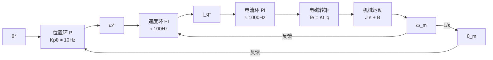

# 速度环与位置环设计

> **为什么学？**
> 速度环和位置环是 FOC 的外环，决定电机能否按预期转速或位置运动。如果外环带宽设计不合理，要么响应迟钝、稳速精度差，要么与电流环动态冲突导致系统振荡；位置环若忽视角度环绕，还可能在过零时产生剧烈反转。
>
> **在 FOC 中的作用**
> 位置环输出速度指令，速度环输出 $i_q^*$（转矩电流指令），再送给电流环执行。三环级联构成了从“目标位置/速度”到“电磁转矩”的完整运动控制链路。

把位置-速度-电流三环画成一条级联的因果链，就能直观看到：外环输出是内环的参考，内环必须比外环快 5~10 倍，否则环间会相互“拖累”。



*图：位置-速度-电流三环级联结构。每一环的典型带宽依次拉开约 10 倍，保证内环对外环近似为纯增益。*

电流环把 $i_q$ 快速控制住之后，就可以把它当作一个可控的转矩源，向上构建速度环和位置环。外环设计的核心不是参数越大越好，而是让各环带宽拉开、互不干扰。

## 1. 数学推导

### 1.1 机电运动方程

为什么要做这一步：速度环设计需要从机电运动方程出发，把电磁转矩和机械运动联系起来，才能建立从 $i_q^*$ 到 $\omega_m$ 的被控对象。

永磁同步电机的机械运动方程：

$$
T_e - T_L = J \frac{d\omega_m}{dt} + B \omega_m
$$

其中：
- $T_e$：电磁转矩（N·m）
- $T_L$：负载转矩（N·m）
- $J$：转动惯量（kg·m²）
- $B$：粘滞摩擦系数（N·m·s/rad）
- $\omega_m$：机械角速度（rad/s）

对于SPMSM的Id=0控制，$T_e = K_t i_q$，其中转矩常数：

$$
K_t = \frac{3}{2} p \psi_f
$$

代入得：

$$
K_t i_q - T_L = J \frac{d\omega_m}{dt} + B \omega_m
$$

### 1.2 速度环被控对象模型

从速度控制器输出 $i_q^*$ 到速度反馈 $\omega_m$ 的传递函数：

$$
G_{\omega}(s) = \frac{\Omega_m(s)}{I_q^*(s)} = \frac{K_t}{J s + B}
$$

这是一个一阶惯性系统（假设电流环动态远快于速度环，即电流环等效为增益1）。

若忽略摩擦（$B \approx 0$）：

$$
G_{\omega}(s) = \frac{K_t}{J s}
$$

为纯积分对象。

### 1.3 速度环PI设计

为什么要做这一步：把速度环闭环设计成标准二阶系统，可以直接用阻尼比和自然频率这两个工程指标来整定 PI 参数。

速度环PI控制器：

$$
G_{PI\_\omega}(s) = K_{p\omega} + \frac{K_{i\omega}}{s}
$$

开环传递函数：

$$
G_{ol\_\omega}(s) = G_{PI\_\omega}(s) \cdot G_{\omega}(s) = \frac{(K_{p\omega} s + K_{i\omega}) K_t}{s(J s + B)}
$$

闭环特征方程：

$$
J s^2 + (B + K_t K_{p\omega}) s + K_t K_{i\omega} = 0
$$

设计为二阶系统，标准形式：

$$
s^2 + 2\zeta\omega_n s + \omega_n^2 = 0
$$

对比系数：

$$
\omega_n = \sqrt{\frac{K_t K_{i\omega}}{J}}, \quad 2\zeta\omega_n = \frac{B + K_t K_{p\omega}}{J}
$$

取阻尼比 $\zeta = 0.707$（最佳阻尼），解得：

$$
K_{i\omega} = \frac{J \omega_n^2}{K_t}
$$

$$
K_{p\omega} = \frac{2\zeta\omega_n J - B}{K_t}
$$

### 1.4 带宽匹配原则

为什么要做这一步：电流环再快也有动态，速度环带宽如果设得太高会“追”到电流环内部，导致级联系统失稳，因此必须遵守带宽层级。

级联控制系统的稳定性要求：

$$
f_{bw,current} \approx 10 \times f_{bw,speed}
$$

若电流环带宽为 $1000\,\text{Hz}$，则速度环带宽宜设为 $50\sim100\,\text{Hz}$。这是为了将内环（电流环）的动态近似为纯增益，避免外环（速度环）与内环动态耦合导致振荡。

### 1.5 位置环P控制设计

为什么要做这一步：位置到速度是纯积分对象，P 控制最简单；但设计时还要考虑角度环绕和速度饱和，否则定位过程会不平滑。

位置环被控对象（从速度到位置）：

$$
G_{\theta}(s) = \frac{1}{s}
$$

位置控制器通常采用P控制（或PI）：

$$
G_{P\_\theta}(s) = K_{p\theta}
$$

开环传递函数：

$$
G_{ol\_\theta}(s) = K_{p\theta} \cdot \frac{1}{s} \cdot G_{\omega\_cl}(s)
$$

其中 $G_{\omega\_cl}(s)$ 为速度环闭环传递函数。若速度环设计良好，可近似为低通滤波器：

$$
G_{\omega\_cl}(s) \approx \frac{\omega_{n\omega}^2}{s^2 + 2\zeta\omega_{n\omega}s + \omega_{n\omega}^2}
$$

位置环带宽通常取速度环带宽的 $1/5 \sim 1/10$：

$$
f_{bw,position} \approx (0.1 \sim 0.2) \times f_{bw,speed}
$$

典型值：电流环1000Hz → 速度环100Hz → 位置环10~20Hz。

---

## 2. 几何直观

### 三环级联结构

```
┌─────────────────────────────────────────────────┐
│  位置环（最外环）                                  │
│  θ* →[P控制]─→ ω* ─────────────────────────────┐│
│     ↑                                          ││
│     └─ θ_fbk                                  ││
│                                                ││
│  速度环（中间环）                                ││
│  ω* →[PI控制]─→ iq* ─────────────────────────┐││
│     ↑                                        │││
│     └─ ω_fbk                                │││
│                                              │││
│  电流环（最内环）                              │││
│  iq*→[PI控制]─→ Vq ──→[电机]─→ iq_fbk ─────┘││
│     ↑                                      │││
│     └─ iq_fbk ───────────────────────────┘││
│                                            ││
│  被控对象：电流→转矩→速度→位置               ││
└────────────────────────────────────────────┘│
```

### 带宽层级金字塔

```
      ▲ 带宽
      │
1000Hz│     ████  电流环（最快）
      │    ████
 100Hz│   ████    速度环（中等）
      │  ████
  10Hz│ ████      位置环（最慢）
      │████
      └──────────────→ 控制层级
```

---

## 3. 数值示例

为什么要做这一步：通过典型伺服参数计算三环带宽和增益，可以验证理论设计是否与工程经验（如电流环 1kHz、速度环 100Hz、位置环 10Hz）一致。

**给定参数**：
- $J = 0.001\,\text{kg·m}^2$
- $B = 0.0005\,\text{N·m·s/rad}$
- $K_t = 0.3\,\text{N·m/A}$（对应 $p=4, \psi_f=0.05$）
- 电流环带宽：$f_{bw,i} = 1000\,\text{Hz}$
- 目标速度环带宽：$f_{bw,\omega} = 100\,\text{Hz}$（电流环的1/10）

**步骤1：速度环自然频率与PI参数**

取阻尼比 $\zeta = 0.707$，自然频率 $\omega_n = 2\pi \times 100 = 628.3\,\text{rad/s}$。

$$
K_{i\omega} = \frac{J \omega_n^2}{K_t} = \frac{0.001 \times (628.3)^2}{0.3} = \frac{394.8}{0.3} = 1316\,\text{A/(rad/s)/s}
$$

$$
K_{p\omega} = \frac{2\zeta\omega_n J - B}{K_t} = \frac{2 \times 0.707 \times 628.3 \times 0.001 - 0.0005}{0.3}
$$

$$
= \frac{0.888 - 0.0005}{0.3} = \frac{0.8875}{0.3} = 2.96\,\text{A/(rad/s)}
$$

**步骤2：验证闭环特性**

闭环特征方程：

$$
s^2 + 2\zeta\omega_n s + \omega_n^2 = s^2 + 888.6s + 394800 = 0
$$

极点：$s = -444.3 \pm j444.3$，阻尼比 $\zeta = 0.707$ ✓

**步骤3：位置环P参数设计**

速度环闭环带宽约100Hz，位置环取1/10，即 $f_{bw,\theta} = 10\,\text{Hz}$，对应 $\omega_{n\theta} = 62.83\,\text{rad/s}$。

简化设计：将速度环近似为一阶惯性 $\tau = 1/(2\pi \times 100) = 1.59\,\text{ms}$，则位置开环为：

$$
G_{ol\_\theta}(s) \approx K_{p\theta} \cdot \frac{1}{s} \cdot \frac{1}{\tau s + 1}
$$

取穿越频率 $\omega_c = 62.8\,\text{rad/s}$，则 $|G_{ol\_\theta}(j\omega_c)| = 1$：

$$
K_{p\theta} \approx \omega_c = 62.8\,\text{rad/s}/\text{rad} = 62.8\,\text{s}^{-1}
$$

（实际工程中会取更低值，如 $K_{p\theta} = 30\sim50$）

**步骤4：阶跃响应仿真**

速度环对 $1000\,\text{rpm}$（$104.7\,\text{rad/s}$）阶跃的响应：
- 上升时间（10%~90%）：$t_r \approx 1.8/\omega_n = 2.86\,\text{ms}$
- 调节时间（5%）：$t_s \approx 3/(\zeta\omega_n) = 6.7\,\text{ms}$
- 超调量：$\sigma\% = e^{-\pi\zeta/\sqrt{1-\zeta^2}} \times 100\% = 4.3\%$

---

## 4. 代码实现

为什么要做这一步：三环代码不仅要实现算法，还必须处理积分饱和和角度环绕，否则再好的理论参数也会在实际运行中出问题。

### C语言：速度环与位置环实现

```c
// 速度环PI
typedef struct {
    float Kp, Ki, Ts;
    float integrator;
    float out_max, out_min;
    float output;
} Speed_PI;

void Speed_PI_Init(Speed_PI *sp, float J, float B, float Kt, 
                   float bw_hz, float iq_max) {
    float wn = 2.0f * 3.1415926f * bw_hz;
    float zeta = 0.707f;
    sp->Ki = J * wn * wn / Kt;
    sp->Kp = (2.0f * zeta * wn * J - B) / Kt;
    sp->Ts = 1.0f / (bw_hz * 10.0f);  // 速度环采样率 = 10×带宽（至少）
    sp->out_max = iq_max;
    sp->out_min = -iq_max;
    sp->integrator = 0.0f;
}

float Speed_PI_Update(Speed_PI *sp, float omega_ref, float omega_fbk) {
    float err = omega_ref - omega_fbk;
    float p_term = sp->Kp * err;
    sp->integrator += sp->Ki * sp->Ts * err;
    
    float out = p_term + sp->integrator;
    
    // 抗饱和
    if (out > sp->out_max) {
        sp->integrator -= (out - sp->out_max);
        out = sp->out_max;
    } else if (out < sp->out_min) {
        sp->integrator -= (out - sp->out_min);
        out = sp->out_min;
    }
    
    sp->output = out;
    return out;  // 输出为 iq_ref
}

// 位置环P控制
typedef struct {
    float Kp;
    float out_max;  // 最大速度指令
    float output;
} Position_P;

float Position_P_Update(Position_P *pp, float theta_ref, float theta_fbk) {
    float err = theta_ref - theta_fbk;
    // 处理角度环绕（-π到π）
    while (err > 3.1415926f) err -= 6.2831853f;
    while (err < -3.1415926f) err += 6.2831853f;
    
    float out = pp->Kp * err;
    if (out > pp->out_max) out = pp->out_max;
    if (out < -pp->out_max) out = -pp->out_max;
    
    pp->output = out;
    return out;  // 输出为 omega_ref
}

// 三环级联调用
void Triple_Loop_Control(float theta_ref, float theta_fbk, float omega_fbk, 
                       float iq_fbk, float omega_e, float vdc, float Ts,
                       float *vd_out, float *vq_out) {
    static Position_P pos_ctrl = {50.0f, 2000.0f};  // Kp=50, max_speed=2000rpm
    static Speed_PI spd_ctrl;
    static int spd_init = 0;
    
    if (!spd_init) {
        Speed_PI_Init(&spd_ctrl, 0.001f, 0.0005f, 0.3f, 100.0f, 10.0f);
        spd_init = 1;
    }
    
    // 位置环 → 速度指令
    float omega_ref = Position_P_Update(&pos_ctrl, theta_ref, theta_fbk);
    
    // 速度环 → 电流指令
    float iq_ref = Speed_PI_Update(&spd_ctrl, omega_ref, omega_fbk);
    
    // 电流环（见002-电流环PI控制器设计）
    // float iq_ref 送入电流环...
}
```

### MATLAB：三环仿真

```matlab
% 参数
J = 0.001; B = 0.0005; Kt = 0.3; p = 4;

% 速度环设计（100Hz带宽）
fbw_spd = 100; wn = 2*pi*fbw_spd; zeta = 0.707;
Ki_w = J*wn^2/Kt;
Kp_w = (2*zeta*wn*J - B)/Kt;

% 速度环闭环
G_spd_ol = tf([Kt*Kp_w, Kt*Ki_w], [J, B, 0]);
G_spd_cl = feedback(G_spd_ol, 1);

% 位置环设计（10Hz）
Kp_th = 30;  % 位置环增益
G_pos = tf(Kp_th, 1) * G_spd_cl * tf(1, [1, 0]);
G_pos_cl = feedback(G_pos, 1);

% 阶跃响应
figure;
subplot(2,1,1); step(G_spd_cl); title('Speed Loop Step Response'); grid;
subplot(2,1,2); step(G_pos_cl); title('Position Loop Step Response'); grid;

% 验证带宽
bandwidth(G_spd_cl)
bandwidth(G_pos_cl)
```

---

## 5. 常见错误

### 错误1：速度环带宽设计过高，与电流环动态冲突

**错误做法**：将速度环带宽设为电流环的50%（如电流环1000Hz，速度环500Hz）。

**后果**：速度环和电流环动态重叠，速度环控制器输出在电流环尚未响应完毕时就开始变化，导致系统振荡。速度环实际表现出欠阻尼或不稳定特性。

**纠正方法**：严格遵守带宽层级：
- $f_{bw,current} : f_{bw,speed} : f_{bw,pos} \approx 100 : 10 : 1$
- 若电流环1000Hz，速度环设为50~100Hz，位置环设为5~10Hz。

### 错误2：位置环未处理角度环绕，导致大角度误差跳变

**错误做法**：
```c
float err = theta_ref - theta_fbk;  // 错误！未处理环绕
```

当电机从 $359°$ 转到 $1°$ 时，若编码器值从 $6.27$ 跳到 $0.017$（rad），误差会突变为 $6.27 - 0.017 = 6.25$（约 $358°$），导致速度指令瞬间饱和，电机剧烈反转。

**纠正方法**：
```c
float wrap_angle_error(float err) {
    while (err > M_PI) err -= 2*M_PI;
    while (err < -M_PI) err += 2*M_PI;
    return err;
}
```

或使用更高效的模运算：
```c
err = fmod(err + M_PI, 2*M_PI) - M_PI;
```

---

## 6. 自测习题

### 习题1

某伺服系统参数：$J = 0.002\,\text{kg·m}^2$，$B = 0.001\,\text{N·m·s/rad}$，$K_t = 0.5\,\text{N·m/A}$。电流环带宽已设为 $800\,\text{Hz}$。设计速度环：

(1) 合理的速度环带宽应为多少？
(2) 按阻尼比 $\zeta=0.707$ 计算 $K_{p\omega}$ 和 $K_{i\omega}$；
(3) 若负载转矩 $T_L = 0.2\,\text{N·m}$ 突加，稳态速度误差为多少？（提示：速度环PI的积分作用可消除稳态误差）

**答案**：

(1) 速度环带宽约为电流环的1/10，取 $80\,\text{Hz}$。

(2) $\omega_n = 2\pi \times 80 = 502.7\,\text{rad/s}$

$K_{i\omega} = J\omega_n^2/K_t = 0.002 \times 252700 / 0.5 = 1011\,\text{A/(rad/s)/s}$

$K_{p\omega} = (2\zeta\omega_n J - B)/K_t = (2 \times 0.707 \times 502.7 \times 0.002 - 0.001)/0.5 = (1.421 - 0.001)/0.5 = 2.84\,\text{A/(rad/s)}$

(3) 由于速度环含积分环节，对阶跃型负载扰动，稳态误差为零（积分器最终累积到足以抵消负载的 $i_q$ 值）。

### 习题2

某位置控制系统要求定位精度 $0.1°$，最大速度 $3000\,\text{rpm}$。若位置环增益 $K_{p\theta} = 50\,\text{s}^{-1}$，问：当位置误差为 $0.1°$（$0.00175\,\text{rad}$）时，速度指令是多少？是否会导致速度饱和？若速度环最大输出 $i_q$ 对应的速度为 $3000\,\text{rpm}$，位置环在什么角度误差时达到速度饱和？

**答案**：

速度指令 = $K_{p\theta} \times err = 50 \times 0.00175 = 0.0875\,\text{rad/s} = 0.84\,\text{rpm}$，远小于3000rpm，不饱和。

速度饱和临界误差：$err_{sat} = \omega_{max}/K_{p\theta} = 314.16/50 = 6.28\,\text{rad} = 360°$。由于角度环绕处理，误差不会达到360°，因此位置环在正常工作范围内不会导致速度饱和。

---

> **延伸阅读**：前馈补偿与交叉解耦见 `004-前馈补偿与交叉解耦.md`；MTPA控制见 `005-MTPA最大转矩电流比控制.md`。
