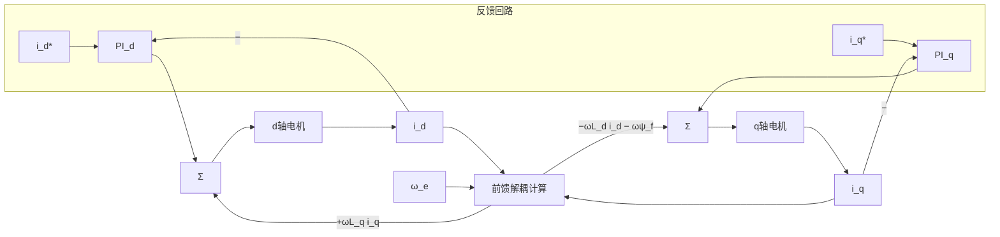
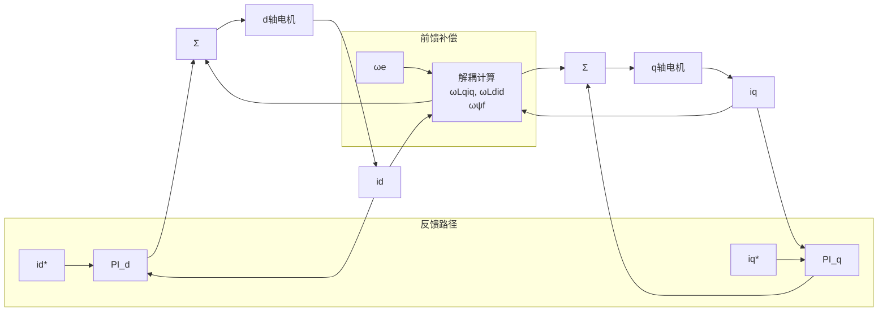

# 前馈补偿与交叉解耦

> **为什么学？**
> 旋转坐标系下的 d、q 轴电压天然相互耦合，并且 q 轴还叠加了与转速成正比的反电动势。如果不做前馈补偿，电流 PI 就要同时承担电流调节和扰动抑制；更麻烦的是，电感参数不准或磁路饱和时，解耦会残留误差，高速下直接恶化电流波形。
>
> **在 FOC 中的作用**
> 这一节在电流环 PI 与逆 Park 变换之间，负责生成并叠加交叉耦合与反电动势的前馈补偿项。它让 PI 控制器只需对付参数不确定性和未建模扰动，把“可预测的已知扰动”提前抵消。

把反馈 PI 与前馈解耦画成两条并行的“加法”支路，就能理解：PI 负责把电流误差压到 0，前馈负责把已知的转速-电流耦合项和反电动势预先抵消，二者相加才是真正的 d、q 轴电压指令。



*图：前馈补偿与反馈 PI 的分工。前馈抵消已知的交叉耦合和反电动势，PI 只处理剩余误差和未建模扰动。*

解耦与 Id=0 控制给出了前馈补偿的基本思路，但那一节主要面向表贴式电机且假设参数精确。对于内置式电机或参数存在误差的情况，需要更一般化的电压方程、耦合矩阵和误差分析。

## 1. 数学推导

### 1.1 dq轴电压方程的完整形式

为什么要做这一步：要推导前馈补偿律，首先得写出包含 $L_d \neq L_q$ 的完整 dq 轴电压方程，才能看清所有耦合项。

PMSM在dq旋转坐标系下的电压方程为：

$$
\begin{cases}
u_d = R_s i_d + L_d \frac{di_d}{dt} - \omega_e L_q i_q \\
u_q = R_s i_q + L_q \frac{di_q}{dt} + \omega_e L_d i_d + \omega_e \psi_f
\end{cases}
$$

对于IPMSM（内置式永磁同步电机），$L_d \neq L_q$，交叉耦合项更复杂。对于SPMSM，$L_d = L_q = L_s$，方程简化为：

$$
\begin{cases}
u_d = R_s i_d + L_s \frac{di_d}{dt} - \omega_e L_s i_q \\
u_q = R_s i_q + L_s \frac{di_q}{dt} + \omega_e L_s i_d + \omega_e \psi_f
\end{cases}
$$

### 1.2 交叉耦合项的物理来源

为什么要做这一步：交叉耦合不是电机本身的物理耦合，而是旋转坐标系引入的“运动电动势”；把它写成矩阵形式，便于程序实现。

交叉速度项来自坐标系旋转。对凸极电机，静止 $\alpha\beta$ 坐标系中的等效电感矩阵随转子角度变化；变换到与转子同步的 $dq$ 坐标系后，在理想线性模型中可写为常值对角阵：

$$
\mathbf{L}_{dq} = \begin{bmatrix} L_d & 0 \\ 0 & L_q \end{bmatrix}
$$

而电压方程中的旋转电动势项来自：

$$
\mathbf{v}_{dq} = R_s \mathbf{i}_{dq} + \mathbf{L}_{dq} \frac{d\mathbf{i}_{dq}}{dt} + \omega_e \begin{bmatrix} 0 & -L_q \\ L_d & 0 \end{bmatrix} \mathbf{i}_{dq} + \begin{bmatrix} 0 \\ \omega_e \psi_f \end{bmatrix}
$$

定义交叉耦合矩阵：

$$
\mathbf{C}(\omega_e) = \omega_e \begin{bmatrix} 0 & -L_q \\ L_d & 0 \end{bmatrix}
$$

反电动势矢量：

$$
\mathbf{e}_{dq} = \begin{bmatrix} 0 \\ \omega_e \psi_f \end{bmatrix}
$$

### 1.3 解耦控制律推导

为什么要做这一步：前馈补偿的核心思想是把已知扰动从 PI 的任务中剥离，因此需要严格推导出抵消耦合和反电动势所需的电压分量。

若将控制器输出分为**反馈项**和**前馈补偿项**：

$$
\begin{bmatrix} u_d \\ u_q \end{bmatrix} = \begin{bmatrix} u_d^{PI} \\ u_q^{PI} \end{bmatrix} + \begin{bmatrix} u_d^{ff} \\ u_q^{ff} \end{bmatrix}
$$

要让 PI 只看到 RL 动态，电压指令应主动加入模型所需的交叉项和反电动势项：

$$
\begin{bmatrix} u_d^{ff} \\ u_q^{ff} \end{bmatrix}=\mathbf{C}(\omega_e)\mathbf{i}_{dq}+\mathbf{e}_{dq}=\begin{bmatrix}-\omega_e L_q i_q \\ \omega_e L_d i_d+\omega_e\psi_f\end{bmatrix}
$$

代入电压方程：

$$
\begin{bmatrix} u_d^{PI} \\ u_q^{PI} \end{bmatrix} = R_s \mathbf{i}_{dq} + \mathbf{L}_{dq} \frac{d\mathbf{i}_{dq}}{dt}
$$

在模型参数准确、角度同步且电压未饱和时，名义 $dq$ 对象被解耦为两个一阶 RL 环节。实际系统仍会因参数误差、饱和、延迟和逆变器非线性存在残余耦合。

### 1.4 前馈vs反馈的互补关系

**前馈补偿**的作用：消除已知扰动（转速、电流相关的耦合项），使PI控制器无需"追赶"这些可预测的变化。

**反馈PI**的作用：处理不可预测扰动（参数误差、负载变化、未建模动态），提供鲁棒性。

两者互补：前馈解决"大方向"，反馈解决"细调"。

### 1.5 参数误差对解耦的影响

为什么要做这一步：实际电感会随电流饱和变化，只有量化参数误差带来的解耦残差，才能判断是否需要在线辨识或查表补偿。

若实际电感为 $L_s$，但控制器使用估计值 $\hat{L}_s$，则解耦残差为：

$$
\Delta u_d = \omega_e (\hat{L}_s - L_s) i_q = \omega_e \Delta L_s i_q
$$

$$
\Delta u_q = -\omega_e (\hat{L}_s - L_s) i_d = -\omega_e \Delta L_s i_d
$$

误差与转速成正比。高速时若电感参数不准（如饱和导致 $L_s$ 下降），解耦不完全，电流环动态恶化。

---

## 2. 几何直观

### 交叉耦合的矢量图

```
            q轴
             ↑
             │
    -ωLdid ←─┼──→ uq(PI)
             │
             │    iq
             │
    ←────────┼─────→ d轴
             │
    -ωLqiq ←─┼──→ ud(PI)
             │
             │    id

说明：
- q轴电压受 d轴电流通过 +ωLdid 耦合影响
- d轴电压受 q轴电流通过 -ωLqiq 耦合影响
- 前馈补偿就是用额外的电压抵消这些耦合箭头
```

### 前馈+反馈控制框图



---

## 3. 数值示例

为什么要做这一步：对 IPMSM 工作点做电压分量分解，可以直观看到耦合项、反电动势和电阻压降各占多少比例，也能判断是否已触及电压极限。

**给定参数**（IPMSM）：
- $R_s = 0.3\,\Omega$
- $L_d = 2.0\,\text{mH}$, $L_q = 3.5\,\text{mH}$
- $\psi_f = 0.12\,\text{Wb}$
- $\omega_e = 400\,\text{rad/s}$（约955 rpm，p=4）
- 工作点：$i_d = -2\,\text{A}$, $i_q = 6\,\text{A}$（MTPA工作点）

**步骤1：计算交叉耦合项**

$$
u_d^{couple} = -\omega_e L_q i_q = -400 \times 0.0035 \times 6 = -8.4\,\text{V}
$$

$$
u_q^{couple} = \omega_e L_d i_d = 400 \times 0.0020 \times (-2) = -1.6\,\text{V}
$$

**步骤2：计算反电动势**

$$
u_q^{emf} = \omega_e \psi_f = 400 \times 0.12 = 48.0\,\text{V}
$$

**步骤3：计算电阻压降**

$$
u_d^{res} = R_s i_d = 0.3 \times (-2) = -0.6\,\text{V}
$$

$$
u_q^{res} = R_s i_q = 0.3 \times 6 = 1.8\,\text{V}
$$

**步骤4：总电压指令**

$$
u_d = u_d^{PI} + (-8.4)\,\text{V}, \quad \text{其中 } u_d^{PI} \approx R_s i_d = -0.6\,\text{V}
$$

$$
u_d = -0.6 - 8.4 = -9.0\,\text{V}
$$

$$
u_q = u_q^{PI} + (-1.6) + 48.0, \quad \text{其中 } u_q^{PI} \approx R_s i_q = 1.8\,\text{V}
$$

$$
u_q = 1.8 - 1.6 + 48.0 = 48.2\,\text{V}
$$

**步骤5：验证电压利用率**

$$
U_s = \sqrt{u_d^2 + u_q^2} = \sqrt{81 + 2323} = 49.0\,\text{V}
$$

若直流母线 $V_{dc} = 72\,\text{V}$，SVPWM最大输出相电压 $V_{max} = V_{dc}/\sqrt{3} = 41.6\,\text{V}$，此时已超出电压极限，需要考虑弱磁控制。

**步骤6：参数误差影响**

若控制器误用 $L_q = 3.0\,\text{mH}$（实际3.5mH），则d轴前馈补偿误差：

$$
\Delta u_d = \omega_e (\hat{L}_q - L_q) i_q = 400 \times (-0.0005) \times 6 = -1.2\,\text{V}
$$

该 $-1.2\,\text{V}$ 残差需要由 PI 反馈校正。它造成多大电流瞬态误差还取决于 $R_s$、$L_d$、闭环带宽和持续时间，不能只由“相对 PI 电压约 10%”直接推出 10% 电流误差。

---

## 4. 代码实现

为什么要做这一步：写解耦代码时要区分 SPMSM 和 IPMSM，并保证符号与 Park 约定一致。前馈电流可选测量值、指令值或两者组合，选择依据是瞬态准确性、噪声和计算延迟。

### C语言：完整解耦+前馈补偿

```c
// 电机参数（IPMSM）
#define RS      0.3f
#define LD      0.0020f
#define LQ      0.0035f
#define PSIF    0.12f

// 解耦与前馈计算
void Decoupling_Feedforward(float id, float iq, float omega_e,
                            float *vd_dec, float *vq_dec) {
    // 交叉耦合补偿
    float cross_d = -omega_e * LQ * iq;  // d轴受q轴耦合
    float cross_q =  omega_e * LD * id;  // q轴受d轴耦合
    
    // 反电动势补偿（仅q轴）
    float emf_q = omega_e * PSIF;
    
    *vd_dec = cross_d;
    *vq_dec = cross_q + emf_q;
}

// 完整电压输出
void Voltage_Command(float vd_pi, float vq_pi, float id, float iq, float omega_e,
                     float *vd_cmd, float *vq_cmd) {
    float vd_dec, vq_dec;
    Decoupling_Feedforward(id, iq, omega_e, &vd_dec, &vq_dec);
    
    *vd_cmd = vd_pi + vd_dec;
    *vq_cmd = vq_pi + vq_dec;
}

// 仅前馈控制（无反馈，用于演示）
void Feedforward_Only_Control(float id_ref, float iq_ref, float omega_e,
                               float *vd_cmd, float *vq_cmd) {
    // 稳态近似：PI输出 ≈ 电阻压降
    float vd_pi = RS * id_ref;
    float vq_pi = RS * iq_ref;
    
    Voltage_Command(vd_pi, vq_pi, id_ref, iq_ref, omega_e, vd_cmd, vq_cmd);
}
```

### MATLAB：解耦效果对比

```matlab
% IPMSM参数
Rs = 0.3; Ld = 2e-3; Lq = 3.5e-3; psif = 0.12;

% 工作点
id = -2; iq = 6; omega_e = 400;

% 计算各电压分量
vd_res = Rs * id;
vq_res = Rs * iq;
vd_cross = -omega_e * Lq * iq;
vq_cross = omega_e * Ld * id;
vq_emf = omega_e * psif;

vd_total = vd_res + vd_cross;
vq_total = vq_res + vq_cross + vq_emf;

fprintf('=== 电压分量分解 ===\n');
fprintf('电阻: vd=%.2f V, vq=%.2f V\n', vd_res, vq_res);
fprintf('耦合: vd=%.2f V, vq=%.2f V\n', vd_cross, vq_cross);
fprintf('反电势: vq=%.2f V\n', vq_emf);
fprintf('总电压: vd=%.2f V, vq=%.2f V\n', vd_total, vq_total);
fprintf('电压幅值: %.2f V\n', sqrt(vd_total^2 + vq_total^2));

% 对比：有解耦 vs 无解耦的阶跃响应
% （使用Simulink模型验证）
```

---

## 5. 常见错误

### 错误1：不经分析地固定使用指令值或原始反馈值

**错误做法**：
```c
float vd_dec = -omega_e * Ls * iq_ref;  // 仅按指令前馈
```

**后果**：动态过程中，指令值可能提前于实际电流，造成暂时过补偿；未经滤波的反馈值则会把测量噪声和采样尖峰直接耦合到电压指令。哪种误差更严重取决于电流环带宽、采样质量和电压裕量。

**纠正方法**：优先从目标动态与噪声预算出发选择，并通过阶跃测试验证。例如可使用限幅、轻度滤波后的反馈值：
```c
float vd_dec = -omega_e * Ls * iq_fbk_filtered;
float vq_dec =  omega_e * Ls * id_fbk_filtered + omega_e * psif;
```

### 错误2：高速时忽略电感饱和，使用固定参数解耦

**错误做法**：在全部工作范围内使用标称电感值 $L_s = 2.5\,\text{mH}$，不考虑电流增大时的饱和效应。

**后果**：大电流时磁路饱和，实际电感下降（如 $L_s$ 降至2.0mH），前馈补偿量 $-\omega_e L_s i_q$ 计算偏大，导致解耦不完全。高速大电流工况下，d轴电流出现不可忽略的瞬态分量，影响转矩精度。

**纠正方法**：
- 离线测量不同电流下的电感值，建立二维查表 $L_d(i_d, i_q)$、$L_q(i_d, i_q)$；
- 或在线自适应辨识电感参数；
- 若采用小于 1 的前馈增益，应把它作为经频响或阶跃验证的鲁棒性折中，并记录适用工作区间，不能把固定 0.8 当作通用经验值。

---

## 6. 自测习题

### 习题1

某SPMSM参数：$L_s = 3\,\text{mH}$，$\psi_f = 0.15\,\text{Wb}$。在 $\omega_e = 500\,\text{rad/s}$ 时，$i_d = 0$，$i_q = 4\,\text{A}$。求：

(1) 交叉耦合项和反电动势的大小；
(2) 若控制器使用的电感参数为 $2.5\,\text{mH}$（实际3.0mH），计算d轴解耦残差；
(3) 该残差在PI控制器带宽 $500\,\text{Hz}$ 下的稳态影响是否可忽略？

**答案**：

(1) d轴耦合：$-\omega_e L_s i_q = -500 \times 0.003 \times 4 = -6.0\,\text{V}$；q轴耦合：$\omega_e L_s i_d = 0$；反电动势：$\omega_e \psi_f = 500 \times 0.15 = 75.0\,\text{V}$

(2) 残差 = $\omega_e (\hat{L}_s - L_s) i_q = 500 \times (-0.0005) \times 4 = -1.0\,\text{V}$

(3) 电流环稳态增益约1/Rs，若Rs=0.5Ω，稳态电流误差约1.0/0.5 = 2A。相对4A的指令，误差达50%，**不可忽略**。需使用在线参数辨识或查表补偿。

### 习题2

证明：在SPMSM的Id=0控制中，若前馈补偿完全正确，d轴电流环的闭环传递函数与q轴完全相同，且与转速无关。

**答案**：

完全解耦后，d轴和q轴电压方程分别为：

$$v_d' = R_s i_d + L_s \frac{di_d}{dt}, \quad v_q' = R_s i_q + L_s \frac{di_q}{dt}$$

两式形式完全相同，均为 $G(s) = 1/(R_s + L_s s)$。转速 $\omega_e$ 仅出现在前馈补偿项中，解耦后被完全消除。因此d轴和q轴闭环特性一致，且与转速无关。证毕。

---

> **延伸阅读**：电流环PI设计见 `002-电流环PI控制器设计.md`；MTPA控制见 `005-MTPA最大转矩电流比控制.md`。
