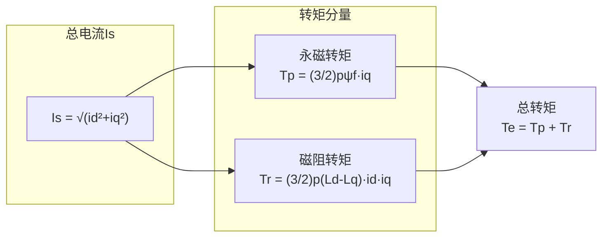

# MTPA最大转矩电流比控制

> **为什么学？**
> 对于内置式永磁同步电机，$i_d=0$ 会浪费磁阻转矩，导致同样转矩下需要更大的电流、更高的铜损，甚至更早触及电流极限。不理解 MTPA，就会在设计高效驱动系统时直接套用 SPMSM 的策略，造成效率下降或发热严重。
>
> **在 FOC 中的作用**
> MTPA 位于转矩指令生成环节，根据目标转矩输出最优的 $i_d^*$、$i_q^*$ 组合，再交给电流环执行。它是 IPMSM 基速以下实现“最小电流、最大转矩”的核心策略。

对比 Id=0 与 MTPA 的电流分配策略，就能看出：IPMSM 通过主动注入负 $i_d$ 产生磁阻转矩，可以在相同转矩下用更小的总电流。

```mermaid
graph LR
    subgraph Id=0控制
        A1["T_e*"] --> B1["i_d* = 0"]
        B1 --> C1["i_q* = T_e / Kt"]
        C1 --> D1["I_s = i_q*"]
    end

    subgraph MTPA控制
        A2["T_e*"] --> B2["min √(i_d²+i_q²)<br/>s.t. T_e = T_e*"]
        B2 --> C2["i_d* < 0"]
        B2 --> D2["i_q*"]
        C2 --> E2["I_s = √(i_d²+i_q²)"]
        D2 --> E2
    end

    D1 -.->|"相同转矩"| E2
```

*图：Id=0 与 MTPA 的电流分配对比。MTPA 通过引入负 $i_d$ 的磁阻转矩分量，降低相同转矩所需的总电流。*

Id=0 控制简单直接，但它只对表贴式电机最优；对于凸极明显的内置式电机，必须主动利用负 $i_d$ 产生的磁阻转矩。MTPA 就是要在给定转矩下找到消耗电流最少的那一组 $i_d$、$i_q$。

## 1. 数学推导

### 1.1 IPMSM转矩方程

为什么要做这一步：要优化电流，首先必须把 IPMSM 转矩拆成永磁转矩和磁阻转矩两部分，才能看出 $i_d\u003c0$ 为什么能增效。

内置式永磁同步电机（IPMSM）的电磁转矩包含两个分量：

$$
T_e = \frac{3}{2} p \left[ \psi_f i_q + (L_d - L_q) i_d i_q \right]
$$

其中：
- 第一项 $\frac{3}{2}p\psi_f i_q$：永磁转矩（由永磁体磁场产生）
- 第二项 $\frac{3}{2}p(L_d - L_q)i_d i_q$：磁阻转矩（由凸极效应产生，$L_d < L_q$）

由于 $L_d < L_q$，令 $i_d < 0$ 时磁阻转矩为**正值**，与永磁转矩叠加。

### 1.2 MTPA优化问题建模

为什么要做这一步：MTPA 的数学目标很明确——在转矩约束下最小化电流幅值；把它写成优化问题才能用拉格朗日法求解。

在**给定转矩**下，使定子电流幅值最小，即：

$$
\min_{i_d, i_q} \quad I_s = \sqrt{i_d^2 + i_q^2}
$$

约束条件：

$$
T_e = \frac{3}{2} p \left[ \psi_f i_q + (L_d - L_q) i_d i_q \right] = T_e^*\,\text{(常数)}
$$

### 1.3 拉格朗日乘子法推导

为什么要做这一步：用拉格朗日乘子法把带约束优化转化为无约束优化，是推导 MTPA 轨迹的标准途径。

构建拉格朗日函数：

$$
\mathcal{L} = i_d^2 + i_q^2 + \lambda \left[ T_e^* - \frac{3}{2} p \psi_f i_q - \frac{3}{2} p (L_d - L_q) i_d i_q \right]
$$

对 $i_d$ 和 $i_q$ 求偏导并令其为零：

$$
\frac{\partial \mathcal{L}}{\partial i_d} = 2i_d - \lambda \cdot \frac{3}{2} p (L_d - L_q) i_q = 0
$$

$$
\frac{\partial \mathcal{L}}{\partial i_q} = 2i_q - \lambda \cdot \frac{3}{2} p \left[ \psi_f + (L_d - L_q) i_d \right] = 0
$$

从第一式得：

$$
\lambda = \frac{2i_d}{\frac{3}{2}p(L_d-L_q)i_q}
$$

代入第二式：

$$
2i_q = \frac{2i_d}{\frac{3}{2}p(L_d-L_q)i_q} \cdot \frac{3}{2}p \left[ \psi_f + (L_d - L_q) i_d \right]
$$

化简：

$$
i_q^2 = i_d \left[ \psi_f + (L_d - L_q) i_d \right] \cdot \frac{1}{L_d - L_q}
$$

$$
i_q^2 = \frac{\psi_f i_d}{L_d - L_q} + i_d^2
$$

$$
\boxed{i_q^2 = i_d^2 + \frac{\psi_f}{L_d - L_q} i_d}
$$

这是MTPA轨迹在dq平面上的隐式方程。

### 1.4 显式解（解析公式）

为什么要做这一步：得到解析解或查表后， MCU 才能根据实时转矩指令快速计算出 $i_d^*$、$i_q^*$，而不必每次都做迭代优化。

上式可改写为：

$$
i_q^2 = i_d \left( i_d + \frac{\psi_f}{L_d - L_q} \right)
$$

令 $L_{diff} = L_q - L_d > 0$（因为 $L_d < L_q$），则：

$$
i_q^2 = i_d^2 - \frac{\psi_f}{L_{diff}} i_d
$$

或写成：

$$
i_q=\sqrt{i_d^2-\frac{\psi_f}{L_{diff}}i_d}
$$

把隐式轨迹看成“给定 $i_q$ 求 $i_d$”，可得：

$$
\boxed{i_d = \frac{\psi_f}{2(L_q - L_d)} - \sqrt{\frac{\psi_f^2}{4(L_q - L_d)^2} + i_q^2}}
$$

实际工程中更常用**等转矩曲线与最小电流圆的切点**几何理解，或查表法实现。

### 1.5 电流角表示

为什么要做这一步：电流角表示把 MTPA 条件与总电流幅值直接关联，适合用查表或近似公式在线实现。

定义电流矢量角度 $\beta$（从q轴顺时针方向测量）：

$$
i_d = -I_s \sin\beta, \quad i_q = I_s \cos\beta
$$

代入转矩方程：

$$
T_e = \frac{3}{2} p \left[ \psi_f I_s \cos\beta + (L_d - L_q) I_s^2 (-\sin\beta)\cos\beta \right]
$$

对 $\beta$ 求导并令其为零，得MTPA条件：

$$
\boxed{\sin\beta = \frac{-\psi_f + \sqrt{\psi_f^2 + 8(L_q - L_d)^2 I_s^2}}{4(L_q - L_d) I_s}}
$$

或简化为：

$$
\tan\beta=-\frac{i_d}{i_q}=\frac{-\psi_f+\sqrt{\psi_f^2+4(L_q-L_d)^2i_q^2}}{2(L_q-L_d)i_q}
$$

这里 $\beta$ 从正 $q$ 轴向负 $d$ 轴方向计为正，因此 $i_d=-I_s\sin\beta$，不能把 $\tan\beta$ 写成 $i_d/i_q$。

---

## 2. 几何直观

### MTPA轨迹在dq平面上的位置

```
            q轴 (iq)
             ↑
             │      ╭────── 等电流圆 (Is = const)
             │     ╱
             │    ╱  MTPA轨迹
             │   ╱
             │  ●  ←  MTPA工作点（等转矩曲线与圆切点）
             │ ╱
             │╱
    ─────────┼────┬────┬────┬──→ d轴 (id)
             │   -2   -4   -6
             │
             │

等转矩曲线：Te = const 的双曲线
MTPA轨迹：所有等转矩曲线与最小电流圆的切点连线
```

### 转矩分量分解



---

## 3. 数值示例

为什么要做这一步：通过小转矩和大转矩两个工况对比，可以看出 MTPA 在什么情况下优势明显、什么情况下收益有限。

**给定参数**（IPMSM）：
- $p = 4$
- $\psi_f = 0.1\,\text{Wb}$
- $L_d = 2.0\,\text{mH}$, $L_q = 5.0\,\text{mH}$
- $L_{diff} = L_q - L_d = 3.0\,\text{mH}$
- 目标转矩：$T_e = 2.0\,\text{N·m}$

**步骤1：对比Id=0 vs MTPA策略**

**Id=0策略**：$i_d = 0$，转矩方程简化为：

$$
T_e = \frac{3}{2} p \psi_f i_q = \frac{3}{2} \times 4 \times 0.1 \times i_q = 0.6 i_q
$$

$$
i_q = 2.0/0.6 = 3.33\,\text{A}, \quad I_s = 3.33\,\text{A}
$$

**MTPA策略**：利用 MTPA 隐式轨迹：

$$
i_q^2 = i_d^2 + \frac{\psi_f}{L_d - L_q} i_d = i_d^2 - \frac{0.1}{0.003} i_d = i_d^2 - 33.33 i_d
$$

并同时满足转矩约束：

$$
2.0=0.6i_q-0.018i_di_q
$$

联立数值求解得到：

$$i_d\approx-0.324\,\text{A},\qquad i_q\approx3.301\,\text{A}$$

双重校验：

$$i_q^2\approx10.899,\qquad i_d^2-33.33i_d\approx10.899$$

$$T_e=0.6\times3.301-0.018\times(-0.324)\times3.301\approx2.000\,\text{N·m}$$

$$I_s=\sqrt{(-0.324)^2+3.301^2}\approx3.317\,\text{A}$$

**步骤2：对比总结**

| 策略 | $i_d$ (A) | $i_q$ (A) | $I_s$ (A) | 铜损相对值 |
|------|----------|----------|----------|----------|
| Id=0 | 0 | 3.33 | 3.33 | 1.00 |
| MTPA | -0.324 | 3.301 | 3.317 | 0.990 |

本例转矩较小时磁阻转矩贡献有限，MTPA 仅把电流平方（也即定电阻下的铜损）降低约 $1.0\%$，但它仍不会比可行的 $i_d=0$ 点更差。转矩提高到 $5\,\text{N·m}$ 时：
- Id=0：$i_q = 8.33\,\text{A}$, $I_s = 8.33\,\text{A}$
- MTPA：$i_d\approx-1.782\,\text{A}$，$i_q\approx7.910\,\text{A}$，$I_s\approx8.109\,\text{A}$，电流平方降低约 $5.3\%$。

---

## 4. 代码实现

为什么要做这一步：工程上常用查表法实现 MTPA，因为实时迭代会占用大量 CPU；同时要注意查表精度和插值平滑。

### C语言：查表法MTPA实现

```c
#include <math.h>

// 电机参数
#define LD      0.0020f
#define LQ      0.0050f
#define PSIF    0.1f
#define POLE_PAIRS  4

#define MTPA_TABLE_SIZE  64

// MTPA查表结构
typedef struct {
    float iq_ref[MTPA_TABLE_SIZE];
    float id_ref[MTPA_TABLE_SIZE];
    float te_max;  // 表中转矩范围
} MTPA_LookupTable;

// 离线生成MTPA表（运行一次或预计算）
void MTPA_GenerateTable(MTPA_LookupTable *table) {
    float Ldiff = LQ - LD;
    float Kt = 1.5f * POLE_PAIRS * PSIF;
    float Kr = 1.5f * POLE_PAIRS * (LD - LQ);  // 负值
    
    // 转矩范围 0 ~ 10 N·m
    float Te_max = 10.0f;
    table->te_max = Te_max;
    
    for (int i = 0; i < MTPA_TABLE_SIZE; i++) {
        float Te = i * Te_max / (MTPA_TABLE_SIZE - 1);
        
        // 解析解：id = [ψf - sqrt(ψf² + 4*Ldiff²*iq²)] / (2*Ldiff)
        // 迭代求解iq
        float iq = Te / Kt;  // Id=0近似作为初值
        float id;
        
        for (int iter = 0; iter < 10; iter++) {
            id = (PSIF - sqrtf(PSIF*PSIF + 4*Ldiff*Ldiff*iq*iq)) / (2*Ldiff);
            // id为负值
            float Te_est = Kt * iq + Kr * id * iq;
            iq = iq * Te / Te_est;  // 修正iq
        }
        
        table->iq_ref[i] = iq;
        table->id_ref[i] = id;
    }
}

// 在线查表+线性插值
void MTPA_Lookup(MTPA_LookupTable *table, float Te_ref, 
                 float *id_ref, float *iq_ref) {
    if (Te_ref < 0) Te_ref = 0;
    if (Te_ref > table->te_max) Te_ref = table->te_max;
    
    float idx_f = Te_ref / table->te_max * (MTPA_TABLE_SIZE - 1);
    int idx = (int)idx_f;
    if (idx >= MTPA_TABLE_SIZE - 1) idx = MTPA_TABLE_SIZE - 2;
    
    float frac = idx_f - idx;
    
    *id_ref = table->id_ref[idx] * (1-frac) + table->id_ref[idx+1] * frac;
    *iq_ref = table->iq_ref[idx] * (1-frac) + table->iq_ref[idx+1] * frac;
}

// 近似公式法（实时计算，无查表）
void MTPA_Approximate(float Te_ref, float *id_ref, float *iq_ref) {
    float Ldiff = LQ - LD;
    float Kt = 1.5f * POLE_PAIRS * PSIF;
    
    // 小转矩近似：id ≈ 0
    // 大转矩近似：id ≈ -ψf/(2*Ldiff) + ...
    
    // 使用经验公式：id = (ψf / (2*Ldiff)) * (1 - sqrt(1 + 4*(Ldiff*Te_ref/(Kt*PSIF))²))
    float x = Ldiff * Te_ref / (Kt * PSIF);
    float sqrt_term = sqrtf(1.0f + 4.0f * x * x);
    *id_ref = (PSIF / (2.0f * Ldiff)) * (1.0f - sqrt_term);
    
    // 由转矩方程反求iq
    float Kr = 1.5f * POLE_PAIRS * (LD - LQ);
    *iq_ref = Te_ref / (Kt + Kr * (*id_ref));
}
```

### MATLAB：MTPA轨迹绘制

```matlab
% IPMSM参数
p = 4; psif = 0.1; Ld = 2e-3; Lq = 5e-3;

% 生成等转矩曲线
id_range = -8:0.1:0;
figure; hold on; grid on;

for Te = [1, 2, 5, 8, 10]
    iq = zeros(size(id_range));
    for i = 1:length(id_range)
        id = id_range(i);
        % 由转矩方程解iq
        a = 1.5*p*(Ld-Lq)*id + 1.5*p*psif;
        iq(i) = Te / a;
    end
    plot(id_range, iq, 'b--');
end

% 绘制MTPA轨迹
Is_range = 0:0.1:10;
id_mtpa = zeros(size(Is_range));
iq_mtpa = zeros(size(Is_range));

for i = 1:length(Is_range)
    Is = Is_range(i);
    % MTPA条件：iq² = id² + (psif/(Ld-Lq))*id
    % 联立 id² + iq² = Is²
    % 代入：id² + id² + (psif/(Ld-Lq))*id = Is²
    % 2*id² + (psif/(Ld-Lq))*id - Is² = 0
    a = 2; b = psif/(Ld-Lq); c = -Is^2;
    id_sol = (-b - sqrt(b^2 - 4*a*c)) / (2*a);  % 取负根
    iq_sol = sqrt(Is^2 - id_sol^2);
    id_mtpa(i) = id_sol;
    iq_mtpa(i) = iq_sol;
end

plot(id_mtpa, iq_mtpa, 'r-', 'LineWidth', 2);
plot(id_range, sqrt(id_range.^2 - psif/(Ld-Lq)*id_range), 'g-.');

xlabel('i_d (A)'); ylabel('i_q (A)');
legend('等转矩曲线', 'MTPA轨迹', 'MTPA隐式方程');
title('MTPA轨迹与等转矩曲线');
```

---

## 5. 常见错误

### 错误1：SPMSM误用MTPA，导致不必要的计算和性能下降

**错误认知**：认为MTPA对所有永磁电机都适用，在SPMSM（$L_d \approx L_q$）上也实现MTPA算法。

**后果**：对于SPMSM，$L_d - L_q \approx 0$，磁阻转矩几乎为零。MTPA轨迹退化为 $i_d = 0$（由MTPA隐式方程，当 $L_d = L_q$ 时，$i_q^2 = i_d^2 + \infty \cdot i_d$，仅在 $i_d = 0$ 时有有限解）。实现MTPA查表或迭代计算增加了代码复杂度和CPU负担，却没有性能收益。

**纠正方法**：
- SPMSM直接采用 $i_d = 0$ 控制；
- IPMSM才需要MTPA；
- 代码中可通过判断 $(L_q - L_d)/L_d$ 是否大于阈值（如>5%）来决定是否启用MTPA。

### 错误2：MTPA查表分辨率不足，导致电流指令抖动

**错误做法**：MTPA查表仅有16个条目，转矩指令在查表边界附近波动时，$i_d$ 和 $i_q$ 出现量化跳变。

**后果**：电流环跟踪跳变的指令，产生转矩脉动和噪声，尤其在低速时明显。

**纠正方法**：
- 查表条目至少64~128个；
- 必须配合线性插值（或三次样条插值）；
- 对输出 $i_d^*$、$i_q^*$ 加一阶低通滤波器平滑（截止频率设为速度环带宽的2~3倍）。

---

## 6. 自测习题

### 习题1

某IPMSM参数：$p=4$，$\psi_f=0.08\,\text{Wb}$，$L_d=1.5\,\text{mH}$，$L_q=4.5\,\text{mH}$。求：

(1) MTPA轨迹的隐式方程；
(2) 当 $i_d = -1\,\text{A}$ 时，对应的MTPA点的 $i_q$ 和总电流 $I_s$；
(3) 该点的永磁转矩和磁阻转矩各为多少？

**答案**：

(1) $i_q^2 = i_d^2 + \frac{0.08}{0.0015-0.0045} i_d = i_d^2 - 26.67 i_d$

(2) $i_q = \sqrt{1 + 26.67} = 5.26\,\text{A}$，$I_s = \sqrt{1 + 27.67} = 5.35\,\text{A}$

(3) 永磁转矩：$T_p = \frac{3}{2} \times 4 \times 0.08 \times 5.26 = 2.53\,\text{N·m}$

磁阻转矩：$T_r = \frac{3}{2} \times 4 \times (-0.003) \times (-1) \times 5.26 = 0.095\,\text{N·m}$

总转矩：$T_e = 2.62\,\text{N·m}$

### 习题2

证明：对于上述线性 IPMSM 模型，当正向转矩 $T_e\to0$ 时，MTPA 轨迹趋近于原点；当 $T_e\to\infty$ 时，证明 $i_d/i_q\to-1$。

**答案**：

由MTPA隐式方程 $i_q^2 = i_d^2 + \frac{\psi_f}{L_d-L_q}i_d$。

当 $T_e\to0$ 时，最小电流解显然应满足 $I_s\to0$，故选择通过原点的 MTPA 分支 $i_d\to0$、$i_q\to0$。令 $i_q=0$ 时隐式方程的另一根 $i_d=\psi_f/(L_q-L_d)>0$ 虽然也给出零转矩，但电流非零，不可能是最小电流解。

令 $A=\psi_f/[2(L_q-L_d)]>0$。由显式式
$$i_d=A-\sqrt{A^2+i_q^2}$$
可得，当 $i_q\to+\infty$ 时，$i_d=-i_q+A+o(1)$，因此 $i_d/i_q\to-1$，电流角 $\beta\to45^\circ$。高电流下磁阻转矩项占主导，轨迹渐近于斜率为 $-1$ 的直线，而不是趋近于某个固定 $i_d$。实际电机进入深度饱和前，常参数模型往往已不再适用。

---

> **延伸阅读**：弱磁控制与电压极限见 `006-弱磁控制与电压极限.md`；前馈补偿见 `004-前馈补偿与交叉解耦.md`。
