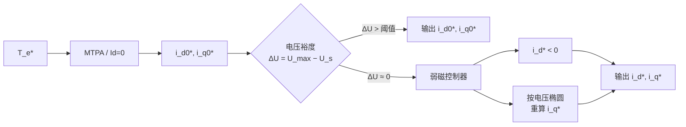
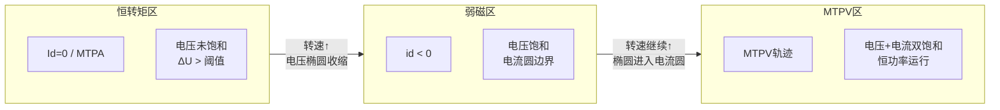

# 弱磁控制与电压极限

> **为什么学？**
> 永磁电机的反电动势随转速线性上升，当转速超过基速后，即使电流环饱和也无法输出足够电压，电机速度被“锁住”。弱磁控制通过注入负 $i_d$ 来抵消永磁磁链，从而扩展恒功率调速范围；但弱磁过深又会导致磁链反向、电机失控，必须精确设计。
>
> **在 FOC 中的作用**
> 弱磁控制位于 MTPA/Id=0 与电流环之间，根据当前转速和电压裕度实时修正 $i_d^*$、$i_q^*$。它是高速区突破电压极限、实现宽范围调速的关键环节。

把弱磁控制器的决策流程画出来，就能理解：基速以下走 MTPA/Id=0，电压饱和后自动切换到弱磁模式，按电压椭圆约束重新分配 d、q 轴电流。



*图：弱磁控制器的切换逻辑。电压未饱和时沿用恒转矩区电流分配；电压饱和后启用弱磁，在电压椭圆约束下重新计算工作点。*

MTPA 和 Id=0 解决的是基速以下“用最小电流产生转矩”的问题；当转速升高、反电动势逼近逆变器输出能力时，控制目标就转变为“在电压约束下尽量维持转矩”，这正是弱磁控制要处理的工作区。

## 1. 数学推导

### 1.1 电压极限椭圆与电流极限圆

为什么要做这一步：要判断电机何时会电压饱和，必须先把稳态电压方程与逆变器电压极限结合起来，画出电压极限椭圆。

在稳态下（$di_d/dt = di_q/dt = 0$），dq轴电压方程为：

$$
\begin{cases}
u_d = R_s i_d - \omega_e L_q i_q \\
u_q = R_s i_q + \omega_e L_d i_d + \omega_e \psi_f
\end{cases}
$$

定子电压幅值受逆变器直流母线限制：

$$
U_s = \sqrt{u_d^2 + u_q^2} \leq U_{max} = \frac{V_{dc}}{\sqrt{3}}
$$

将稳态电压方程代入：

$$
(R_s i_d - \omega_e L_q i_q)^2 + (R_s i_q + \omega_e L_d i_d + \omega_e \psi_f)^2 \leq U_{max}^2
$$

在高速区，电阻压降 $R_s i_d, R_s i_q$ 相对较小，可忽略：

$$
(\omega_e L_q i_q)^2 + (\omega_e L_d i_d + \omega_e \psi_f)^2 \leq U_{max}^2
$$

两边除以 $\omega_e^2$：

$$
(L_q i_q)^2 + (L_d i_d + \psi_f)^2 \leq \left(\frac{U_{max}}{\omega_e}\right)^2
$$

这是**电压极限椭圆**方程，半轴随 $\omega_e$ 增大而收缩：

- d轴半轴：$a = \frac{U_{max}}{\omega_e L_d}$
- q轴半轴：$b = \frac{U_{max}}{\omega_e L_q}$
- 中心偏移：$(-\frac{\psi_f}{L_d}, 0)$

同时，逆变器和电机电流受额定值限制：

$$
I_s = \sqrt{i_d^2 + i_q^2} \leq I_{max}
$$

这是**电流极限圆**。

### 1.2 弱磁控制的物理原理

为什么要做这一步：弱磁的物理本质是用 d 轴电枢反应去抵消永磁体磁链，从而降低等效反电动势；这一点是设计弱磁控制器的直观依据。

当转速升高到电压极限时，若要继续提速，必须降低反电动势。反电动势与永磁体磁链成正比：

$$
E = \omega_e \psi_f
$$

通过产生负的d轴电流（$i_d < 0$），d轴电枢反应产生与永磁体磁场相反的磁通：

$$
\psi_d = L_d i_d + \psi_f < \psi_f
$$

从而等效降低反电动势，使电机能在更高转速下运行。

### 1.3 恒功率区运行的数学条件

在恒功率区，电压极限椭圆与电流极限圆相交，工作点位于两者的交点处。

令电流圆：$i_d^2 + i_q^2 = I_{max}^2$

电压椭圆（忽略电阻）：$(L_d i_d + \psi_f)^2 + (L_q i_q)^2 = (U_{max}/\omega_e)^2$

在高速极限时，电压椭圆收缩到完全在电流圆内部，工作点由电压椭圆决定（电压饱和）。

### 1.4 MTPV最大转矩电压比轨迹

为什么要做这一步：电压饱和后，优化目标从“单位电流最大转矩”变成“单位电压最大转矩”，需要重新推导 MTPV 轨迹。

在弱磁区，电压已饱和，目标是**在电压约束下产生最大转矩**，即MTPV（Maximum Torque Per Voltage）。

优化问题：

$$
\max_{i_d, i_q} T_e = \frac{3}{2}p[\psi_f i_q + (L_d - L_q)i_d i_q]
$$

约束：$(L_d i_d + \psi_f)^2 + (L_q i_q)^2 = (U_{max}/\omega_e)^2$

用拉格朗日法求解，得MTPV条件：

$$
\boxed{i_d = \frac{-\psi_f + \sqrt{\psi_f^2 + 4L_d^2 i_q^2}}{2L_d}}
$$

或隐式形式：

$$
\psi_f i_d + L_d i_d^2 = L_q i_q^2
$$

### 1.5 弱磁区切换逻辑

为什么要做这一步：实际控制器需要根据实时电压裕度判断当前处于恒转矩区、弱磁区还是深度弱磁区，再切换不同的电流分配策略。

定义电压裕度：

$$
\Delta U = U_{max} - \sqrt{u_d^2 + u_q^2}
$$

弱磁控制策略：
- **Zone 1（恒转矩区）**：$\Delta U > \Delta U_{threshold}$，$i_d = 0$（SPMSM）或MTPA（IPMSM）
- **Zone 2（弱磁区）**：$\Delta U \approx 0$，按电压椭圆调节 $i_d < 0$
- **Zone 3（深度弱磁/MTPV）**：电压极限严重约束，沿MTPV轨迹运行

---

## 2. 几何直观

### 电压椭圆与电流圆

```
            q轴 (iq)
             ↑
             │    ╭────── 电流极限圆 (Imax)
             │   ╱
             │  ╱ 电压极限椭圆
    ─────────┼─●────┬────┬──→ d轴 (id)
             │╱    │    │
             ●     │    │
             │     │    │
             │     │    │
             │

● = 工作点
低速时：椭圆很大，工作点在电流圆内（Id=0或MTPA）
高速时：椭圆收缩，工作点由椭圆边界决定（弱磁）
椭圆中心在 (-ψf/Ld, 0)
```

### 三区运行示意图



---

## 3. 数值示例

为什么要做这一步：通过计算基速、高速工作点和最大弱磁转速，可以验证电机的调速范围，也能判断弱磁深度是否超出安全边界。

**给定参数**（IPMSM）：
- $V_{dc} = 72\,\text{V}$，$U_{max} = 72/\sqrt{3} = 41.57\,\text{V}$
- $R_s = 0.3\,\Omega$
- $L_d = 2.0\,\text{mH}$, $L_q = 5.0\,\text{mH}$
- $\psi_f = 0.1\,\text{Wb}$
- $I_{max} = 10\,\text{A}$
- $p = 4$

**步骤1：计算基速**

基速定义为Id=0、电流为额定值时电压恰好饱和的转速：

$$
U_s^2 = (R_s i_q)^2 + (\omega_e \psi_f + R_s i_d + \omega_e L_d i_d)^2
$$

Id=0时，$i_d = 0, i_q = I_{max} = 10$：

$$
U_s = \sqrt{(0.3 \times 10)^2 + (\omega_e \times 0.1)^2} = \sqrt{9 + 0.01\omega_e^2}
$$

令 $U_s = U_{max} = 41.57$：

$$
41.57^2 = 9 + 0.01\omega_e^2
$$

$$
1728 - 9 = 0.01\omega_e^2 \Rightarrow \omega_e = \sqrt{171900} = 414.6\,\text{rad/s}
$$

对应机械转速：$n = \omega_e \times \frac{60}{2\pi p} = 414.6 \times \frac{60}{25.13} = 990\,\text{rpm}$

（若忽略电阻，$\omega_e = U_{max}/\psi_f = 415.7\,\text{rad/s}$，误差极小）

**步骤2：高速弱磁运行（$\omega_e = 800\,\text{rad/s}$）**

电压椭圆（忽略电阻）：

$$
(0.005 i_q)^2 + (0.002 i_d + 0.1)^2 = \left(\frac{41.57}{800}\right)^2 = 0.0027
$$

电流圆：$i_d^2 + i_q^2 = 100$

此时电压椭圆半轴：$a = 41.57/(800 \times 0.002) = 26.0\,\text{A}$，$b = 41.57/(800 \times 0.005) = 10.4\,\text{A}$。中心在 $(-0.1/0.002, 0) = (-50, 0)$。

椭圆远大于电流圆，说明电流尚未饱和，但电压已饱和。工作点在电压椭圆上。

由MTPV条件（电压约束下最大转矩）：

$$
\psi_f i_d + L_d i_d^2 = L_q i_q^2
$$

$$0.1 i_d + 0.002 i_d^2 = 0.005 i_q^2$$

联立电压椭圆方程：

$$(0.005 i_q)^2 + (0.002 i_d + 0.1)^2 = 0.0027$$

令 $x = i_d$，则 $i_q^2 = 20x + 0.4x^2$，代入电压椭圆：

$$0.000025(20x + 0.4x^2) + (0.002x + 0.1)^2 = 0.0027$$

$$0.0005x + 0.00001x^2 + 0.000004x^2 + 0.0004x + 0.01 = 0.0027$$

$$0.000014x^2 + 0.0009x + 0.0073 = 0$$

解得 $x \approx -6.5$（取负值），$i_d \approx -6.5\,\text{A}$

$$i_q = \sqrt{20 \times (-6.5) + 0.4 \times 42.25} = \sqrt{-130 + 16.9} = \text{无实数解}$$

说明在 $\omega_e = 800\,\text{rad/s}$ 时，电压椭圆已收缩到电流圆内部，且MTPV轨迹不与电流圆相交。实际工作点在电压椭圆与电流圆的交点处。

数值求解：

由电流圆 $i_q = \sqrt{100 - i_d^2}$，代入电压椭圆：

$$0.0025(100 - i_d^2) + (0.002i_d + 0.1)^2 = 0.0027$$

$$0.25 - 0.0025i_d^2 + 0.000004i_d^2 + 0.0004i_d + 0.01 = 0.0027$$

$$-0.002496i_d^2 + 0.0004i_d + 0.2573 = 0$$

乘以 -400：

$$0.9984i_d^2 - 0.16i_d - 102.9 = 0$$

$$i_d = \frac{0.16 + \sqrt{0.0256 + 410.6}}{1.9968} = \frac{0.16 + 20.27}{1.9968} = 10.2\,\text{A}$$（不合理，为正）

或 $i_d = \frac{0.16 - 20.27}{1.9968} = -10.1\,\text{A}$，此时 $i_q \approx 0$

说明在800rad/s时，电流几乎全部用于弱磁，几乎没有q轴电流，输出转矩接近零。这验证了永磁电机的最高转速有限。

**步骤3：最大弱磁转速**

令 $i_q = 0$，$i_d = -I_{max} = -10$：

$$U_s = |R_s i_d + \omega_e L_d i_d + \omega_e \psi_f| = |-0.003\omega_e - 0.02\omega_e + 0.1\omega_e|$$

等等，电压方程应为：

$$u_d = R_s i_d - \omega_e L_q i_q = -3\,\text{V}$$

$$u_q = R_s i_q + \omega_e L_d i_d + \omega_e \psi_f = 0 + 0.002\omega_e(-10) + 0.1\omega_e = 0.08\omega_e$$

令 $U_s = U_{max}$：

$$\sqrt{9 + (0.08\omega_e)^2} = 41.57$$

$$0.0064\omega_e^2 = 1728 - 9 = 1719$$

$$\omega_e = \sqrt{268600} = 518.3\,\text{rad/s}$$

对应 $n = 1238\,\text{rpm}$。这是该电机在10A电流极限下的最高转速（约基速的1.25倍）。

---

## 4. 代码实现

为什么要做这一步：弱磁控制器通常用电压裕度反馈来积分生成 $i_d$，并限制 $i_d$ 下限防止过弱磁；代码中还要考虑与 MTPA 的平滑切换。

### C语言：弱磁控制器

```c
#include <math.h>

#define VDC         72.0f
#define U_MAX       (VDC / 1.732f)   // 41.57V
#define RS          0.3f
#define LD          0.002f
#define LQ          0.005f
#define PSIF        0.1f
#define I_MAX       10.0f
#define POLE_PAIRS  4

// 弱磁控制器结构
typedef struct {
    float id_fw;        // 弱磁电流
    float K_fw;         // 弱磁增益
    float threshold;    // 电压裕度阈值
} Flux_Weakening_Controller;

void FW_Init(Flux_Weakening_Controller *fw) {
    fw->id_fw = 0.0f;
    fw->K_fw = 0.5f;        // 弱磁增益，可调
    fw->threshold = 2.0f;   // 电压裕度阈值（V）
}

// 简单弱磁：基于电压裕度负反馈
float FW_Update(Flux_Weakening_Controller *fw, float ud, float uq, float iq_ref) {
    float us = sqrtf(ud*ud + uq*uq);
    float delta_u = U_MAX - us;
    
    // 电压裕度不足时，增加负的id电流
    if (delta_u < fw->threshold) {
        fw->id_fw -= fw->K_fw * (fw->threshold - delta_u) * 0.001f;  // 积分式弱磁
    } else if (fw->id_fw < 0) {
        fw->id_fw += fw->K_fw * (delta_u - fw->threshold) * 0.002f;  // 退出弱磁
    }
    
    // 限制弱磁电流范围
    if (fw->id_fw < -I_MAX) fw->id_fw = -I_MAX;
    if (fw->id_fw > 0.0f) fw->id_fw = 0.0f;  // 不允许正的弱磁电流
    
    return fw->id_fw;
}

// 完整弱磁+MTPA控制
void FW_MTPA_Control(float Te_ref, float omega_e, float ud, float uq,
                    float *id_ref, float *iq_ref) {
    static Flux_Weakening_Controller fw;
    static int init = 0;
    if (!init) { FW_Init(&fw); init = 1; }
    
    // 先按MTPA计算
    float id_mtpa, iq_mtpa;
    MTPA_Lookup(Te_ref, &id_mtpa, &iq_mtpa);  // 调用MTPA查表
    
    // 检查电压裕度
    float us = sqrtf(ud*ud + uq*uq);
    
    if (us < U_MAX - 3.0f) {
        // 未饱和，直接用MTPA
        *id_ref = id_mtpa;
        *iq_ref = iq_mtpa;
    } else {
        // 电压饱和，启用弱磁
        float id_fw = FW_Update(&fw, ud, uq, iq_mtpa);
        *id_ref = id_fw;
        
        // 在电压椭圆约束下计算最大iq
        // 电压椭圆： (Ld*id + ψf)² + (Lq*iq)² = (Umax/ωe)²
        float term_d = LD * id_fw + PSIF;
        float max_iq_sq = (U_MAX*U_MAX - term_d*term_d) / (LQ*LQ);
        if (max_iq_sq < 0) max_iq_sq = 0;
        float max_iq = sqrtf(max_iq_sq);
        
        // 同时受电流圆限制
        float max_iq_cur = sqrtf(I_MAX*I_MAX - id_fw*id_fw);
        if (max_iq > max_iq_cur) max_iq = max_iq_cur;
        
        *iq_ref = max_iq;
        if (*iq_ref < 0) *iq_ref = 0;
    }
}
```

### MATLAB：弱磁区可视化

```matlab
% 参数
Vdc = 72; Umax = Vdc/sqrt(3);
Ld = 2e-3; Lq = 5e-3; psif = 0.1; Rs = 0.3;
Imax = 10;

% 绘制电流圆
theta = linspace(0, 2*pi, 360);
id_circle = Imax * cos(theta);
iq_circle = Imax * sin(theta);
figure; hold on; grid on;
plot(id_circle, iq_circle, 'k-', 'LineWidth', 1.5);

% 绘制不同转速下的电压椭圆
omega_list = [200, 400, 600, 800, 1000];  % rad/s
colors = jet(length(omega_list));

for idx = 1:length(omega_list)
    w = omega_list(idx);
    a = Umax / (w * Ld);  % d轴半轴（忽略中心偏移）
    b = Umax / (w * Lq);  % q轴半轴
    
    id_ellipse = -psif/Ld + a * cos(theta);  % 中心偏移
    iq_ellipse = b * sin(theta);
    
    plot(id_ellipse, iq_ellipse, 'Color', colors(idx,:), 'LineStyle', '--');
end

xlabel('i_d (A)'); ylabel('i_q (A)');
legend('电流极限', '电压椭圆 200rad/s', '400rad/s', '600rad/s', '800rad/s', '1000rad/s');
title('弱磁区：电压椭圆与电流极限');
axis equal;
```

---

## 5. 常见错误

### 错误1：弱磁过深，导致电机失控（过弱磁）

**错误做法**：弱磁控制器增益 $K_{fw}$ 过大，或阈值设置过严，导致 $i_d$ 负向过大，使 $L_d i_d + \psi_f < 0$。

**后果**：当 $\psi_d = L_d i_d + \psi_f < 0$ 时，d轴磁链反向，电机反电动势相位翻转，反电动势模型失效。位置观测器和电流控制器可能发散，电机失控甚至损坏。

**纠正方法**：
- 限制 $i_d \geq -\psi_f/L_d$（对于本例，$i_d \geq -0.1/0.002 = -50\,\text{A}$），实际受电流极限约束为 $i_d \geq -10\,\text{A}$；
- 软限制：设置 $i_d$ 下限为 $-0.8\psi_f/L_d$（留有安全裕度）；
- 检测 $\psi_d$ 符号，若变负则立即退出弱磁。

### 错误2：弱磁区与恒转矩区切换时产生转矩冲击

**错误做法**：在电压裕度跨越阈值时，$i_d$ 从0跳变到弱磁值（如-3A），没有平滑过渡。

**后果**：电流指令阶跃导致转矩突变，电机抖动，尤其在速度环带宽较高时明显。

**纠正方法**：
- 在恒转矩区和弱磁区之间设置**过渡带**（如电压裕度3V~5V），在过渡带内线性插值 $i_d$；
- 对 $i_d$ 指令加一阶低通滤波（截止频率约50~100Hz）；
- 使用积分型弱磁控制器（如上述代码），而非比例型。

---

## 6. 自测习题

### 习题1

某SPMSM参数：$V_{dc} = 48\,\text{V}$，$R_s = 0.5\,\Omega$，$L_s = 3\,\text{mH}$，$\psi_f = 0.08\,\text{Wb}$，$I_{max} = 8\,\text{A}$。求：

(1) 忽略电阻时的基速（电压恰好饱和时的转速）；
(2) 若要求运行在2倍基速，需要多少弱磁电流 $i_d$（假设 $i_q = 0$）？
(3) 此时逆变器能否输出该电压？若不能，说明什么？

**答案**：

(1) $U_{max} = 48/\sqrt{3} = 27.7\,\text{V}$，基速 $\omega_{base} = U_{max}/\psi_f = 27.7/0.08 = 346.4\,\text{rad/s}$

(2) 2倍基速：$\omega_e = 692.8\,\text{rad/s}$。令 $i_q = 0$，电压方程：

$$u_d = R_s i_d - 0 = 0.5 i_d$$

$$u_q = 0 + \omega_e L_s i_d + \omega_e \psi_f = 692.8 \times 0.003 i_d + 692.8 \times 0.08 = 2.08 i_d + 55.4$$

$$U_s^2 = (0.5i_d)^2 + (2.08i_d + 55.4)^2 = 27.7^2 = 767$$

展开：$0.25i_d^2 + 4.33i_d^2 + 230.5i_d + 3069 = 767$

$4.58i_d^2 + 230.5i_d + 2302 = 0$

判别式：$230.5^2 - 4 \times 4.58 \times 2302 = 53190 - 42180 = 11010 > 0$

$i_d = \frac{-230.5 + 105}{9.16} = -13.7\,\text{A}$（取负值）

但 $I_{max} = 8\,\text{A}$，因此 $|i_d| > I_{max}$。

(3) 即使将全部8A用于弱磁，$i_d = -8$：

$U_s^2 = (-4)^2 + (-16.64 + 55.4)^2 = 16 + 1503 = 1519 > 767$，仍超出电压极限。

说明该电机在 $V_{dc}=48\text{V}$、$I_{max}=8\text{A}$ 条件下**无法达到2倍基速**，需要更高的电压或电流。

### 习题2

解释为什么在弱磁区，IPMSM的MTPV轨迹与MTPA轨迹不同，并说明在什么转速下两者会相交。

**答案**：

MTPA是在**电流约束**下（电流圆边界）最大化转矩，适用于恒转矩区（电压未饱和）。MTPV是在**电压约束**下（电压椭圆边界）最大化转矩，适用于弱磁区（电压已饱和）。

在低速时，电压椭圆很大，不约束工作点，MTPV轨迹在电流圆外部；在基速附近，电压椭圆开始与电流圆相交，MTPV和MTPA的交点即为**基速点**（恒转矩区与弱磁区的分界点）。在此点，电流圆和电压椭圆相切，MTPA轨迹与电压椭圆边界相交。当转速继续升高，电压椭圆进入电流圆内部，工作点沿MTPV轨迹运行。

---

> **延伸阅读**：MTPA控制见 `005-MTPA最大转矩电流比控制.md`；电流环设计见 `002-电流环PI控制器设计.md`。
