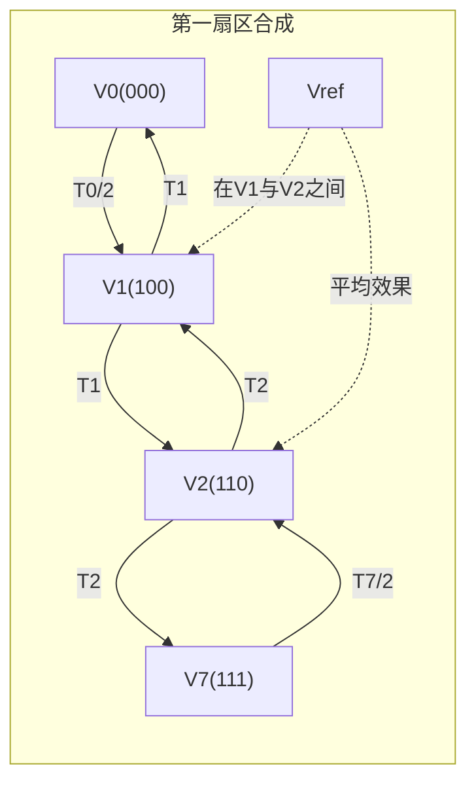

# SVPWM空间矢量调制

> **为什么学？**
> FOC 电流环输出的是旋转坐标系下的 $V_d$、$V_q$，而逆变器只能产生 8 个离散电压矢量。SVPWM 负责把连续期望电压“拟合”成开关管的通断时序。如果不会算扇区、作用时间和占空比，控制器想输出的电压和逆变器实际输出的电压就会不一致，电流环带宽和稳态精度都会受限。
>
> **在 FOC 中的作用**
> SVPWM 是 FOC 控制链路的“最后一公里”。它以 $V_\alpha$、$V_\beta$ 为输入，输出三相 PWM 占空比，直接决定电机相电压的基波分量，是连接控制算法与功率硬件的桥梁。

理解了逆变器 8 个基本开关状态之后，下一步就是：给定任意期望电压矢量 $\vec{V}_{ref}$，如何在一个 PWM 周期内用相邻的基本矢量按时间加权合成它，并把时间分配转换成三相占空比写入寄存器。

## 1. SVPWM基本原理

空间矢量脉宽调制（SVPWM）的核心思想：在任意时刻，用三相逆变器的 8 个离散开关状态所对应的电压矢量，通过时间加权平均来合成一个连续的期望电压矢量 $\vec{V}_{ref}$。

设 PWM 周期为 $T_s$，在一个周期内，期望矢量 $\vec{V}_{ref}$ 由相邻两个有效矢量 $\vec{V}_x$、$\vec{V}_{x+1}$ 和两个零矢量 $\vec{V}_0$、$\vec{V}_7$ 合成：

$$
\vec{V}_{ref} \cdot T_s = \vec{V}_x \cdot T_x + \vec{V}_{x+1} \cdot T_{x+1} + \vec{V}_0 \cdot T_0 + \vec{V}_7 \cdot T_7
$$

其中作用时间满足：

$$
T_x + T_{x+1} + T_0 + T_7 = T_s
$$

## 2. 数学推导：作用时间计算

为什么要做这一步：知道目标矢量落在哪个扇区后，必须求出相邻两个有效矢量和零矢量各自作用多久，才能让它们的伏秒平均值等于期望矢量。这是把几何合成变成可编程时序的关键。

以第一扇区（$0° \le \theta < 60°$）为例，相邻有效矢量为 $\vec{V}_1$（$(1,0,0)$）和 $\vec{V}_2$（$(1,1,0)$）。

在 $\alpha\beta$ 坐标系中：

$$
\vec{V}_1 = \frac{2U_{dc}}{3} \angle 0° = \frac{2U_{dc}}{3}
$$

$$
\vec{V}_2 = \frac{2U_{dc}}{3} \angle 60° = \frac{2U_{dc}}{3} \left(\frac{1}{2} + j\frac{\sqrt{3}}{2}\right)
$$

设期望矢量为：

$$
\vec{V}_{ref} = V_{ref} \angle \theta = V_{ref}(\cos\theta + j\sin\theta)
$$

根据伏秒平衡：

$$
\vec{V}_{ref} \cdot T_s = \vec{V}_1 \cdot T_1 + \vec{V}_2 \cdot T_2
$$

分解到 $\alpha$、$\beta$ 轴：

$$
\begin{cases}
V_{ref} \cos\theta \cdot T_s = \frac{2U_{dc}}{3} T_1 + \frac{U_{dc}}{3} T_2 \\
V_{ref} \sin\theta \cdot T_s = \frac{U_{dc}}{\sqrt{3}} T_2
\end{cases}
$$

由第二式解出：

$$
T_2 = \frac{\sqrt{3} V_{ref} T_s}{U_{dc}} \sin\theta = m \cdot T_s \cdot \sin\theta
$$

其中调制比 $m = \frac{\sqrt{3} V_{ref}}{U_{dc}}$。

代入第一式：

$$
T_1 = \frac{V_{ref} T_s \cos\theta - \frac{U_{dc}}{3} T_2}{\frac{2U_{dc}}{3}} = m \cdot T_s \cdot \sin(60° - \theta)
$$

零矢量总时间：

$$
T_0 + T_7 = T_s - T_1 - T_2 = T_s - m \cdot T_s \left[\sin(60° - \theta) + \sin\theta\right]
$$

利用三角恒等式 $\sin(60° - \theta) + \sin\theta = \sqrt{3} \cos(30° - \theta)$，可得：

$$
T_0 + T_7 = T_s \left[1 - m \cdot \sqrt{3} \cos(30° - \theta)\right]
$$

## 3. 统一公式：通用相邻矢量时间

为什么要做这一步：工程实现时不可能为每个扇区单独写一套公式。通过引入相对角度 $\theta_{rel}$，可以把六个扇区统一到同一组公式，再用查表或 switch-case 选择对应的矢量，代码更简洁、运行更高效。

对于任意扇区，定义相邻有效矢量作用时间为 $T_a$、$T_b$，统一表达式为：

$$
\begin{cases}
T_a = m \cdot T_s \cdot \sin(60° - \theta_{rel}) \\
T_b = m \cdot T_s \cdot \sin(\theta_{rel}) \\
T_0 = T_s - T_a - T_b
\end{cases}
$$

其中 $\theta_{rel}$ 为期望矢量在该扇区内的相对角度（$0° \le \theta_{rel} < 60°$），调制比：

$$
m = \frac{\sqrt{3} |V_{ref}|}{U_{dc}}
$$

线性调制条件：$m \le 1$，即 $|V_{ref}| \le \frac{U_{dc}}{\sqrt{3}}$。

## 4. 扇区判断

为什么要做这一步：作用时间公式依赖于“相邻矢量”是谁，而不同扇区的相邻矢量不同。扇区判断出错会导致有效矢量选错、输出电压相位反转，电机可能反转或失控。

通过 $V_\alpha$、$V_\beta$ 或 $V_a$、$V_b$、$V_c$ 判断扇区。常用三相比较法：

定义中间变量：

$$
\begin{cases}
V_{ref1} = V_\beta \\
V_{ref2} = \frac{\sqrt{3}}{2}V_\alpha - \frac{1}{2}V_\beta \\
V_{ref3} = -\frac{\sqrt{3}}{2}V_\alpha - \frac{1}{2}V_\beta
\end{cases}
$$

定义符号函数：

$$
N = 4 \cdot \text{sign}(V_{ref1}) + 2 \cdot \text{sign}(V_{ref2}) + 1 \cdot \text{sign}(V_{ref3})
$$

查表得到扇区号：

| $N$ | 3 | 1 | 5 | 4 | 6 | 2 |
|:---:|:---:|:---:|:---:|:---:|:---:|:---:|
| 扇区 | I | II | III | IV | V | VI |

## 5. 几何直观：伏秒平衡与矢量合成



ASCII 示意图：

```
                β
                ↑
                |
           V2 • |  / V1
              \  | /
               \ |/   ← Vref 位于扇区 I
                •------→ α
               /|
              / |
         V3 •  |  • V6
                |
```

**7段式对称调制时序**（以第一扇区为例）：

```
Sa:  0 ─── 1 ─────── 1 ─────── 1 ─── 0
Sb:  0 ─── 0 ─────── 1 ─────── 0 ─── 0
Sc:  0 ─── 0 ─────── 0 ─────── 0 ─── 0
     |←T0/2→|←─T1──→|←─T2──→|←T7/2→|
     └────────────── Ts ──────────────┘
```

对称 7 段式的好处：
- 每相开关次数最少（每周期两次），降低开关损耗
- 波形关于周期中点对称，消除偶次谐波
- 零矢量均匀分配，减少共模电压波动

## 6. 数值示例

**给定条件**：$U_{dc} = 24\,V$，$T_s = 100\,\mu s$，期望矢量 $V_\alpha = 8\,V$，$V_\beta = 4\,V$。

**求解**：扇区、作用时间及各相占空比。

**解**：

1. 计算矢量幅值与角度：

$$
|V_{ref}| = \sqrt{8^2 + 4^2} = 8.944\,V
$$

$$
\theta = \arctan\frac{V_\beta}{V_\alpha} = \arctan(0.5) = 26.565°
$$

位于第一扇区（$0° \le 26.565° < 60°$）。

2. 调制比：

$$
m = \frac{\sqrt{3} \times 8.944}{24} = 0.6455
$$

3. 作用时间（相对角度 $\theta_{rel} = 26.565°$）：

$$
T_1 = 0.6455 \times 100\,\mu s \times \sin(60° - 26.565°) = 0.6455 \times 100 \times 0.5528 = 35.68\,\mu s
$$

$$
T_2 = 0.6455 \times 100\,\mu s \times \sin(26.565°) = 0.6455 \times 100 \times 0.4472 = 28.86\,\mu s
$$

$$
T_0 = 100 - 35.68 - 28.86 = 35.46\,\mu s
$$

4. 7段式分配：$T_0/2 = 17.73\,\mu s$，$T_7 = 0$（也可对半分配）。

5. 各相导通时间（相对周期起点）：

| 时段 | 矢量 | $S_a$ | $S_b$ | $S_c$ | 持续时间 |
|:---:|:---:|:---:|:---:|:---:|:---:|
| 1 | $\vec{V}_0$ | 0 | 0 | 0 | $17.73\,\mu s$ |
| 2 | $\vec{V}_1$ | 1 | 0 | 0 | $35.68\,\mu s$ |
| 3 | $\vec{V}_2$ | 1 | 1 | 0 | $28.86\,\mu s$ |
| 4 | $\vec{V}_7$ | 1 | 1 | 1 | $17.73\,\mu s$ |

A相总导通时间：$T_a = 35.68 + 28.86 + 17.73 = 82.27\,\mu s$

B相总导通时间：$T_b = 28.86 + 17.73 = 46.59\,\mu s$

C相总导通时间：$T_c = 17.73\,\mu s$

占空比：$D_a = 82.27\%$，$D_b = 46.59\%$，$D_c = 17.73\%$。

## 7. 代码实现：C语言 SVPWM 核心算法

```c
#include <math.h>

#define SQRT3       1.7320508075688772f
#define INV_SQRT3   0.5773502691896258f
#define UDC         24.0f
#define TS          100.0e-6f   // 100 us
#define PI          3.141592653589793f

typedef struct {
    float Ta;  // A相导通时间
    float Tb;  // B相导通时间
    float Tc;  // C相导通时间
} SVPWM_Result;

// 快速符号函数：正数返回1，负数返回0
typedef uint8_t Sector;

// 扇区判断与作用时间计算（7段式对称SVPWM）
SVPWM_Result svpwm_calc(float Valpha, float Vbeta) {
    SVPWM_Result res;
    float X, Y, Z;
    float T1, T2, T0;
    Sector sector;

    // 中间变量（用于扇区判断和作用时间计算）
    X = Vbeta;                              // Vref1
    Y =  SQRT3 * 0.5f * Valpha - 0.5f * Vbeta;  // Vref2
    Z = -SQRT3 * 0.5f * Valpha - 0.5f * Vbeta;  // Vref3

    // 扇区判断（3路比较法）
    uint8_t A = (X > 0) ? 1 : 0;
    uint8_t B = (Y > 0) ? 1 : 0;
    uint8_t C = (Z > 0) ? 1 : 0;
    uint8_t N = 4*A + 2*B + C;

    // 扇区查表：N=3->I, 1->II, 5->III, 4->IV, 6->V, 2->VI
    switch (N) {
        case 3:  sector = 1; T1 = -Z; T2 =  X; break;  // I
        case 1:  sector = 2; T1 =  Z; T2 =  Y; break;  // II
        case 5:  sector = 3; T1 =  X; T2 = -Y; break;  // III
        case 4:  sector = 4; T1 = -X; T2 =  Z; break;  // IV
        case 6:  sector = 5; T1 = -Y; T2 = -Z; break;  // V
        case 2:  sector = 6; T1 =  Y; T2 = -X; break;  // VI
        default: sector = 1; T1 = 0;  T2 = 0;  break;  // 不应出现
    }

    // 计算实际作用时间（归一化到Ts）
    float tmp1 = T1 * (SQRT3 * TS / UDC);
    float tmp2 = T2 * (SQRT3 * TS / UDC);
    T1 = tmp1;
    T2 = tmp2;

    // 饱和处理：过调制时截断
    if (T1 + T2 > TS) {
        float sum = T1 + T2;
        T1 = T1 * TS / sum;
        T2 = T2 * TS / sum;
    }

    T0 = (TS - T1 - T2) * 0.5f;  // 零矢量对半分配

    // 7段式：根据扇区生成三相导通时间
    float Ta_on, Tb_on, Tc_on;
    switch (sector) {
        case 1:  // I:  V0-V1-V2-V7-V2-V1-V0
            Ta_on = T0 + T1 + T2;
            Tb_on = T0 + T2;
            Tc_on = T0;
            break;
        case 2:  // II: V0-V3-V2-V7-V2-V3-V0
            Ta_on = T0 + T2;
            Tb_on = T0 + T1 + T2;
            Tc_on = T0;
            break;
        case 3:  // III: V0-V3-V4-V7-V4-V3-V0
            Ta_on = T0;
            Tb_on = T0 + T1 + T2;
            Tc_on = T0 + T2;
            break;
        case 4:  // IV: V0-V5-V4-V7-V4-V5-V0
            Ta_on = T0;
            Tb_on = T0 + T2;
            Tc_on = T0 + T1 + T2;
            break;
        case 5:  // V: V0-V5-V6-V7-V6-V5-V0
            Ta_on = T0 + T2;
            Tb_on = T0;
            Tc_on = T0 + T1 + T2;
            break;
        case 6:  // VI: V0-V1-V6-V7-V6-V1-V0
            Ta_on = T0 + T1 + T2;
            Tb_on = T0;
            Tc_on = T0 + T2;
            break;
        default:
            Ta_on = Tb_on = Tc_on = TS * 0.5f;
            break;
    }

    res.Ta = Ta_on;
    res.Tb = Tb_on;
    res.Tc = Tc_on;
    return res;
}

// 将导通时间转换为PWM比较寄存器值（假设定时器向上计数，ARR=TS对应值）
void svpwm_to_pwm(const SVPWM_Result* r, uint16_t arr, uint16_t* ccr_a, uint16_t* ccr_b, uint16_t* ccr_c) {
    float scale = (float)arr / TS;
    *ccr_a = (uint16_t)(r->Ta * scale);
    *ccr_b = (uint16_t)(r->Tb * scale);
    *ccr_c = (uint16_t)(r->Tc * scale);
}
```

## 8. 5段式 vs 7段式 SVPWM

| 特性 | 7段式对称 | 5段式（交替零矢量） |
|:---:|:---:|:---:|
| 每相开关次数/周期 | 2 次 | 1~2 次（平均 1.33 次） |
| 总开关次数/周期 | 6 次 | 4 次 |
| 谐波含量 | 低 | 略高 |
| 共模电压 | 变化小 | 变化较大 |
| 适用场景 | 通用、低谐波要求 | 高开关频率、低损耗要求 |

5段式每周期只使用一个零矢量（交替使用 $\vec{V}_0$ 和 $\vec{V}_7$），减少开关次数，但电流谐波纹波增大。

## 9. 常见错误

### 错误1：扇区判断时未处理边界条件

**错误表现**：当期望矢量恰好落在扇区边界（$\theta = 0°$、$60°$、$120°$ 等）时，$V_{ref1}$、$V_{ref2}$、$V_{ref3}$ 中某个值接近零，浮点数比较导致扇区号跳变，造成 PWM 输出抖动。

**纠正方法**：
1. 引入极小阈值 $\epsilon$（如 $1\times10^{-6}$），将 sign 函数修改为：

```c
#define EPS 1e-6f
int sign(float x) { return (x > EPS) ? 1 : ((x < -EPS) ? -1 : 1); }
```

2. 或采用两路反正切判断，避免三路比较法的歧义。

### 错误2：零矢量时间分配不当导致共模电压尖峰

**错误表现**：若连续多个周期只使用 $\vec{V}_0$（或只使用 $\vec{V}_7$），共模电压 $U_{nN}$ 会在 $0$ 和 $U_{dc}$ 之间大幅跳变，产生高频共模电流，通过电机轴承放电，损坏轴承。

**纠正方法**：7 段式对称调制中，将零矢量时间对半分配给 $\vec{V}_0$ 和 $\vec{V}_7$，使共模电压变化最小。5 段式中应采用交替零矢量策略，相邻周期分别使用 $\vec{V}_0$ 和 $\vec{V}_7$。

## 10. 自测习题

**习题1**：已知 $U_{dc} = 48\,V$，$T_s = 50\,\mu s$，期望矢量 $V_\alpha = 20\,V$，$V_\beta = 10\,V$。求：
1. 扇区号
2. 相邻有效矢量作用时间 $T_1$、$T_2$ 及零矢量时间 $T_0$
3. A/B/C 三相的导通时间（7段式）

**答案**：
1. $\theta = 26.565°$，位于扇区 I
2. $m = \frac{\sqrt{3} \times 22.36}{48} = 0.806$，$T_1 = 50 \times 0.806 \times \sin(33.435°) = 22.1\,\mu s$，$T_2 = 50 \times 0.806 \times \sin(26.565°) = 18.0\,\mu s$，$T_0 = 50 - 22.1 - 18.0 = 9.9\,\mu s$
3. $T_a = T_0/2 + T_1 + T_2 = 4.95 + 22.1 + 18.0 = 45.05\,\mu s$，$T_b = T_0/2 + T_2 = 4.95 + 18.0 = 22.95\,\mu s$，$T_c = T_0/2 = 4.95\,\mu s$

**习题2**：SVPWM 线性调制区的最大输出电压幅值是多少？与 SPWM（正弦脉宽调制）相比，电压利用率提高了多少？

**答案**：
- SVPWM 线性调制最大幅值：$V_{max} = \frac{U_{dc}}{\sqrt{3}} \approx 0.577 U_{dc}$
- SPWM 线性调制最大幅值：$V_{max,SPWM} = \frac{U_{dc}}{2} = 0.5 U_{dc}$
- SVPWM 比 SPWM 提高：$\frac{0.577 - 0.5}{0.5} \times 100\% = 15.47\%$

即 SVPWM 的直流母线电压利用率比 SPWM 高约 15.5%，这是 SVPWM 在电机驱动中被广泛采用的关键原因。


---

## 参考图片

### 电压空间矢量六边形与8种开关状态

![[14-FOC-电机控制/assets/svpwm_space_vector_hexagon.png|1500]]

> **图片来源**：CSDN博客: 经典的SVPWM理论及Simulink仿真搭建

### 六个扇区划分与基本矢量分布

![[14-FOC-电机控制/assets/svpwm_six_sectors.png|1500]]

> **图片来源**：掘金: SVPWM分析、各个扇区详细计算

### 电压空间矢量合成示意图（扇区 I）

![[14-FOC-电机控制/assets/svpwm_vector_composition.png|1500]]

> **图片来源**：CSDN博客: 经典的SVPWM理论及Simulink仿真搭建

### 七段式 SVPWM 矢量路径（扇区 I）

![[14-FOC-电机控制/assets/svpwm_7segment_path.png|1500]]

> **图片来源**：掘金: SVPWM分析、各个扇区详细计算

### 六个扇区七段式发波总体路径

![[14-FOC-电机控制/assets/svpwm_all_sectors_path.png|1500]]

> **图片来源**：掘金: SVPWM分析、各个扇区详细计算

### 扇区 I 内三相 PWM 调制方式（7段式）

![[14-FOC-电机控制/assets/svpwm_sector1_pwm.png|1500]]

> **图片来源**：CSDN博客: 经典的SVPWM理论及Simulink仿真搭建

### 七段式 SVPWM 电流波形

![[14-FOC-电机控制/assets/svpwm_7segment_current.png|1500]]

> **图片来源**：掘金: SVPWM分析、各个扇区详细计算

### 五段式（DPWM）电流波形

![[14-FOC-电机控制/assets/svpwm_5segment_current.png|1500]]

> **图片来源**：掘金: SVPWM分析、各个扇区详细计算

