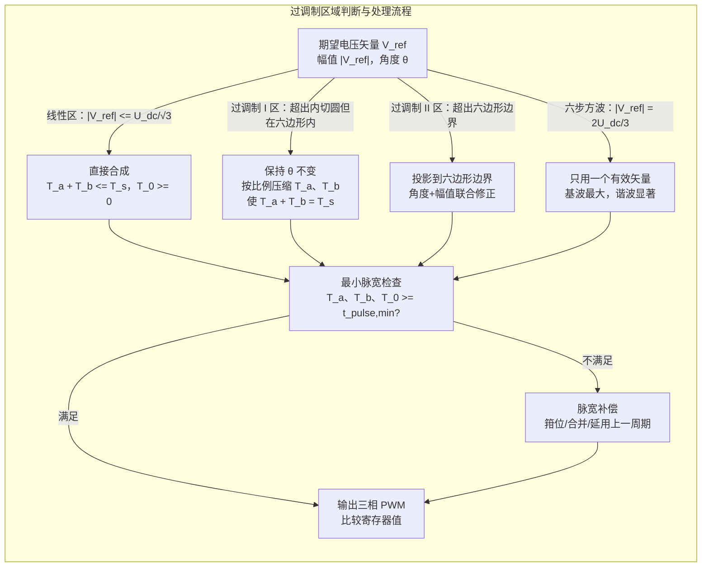
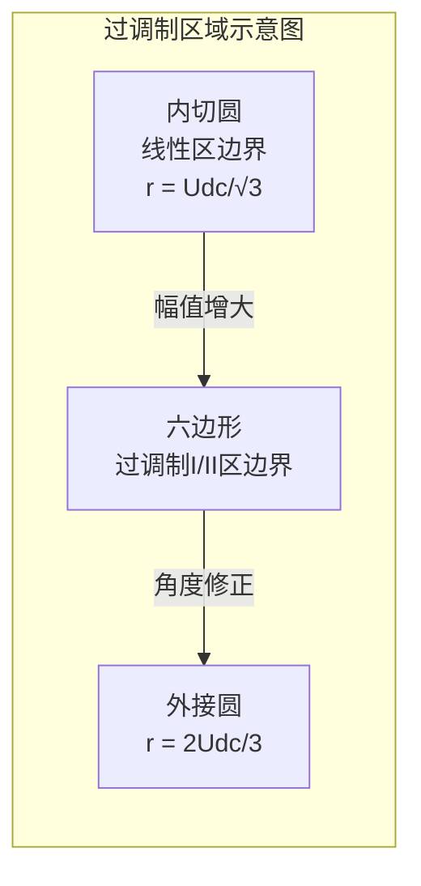

# 过调制与最小脉宽处理

> **为什么学？**
> 电机高速或弱磁运行时，电流环输出的电压需求可能超出 SVPWM 的线性调制区。如果不处理过调制和最小脉宽限制，PWM 比较值会溢出或出现极窄脉冲，导致输出电压畸变、电流谐波增大、MOSFET 局部过热甚至损坏。
>
> **在 FOC 中的作用**
> 这一节是 SVPWM 的“边界保护”。它把电流环给出的理想电压约束到逆变器实际可输出范围内，并保证每个开关脉冲宽度都在器件允许的物理极限之上，是高压、高速、弱磁工况下稳定运行的必要环节。

下面这张图把“期望电压矢量落在哪个区域”和“该采用什么修正策略”放在一张流程图里：线性区直接合成；过调制 I 区保持方向不变、按比例压缩作用时间；过调制 II 区需要把矢量投影回六边形边界；六步方波是极限工况；最后所有路径都要经过最小脉宽检查，防止功率器件收到窄脉冲。



*图：过调制区域划分与最小脉宽处理流程。它把电压需求由小到大映射到“线性→过调制 I→过调制 II→六步波”四档，并强调所有路径最终都要通过最小脉宽检查，否则硬件实现不了。*

SVPWM 能在线性区完美合成任意电压矢量，但当电机转速升高、反电动势接近母线电压时，期望电压会触及甚至超出线性区边界。此时需要先对电压矢量做饱和或修正，再检查生成的脉宽是否满足器件最小导通/关断时间要求。

## 1. 过调制区域的定义

在 SVPWM 中，当期望电压矢量幅值 $|V_{ref}|$ 超过线性调制区边界 $\frac{U_{dc}}{\sqrt{3}}$ 时，即进入**过调制区**。过调制分为三个区域：

- **线性区**：$|V_{ref}| \le \frac{U_{dc}}{\sqrt{3}}$，$m \le 1$
- **过调制 I 区**：$\frac{U_{dc}}{\sqrt{3}} < |V_{ref}| \le \frac{U_{dc}}{\sqrt{3}\cos15°}$（或简化描述为 $1 < m \le 1.047$）
- **过调制 II 区**：$\frac{U_{dc}}{\sqrt{3}\cos15°} < |V_{ref}| < \frac{2U_{dc}}{3}$（$1.047 < m < 1.155$）
- **过调制 III 区（六步方波）**：$|V_{ref}| = \frac{2U_{dc}}{3}$，$m = 1.155$

其中调制比 $m = \frac{\sqrt{3}|V_{ref}|}{U_{dc}}$。

## 2. 数学推导：过调制 I 区的修正

为什么要做这一步：当期望矢量只超出内切圆但仍在六边形内部时，相邻有效矢量作用时间之和会超过一个 PWM 周期。如果不按比例压缩这两个时间，零矢量时间变成负数，PWM 比较值会溢出，输出波形严重畸变。

过调制 I 区的本质是：期望矢量超出了六边形内切圆，但仍在六边形边界内。此时相邻有效矢量作用时间之和 $T_a + T_b > T_s$，导致零矢量时间为负。

**修正策略**：保持矢量方向不变，按比例缩放作用时间，使 $T_a + T_b = T_s$。

设未修正的作用时间为：

$$
\begin{cases}
T_a' = m \cdot T_s \cdot \sin(60° - \theta_{rel}) \\
T_b' = m \cdot T_s \cdot \sin(\theta_{rel})
\end{cases}
$$

当 $T_a' + T_b' > T_s$ 时，令修正后的时间为：

$$
\begin{cases}
T_a = T_s \cdot \frac{T_a'}{T_a' + T_b'} \\
T_b = T_s \cdot \frac{T_b'}{T_a' + T_b'}
\end{cases}
$$

此时零矢量时间 $T_0 = 0$，但输出矢量的幅值被压缩，不再严格等于期望幅值。基波分量与期望值之间存在非线性关系。

## 3. 过调制 II 区的角度修正

为什么要做这一步：当期望矢量已经跑到六边形外面时，仅压缩幅值还不够，必须同时修正相位，把矢量端点投影回六边形边界，否则逆变器根本实现不了这个电压，电流环会出现非线性饱和。

过调制 II 区中，期望矢量已超出六边形边界，此时不仅幅值受限，角度也需要修正。

设期望角度为 $\theta$，六边形边界在扇区内的角度函数为 $\theta_{hex}(|V|)$。过调制 II 区采用**角度保持-幅值饱和**策略：

1. 若期望矢量端点落在六边形内，直接使用（此时处于 I 区或线性区）
2. 若期望矢量端点落在六边形外，将矢量投影到六边形边界上，保持角度尽可能接近原值

过调制 II 区的输出基波电压与调制比的关系为：

$$
V_{fund} = \frac{U_{dc}}{\sqrt{3}} \cdot f(m)
$$

其中 $f(m)$ 为过调制非线性增益函数，在 $m=1$ 时 $f(1)=1$，在 $m=1.155$ 时 $f(1.155) = \frac{2}{\sqrt{3}} \approx 1.155$。

## 4. 最小脉宽限制

为什么要做这一步：功率开关器件不是理想开关，存在开通/关断延迟和最小导通时间。如果 SVPWM 算出的脉宽太窄，MOSFET/IGBT 还没完全导通就要关断，会造成局部过热、驱动欠压或电流采样失败。

功率开关器件存在物理限制：
- **开通延迟** $t_{d(on)}$：驱动信号到导通的时间
- **关断延迟** $t_{d(off)}$：驱动信号到关断的时间
- **最小导通时间** $t_{on,min}$：确保器件充分导通、避免局部过热
- **最小关断时间** $t_{off,min}$：确保器件完全关断、恢复阻断能力

设 PWM 周期为 $T_s$，若某相占空比 $D$ 满足：

$$
D \cdot T_s < t_{on,min} \quad \text{或} \quad (1-D) \cdot T_s < t_{off,min}
$$

则该脉冲会被控制器丢弃或箝位，导致**脉冲丢失**。

### 数学分析：脉冲丢失的影响

以 7 段式 SVPWM 为例，当零矢量时间 $T_0$ 过小时：

$$
T_0 = T_s - T_a - T_b < t_{pulse,min}
$$

若直接丢弃，实际输出电压矢量为：

$$
\vec{V}_{actual} = \frac{T_a \vec{V}_x + T_b \vec{V}_{x+1}}{T_a + T_b} \neq \vec{V}_{ref}
$$

即输出电压被放大，电流谐波剧增，电机出现振动与噪声。

## 5. 几何直观：过调制区域与六边形边界



ASCII 示意图：

```
                β
                ↑
                |        Vref 在过调制II区
                |           ×
                |          /|
           V2 • |         / | ← 投影到六边形边界
              \  |        /  |
               \ |       /   |
                \|------/----|--------→ α
                •\     /  V1
               /  \   /
              /    \ /
         V3 •      • V6

    内切圆：半径 = Udc/√3  （线性区）
    六边形：顶点到原点 = 2Udc/3  （过调制极限）
```

当 $V_{ref}$ 超出内切圆时，通过**幅值缩放**（I区）或**角度-幅值联合修正**（II区）将其拉回到可行域内。

## 6. 数值示例

**给定条件**：$U_{dc} = 24\,V$，$T_s = 100\,\mu s$，最小脉宽 $t_{min} = 2\,\mu s$，期望 $V_\alpha = 16\,V$，$V_\beta = 0\,V$。

**求解**：判断是否过调制，并计算修正后的作用时间。

**解**：

1. 线性调制边界：

$$
V_{max,linear} = \frac{U_{dc}}{\sqrt{3}} = \frac{24}{1.732} = 13.86\,V
$$

期望幅值 $|V_{ref}| = 16\,V > 13.86\,V$，进入过调制 I 区。

2. 调制比：

$$
m = \frac{\sqrt{3} \times 16}{24} = 1.155
$$

恰好达到过调制 III 区（六步波）边界。

3. 未修正作用时间（$\theta = 0°$，扇区 I，$\theta_{rel} = 0°$）：

$$
T_1 = m \cdot T_s \cdot \sin(60°) = 1.155 \times 100 \times 0.866 = 100\,\mu s
$$

$$
T_2 = m \cdot T_s \cdot \sin(0°) = 0\,\mu s
$$

$$
T_0 = 100 - 100 - 0 = 0\,\mu s
$$

此时 $T_1 = T_s$，$T_2 = T_0 = 0$，即只使用 $\vec{V}_1$，输出为方波状态。

4. 若 $V_\alpha = 15\,V$（过调制 I 区）：

$$
m = \frac{\sqrt{3} \times 15}{24} = 1.082
$$

$$
T_1 = 1.082 \times 100 \times 0.866 = 93.7\,\mu s
$$

$$
T_2 = 1.082 \times 100 \times 0 = 0
$$

$$
T_0 = 100 - 93.7 = 6.3\,\mu s > t_{min} = 2\,\mu s
$$

无需脉宽限制，但已进入过调制 I 区，基波电压非线性增大。

5. 若 $V_\alpha = 14.5\,V$（接近过调制边界）：

$$
m = 1.046
$$

$$
T_1 = 1.046 \times 100 \times 0.866 = 90.6\,\mu s
$$

$$
T_2 = 0
$$

$$
T_0 = 9.4\,\mu s
$$

## 7. 代码实现：过调制处理与最小脉宽限制

```c
#include <math.h>

#define UDC         24.0f
#define TS          100.0e-6f
#define SQRT3       1.7320508075688772f
#define T_PULSE_MIN 2.0e-6f   // 最小脉宽 2us

// 过调制处理与最小脉宽限制
void svpwm_with_overmod(float Valpha, float Vbeta,
                        float* T1, float* T2, float* T0) {
    float Vref = sqrtf(Valpha * Valpha + Vbeta * Vbeta);
    float theta = atan2f(Vbeta, Valpha);   // 期望角度

    // 限制到 [0, 2π)
    while (theta < 0) theta += 2.0f * M_PI;
    while (theta >= 2.0f * M_PI) theta -= 2.0f * M_PI;

    // 扇区与相对角度
    int sector = (int)(theta / (M_PI / 3.0f)) + 1;
    if (sector > 6) sector = 6;
    float theta_rel = theta - (sector - 1) * M_PI / 3.0f;

    // 调制比
    float m = (SQRT3 * Vref) / UDC;

    // 计算未修正作用时间
    float T1_raw = m * TS * sinf(M_PI / 3.0f - theta_rel);
    float T2_raw = m * TS * sinf(theta_rel);

    // 过调制 I 区：缩放处理
    if (T1_raw + T2_raw > TS) {
        float sum = T1_raw + T2_raw;
        T1_raw = T1_raw * TS / sum;
        T2_raw = T2_raw * TS / sum;
    }

    // 最小脉宽限制
    float Tzero = TS - T1_raw - T2_raw;
    if (Tzero < T_PULSE_MIN) {
        // 零矢量时间不足，从有效矢量时间中扣除
        float deficit = T_PULSE_MIN - Tzero;
        if (T1_raw > T2_raw) {
            T1_raw -= deficit * 0.5f;
            T2_raw -= deficit * 0.5f;
        } else {
            T2_raw -= deficit * 0.5f;
            T1_raw -= deficit * 0.5f;
        }
        // 防止负值
        if (T1_raw < 0) T1_raw = 0;
        if (T2_raw < 0) T2_raw = 0;
        Tzero = TS - T1_raw - T2_raw;
    }

    // 再次检查有效矢量最小脉宽
    if (T1_raw > 0 && T1_raw < T_PULSE_MIN) {
        Tzero -= (T_PULSE_MIN - T1_raw);
        T1_raw = T_PULSE_MIN;
    }
    if (T2_raw > 0 && T2_raw < T_PULSE_MIN) {
        Tzero -= (T_PULSE_MIN - T2_raw);
        T2_raw = T_PULSE_MIN;
    }
    if (Tzero < 0) Tzero = 0;

    *T1 = T1_raw;
    *T2 = T2_raw;
    *T0 = Tzero;
}

// 过调制补偿：根据调制比修正期望电压，使基波分量线性化
float overmod_compensation(float Vref_raw, float Udc) {
    float Vmax_lin = Udc / SQRT3;       // 线性区最大幅值
    float Vmax_6step = 2.0f * Udc / 3.0f; // 六步波最大幅值

    if (Vref_raw <= Vmax_lin) {
        return Vref_raw;  // 线性区无需补偿
    } else if (Vref_raw >= Vmax_6step) {
        return Vmax_6step; // 六步波饱和
    } else {
        // 过调制 I/II 区的近似线性化补偿
        // 使用查表法或多项式拟合
        float x = (Vref_raw - Vmax_lin) / (Vmax_6step - Vmax_lin);
        // 经验补偿系数：二次曲线近似
        float comp = 1.0f - 0.15f * x * x;
        return Vref_raw * comp;
    }
}
```

## 8. 补偿策略

### 过调制补偿

为降低过调制引起的电流谐波，常用策略：

1. **前馈补偿**：在电流环输出后，根据调制比 $m$ 对 $V_d$、$V_q$ 进行预修正，使实际基波电压接近期望值。

2. **查表法**：离线计算过调制区的非线性增益曲线，存储在 Flash 中，运行时查表修正。

3. **限制进入过调制**：在速度环或弱磁环中，限制 $V_d$、$V_q$ 的矢量和，确保 $|V_{ref}| \le \frac{U_{dc}}{\sqrt{3}}$。这是工程中最稳妥的做法。

### 最小脉宽补偿

当计算出的脉宽小于 $t_{min}$ 时：

1. **脉宽合并**：将相邻小脉宽合并到相邻有效矢量中
2. **零矢量补偿**：若零矢量时间不足，等比例缩减两个有效矢量时间，保留最小零矢量时间
3. **周期延拓**：在极端情况下，允许当前周期占空比延用上一周期的值，避免脉冲抖动

## 9. 常见错误

### 错误1：过调制时不进行饱和处理，导致比较寄存器溢出

**错误表现**：在过调制区，若 $T_a + T_b > T_s$ 且未做缩放，计算出的零矢量时间 $T_0$ 为负数。直接写入 PWM 比较寄存器会导致计数器溢出，产生随机脉宽，电机剧烈抖动。

**纠正方法**：在 SVPWM 计算末尾必须加入饱和判断：

```c
if (T1 + T2 > TS) {
    float sum = T1 + T2;
    T1 = T1 * TS / sum;
    T2 = T2 * TS / sum;
}
```

并将零矢量时间箝位到非负值：$T_0 = \max(0, T_s - T_1 - T_2)$。

### 错误2：忽略最小脉宽限制，导致 MOSFET 局部过热

**错误表现**：在高开关频率（如 $>50\,kHz$）下，$T_s = 20\,\mu s$，若最小脉宽为 $2\,\mu s$，则占空比可调范围仅为 $10\% \sim 90\%$。当电流环输出小电压时，计算出的脉宽可能小于 $2\,\mu s$，若直接输出，MOSFET 在短时间内频繁开关但未充分导通，导通损耗集中在芯片局部，导致热斑损坏。

**纠正方法**：在 PWM 比较值更新前，检查：

```c
if (ccr_val < CCR_MIN) ccr_val = 0;      // 完全关断
if (ccr_val > CCR_MAX) ccr_val = ARR;  // 完全导通
```

其中 $CCR_{MIN} = \frac{t_{min}}{T_s} \cdot ARR$。将极小脉宽直接箝位到 $0$ 或 $ARR$，避免"窄脉冲"效应。

## 10. 自测习题

**习题1**：已知 $U_{dc} = 48\,V$，$T_s = 50\,\mu s$，期望 $V_\alpha = 30\,V$，$V_\beta = 0\,V$。判断是否过调制，若过调制，按过调制 I 区策略计算修正后的 $T_1$、$T_2$、$T_0$。

**答案**：
- 线性区边界：$V_{max} = \frac{48}{\sqrt{3}} = 27.71\,V$
- $|V_{ref}| = 30\,V > 27.71\,V$，过调制
- $m = \frac{\sqrt{3} \times 30}{48} = 1.082$
- $T_1' = 1.082 \times 50 \times \sin(60°) = 46.87\,\mu s$，$T_2' = 0$
- $T_1' + T_2' = 46.87 < T_s$，实际处于过调制 I 区边缘（需看具体角度修正）
- 若按幅值缩放：$T_1 = 46.87 \times \frac{50}{46.87} = 50\,\mu s$，$T_2 = 0$，$T_0 = 0$
- 结果：零矢量时间为零，进入临界六步波状态

**习题2**：某逆变器开关频率 $f_{sw} = 20\,kHz$，MOSFET 最小导通时间 $t_{on,min} = 1.5\,\mu s$。求占空比的可调范围。若期望输出占空比为 $2\%$，应如何处理？

**答案**：
- $T_s = 50\,\mu s$
- 最小占空比：$D_{min} = \frac{1.5}{50} = 3\%$
- 最大占空比：$D_{max} = 1 - 3\% = 97\%$
- $2\% < D_{min}$，不可直接输出。应将占空比箝位到 $0\%$（本周期完全关断），或合并到相邻周期处理。若连续多个周期期望占空比均低于 $3\%$，需采用平均化补偿策略。
