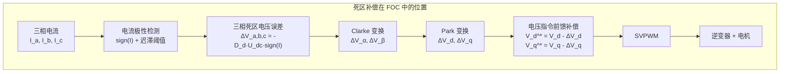
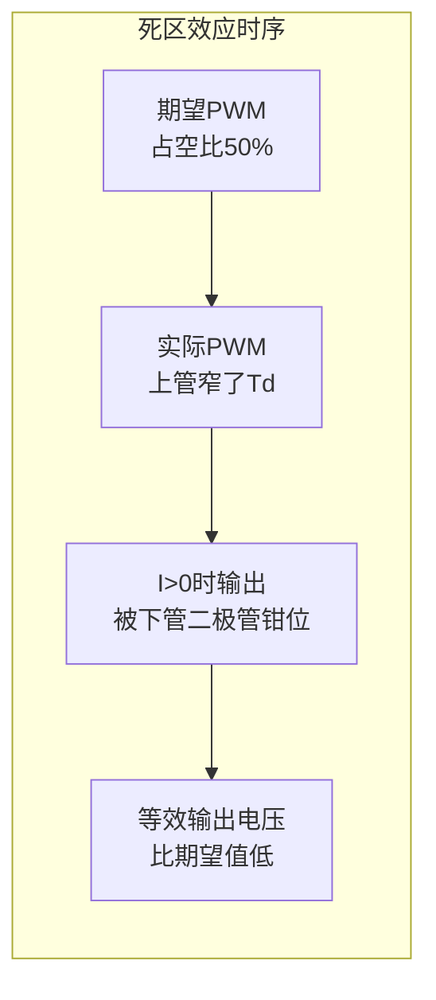

# 死区补偿与电流极性检测

> **为什么学？**
> 为了防止桥臂直通，逆变器必须在上下管切换时插入死区时间。死区会让实际输出电压偏离 SVPWM 的期望值，尤其在低速时占期望电压比例很大，不补偿会造成电流波形畸变、转矩脉动和定位抖动。
>
> **在 FOC 中的作用**
> 这一节是 SVPWM 输出精度的“误差修正器”。它根据三相电流方向预估死区引起的电压误差，并在 $dq$ 轴电压指令上进行前馈补偿，让电机真正得到的电压接近控制器意图。

下面这张图把死区补偿的完整信号链路画出来：从三相电流极性检测出发，算出每相死区电压误差，经 Clarke/Park 变换映射到 $dq$ 轴，最后前馈补偿到电流环输出的电压指令上，再进入 SVPWM。



*图：死区补偿信号链路。它说明死区误差虽然在三相静止坐标系产生，但最终要变换到 $dq$ 轴并叠加到电压指令上，才能在 FOC 电流环里被抵消。*

SVPWM 算出了“理想开关时刻”，但实际硬件为了避免上下管同时导通，会在这些理想边沿附近插入一段“谁也不导通”的死区。死区期间电流靠二极管续流，输出节点被钳位到母线正端或负端，导致平均电压出现与电流极性相关的偏差。

## 1. 死区效应的物理机理

在半桥拓扑中，上下两个开关器件（如 MOSFET）的开关过程并非瞬时完成。若上管关断信号与下管开通信号之间没有延时，可能因器件关断延迟 $t_{off}$ 大于开通延迟 $t_{on}$ 而导致**桥臂直通**（shoot-through），造成直流母线短路。

为防止直通，控制器在互补 PWM 中插入**死区时间** $T_d$（通常 $1\sim3\,\mu s$），确保上管完全关断后下管才开通。

死区时间带来的副作用：
- 实际输出脉冲宽度比期望宽度窄 $T_d$
- 输出电压与期望电压存在偏差
- 偏差极性取决于输出电流方向

## 2. 数学推导：死区引起的电压误差

为什么要做这一步：要补偿死区，首先得定量算出每个桥臂因为死区到底少输出或多输出了多少电压，而这个误差的大小和方向直接由电流方向决定。

以 A 相桥臂为例，分析死区对输出电压的影响。设期望导通时间为 $T_{on}$，PWM 周期为 $T_s$。

**情况1：电流从逆变器流向电机（$I_a > 0$，流出桥臂）**

死区期间，上下管均关断。由于电流方向为正，电流经下管反并联二极管续流，输出节点 $a$ 被钳位到母线负端 $N$（$0\,V$）。

期望输出电压（相对母线负端）：$V_{aN}^{*} = D_a \cdot U_{dc}$

实际输出电压：

- 导通阶段：上管导通，$V_{aN} = U_{dc}$，持续时间 $T_{on} - T_d$
- 死区阶段：下管二极管续流，$V_{aN} = 0$，持续时间 $T_d$
- 关断阶段：下管导通，$V_{aN} = 0$，持续时间 $T_s - T_{on}$

实际平均电压：

$$
\bar{V}_{aN} = \frac{(T_{on} - T_d) \cdot U_{dc} + T_d \cdot 0 + (T_s - T_{on}) \cdot 0}{T_s} = (D_a - \frac{T_d}{T_s}) U_{dc}
$$

电压误差：

$$
\Delta V_a = \bar{V}_{aN} - V_{aN}^{*} = -\frac{T_d}{T_s} U_{dc} = -D_d \cdot U_{dc}
$$

其中 $D_d = T_d / T_s$ 为死区占空比。

**情况2：电流从电机流向逆变器（$I_a < 0$，流入桥臂）**

死区期间，电流经上管反并联二极管续流，输出节点 $a$ 被钳位到母线正端 $P$（$U_{dc}$）。

实际平均电压：

$$
\bar{V}_{aN} = \frac{T_{on} \cdot U_{dc} + T_d \cdot U_{dc} + (T_s - T_{on} - T_d) \cdot 0}{T_s} = (D_a + \frac{T_d}{T_s}) U_{dc}
$$

电压误差：

$$
\Delta V_a = +\frac{T_d}{T_s} U_{dc} = +D_d \cdot U_{dc}
$$

**总结**：

$$
\Delta V_a = -D_d \cdot U_{dc} \cdot \text{sign}(I_a)
$$

## 3. 三相死区电压误差合成

为什么要做这一步：死区误差发生在三相静止坐标系下，而 FOC 控制器工作在旋转 $dq$ 坐标系。只有把三相误差通过 Clarke/Park 变换映射到 $dq$ 轴，才能直接叠加到 $V_d$、$V_q$ 上进行补偿。

三相误差电压分别为：

$$
\begin{cases}
\Delta V_a = -D_d \cdot U_{dc} \cdot \text{sign}(I_a) \\
\Delta V_b = -D_d \cdot U_{dc} \cdot \text{sign}(I_b) \\
\Delta V_c = -D_d \cdot U_{dc} \cdot \text{sign}(I_c)
\end{cases}
$$

通过 Clarke 变换到 $\alpha\beta$ 坐标系：

$$
\begin{cases}
\Delta V_\alpha = \frac{2}{3}\left(\Delta V_a - \frac{1}{2}\Delta V_b - \frac{1}{2}\Delta V_c\right) \\
\Delta V_\beta = \frac{2}{3}\left(\frac{\sqrt{3}}{2}\Delta V_b - \frac{\sqrt{3}}{2}\Delta V_c\right)
\end{cases}
$$

进一步 Park 变换到 $dq$ 旋转坐标系：

$$
\begin{cases}
\Delta V_d = \Delta V_\alpha \cos\theta + \Delta V_\beta \sin\theta \\
\Delta V_q = -\Delta V_\alpha \sin\theta + \Delta V_\beta \cos\theta
\end{cases}
$$

死区误差在 $dq$ 轴上表现为与电流极性相关的周期性扰动，低速时尤为明显，导致：
- 电流波形畸变（5 次、7 次谐波）
- 转矩脉动（6 倍频）
- 电机低速抖动与嗡嗡声

## 4. 电流极性检测方法

为什么要做这一步：死区补偿的符号完全取决于电流方向，极性判断错了会把补偿加反，反而放大误差。因此必须设计可靠的电流极性检测策略，尤其要处理电流过零时的噪声和钳位问题。

死区补偿的前提是准确知道电流方向。常用检测方法：

### 方法一：直接采样电流极性

通过霍尔传感器或采样电阻获取相电流，判断符号：

$$
\text{sign}(I) = \begin{cases} +1, & I > I_{th} \\ -1, & I < -I_{th} \\ \text{保持}, & |I| \le I_{th} \end{cases}
$$

其中 $I_{th}$ 为迟滞阈值，防止零电流附近噪声导致的频繁翻转。

### 方法二：观测器估计

在电流环中，通过 PI 控制器输出与实测电流的差异间接判断极性：

$$
\text{若 } V_{ctrl} > V_{backEMF} + \Delta, \text{ 则 } I > 0
$$

### 方法三：无传感器极性检测（适用于低成本方案）

利用采样时刻的电流变化率 $\frac{dI}{dt}$ 辅助判断：当电流接近过零时，通过比较相邻两个采样点的电流值，外推极性。

## 5. 几何直观：死区效应波形



ASCII 波形图（$I_a > 0$ 时）：

```
期望Sa:  ____|████████|______  (理想占空比50%)
实际Sa:  ____|██████|________  (导通时间减少Td)
实际Sb:  ████|______|██████  (互补，含死区)
         |←Td→|

输出Van:  ___|████|░░░░|____  
          Udc  ↑死区↓  0V
               二极管续流
               实际平均↓

误差:     ΔVa = -Td/Ts * Udc
```

## 6. 数值示例

**给定条件**：$U_{dc} = 24\,V$，$T_s = 100\,\mu s$，$T_d = 2\,\mu s$，A 相期望占空比 $D_a = 50\%$，A 相电流 $I_a = 1.5\,A$（流出桥臂）。

**求解**：死区引起的 A 相电压误差、输出电压偏差，以及 $dq$ 轴误差（假设 $\theta = 30°$，B/C 相电流 $I_b = -2.0\,A$，$I_c = 0.5\,A$）。

**解**：

1. 死区占空比：

$$
D_d = \frac{T_d}{T_s} = \frac{2}{100} = 0.02
$$

2. A 相电压误差（$I_a > 0$）：

$$
\Delta V_a = -D_d \cdot U_{dc} = -0.02 \times 24 = -0.48\,V
$$

3. B 相电压误差（$I_b < 0$）：

$$
\Delta V_b = +D_d \cdot U_{dc} = +0.48\,V
$$

4. C 相电压误差（$I_c > 0$）：

$$
\Delta V_c = -D_d \cdot U_{dc} = -0.48\,V
$$

5. Clarke 变换：

$$
\Delta V_\alpha = \frac{2}{3}\left(-0.48 - \frac{1}{2}(+0.48) - \frac{1}{2}(-0.48)\right) = \frac{2}{3}(-0.48) = -0.32\,V
$$

$$
\Delta V_\beta = \frac{2}{3}\left(\frac{\sqrt{3}}{2}(+0.48) - \frac{\sqrt{3}}{2}(-0.48)\right) = \frac{2}{3} \times 0.831 = 0.554\,V
$$

6. Park 变换（$\theta = 30°$）：

$$
\Delta V_d = -0.32 \times \cos30° + 0.554 \times \sin30° = -0.277 + 0.277 = 0\,V
$$

$$
\Delta V_q = -(-0.32) \times \sin30° + 0.554 \times \cos30° = 0.16 + 0.480 = 0.64\,V
$$

即死区误差主要落在 $q$ 轴上，造成转矩脉动。

## 7. 代码实现：死区补偿算法

```c
#include <math.h>

#define UDC         24.0f
#define TS          100.0e-6f
#define TD          2.0e-6f
#define SQRT3       1.7320508075688772f
#define I_TH        0.05f   // 电流过零阈值，单位A

// 电流极性检测（带迟滞）
int current_polarity(float I, int last_polarity) {
    if (I > I_TH) return 1;
    if (I < -I_TH) return -1;
    return last_polarity;  // 保持上次状态
}

// 死区补偿：计算三相电压误差
typedef struct {
    float dV_a;
    float dV_b;
    float dV_c;
} DeadTimeVoltageError;

DeadTimeVoltageError calc_deadtime_error(int polarity_a, int polarity_b, int polarity_c) {
    DeadTimeVoltageError err;
    float delta = -(TD / TS) * UDC;  // 单相死区误差幅度

    err.dV_a = delta * (float)polarity_a;
    err.dV_b = delta * (float)polarity_b;
    err.dV_c = delta * (float)polarity_c;

    return err;
}

// 死区补偿后的 dq 轴电压修正
void deadtime_compensation_dq(float I_a, float I_b, float I_c,
                               float theta, int* last_pol,
                               float* dV_d_comp, float* dV_q_comp) {
    // 极性检测
    int pol_a = current_polarity(I_a, last_pol[0]);
    int pol_b = current_polarity(I_b, last_pol[1]);
    int pol_c = current_polarity(I_c, last_pol[2]);
    last_pol[0] = pol_a;
    last_pol[1] = pol_b;
    last_pol[2] = pol_c;

    // 三相电压误差
    DeadTimeVoltageError err = calc_deadtime_error(pol_a, pol_b, pol_c);

    // Clarke 变换
    float dV_alpha = (2.0f/3.0f) * (err.dV_a - 0.5f*err.dV_b - 0.5f*err.dV_c);
    float dV_beta  = (2.0f/3.0f) * (SQRT3*0.5f*err.dV_b - SQRT3*0.5f*err.dV_c);

    // Park 变换
    float cos_t = cosf(theta);
    float sin_t = sinf(theta);

    *dV_d_comp = dV_alpha * cos_t + dV_beta * sin_t;
    *dV_q_comp = -dV_alpha * sin_t + dV_beta * cos_t;
}

// 应用补偿：将 dq 补偿电压加到 SVPWM 输入
void apply_deadtime_comp(float V_d, float V_q,
                         float dV_d_comp, float dV_q_comp,
                         float* V_d_out, float* V_q_out) {
    *V_d_out = V_d - dV_d_comp;  // 抵消死区误差
    *V_q_out = V_q - dV_q_comp;
}
```

## 8. 零电流钳位效应

当相电流接近零时，电流极性难以准确判断，出现**零电流钳位**（zero-current clamping）现象：

- 电流在零附近振荡，二极管续流方向频繁切换
- 输出电压被二极管钳位，实际波形偏离 PWM 预期
- 电流波形出现平台（flat-top），THD 显著增加

**补偿措施**：
1. 在电流过零区域（$|I| < I_{th}$）禁用死区补偿，避免极性误判导致反向补偿
2. 增大过零阈值 $I_{th}$，或采用线性插值过渡区（soft transition）
3. 通过状态观测器估计真实电流极性，降低对采样噪声的敏感度

## 9. 常见错误

### 错误1：电流极性检测阈值过小，导致噪声引起极性翻转

**错误表现**：在电流过零附近，由于 ADC 采样噪声或 PWM 开关噪声耦合，电流采样值在正负之间随机跳动。若阈值 $I_{th} = 0.01\,A$（过小），极性判断频繁翻转，死区补偿方向反复变化，输出电压出现高频抖动，电机发出尖锐噪声。

**纠正方法**：
- 设置合理的迟滞阈值，通常 $I_{th} = 2\% \sim 5\% \cdot I_{rated}$
- 对电流采样进行低通滤波后再判断极性
- 采用"保持上一状态"策略，只有当连续 $N$ 个采样周期极性一致时才更新

### 错误2：未补偿死区误差，导致低速运行电流波形畸变

**错误表现**：在低速大电流工况（如伺服电机启动瞬间），死区误差占期望电压的比例很大（$D_d = T_d/T_s$ 可达 $3\% \sim 10\%$）。若不做补偿，$q$ 轴电压存在持续直流偏置，电流波形呈梯形而非正弦，THD 超过 $10\%$，电机转矩脉动明显，定位精度下降。

**纠正方法**：
- 在电压输出前叠加死区补偿项，根据电流极性实时修正 $V_d$、$V_q$
- 在电流环中，将死区误差视为扰动，通过增大积分增益部分抑制稳态误差（但会降低动态响应）
- 最佳方案是前馈补偿，直接抵消已知死区误差

## 10. 自测习题

**习题1**：已知 $U_{dc} = 48\,V$，$T_s = 50\,\mu s$，$T_d = 1.5\,\mu s$。A 相期望占空比 $40\%$，A 相电流 $I_a = 2\,A$（流出）。求：
1. 死区占空比 $D_d$
2. A 相实际平均输出电压（相对母线负端）
3. 死区引起的电压误差

**答案**：
1. $D_d = \frac{1.5}{50} = 0.03$
2. 期望电压：$V_{aN}^{*} = 0.4 \times 48 = 19.2\,V$；实际电压（$I_a>0$）：$\bar{V}_{aN} = (0.4 - 0.03) \times 48 = 17.76\,V$
3. $\Delta V_a = -0.03 \times 48 = -1.44\,V$（或 $17.76 - 19.2 = -1.44\,V$）

**习题2**：若三相电流极性分别为 $(+, -, +)$，死区误差 $D_d \cdot U_{dc} = 1\,V$，求 Clarke 变换后的 $\Delta V_\alpha$、$\Delta V_\beta$。

**答案**：
- $\Delta V_a = -1\,V$，$\Delta V_b = +1\,V$，$\Delta V_c = -1\,V$
- $\Delta V_\alpha = \frac{2}{3}(-1 - 0.5 + 0.5) = -\frac{2}{3} \approx -0.667\,V$
- $\Delta V_\beta = \frac{2}{3}(0.866 + 0.866) = \frac{2}{3} \times 1.732 = 1.155\,V$
