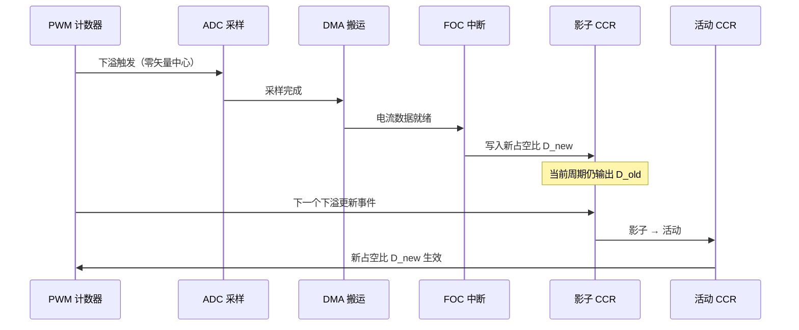
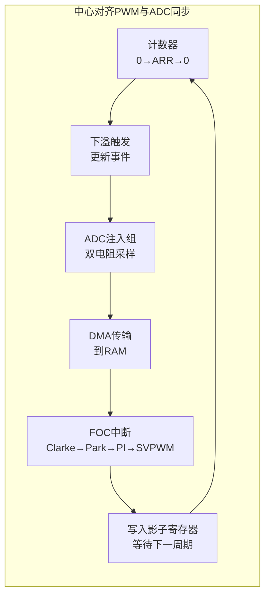

# 载波同步与PWM更新策略

> **为什么学？**
> FOC 是一个多环节串并行运行的实时系统：ADC 采样、电流环计算、PWM 更新必须在时间上精确配合。如果采样点和开关边沿没对齐、PWM 更新晚了一个周期，电流环会引入额外延迟，严重时导致系统振荡或过流。
>
> **在 FOC 中的作用**
> 这一节解决“控制节奏”问题。它规定何时采样电流、何时启动 FOC 中断、何时把新占空比写入硬件，保证电流采样在零矢量安静区完成、新占空比在下个周期稳定生效。

下面这张图用序列图把“计数器下溢 → ADC 采样 → DMA 搬运 → FOC 计算 → 写入影子寄存器 → 下一周期生效”的完整节奏画出来，帮助理解为什么新占空比总要延迟约一个 PWM 周期才能到电机。



*图：中心对齐模式下 PWM-ADC-FOC 同步时序。它体现了双缓冲的本质：FOC 算出的占空比先写入影子寄存器，等到下一个下溢才转到活动寄存器，因此新电压指令延迟约一个 PWM 周期生效。*

SVPWM 算出了三相占空比，但“什么时候把占空比写入寄存器”“电流采样安排在哪个时刻”“中心对齐和边沿对齐有什么区别”，这些时序问题直接决定 FOC 能否稳定运行。只有把 PWM 载波、ADC 触发和软件中断三者同步起来，控制器的输出才能和采样到的电流一一对应。

## 1. PWM 更新机制概述

在 FOC 控制系统中，电流环通常以 $50\,\mu s$（$20\,kHz$）的周期运行。每个周期需要完成：
1. ADC 采样两相/三相电流
2. 执行 Clarke/Park 变换
3. 执行 $dq$ 轴 PI 控制器
4. 执行逆 Park 变换
5. 执行 SVPWM 计算
6. 更新 PWM 比较寄存器

PWM 更新策略的核心问题：**何时将计算出的新占空比写入硬件寄存器？**

若写入时机不当，会导致：
- 同一周期内出现两个不同的占空比值（毛刺）
- 电流采样与 PWM 更新不同步，引入额外相移
- 双电机或多相系统中，各桥臂 PWM 相位不一致，共模电流增大

## 2. 双缓冲机制（Double Buffering）

为什么要做这一步：FOC 计算需要时间，不可能在开关边沿瞬间完成。双缓冲机制让新占空比先写入影子寄存器，在安全的更新事件（如下溢）再同步生效，避免同一周期内出现占空比毛刺。

现代 MCU（如 STM32、TI C2000）的 PWM 定时器普遍支持**双缓冲机制**：

- **比较寄存器（影子寄存器）**：存放下一周期将生效的占空比值
- **活动寄存器（active register）**：存放当前周期正在输出的占空比值

```
时序：
周期 N:   [影子寄存器写入新值Dnew] → [周期N继续输出Dold]
周期 N+1: [更新事件触发] → [影子→活动，开始输出Dnew]
```

更新事件通常由以下方式触发：
- **计数器溢出**（更新事件 UEV）
- **软件强制触发**
- **外部触发信号**

### 数学描述：占空比更新延迟

设电流环计算耗时 $T_{calc}$，从采样完成到 PWM 更新完成的时间差为：

$$
T_{delay} = T_{calc} + T_{update}
$$

其中 $T_{update}$ 为硬件更新延迟（通常半个 PWM 周期）。

对于中心对齐模式（up-down counting），更新发生在计数器下溢（underflow）或溢出（overflow）时刻。若 SVPWM 计算在计数器上溢前完成，新占空比将在**下一个 PWM 周期**生效，总延迟约为：

$$
T_{delay,total} = T_{calc} + \frac{T_s}{2}
$$

## 3. 中心对齐 vs 边沿对齐

为什么要做这一步：计数方式决定 PWM 波形的对称性、电流纹波分布以及可选择的 ADC 触发点。中心对齐配合 7 段式 SVPWM 能抑制偶次谐波，是 FOC 的主流方案。

### 边沿对齐模式（Edge-Aligned）

计数器从 0 递增到 $ARR$，然后复位。PWM 波形在周期起始边沿对齐。

```
计数器：  0  →  ARR  →  0
          |__________|        A相
          |____|              B相
          |__|                C相
          ↑更新点（下溢）
```

特点：
- 更新事件发生在周期起点（下溢）
- 三相开关时刻集中在一侧，电流纹波不对称
- 实现简单，但电流采样时刻受限

### 中心对齐模式（Center-Aligned）

计数器从 0 递增到 $ARR$，再递减到 0。

```
计数器：  0  →  ARR  →  0  →  ARR
              ↑      ↑
           上溢    下溢（更新点）

波形：
A相：      ___|███████|___
B相：      _____|███|_____
C相：      _______|█|_____
```

特点：
- 更新事件可配置在上溢或下溢
- 三相开关关于周期中点对称，电流纹波对称
- 谐波性能优于边沿对齐，是 FOC 的主流选择

**中心对齐的数学优势**：

对于对称 7 段式 SVPWM，中心对齐天然与波形对称性匹配，偶次谐波被抵消。总谐波失真（THD）约为边沿对齐的 $1/\sqrt{2}$。

## 4. ADC 触发时机设计

为什么要做这一步：电流采样必须避开 MOSFET/IGBT 开关瞬态噪声，否则采样值会包含尖峰，导致电流环误判。最佳采样点通常在零矢量持续期间，此时三相线电压为零，电流变化率最小。

电流采样必须在 PWM 周期的**安静时刻**进行，避开开关噪声。最佳采样点：

- **中心对齐模式**：在计数器到达谷底（0）或峰顶（ARR）时，所有开关动作已完成，电流处于稳定状态
- **具体时刻**：通常在零矢量持续期间采样，因为此时三相上管同时导通或同时关断，电流变化率最小

### 采样时刻的数学推导

以 7 段式 SVPWM 为例，零矢量 $\vec{V}_0$（$(0,0,0)$）或 $\vec{V}_7$（$(1,1,1)$）期间，所有相处于同一电平，电机线电压为零，电流变化率：

$$
\frac{dI}{dt} = \frac{V_{phase} - E_{backEMF}}{L} \approx 0
$$

因此，在零矢量中间点采样，可最大程度抑制开关噪声。

对于中心对齐、7 段式调制，最优采样点位于计数器下溢或上溢处（即零矢量对称中心）。

## 5. 几何直观：时序与同步关系



ASCII 时序图：

```
计数器:    0    ↑ARR    0    ↑ARR    0
                |        |        |
PWM A:     ____|████|____|████|____|████|
PWM B:     ______|██|______|██|______|██|
PWM C:     ________|_|________|_|________|_|
                ↑        ↑        ↑
             上溢      下溢      上溢

ADC触发:      |        ↑        |        ↑
              |     (下溢采样)   |     (下溢采样)
              |        |        |        |
FOC计算:      |        |________|        |________
              |        ↑开始计算 ↑开始计算
              |        |        |        |
PWM更新:      |        |        ↑        |
           (影子)   (影子)   (生效)   (影子)
```

关键要求：
- FOC 计算必须在下一个下溢前完成（即半个周期内）
- 若计算超时，需使用上一周期的占空比（安全兜底）

## 6. 数值示例

**给定条件**：PWM 开关频率 $f_{sw} = 20\,kHz$（$T_s = 50\,\mu s$），中心对齐模式，ARR = 4000，时钟频率 $72\,MHz$。

**求解**：
1. 计数器从 0 到 ARR 的时间
2. 若 FOC 计算耗时 $25\,\mu s$，更新延迟是多少？
3. 若 ADC 在下溢时触发，采样完成后 DMA 传输耗时 $2\,\mu s$，FOC 计算何时开始？

**解**：

1. 中心对齐模式下，计数器从 0 $\to$ ARR $\to$ 0 为一个完整周期 $T_s = 50\,\mu s$。从 0 到 ARR 的时间为 $T_s/2 = 25\,\mu s$。

2. 中心对齐的更新点通常在下溢（计数器从 1 到 0 的过渡）或上溢。若配置为下溢更新，FOC 计算耗时 $25\,\mu s$，则：

$$
T_{delay} = 25\,\mu s + \frac{T_s}{2} = 25 + 25 = 50\,\mu s = T_s
$$

即新占空比延迟一个完整 PWM 周期生效。这是中心对齐的标准延迟特性。

3. 下溢发生在 $t = 0$、$50\,\mu s$、$100\,\mu s$ 等时刻。ADC 在下溢时触发，DMA 传输 $2\,\mu s$ 后，FOC 计算开始时刻为：

$$
t_{FOC,start} = t_{underflow} + 2\,\mu s
$$

FOC 计算完成时刻：

$$
t_{FOC,end} = t_{underflow} + 2 + 25 = t_{underflow} + 27\,\mu s
$$

下一个下溢发生在 $t_{underflow} + 50\,\mu s$，因此新占空比将在该时刻生效。$27\,\mu s < 50\,\mu s$，满足实时性要求。

## 7. 代码实现：STM32 风格 PWM+ADC 同步配置

```c
#include <stdint.h>

// 假设使用 STM32 风格寄存器（示意代码）
#define TIM1_ARR    4000    // 自动重载值，对应50us周期（中心对齐）
#define TIM1_CCR_A  2000    // A相初始占空比
#define TIM1_CCR_B  2000    // B相初始占空比
#define TIM1_CCR_C  2000    // C相初始占空比

// 定时器初始化：中心对齐模式，下溢触发更新事件
void TIM1_Init_CenterAligned(void) {
    // 1. 配置定时器为向上向下计数（中心对齐模式1）
    // TIM1->CR1 |= TIM_CR1_CMS_0;  // CMS = 01，中心对齐模式1

    // 2. 设置周期
    // TIM1->ARR = TIM1_ARR;

    // 3. 配置三路PWM输出（互补通道+死区）
    // TIM1->CCMR1 = ...;  // PWM模式1
    // TIM1->CCER  = ...;  // 使能互补输出，插入死区

    // 4. 使能更新事件中断（下溢时触发）
    // TIM1->DIER |= TIM_DIER_UIE;

    // 5. 配置ADC触发源为TIM1_TRGO（下溢事件）
    // ADC1->CR2 |= ADC_CR2_EXTSEL;  // 选择TIM1_TRGO作为外部触发
    // ADC1->CR2 |= ADC_CR2_EXTTRIG; // 使能外部触发

    // 6. 使能定时器
    // TIM1->CR1 |= TIM_CR1_CEN;
}

// FOC 中断服务程序（由TIM1下溢更新事件触发）
void TIM1_UP_IRQHandler(void) {
    // 清除中断标志
    // TIM1->SR &= ~TIM_SR_UIF;

    // 1. 读取ADC采样值（DMA已完成传输到RAM）
    float I_a = adc_buffer[0];  // 假设双电阻采样，已做Offset校准
    float I_b = adc_buffer[1];
    // float I_c = -(I_a + I_b);  // 三相重构

    // 2. 角度读取（编码器或观测器）
    float theta = get_electrical_angle();

    // 3. 执行FOC计算（Clarke→Park→PI→逆Park→SVPWM）
    SVPWM_Result pwm = run_foc_pipeline(I_a, I_b, theta, I_d_ref, I_q_ref);

    // 4. 写入影子寄存器（下一周期生效）
    // TIM1->CCR1 = pwm.Ta;  // 影子寄存器，硬件在下溢时自动更新到活动寄存器
    // TIM1->CCR2 = pwm.Tb;
    // TIM1->CCR3 = pwm.Tc;

    // 注意：此处写入的是影子寄存器，当前周期仍输出上一周期的占空比
}

// ADC注入组+DMA双缓冲配置（示意）
void ADC_Init_Injected(void) {
    // 1. 配置两个注入通道（I_a, I_b）
    // ADC1->JSQR = ...;  // 通道选择

    // 2. 配置DMA循环模式，目标为 adc_buffer[]
    // DMA1_Channel1->CCR |= DMA_CCR_CIRC | DMA_CCR_MINC;
    // DMA1_Channel1->CPAR = (uint32_t)&ADC1->JDR1;
    // DMA1_Channel1->CMAR = (uint32_t)adc_buffer;

    // 3. 启动DMA
    // DMA1_Channel1->CCR |= DMA_CCR_EN;
}
```

## 8. 多电机同步与相位交错

在多电机驱动或多相逆变器中，需要各桥臂 PWM 同步运行：

- **主从同步**：主定时器输出触发信号（TRGO），从定时器接收后复位计数器，确保所有桥臂周期起点一致
- **相位交错（Phase Interleaving）**：多相系统中，各相 PWM 错开 $120°$ 或 $60°$，降低输入电流纹波

### 相位交错的数学表达

两相交错 $180°$：

$$
PWM_2(t) = PWM_1(t - T_s/2)
$$

输入电流纹波频率加倍，幅值降低，EMI 滤波器尺寸可减小。

## 9. 常见错误

### 错误1：FOC 计算超时，导致 PWM 更新不及时

**错误表现**：在复杂控制算法（如加入 EKF 观测器、在线参数辨识）中，FOC 计算时间可能超过 $T_s/2$。若计算未完成时下一个更新事件已到来，影子寄存器未被更新，活动寄存器保持旧值，造成占空比"卡住"一整个周期。严重时电流环失控，电机过流。

**纠正方法**：
- 在 FOC 中断开始处记录时间戳，结束前检查耗时
- 若预计超时，提前退出复杂计算，使用简化控制（如直接输出上一周期占空比）
- 采用"提前计算"策略：在计数器上溢时启动计算，下溢时更新，将可用计算时间扩展到整个周期
- 使用更高主频的 MCU 或硬件加速器（如 CORDIC、FMAC）

### 错误2：ADC 采样点与 PWM 开关边沿未对齐，导致采样噪声

**错误表现**：若 ADC 触发时刻与 MOSFET 开关时刻重合（如配置为上溢触发，而上溢时恰好是某些相的关断时刻），电流采样瞬间会捕获开关瞬态尖峰，采样值偏离真实电流，PI 控制器产生错误输出。

**纠正方法**：
- 使用 ADC 注入组（Injected Group），由定时器 TRGO 精确触发
- 配置触发时刻为计数器下溢（中心对齐时所有相均处于零矢量状态）
- 若必须在开关边沿附近采样，加入硬件 RC 滤波或软件数字滤波
- 验证采样时刻：用示波器同时观察 PWM 波形和 ADC 触发信号，确保两者间隔 $> 2\,\mu s$

## 10. 自测习题

**习题1**：中心对齐 PWM，$f_{sw} = 20\,kHz$（$T_s = 50\,\mu s$），ARR = 4000。FOC 计算耗时 $30\,\mu s$。问：
1. 新占空比从计算完成到实际生效，延迟多少？
2. 若改用边沿对齐模式，更新事件发生在周期起点，延迟又是多少？

**答案**：
1. 中心对齐：更新事件发生在下溢（$t = 0$、$50\,\mu s$、$100\,\mu s$...）。假设计算在 $t = 30\,\mu s$ 完成，下一个下溢在 $t = 50\,\mu s$，延迟 $20\,\mu s$。但相对于"需要更新"的决策时刻（$t = 0$ 的采样），总延迟为 $50\,\mu s = T_s$。
2. 边沿对齐：更新事件发生在周期起点。若采样在 $t = 0$ 完成，计算在 $t = 30\,\mu s$ 完成，写入影子寄存器，下一个周期起点在 $t = 50\,\mu s$ 生效，延迟 $50\,\mu s = T_s$。两者总延迟相同，但中心对齐的电流纹波更对称。

**习题2**：某双电机系统，要求两个逆变器的 PWM 完全同步。主定时器 TIM1 配置为中心对齐，从定时器 TIM2 应如何配置？若要求两电机桥臂相位交错 $180°$，从定时器应如何设置？

**答案**：
1. 同步配置：TIM2 配置为从模式（Slave Mode），触发源选择 ITR0（TIM1 触发输出），复位模式（Reset Mode）。TIM1 的 UEV（更新事件）输出到 TRGO，TIM2 收到后复位计数器，确保两者计数器同步。

2. $180°$ 交错：TIM2 的计数器初始值设为 $ARR/2$（或相位寄存器设为 $180°$）。当 TIM1 计数器从 0 开始时，TIM2 计数器从 2000 开始，两者相位差 $180°$。或者，TIM2 也使用 Reset Mode，但配置触发延迟计数器，使 TIM2 在收到 TIM1 触发后延迟 $T_s/2$ 再开始计数。
