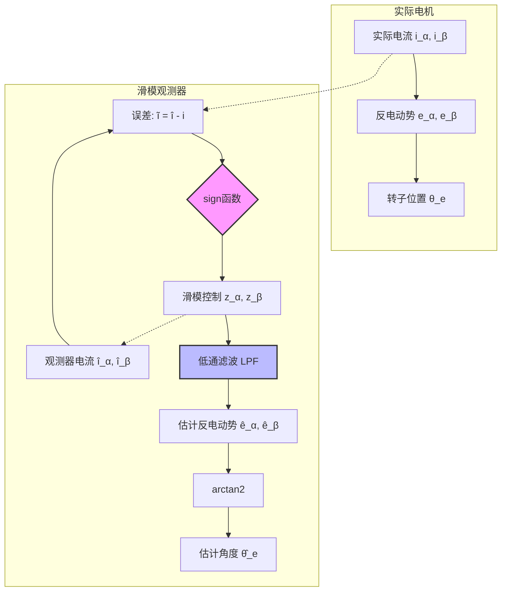

# 滑模观测器 SMO

> **为什么学？**
> 直接用电压方程反解反电动势会放大电流采样噪声，低速时几乎不可用。如果不掌握滑模观测器的设计思想，就难以在低成本MCU上实现鲁棒的中高速无传感器FOC；错误的滑模增益或滤波参数会导致角度抖动、相位滞后甚至观测器发散。
>
> **在 FOC 中的作用**
> SMO是无传感器FOC中最常用的“反电动势观测器”实现之一。它把电流作为可测量输出，通过不连续切换强制电流估计收敛，再从等效控制中提取反电动势，最终输出给Park变换所需的$\theta_e$和速度环所需的$\omega_e$。

从电压方程直接提取反电动势对噪声过于敏感，工程上需要一种闭环机制：既利用电机模型预测电流，又用实测电流修正预测。滑模观测器正是这样一种“硬约束”方案——用sign函数把电流误差压到零，再从切换信号的平均值中恢复反电动势。

## 1. 数学推导：滑模观测器完整设计

### 1.1 PMSM 的 αβ 坐标系数学模型

**为什么要做这一步**：$\alpha\beta$坐标系下的电压方程是SMO的标称模型，只有先把模型写清楚，才能设计观测器使其跟踪实际电流而不是发散。

在静止坐标系（αβ）下，表贴式 PMSM（SPMSM）的电压方程为：

$$
\begin{cases}
\frac{di_\alpha}{dt} = -\frac{R_s}{L_s} i_\alpha + \frac{1}{L_s} v_\alpha - \frac{1}{L_s} e_\alpha \\[8pt]
\frac{di_\beta}{dt} = -\frac{R_s}{L_s} i_\beta + \frac{1}{L_s} v_\beta - \frac{1}{L_s} e_\beta
\end{cases}
$$

其中反电动势满足：

$$
\begin{cases}
e_\alpha = -\omega_e \psi_f \sin\theta_e \\[4pt]
e_\beta = \omega_e \psi_f \cos\theta_e
\end{cases}
$$

将系统写成状态空间形式，选取状态向量 $x = \begin{bmatrix} i_\alpha & i_\beta \end{bmatrix}^T$：

$$
\dot{x} = A x + B u + D \cdot (-e_{\alpha\beta})
$$

其中：

$$
A = \begin{bmatrix} -\frac{R_s}{L_s} & 0 \\ 0 & -\frac{R_s}{L_s} \end{bmatrix}, \quad
B = D = \begin{bmatrix} \frac{1}{L_s} & 0 \\ 0 & \frac{1}{L_s} \end{bmatrix}, \quad
u = \begin{bmatrix} v_\alpha \\ v_\beta \end{bmatrix}
$$

### 1.2 SMO 的核心结构

**为什么要做这一步**：SMO的核心不是复制电机，而是用切换项替代未知的反电动势；这一节说明如何通过电流误差构造滑模控制律。

滑模观测器的基本思想是：构建一个与真实系统相同的标称模型，并通过**不连续的切换控制（sign 函数）**来强制观测器的输出跟踪实际系统的输出。一旦系统进入滑模面，观测误差将被约束在零附近，此时可以从等效控制（equivalent control）中提取反电动势信息。

**观测器方程**：

$$
\begin{cases}
\frac{d\hat{i}_\alpha}{dt} = -\frac{R_s}{L_s} \hat{i}_\alpha + \frac{1}{L_s} v_\alpha - \frac{1}{L_s} z_\alpha \\[8pt]
\frac{d\hat{i}_\beta}{dt} = -\frac{R_s}{L_s} \hat{i}_\beta + \frac{1}{L_s} v_\beta - \frac{1}{L_s} z_\beta
\end{cases}
$$

其中 $z_\alpha$ 和 $z_\beta$ 是滑模控制项，定义为：

$$
\begin{cases}
z_\alpha = k \cdot \text{sign}(\hat{i}_\alpha - i_\alpha) = k \cdot \text{sign}(\tilde{i}_\alpha) \\[4pt]
z_\beta = k \cdot \text{sign}(\hat{i}_\beta - i_\beta) = k \cdot \text{sign}(\tilde{i}_\beta)
\end{cases}
$$

这里 $k$ 是滑模增益（switching gain），$\tilde{i} = \hat{i} - i$ 是电流观测误差。

### 1.3 滑模面与收敛条件

**为什么要做这一步**：滑模增益选太小会失步，选太大会抖振；Lyapunov分析给出可量化的收敛条件，是工程调参的理论依据。

定义滑模面为电流估计误差：

$$
s = \begin{bmatrix} \tilde{i}_\alpha \\ \tilde{i}_\beta \end{bmatrix} = \begin{bmatrix} \hat{i}_\alpha - i_\alpha \\ \hat{i}_\beta - i_\beta \end{bmatrix}
$$

对误差系统求导：

$$
\dot{\tilde{i}}_\alpha = -\frac{R_s}{L_s} \tilde{i}_\alpha - \frac{1}{L_s}(z_\alpha - e_\alpha)
$$
$$
\dot{\tilde{i}}_\beta = -\frac{R_s}{L_s} \tilde{i}_\beta - \frac{1}{L_s}(z_\beta - e_\beta)
$$

选取 Lyapunov 函数 $V = \frac{1}{2}(\tilde{i}_\alpha^2 + \tilde{i}_\beta^2)$，其导数为：

$$
\dot{V} = \tilde{i}_\alpha \dot{\tilde{i}}_\alpha + \tilde{i}_\beta \dot{\tilde{i}}_\beta = -\frac{R_s}{L_s}(\tilde{i}_\alpha^2 + \tilde{i}_\beta^2) - \frac{1}{L_s}\left[k(|\tilde{i}_\alpha| + |\tilde{i}_\beta|) - (e_\alpha \tilde{i}_\alpha + e_\beta \tilde{i}_\beta)\right]
$$

为保证 $\dot{V} < 0$，需要滑模增益满足：

$$
k > \max(|e_\alpha|, |e_\beta|) + \frac{R_s}{2} \cdot \text{small_margin}
$$

更保守且实用的条件为：

$$
k > \omega_{e,max} \psi_f + \text{margin}
$$

即滑模增益必须大于反电动势的最大幅值，才能保证观测器电流跟踪实际电流。

### 1.4 等效控制与反电动势提取

**为什么要做这一步**：sign函数输出是高频切换，不能直接当反电动势用；等效控制+低通滤波是从中提取低频位置信息的桥梁。

当系统进入滑模面后（$\tilde{i}_\alpha \approx 0$, $\tilde{i}_\beta \approx 0$），从误差方程可得：

$$
0 = -\frac{1}{L_s}(z_{\alpha,eq} - e_\alpha) \quad \Rightarrow \quad z_{\alpha,eq} = e_\alpha
$$
$$
0 = -\frac{1}{L_s}(z_{\beta,eq} - e_\beta) \quad \Rightarrow \quad z_{\beta,eq} = e_\beta
$$

**核心洞察**：滑模控制项的**等效分量**（即 sign 函数输出的平均/低频分量）等于反电动势。因此，只要对 $z_\alpha$ 和 $z_\beta$ 进行低通滤波（LPF），就能得到反电动势的估计值：

$$
\hat{e}_\alpha = \frac{\omega_{LPF}}{s + \omega_{LPF}} z_\alpha, \quad \hat{e}_\beta = \frac{\omega_{LPF}}{s + \omega_{LPF}} z_\beta
$$

其中 $\omega_{LPF}$ 是低通滤波器的截止角频率。

### 1.5 从反电动势估计位置与速度

**为什么要做这一步**：滤波带来相位滞后，高速时尤其明显；补偿后才能把估计角准确交给Park变换，避免d-q轴解耦失效。

获得 $\hat{e}_\alpha$ 和 $\hat{e}_\beta$ 后，角度和速度估计为：

$$
\hat{\theta}_e = \arctan2(-\hat{e}_\alpha, \hat{e}_\beta)
$$

$$
\hat{\omega}_e = \frac{\sqrt{\hat{e}_\alpha^2 + \hat{e}_\beta^2}}{\psi_f}
$$

由于低通滤波会引入相位滞后，需要对估计角度进行补偿：

$$
\hat{\theta}_{e,comp} = \hat{\theta}_e + \arctan\left(\frac{\hat{\omega}_e}{\omega_{LPF}}\right)
$$

---

## 2. 几何直观：滑模观测器的工作原理



**ASCII 图：滑模面附近的动态行为**

```
                ĩ_β (电流误差)
                  |
                  |     滑模面 (ĩ=0)
                  |    /
                  |   /  系统轨迹被
                  |  /   强制拉向
                  | /    滑模面
                  |/
    ──────────────+────────────── ĩ_α
                 /|
                / |
               /  |
              /   |
             
    sign(ĩ) 产生不连续切换，将误差约束在原点附近
    
    在滑模面上：z_eq = e，即等效控制等于反电动势
```

**滑模观测器的物理直觉**：
1. 观测器复制了电机的电气动态，但用开关控制 $z$ 替代了未知的反电动势 $e$。
2. 当观测器电流偏离实际电流时，sign 函数产生强烈的不连续反馈，将误差"锤"回零。
3. 由于 sign 函数的高频切换特性，其输出包含一个平均值（等效控制），这个平均值恰好等于反电动势。
4. 低通滤波器就像从嘈杂的信号中提取"直流分量"，而这个直流分量就是我们要的反电动势。

---

## 3. 数值示例：SMO 完整计算流程

**给定参数**：
- $R_s = 0.5\ \Omega$，$L_s = 1.2\ \text{mH}$
- $\psi_f = 0.05\ \text{Wb}$，$P = 4$
- $n = 1500\ \text{rpm}$，$\omega_e = 628.3\ \text{rad/s}$
- $T_s = 50\ \mu\text{s}$（离散化步长）
- 滑模增益 $k = 50\ \text{V}$（大于 $E_{max} = 31.4\ \text{V}$）
- LPF 截止频率 $f_{LPF} = 2\ \text{kHz}$，$\omega_{LPF} = 2\pi \times 2000 = 12566\ \text{rad/s}$
- 当前真实电角度 $\theta_e = 45°$
- 实际电流：$i_\alpha = 2.0\ \text{A}$，$i_\beta = 1.5\ \text{A}$
- 观测器电流初始值：$\hat{i}_\alpha = 1.8\ \text{A}$，$\hat{i}_\beta = 1.7\ \text{A}$
- 输入电压：$v_\alpha = 15\ \text{V}$，$v_\beta = 10\ \text{V}$

**Step 1：计算电流误差**

$$
\tilde{i}_\alpha = 1.8 - 2.0 = -0.2\ \text{A}
$$
$$
\tilde{i}_\beta = 1.7 - 1.5 = 0.2\ \text{A}
$$

**Step 2：计算滑模控制项**

$$
z_\alpha = k \cdot \text{sign}(\tilde{i}_\alpha) = 50 \times (-1) = -50\ \text{V}
$$
$$
z_\beta = k \cdot \text{sign}(\tilde{i}_\beta) = 50 \times 1 = 50\ \text{V}
$$

**Step 3：更新观测器电流（前向欧拉离散化）**

$$
\frac{d\hat{i}_\alpha}{dt} = -\frac{0.5}{0.0012} \times 1.8 + \frac{1}{0.0012} \times 15 - \frac{1}{0.0012} \times (-50) = -750 + 12500 + 41667 = 53417\ \text{A/s}
$$

$$
\hat{i}_\alpha^{(k+1)} = 1.8 + 53417 \times 50\times 10^{-6} = 1.8 + 2.67 = 4.47\ \text{A}
$$

注意：这个跳动很大，说明在这一步内误差已经被强行拉向实际值。在实际代码中，sign 函数的强切换会导致观测器电流在真实值附近高频抖动。

**Step 4：提取等效控制（经过 LPF）**

假设经过若干周期后，观测器已进入稳态滑模，此时 LPF 输出为：

$$
\hat{e}_\alpha = -\omega_e \psi_f \sin(45°) = -31.4 \times 0.707 = -22.2\ \text{V}
$$
$$
\hat{e}_\beta = \omega_e \psi_f \cos(45°) = 31.4 \times 0.707 = 22.2\ \text{V}
$$

**Step 5：角度估计**

$$
\hat{\theta}_e = \arctan2(-\hat{e}_\alpha, \hat{e}_\beta) = \arctan2(22.2, 22.2) = 45°
$$

**Step 6：相位补偿**

$$
\Delta\theta = \arctan\left(\frac{628.3}{12566}\right) = \arctan(0.05) = 2.86°
$$

$$
\hat{\theta}_{e,comp} = 45° + 2.86° = 47.86° \approx 48°
$$

补偿后角度更接近真实值，但补偿量本身依赖于速度估计的准确性。

---

## 4. 代码实现：完整的滑模观测器

### C 语言实现（可运行于 FOC 50μs 中断）

```c
#include <math.h>

#define PI 3.14159265359f
#define TWO_PI 6.28318530718f
#define SQRT3 1.73205080757f

// 电机参数
#define RS 0.5f
#define LS 0.0012f
#define PSIF 0.05f
#define POLE_PAIRS 4
#define TS 50.0e-6f

// SMO 参数
#define SMO_GAIN 50.0f          // 滑模增益 k，需大于最大反电动势
#define LPF_CUTOFF_HZ 2000.0f   // 低通滤波截止频率
#define OMEGA_LPF (2.0f * PI * LPF_CUTOFF_HZ)

// 低通滤波系数（一阶 IIR：y[n] = a*x[n] + (1-a)*y[n-1]）
// a = omega_lpf * Ts / (1 + omega_lpf * Ts) 对于双线性变换
// 简化前向欧拉：a = omega_lpf * Ts
#define LPF_ALPHA (OMEGA_LPF * TS)  // 约 0.628

// 观测器状态
static float i_alpha_hat = 0.0f;   // 估计电流 α
static float i_beta_hat = 0.0f;    // 估计电流 β
static float e_alpha_hat = 0.0f;   // 估计反电动势 α
static float e_beta_hat = 0.0f;    // 估计反电动势 β
static float theta_hat = 0.0f;     // 估计角度
static float omega_hat = 0.0f;     // 估计速度

// sign 函数（不连续切换函数）
inline float sign(float x) {
    if (x > 0.0f) return 1.0f;
    if (x < 0.0f) return -1.0f;
    return 0.0f;
}

// 改进的饱和函数（边界层法，减少抖振）
inline float sat(float x, float boundary) {
    if (x > boundary) return 1.0f;
    if (x < -boundary) return -1.0f;
    return x / boundary;
}

// 滑模观测器主函数（每 50us 调用）
void SMO_update(float v_alpha, float v_beta, float i_alpha, float i_beta) {
    // 1. 计算电流误差
    float err_alpha = i_alpha_hat - i_alpha;
    float err_beta = i_beta_hat - i_beta;
    
    // 2. 滑模控制项（使用饱和函数替代 sign 以减少抖动）
    float z_alpha = SMO_GAIN * sign(err_alpha);  // 或 sat(err_alpha, 0.1f)
    float z_beta = SMO_GAIN * sign(err_beta);
    
    // 3. 观测器电流更新（前向欧拉）
    float di_alpha_hat = -(RS / LS) * i_alpha_hat + (v_alpha - z_alpha) / LS;
    float di_beta_hat = -(RS / LS) * i_beta_hat + (v_beta - z_beta) / LS;
    
    i_alpha_hat += di_alpha_hat * TS;
    i_beta_hat += di_beta_hat * TS;
    
    // 4. 等效控制提取：通过低通滤波获取反电动势
    e_alpha_hat = LPF_ALPHA * z_alpha + (1.0f - LPF_ALPHA) * e_alpha_hat;
    e_beta_hat = LPF_ALPHA * z_beta + (1.0f - LPF_ALPHA) * e_beta_hat;
    
    // 5. 角度估计（arctan2）
    theta_hat = atan2f(-e_alpha_hat, e_beta_hat);
    
    // 6. 速度估计（反电动势幅值 / ψ_f）
    float e_mag = sqrtf(e_alpha_hat * e_alpha_hat + e_beta_hat * e_beta_hat);
    omega_hat = e_mag / PSIF;
    
    // 7. 相位补偿（LPF 引入的滞后）
    if (omega_hat > 1.0f) {  // 避免低速时除零
        float phase_comp = atan2f(omega_hat, OMEGA_LPF);
        theta_hat += phase_comp;
    }
    
    // 8. 角度归一化到 [0, 2π)
    if (theta_hat >= TWO_PI) theta_hat -= TWO_PI;
    if (theta_hat < 0.0f) theta_hat += TWO_PI;
}

// 外部接口：获取估计的角度和速度
float SMO_get_theta(void) { return theta_hat; }
float SMO_get_omega(void) { return omega_hat; }
```

### 带锁相环（PLL）的速度提取（更平滑）

直接用 $\arctan2$ 和微分求速度会引入噪声。工程上常用锁相环（PLL）来从反电动势提取速度：

```c
// PLL 结构从反电动势提取速度
static float theta_pll = 0.0f;
static float omega_pll = 0.0f;
#define PLL_KP 500.0f
#define PLL_KI 50000.0f
static float pll_integral = 0.0f;

void PLL_update(float e_alpha, float e_beta) {
    // PLL 误差：cross product of (e_αβ) and (sinθ, cosθ)
    float sin_theta = sinf(theta_pll);
    float cos_theta = cosf(theta_pll);
    float error = -e_alpha * cos_theta - e_beta * sin_theta;  // 或 e_β*cosθ - e_α*sinθ
    
    // PI 控制器
    pll_integral += PLL_KI * error * TS;
    omega_pll = PLL_KP * error + pll_integral;
    
    // 积分得到角度
    theta_pll += omega_pll * TS;
    
    if (theta_pll >= TWO_PI) theta_pll -= TWO_PI;
    if (theta_pll < 0.0f) theta_pll += TWO_PI;
}
```

---

## 5. 常见错误与纠正

### 错误 1：滑模增益过小导致观测器无法进入滑模

**问题描述**：初学者往往担心 sign 函数带来的抖动，倾向于选择较小的滑模增益 $k$。然而，如果 $k < |e_{max}|$，观测器无法克服反电动势的"扰动"，电流误差无法收敛到零，系统永远无法进入滑模状态。

**错误表现**：电流估计值 $\hat{i}$ 偏离实际值 $i$ 越来越远，观测器发散；或在大负载突变时观测器丢失跟踪，导致电机失步。

**纠正方法**：

保守设计公式：

$$
k > 1.5 \times \omega_{e,max} \times \psi_f
$$

例如，若电机最高转速为 $6000\ \text{rpm}$，$P=4$，$\psi_f = 0.05\ \text{Wb}$：

$$
\omega_{e,max} = 4 \times \frac{2\pi \times 6000}{60} = 2513\ \text{rad/s}
$$
$$
k > 1.5 \times 2513 \times 0.05 = 188.5\ \text{V}
$$

实际可取 $k = 200\ \text{V}$ 或更高，并留有一定裕量。

### 错误 2：低通滤波截止频率选择不当导致相位滞后或噪声过大

**问题描述**：低通滤波器的截止频率 $f_{LPF}$ 是一个关键参数。若 $f_{LPF}$ 过高，无法有效滤除 sign 函数的高频切换分量，估计角度抖动严重；若 $f_{LPF}$ 过低，虽然滤波效果好，但会引入显著的相位滞后，在高速时角度补偿误差大，甚至导致系统不稳定。

**典型错误配置**：$f_{LPF} = 500\ \text{Hz}$，在转速 $3000\ \text{rpm}$ 时，相位滞后为：

$$
\Delta\phi = \arctan\left(\frac{\omega_e}{\omega_{LPF}}\right) = \arctan\left(\frac{1256}{3141}\right) = 21.8°
$$

这个角度误差在 FOC 中会导致 d-q 轴解耦严重失效，电流失控。

**纠正方法**：
1. **按速度范围选择**：通常取 $f_{LPF}$ 为电流环带宽的 1/5 到 1/10，典型值为 $1\text{--}5\ \text{kHz}$。
2. **自适应 LPF**：根据估计速度动态调整截止频率，低速时降低 $f_{LPF}$ 以更好地滤波，高速时提高 $f_{LPF}$ 以减少相位滞后。
3. **PLL 替代直接 arctan2**：用锁相环从反电动势提取角度，PLL 本身具有低通特性，且相位滞后更可控。

---

## 6. 自测习题

### 习题 1：滑模增益设计

一台 PMSM 参数如下：$R_s = 0.3\ \Omega$，$L_s = 1.5\ \text{mH}$，$\psi_f = 0.06\ \text{Wb}$，极对数 $P = 4$。电机额定转速为 $4000\ \text{rpm}$，最大允许转速为 $8000\ \text{rpm}$。

**问题**：
(1) 计算保证全速范围内滑模收敛所需的最小滑模增益 $k_{min}$。
(2) 若选择 $k = 1.2 \times k_{min}$，当电机运行在额定转速、电角度 $\theta_e = 30°$ 时，计算 $z_\alpha$ 和 $z_\beta$（假设电流误差 $\tilde{i}_\alpha = 0.1\ \text{A}$，$\tilde{i}_\beta = -0.05\ \text{A}$）。
(3) 说明为什么 $k$ 不能过大，过大的 $k$ 会导致什么问题？

**答案**：

(1) 最大电角速度：
$$
\omega_{e,max} = 4 \times \frac{2\pi \times 8000}{60} = 3351\ \text{rad/s}
$$

最大反电动势：
$$
E_{max} = \omega_{e,max} \psi_f = 3351 \times 0.06 = 201.1\ \text{V}
$$

最小滑模增益：
$$
k_{min} = E_{max} = 201.1\ \text{V}
$$

(2) 取 $k = 1.2 \times 201.1 = 241.3\ \text{V}$。

$$
z_\alpha = k \cdot \text{sign}(0.1) = 241.3\ \text{V}
$$
$$
z_\beta = k \cdot \text{sign}(-0.05) = -241.3\ \text{V}
$$

注意：无论误差大小（只要大于零），sign 函数的输出都是 ±1，这是滑模控制的特性。

(3) **$k$ 过大的问题**：
- **抖振加剧**：sign 函数的切换幅度与 $k$ 成正比，过大的 $k$ 会导致观测器电流在滑模面附近剧烈抖动，增加谐波损耗和噪声。
- **低通滤波负担加重**：需要更低截止频率的 LPF 来平滑，导致更大的相位滞后。
- **系统不稳定风险**：在低速时，过大的切换增益可能使观测器表现出类似继电特性，引起极限环振荡。
- 合理的设计是取 $k = (1.2\text{--}1.5) \times E_{max}$，平衡收敛速度和抖振抑制。

### 习题 2：等效控制提取与角度估计

在上述 SMO 中，假设经过 LPF 后得到 $\hat{e}_\alpha = -30\ \text{V}$，$\hat{e}_\beta = 40\ \text{V}$。已知低通滤波器的截止频率为 $f_{LPF} = 2.5\ \text{kHz}$。

**问题**：
(1) 计算估计电角度 $\hat{\theta}_e$（未补偿）。
(2) 计算估计电角速度 $\hat{\omega}_e$（已知 $\psi_f = 0.06\ \text{Wb}$）。
(3) 计算相位补偿量，并给出补偿后的角度估计值。

**答案**：

(1) 估计电角度：
$$
\hat{\theta}_e = \arctan2(-\hat{e}_\alpha, \hat{e}_\beta) = \arctan2(30, 40) = 36.87°
$$

(2) 估计电角速度：
$$
\hat{\omega}_e = \frac{\sqrt{(-30)^2 + 40^2}}{0.06} = \frac{50}{0.06} = 833.3\ \text{rad/s}
$$

对应机械转速：
$$
n = \frac{833.3}{4} \times \frac{60}{2\pi} = 1990\ \text{rpm}
$$

(3) 相位补偿：
$$
\omega_{LPF} = 2\pi \times 2500 = 15708\ \text{rad/s}
$$
$$
\Delta\theta = \arctan\left(\frac{833.3}{15708}\right) = \arctan(0.053) = 3.04°
$$

补偿后角度：
$$
\hat{\theta}_{e,comp} = 36.87° + 3.04° = 39.91° \approx 40°
$$

---

## 7. 小结与进阶方向

滑模观测器 SMO 以其结构简单、鲁棒性强、实现成本低的优势，成为无传感器 FOC 中应用最广泛的观测器之一。本文从数学推导、几何直观、数值示例、代码实现、常见错误和自测习题六个维度，完整构建了 SMO 的知识体系。

**SMO 的核心要点回顾**：
1. 通过 sign 函数产生不连续切换，强制电流估计误差收敛到零。
2. 滑模增益 $k$ 必须大于最大反电动势，确保全局收敛。
3. 等效控制 $z_{eq}$ 经过低通滤波后等于反电动势，是位置提取的桥梁。
4. 低通滤波引入的相位滞后必须补偿，尤其在高速运行时。

**进阶方向**：
- **自适应滑模增益**：根据速度或误差动态调整 $k$，低速时减小 $k$ 抑制抖振，高速时增大 $k$ 确保收敛。
- **super-twisting 算法**：二阶滑模算法，在保持有限时间收敛的同时显著减小抖振，无需额外低通滤波。
- **与 PLL 结合**：用锁相环替代直接 arctan2，获得更平滑的速度和角度估计。
- **扩展至 IPMSM**：考虑凸极效应（$L_d \neq L_q$），设计更复杂的滑模面来处理磁阻转矩和交叉耦合。

在后续笔记中，我们将讨论龙伯格观测器和扩展卡尔曼滤波（EKF），它们提供了更平滑的估计性能，但计算复杂度也更高。理解 SMO 的物理本质，是掌握这些更高级观测器的重要 stepping stone。
