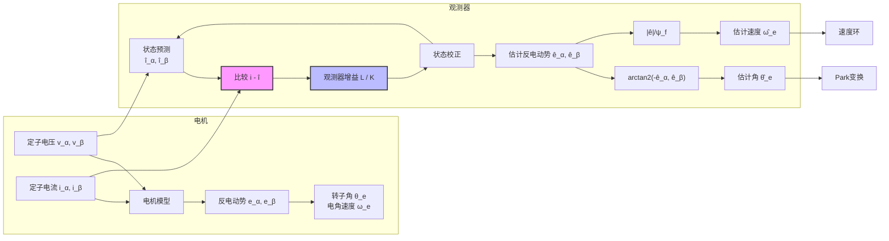
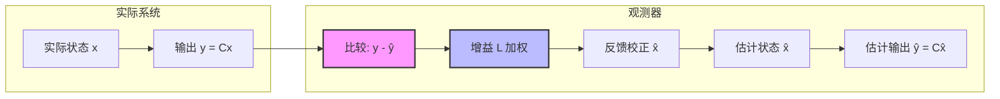

# 龙伯格观测器与 EKF

> **为什么学？**
> SMO的不连续性会引入抖振和相位滞后，对伺服、机器人等需要平滑估计的场景不够理想。如果不理解龙伯格观测器或EKF，就无法在“平滑性”与“计算量”之间做合理取舍；错误配置EKF的Q/R矩阵还会导致估计发散或响应迟缓。
>
> **在 FOC 中的作用**
> 龙伯格观测器和EKF都是连续状态估计框架，用于从电流测量中平滑地恢复反电动势、转子角和速度。它们与SMO并行，供设计者根据处理器能力、精度需求和鲁棒性要求选择。

这张图说明龙伯格观测器/EKF 如何把实测电流与模型预测电流的误差，通过连续增益反馈到状态估计，最终平滑地输出反电动势、角度和速度。

*图：连续状态观测器在 FOC 中的估计链路*



SMO用“硬切换”压制误差，换来的代价是高频抖振；龙伯格观测器和EKF则用“软反馈”——通过连续增益或协方差矩阵把电流测量信息揉进状态估计。下面从线性龙伯格观测器出发，逐步扩展到扩展卡尔曼滤波，说明它们如何在FOC中提供更平滑的位置/速度输出。

## 1. 数学推导：从龙伯格观测器到 EKF

### 1.1 线性龙伯格观测器设计

**为什么要做这一步**：把PMSM电压方程写成标准状态空间形式，是设计任何线性观测器的前提；只有明确$A$、$B$、$C$矩阵，才能用极点配置稳定误差动态。

对于表贴式 PMSM（$L_d = L_q = L_s$），在 αβ 坐标系下的状态空间模型为：

$$
\dot{x} = A x + B v + D \cdot w
$$

其中状态向量 $x = \begin{bmatrix} i_\alpha & i_\beta \end{bmatrix}^T$，输入 $v = \begin{bmatrix} v_\alpha & v_\beta \end{bmatrix}^T$，扰动 $w = \begin{bmatrix} e_\alpha & e_\beta \end{bmatrix}^T$（将反电动势视为未知扰动）。

$$
A = \begin{bmatrix} -\frac{R_s}{L_s} & 0 \\ 0 & -\frac{R_s}{L_s} \end{bmatrix}, \quad
B = D = \begin{bmatrix} \frac{1}{L_s} & 0 \\ 0 & \frac{1}{L_s} \end{bmatrix}
$$

**龙伯格观测器**的结构为：

$$
\dot{\hat{x}} = A \hat{x} + B v + L(y - \hat{y})
$$

其中 $y = x$ 为测量输出（电流），$\hat{y} = C\hat{x}$ 为观测器输出，$C = I$（单位矩阵），$L$ 为观测器增益矩阵。

代入具体模型：

$$
\begin{cases}
\frac{d\hat{i}_\alpha}{dt} = -\frac{R_s}{L_s} \hat{i}_\alpha + \frac{1}{L_s} v_\alpha + l_1(i_\alpha - \hat{i}_\alpha) + l_2(i_\beta - \hat{i}_\beta) \\[8pt]
\frac{d\hat{i}_\beta}{dt} = -\frac{R_s}{L_s} \hat{i}_\beta + \frac{1}{L_s} v_\beta + l_3(i_\alpha - \hat{i}_\alpha) + l_4(i_\beta - \hat{i}_\beta)
\end{cases}
$$

### 1.2 观测器误差动态与极点配置

**为什么要做这一步**：观测器不是单纯复制模型，而是用输出误差反馈校正；极点配置决定估计收敛速度与噪声敏感度之间的平衡。

定义误差 $e = x - \hat{x}$，则误差动态为：

$$
\dot{e} = (A - LC)e + D \cdot w
$$

当反电动势 $w$ 较小时（或作为慢变扰动处理），误差动态主要由矩阵 $(A - LC)$ 决定。若选择合适的 $L$ 使得 $(A - LC)$ 的所有特征值（极点）位于左半平面，则误差指数收敛到零。

对于对称的 PMSM 模型，通常取 $L$ 为对角矩阵：

$$
L = \begin{bmatrix} l_1 & 0 \\ 0 & l_2 \end{bmatrix}
$$

误差动态变为两个独立的子系统：

$$
\dot{e}_\alpha = \left(-\frac{R_s}{L_s} - l_1\right) e_\alpha + \frac{1}{L_s} e_\alpha^{(bemf)}
$$
$$
\dot{e}_\beta = \left(-\frac{R_s}{L_s} - l_2\right) e_\beta + \frac{1}{L_s} e_\beta^{(bemf)}
$$

选择极点配置，令：

$$
-\frac{R_s}{L_s} - l_1 = -\omega_{obs}, \quad -\frac{R_s}{L_s} - l_2 = -\omega_{obs}
$$

其中 $\omega_{obs}$ 为观测器带宽（rad/s），通常取电流环带宽的 $2\text{--}5$ 倍。解得：

$$
l_1 = l_2 = \omega_{obs} - \frac{R_s}{L_s}
$$

### 1.3 反电动势的扩展状态估计

**为什么要做这一步**：如果反电动势不被显式估计，就无法直接用于角度计算；扩展状态向量后，观测器同时给出电流和反电动势的平滑估计。

上述龙伯格观测器将反电动势视为扰动，没有直接估计它。为了估计反电动势并提取位置，需要**扩展状态向量**，将 $e_\alpha$ 和 $e_\beta$ 作为额外状态：

$$
x_{ext} = \begin{bmatrix} i_\alpha & i_\beta & e_\alpha & e_\beta \end{bmatrix}^T
$$

假设反电动势在观测器时间尺度上慢变（$\dot{e}_\alpha \approx 0, \dot{e}_\beta \approx 0$），扩展系统为：

$$
\dot{x}_{ext} = A_{ext} x_{ext} + B_{ext} v
$$

$$
A_{ext} = \begin{bmatrix}
-\frac{R_s}{L_s} & 0 & -\frac{1}{L_s} & 0 \\[4pt]
0 & -\frac{R_s}{L_s} & 0 & -\frac{1}{L_s} \\[4pt]
0 & 0 & 0 & 0 \\[4pt]
0 & 0 & 0 & 0
\end{bmatrix}, \quad
B_{ext} = \begin{bmatrix}
\frac{1}{L_s} & 0 \\[4pt]
0 & \frac{1}{L_s} \\[4pt]
0 & 0 \\[4pt]
0 & 0
\end{bmatrix}
$$

输出方程：$y = C_{ext} x_{ext}$，其中 $C_{ext} = \begin{bmatrix} I_2 & 0_2 \end{bmatrix}$。

扩展龙伯格观测器为：

$$
\dot{\hat{x}}_{ext} = A_{ext} \hat{x}_{ext} + B_{ext} v + L_{ext}(y - C_{ext}\hat{x}_{ext})
$$

通过配置 $L_{ext}$（$4 \times 2$ 矩阵）的极点，可以使四个状态（电流和反电动势）同时收敛。反电动势估计值可直接用于角度计算：

$$
\hat{\theta}_e = \arctan2(-\hat{e}_\alpha, \hat{e}_\beta)
$$

### 1.4 扩展卡尔曼滤波（EKF）

**为什么要做这一步**：电机电压方程对$\theta_e$是非线性的，KF不能直接套用；EKF在每个工作点线性化，使得卡尔曼框架可以覆盖FOC这种非线性对象。

卡尔曼滤波（KF）是线性系统在最小均方误差意义下的最优状态估计器。对于非线性系统，使用**扩展卡尔曼滤波（EKF）**，通过在每个工作点进行线性化来近似。

将 PMSM 模型写成非线性状态空间形式，选取状态：

$$
x = \begin{bmatrix} i_\alpha & i_\beta & \theta_e & \omega_e \end{bmatrix}^T
$$

状态方程（非线性）：

$$
\dot{i}_\alpha = -\frac{R_s}{L_s} i_\alpha + \frac{1}{L_s} v_\alpha + \frac{\omega_e \psi_f}{L_s} \sin\theta_e
$$
$$
\dot{i}_\beta = -\frac{R_s}{L_s} i_\beta + \frac{1}{L_s} v_\beta - \frac{\omega_e \psi_f}{L_s} \cos\theta_e
$$
$$
\dot{\theta}_e = \omega_e
$$
$$
\dot{\omega}_e = 0 \quad \text{(假设机械时间常数远大于电气时间常数)}
$$

测量输出为电流：$y = \begin{bmatrix} i_\alpha & i_\beta \end{bmatrix}^T$。

**EKF 算法步骤**（连续-离散形式）：

**Step 1：预测（时间更新）**

$$
\dot{\hat{x}} = f(\hat{x}, v), \quad \text{从 } t_{k-1} \text{ 积分到 } t_k \text{ 得 } \hat{x}_k^-
$$

$$
\dot{P} = F P + P F^T + Q, \quad \text{得 } P_k^-
$$

其中 $F = \frac{\partial f}{\partial x}$ 为 Jacobian 矩阵，$Q$ 为过程噪声协方差。

**Step 2：更新（测量更新）**

$$
K_k = P_k^- H^T (H P_k^- H^T + R)^{-1}
$$

$$
\hat{x}_k = \hat{x}_k^- + K_k (y_k - h(\hat{x}_k^-))
$$

$$
P_k = (I - K_k H) P_k^-
$$

其中 $H = \frac{\partial h}{\partial x}$ 为测量 Jacobian，$R$ 为测量噪声协方差。

**关键 Jacobian 矩阵**：

$$
F = \begin{bmatrix}
-\frac{R_s}{L_s} & 0 & \frac{\omega_e \psi_f}{L_s}\cos\theta_e & \frac{\psi_f}{L_s}\sin\theta_e \\[6pt]
0 & -\frac{R_s}{L_s} & \frac{\omega_e \psi_f}{L_s}\sin\theta_e & -\frac{\psi_f}{L_s}\cos\theta_e \\[6pt]
0 & 0 & 0 & 1 \\[6pt]
0 & 0 & 0 & 0
\end{bmatrix}
$$

$$
H = \begin{bmatrix} 1 & 0 & 0 & 0 \\ 0 & 1 & 0 & 0 \end{bmatrix}
$$

---

## 2. 几何直观：观测器的反馈校正机制



**ASCII 图：龙伯格观测器的误差收敛**

```
    误差 e(t)
      |
      |   *  初值
      |  /|
      | / |  按指数收敛
      |/  |  e(t) = e(0) * exp(-ω_obs * t)
      +---|-------------> 时间
     /    |
    /     |
   /      |
  
  观测器带宽 ω_obs 越大，收敛越快，但对噪声越敏感
  观测器带宽 ω_obs 越小，滤波效果越好，但收敛越慢
```

**EKF 的几何直觉**：
- 预测步：基于模型（电机电压方程）推测状态如何演化，但这会累积模型误差和积分漂移。
- 更新步：当新的电流测量到来时，利用测量信息来校正预测。卡尔曼增益 $K$ 自动调节"信任模型"和"信任测量"的比例。
- 如果测量噪声 $R$ 小（传感器精度高），$K$ 增大，更信任测量；如果过程噪声 $Q$ 大（模型不确定性高），$K$ 也增大，更信任测量来修正模型偏差。

---

## 3. 数值示例：扩展龙伯格观测器设计

**给定参数**：
- $R_s = 0.5\ \Omega$，$L_s = 1.2\ \text{mH}$
- $\psi_f = 0.05\ \text{Wb}$，$P = 4$
- $n = 2000\ \text{rpm}$，$\omega_e = 837.8\ \text{rad/s}$
- 观测器带宽 $\omega_{obs} = 5000\ \text{rad/s}$（约 $796\ \text{Hz}$）
- 当前真实状态：$i_\alpha = 3.0\ \text{A}$，$i_\beta = 2.0\ \text{A}$，$e_\alpha = -35.35\ \text{V}$，$e_\beta = 35.35\ \text{V}$（对应 $\theta_e = 135°$）
- 初始估计状态：$\hat{i}_\alpha = 2.5\ \text{A}$，$\hat{i}_\beta = 1.5\ \text{A}$，$\hat{e}_\alpha = 0$，$\hat{e}_\beta = 0$
- 输入电压：$v_\alpha = 20\ \text{V}$，$v_\beta = 15\ \text{V}$
- 离散步长 $T_s = 50\ \mu\text{s}$

**Step 1：计算观测器增益矩阵 $L_{ext}$**

对于扩展系统，设四个极点均配置在 $s = -\omega_{obs} = -5000$。利用 Ackermann 公式或 MATLAB 的 `place` 函数，可解得：

$$
L_{ext} = \begin{bmatrix} l_{11} & 0 \\ 0 & l_{22} \\ l_{31} & 0 \\ 0 & l_{42} \end{bmatrix}
$$

对于对称的 PMSM，α 和 β 轴解耦，可以独立设计。对于单轴（以 α 为例），扩展子系统为：

$$
\begin{bmatrix} \dot{i}_\alpha \\ \dot{e}_\alpha \end{bmatrix} =
\begin{bmatrix} -\frac{R_s}{L_s} & -\frac{1}{L_s} \\ 0 & 0 \end{bmatrix}
\begin{bmatrix} i_\alpha \\ e_\alpha \end{bmatrix} +
\begin{bmatrix} \frac{1}{L_s} \\ 0 \end{bmatrix} v_\alpha
$$

观测器增益 $L_\alpha = \begin{bmatrix} l_{11} \\ l_{31} \end{bmatrix}$，误差动态为：

$$
\begin{bmatrix} \dot{\tilde{i}}_\alpha \\ \dot{\tilde{e}}_\alpha \end{bmatrix} =
\begin{bmatrix} -\frac{R_s}{L_s} - l_{11} & -\frac{1}{L_s} \\ -l_{31} & 0 \end{bmatrix}
\begin{bmatrix} \tilde{i}_\alpha \\ \tilde{e}_\alpha \end{bmatrix}
$$

期望特征方程：$(s + \omega_{obs})^2 = s^2 + 2\omega_{obs} s + \omega_{obs}^2 = 0$。

实际特征方程：$s^2 + \left(\frac{R_s}{L_s} + l_{11}\right)s - \frac{l_{31}}{L_s} = 0$。

对比系数：

$$
\frac{R_s}{L_s} + l_{11} = 2\omega_{obs} \quad \Rightarrow \quad l_{11} = 2\omega_{obs} - \frac{R_s}{L_s} = 2 \times 5000 - \frac{0.5}{0.0012} = 10000 - 416.7 = 9583.3
$$

$$
-\frac{l_{31}}{L_s} = \omega_{obs}^2 \quad \Rightarrow \quad l_{31} = -L_s \omega_{obs}^2 = -0.0012 \times 25\times 10^6 = -30000
$$

由对称性，$l_{22} = 9583.3$，$l_{42} = -30000$。

**Step 2：前向欧拉离散化，更新估计状态**

电流估计更新：

$$
\hat{i}_\alpha^{(k+1)} = \hat{i}_\alpha + T_s \left[ -\frac{R_s}{L_s}\hat{i}_\alpha + \frac{v_\alpha - \hat{e}_\alpha}{L_s} + l_{11}(i_\alpha - \hat{i}_\alpha) \right]
$$

代入数值：

$$
\hat{i}_\alpha^{(k+1)} = 2.5 + 50\times 10^{-6} \left[ -416.7 \times 2.5 + \frac{20 - 0}{0.0012} + 9583.3 \times (3.0 - 2.5) \right]
$$
$$
= 2.5 + 50\times 10^{-6} \left[ -1041.7 + 16666.7 + 4791.7 \right]
$$
$$
= 2.5 + 50\times 10^{-6} \times 20416.7 = 2.5 + 1.02 = 3.52\ \text{A}
$$

注意：初始一步跳得较大，这是因为初始误差较大。随着迭代收敛，估计值会趋于真实值。反电动势估计的收敛速度较慢（二阶系统的慢模态）。

---

## 4. 代码实现：龙伯格观测器与 EKF

### 4.1 扩展龙伯格观测器 C 实现

```c
#include <math.h>

#define PI 3.14159265359f
#define TWO_PI 6.28318530718f

// 电机参数
#define RS 0.5f
#define LS 0.0012f
#define PSIF 0.05f
#define POLE_PAIRS 4
#define TS 50.0e-6f

// 观测器带宽
#define OMEGA_OBS 5000.0f

// 观测器增益（按极点配置计算）
#define L11 (2.0f * OMEGA_OBS - RS / LS)   // ≈ 9583
#define L31 (-LS * OMEGA_OBS * OMEGA_OBS)  // ≈ -30000
#define L22 L11
#define L42 L31

// 观测器状态
static float i_alpha_hat = 0.0f;
static float i_beta_hat = 0.0f;
static float e_alpha_hat = 0.0f;
static float e_beta_hat = 0.0f;
static float theta_hat = 0.0f;
static float omega_hat = 0.0f;

void LuenbergerObserver_update(float v_alpha, float v_beta,
                                float i_alpha, float i_beta) {
    // 电流误差
    float err_alpha = i_alpha - i_alpha_hat;
    float err_beta = i_beta - i_beta_hat;
    
    // 状态导数
    float di_alpha_hat = -(RS / LS) * i_alpha_hat + (v_alpha - e_alpha_hat) / LS + L11 * err_alpha;
    float di_beta_hat = -(RS / LS) * i_beta_hat + (v_beta - e_beta_hat) / LS + L22 * err_beta;
    
    float de_alpha_hat = L31 * err_alpha;
    float de_beta_hat = L42 * err_beta;
    
    // 前向欧拉更新
    i_alpha_hat += di_alpha_hat * TS;
    i_beta_hat += di_beta_hat * TS;
    e_alpha_hat += de_alpha_hat * TS;
    e_beta_hat += de_beta_hat * TS;
    
    // 角度估计
    theta_hat = atan2f(-e_alpha_hat, e_beta_hat);
    if (theta_hat < 0.0f) theta_hat += TWO_PI;
    
    // 速度估计
    float e_mag = sqrtf(e_alpha_hat * e_alpha_hat + e_beta_hat * e_beta_hat);
    omega_hat = e_mag / PSIF;
}
```

### 4.2 简化 EKF 实现（4 状态）

```c
#include <math.h>

#define N_STATE 4
#define N_MEAS 2

// 状态索引
#define IDX_IA 0
#define IDX_IB 1
#define IDX_THETA 2
#define IDX_OMEGA 3

// EKF 状态
static float x[4];      // [i_α, i_β, θ_e, ω_e]
static float P[4][4];   // 误差协方差
static float Q[4][4];   // 过程噪声
static float R[2][2];   // 测量噪声
static float K[4][2];   // 卡尔曼增益

// 初始化 EKF
void EKF_init(void) {
    x[IDX_IA] = x[IDX_IB] = x[IDX_THETA] = x[IDX_OMEGA] = 0.0f;
    
    // 初始协方差：电流较确定，角度和速度不确定
    for (int i = 0; i < 4; i++)
        for (int j = 0; j < 4; j++)
            P[i][j] = (i == j) ? ((i < 2) ? 0.1f : 10.0f) : 0.0f;
    
    // 过程噪声：角度和速度过程噪声较大（模型不确定性）
    for (int i = 0; i < 4; i++)
        for (int j = 0; j < 4; j++)
            Q[i][j] = (i == j) ? ((i < 2) ? 0.01f : 100.0f) : 0.0f;
    
    // 测量噪声：电流测量噪声
    R[0][0] = R[1][1] = 0.001f;
    R[0][1] = R[1][0] = 0.0f;
}

// 预测步（前向欧拉）
void EKF_predict(float v_alpha, float v_beta) {
    float ia = x[IDX_IA], ib = x[IDX_IB], theta = x[IDX_THETA], omega = x[IDX_OMEGA];
    float sin_t = sinf(theta), cos_t = cosf(theta);
    
    // 状态预测
    float dia = -(RS / LS) * ia + (v_alpha + omega * PSIF * sin_t) / LS;
    float dib = -(RS / LS) * ib + (v_beta - omega * PSIF * cos_t) / LS;
    
    x[IDX_IA] += dia * TS;
    x[IDX_IB] += dib * TS;
    x[IDX_THETA] += omega * TS;
    x[IDX_OMEGA] += 0.0f;  // 速度假设慢变
    
    if (x[IDX_THETA] >= TWO_PI) x[IDX_THETA] -= TWO_PI;
    if (x[IDX_THETA] < 0.0f) x[IDX_THETA] += TWO_PI;
    
    // Jacobian F（4x4）- 简化，只计算对角和关键元素
    float F[4][4] = {{0}};
    F[0][0] = -(RS / LS);
    F[0][2] = (omega * PSIF * cos_t) / LS;
    F[0][3] = (PSIF * sin_t) / LS;
    F[1][1] = -(RS / LS);
    F[1][2] = (omega * PSIF * sin_t) / LS;
    F[1][3] = -(PSIF * cos_t) / LS;
    F[2][3] = 1.0f;
    
    // 协方差预测：P = P + (F*P + P*F^T + Q)*dt （简化 Euler 积分）
    // 实际应用中使用更高效的矩阵运算或定点实现
}

// 更新步（测量更新）
void EKF_update(float i_alpha_meas, float i_beta_meas) {
    // 测量矩阵 H = [I2, 0]
    // 创新：y - h(x) = [i_α_meas - x[0], i_β_meas - x[1]]
    float innov[2] = {i_alpha_meas - x[IDX_IA], i_beta_meas - x[IDX_IB]};
    
    // 计算 S = H*P*H^T + R（简化为 P 的前 2x2 子矩阵 + R）
    float S[2][2];
    S[0][0] = P[0][0] + R[0][0]; S[0][1] = P[0][1] + R[0][1];
    S[1][0] = P[1][0] + R[1][0]; S[1][1] = P[1][1] + R[1][1];
    
    // 计算 K = P*H^T * S^{-1}（简化实现）
    // ... 矩阵求逆和乘法 ...
    
    // 状态更新
    for (int i = 0; i < 4; i++) {
        x[i] += K[i][0] * innov[0] + K[i][1] * innov[1];
    }
    
    // 协方差更新
    // P = (I - K*H)*P
}
```

---

## 5. 常见错误与纠正

### 错误 1：EKF 的协方差矩阵初始化不当导致收敛缓慢或发散

**问题描述**：初学者往往将所有状态的初始协方差 $P_0$ 设为相同的值（如单位矩阵），或者对 $P_0$、$Q$、$R$ 的物理意义缺乏理解，随意赋值。这会导致：
- 若 $P_0$ 过小，EKF 过于"自信"初始估计，即使初始角度误差很大，也不愿被测量校正，收敛极慢。
- 若 $Q$ 过小，EKF 过于信任模型，在电机参数变化（如温升导致电阻变化）时无法自适应，估计漂移。
- 若 $R$ 过小，EKF 过于信任测量，放大电流采样噪声，导致角度估计抖动。

**纠正方法**：

**经验调参指南**：

| 参数 | 物理意义 | 典型取值 | 调参方向 |
|------|---------|---------|---------|
| $P_0(1,1)$, $P_0(2,2)$ | 初始电流不确定度 | $0.1\text{--}1.0$ | 电流采样精度高则取小 |
| $P_0(3,3)$ | 初始角度不确定度 | $5\text{--}10$ | 启动时角度未知则取大 |
| $P_0(4,4)$ | 初始速度不确定度 | $100\text{--}1000$ | 零速启动时取大 |
| $Q(1,1)$, $Q(2,2)$ | 电流过程噪声 | $0.01\text{--}0.1$ | 模型精确则取小 |
| $Q(3,3)$ | 角度过程噪声 | $10\text{--}100$ | 速度波动大则取大 |
| $Q(4,4)$ | 速度过程噪声 | $100\text{--}10000$ | 加速度变化快则取大 |
| $R(1,1)$, $R(2,2)$ | 电流测量噪声 | $0.001\text{--}0.01$ | 由 ADC 分辨率决定 |

**原则**：$Q/R$ 的比值决定了 EKF 对模型和测量的信任比例。增大 $Q$ 或减小 $R$ 使滤波器更响应测量；反之则更信任模型预测。

### 错误 2：观测器极点配置过宽导致噪声放大

**问题描述**：误以为观测器带宽越大越好，将极点配置得远高于电流环带宽（如 $\omega_{obs} = 20000\ \text{rad/s}$）。虽然收敛速度更快，但观测器对高频噪声（开关噪声、ADC 量化噪声）的放大作用增强，导致估计电流和反电动势含有高频纹波，最终输出的角度估计抖动严重。

**纠正方法**：

观测器带宽应遵循以下经验法则：

$$
\omega_{obs} = (2 \sim 5) \times \omega_{current\_loop}
$$

其中 $\omega_{current\_loop}$ 为电流环带宽（rad/s）。例如，若电流环设计带宽为 $1\ \text{kHz}$（$6283\ \text{rad/s}$），则观测器带宽取 $2\text{--}5\ \text{kHz}$ 为宜。

另一个约束：

$$
\omega_{obs} < \frac{1}{10} \times \frac{2\pi}{T_s} = \frac{1}{10} \times f_{PWM}
$$

对于 $20\ \text{kHz}$ 的 PWM 频率，观测器带宽应低于 $2\ \text{kHz}$，以确保数字实现有足够的分辨率。

---

## 6. 自测习题

### 习题 1：龙伯格观测器增益设计

一台 PMSM，$R_s = 0.8\ \Omega$，$L_s = 2.0\ \text{mH}$。设计一个龙伯格观测器，将所有极点配置在 $s = -4000$ 处。

**问题**：
(1) 对于单轴（α 或 β）的二阶扩展观测器（状态为 $i$ 和 $e$），计算观测器增益 $l_1$ 和 $l_2$（使用本文中的符号约定）。
(2) 若电机实际运行在 $e = 20\ \text{V}$ 的稳态，观测器估计的电流已收敛（$\tilde{i} = 0$），问此时观测器估计的反电动势 $\hat{e}$ 等于多少？为什么？

**答案**：

(1) 对于单轴扩展系统：

$$
A_{ext} = \begin{bmatrix} -\frac{R_s}{L_s} & -\frac{1}{L_s} \\ 0 & 0 \end{bmatrix} = \begin{bmatrix} -400 & -500 \\ 0 & 0 \end{bmatrix}
$$

期望特征方程：$(s + 4000)^2 = s^2 + 8000s + 16\times 10^6 = 0$。

观测器误差动态矩阵：

$$
A_{ext} - LC = \begin{bmatrix} -400 - l_1 & -500 \\ -l_2 & 0 \end{bmatrix}
$$

特征方程：$s^2 + (400 + l_1)s - 500l_2 = 0$。

对比：

$$
400 + l_1 = 8000 \quad \Rightarrow \quad l_1 = 7600
$$

$$
-500l_2 = 16\times 10^6 \quad \Rightarrow \quad l_2 = -32000
$$

(2) 当电流估计收敛后（$\tilde{i} = 0$），误差动态方程变为：

$$
\dot{\tilde{e}} = -l_2 \tilde{i} = 0
$$

但这并不直接说明 $\tilde{e} = 0$。实际上，在稳态时，观测器电流方程满足：

$$
0 = -400\hat{i} + \frac{v - \hat{e}}{L_s} + l_1 \cdot 0 \quad \Rightarrow \quad \hat{e} = v - R_s \hat{i}
$$

而真实系统满足 $e = v - R_s i - L_s \frac{di}{dt}$。在稳态且电流收敛（$\hat{i} = i$）时，$\hat{e} = v - R_s i = e$（因为 $\frac{di}{dt} = 0$）。因此 $\hat{e} = 20\ \text{V}$。这说明观测器在稳态下能准确估计反电动势，但在动态过程中会有瞬态误差。

### 习题 2：EKF 的噪声矩阵调参

在某 EKF 实现中，初始状态为静止，角度未知。初始协方差 $P_0 = \text{diag}(0.1, 0.1, 10, 100)$，过程噪声 $Q = \text{diag}(0.01, 0.01, 50, 5000)$，测量噪声 $R = \text{diag}(0.001, 0.001)$。

**问题**：
(1) 解释为什么 $P_0(3,3)$（角度）和 $P_0(4,4)$（速度）的初始值远大于电流项。
(2) 若发现启动后角度估计收敛很慢（需要数秒），但电流估计很快收敛，应调整哪些参数？
(3) 若发现稳态运行时角度估计抖动严重，但响应速度还可以，应调整 $Q$ 和 $R$ 中的哪些项？

**答案**：

(1) 启动时电流通常可以测量（或初始化为零），精度较高；但角度是完全未知的（转子可能停在任意位置），速度为零但不确定度大。因此角度和速度的初始不确定度应远大于电流，使 EKF 在初始阶段更依赖测量来校正这些状态。

(2) 角度收敛慢说明 EKF 对角度过程噪声的置信度过高，或者角度测量校正通道的增益不足。应：
- 增大 $Q(3,3)$ 和 $Q(4,4)$（增大角度和速度的过程噪声，告诉 EKF 模型预测不可靠）；
- 或减小 $R$（使 EKF 更信任电流测量，从而通过电流隐含信息更快地推断角度）。

(3) 角度抖动严重说明高频噪声被放大。应：
- 增大 $R(1,1)$ 和 $R(1,1)$（减小对电流测量的信任，抑制噪声传递）；
- 或减小 $Q(3,3)$ 和 $Q(4,4)$（增大对角度/速度模型预测的信任，使滤波更平滑）。

---

## 7. 小结与对比

| 特性 | 滑模观测器 SMO | 龙伯格观测器 | 扩展卡尔曼滤波 EKF |
|------|--------------|------------|------------------|
| 连续性 | 不连续（sign） | 连续 | 连续 |
| 鲁棒性 | 强（对参数误差不敏感） | 中等 | 弱（依赖模型精度） |
| 平滑性 | 需额外 LPF | 平滑 | 最优平滑 |
| 相位滞后 | 有（LPF 引起） | 小 | 自适应最小 |
| 计算量 | 小 | 中等 | 大（矩阵运算） |
| 参数调参 | 简单（k, ω_LPF） | 中等（极点配置） | 复杂（Q, R, P） |
| 低速性能 | 差（依赖反电动势） | 差 | 差 |
| 适用场景 | 中高速、成本敏感 | 中高速、平滑性要求高 | 全速域、精度要求极高 |

**选择建议**：
- 低成本、高速应用（如风扇、泵）：SMO。
- 伺服应用、对平滑性要求高：龙伯格观测器或 EKF。
- 航空航天、高端伺服：EKF（配合高性能处理器）。

无论选择哪种观测器，都需要与**高频注入（HFI）**或**开环启动（I-F）**策略结合，才能覆盖零速和极低速区域。下一篇笔记将深入讨论高频注入技术。
