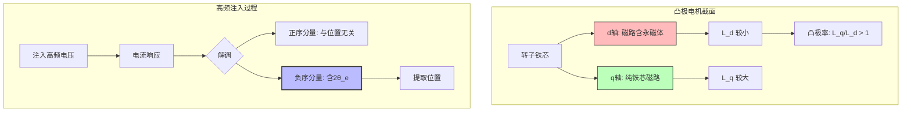

# 高频注入 HFI 与凸极效应

> **为什么学？**
> 反电动势观测器在零速和极低速会失效，而很多应用（如伺服、电动门）又必须从这里启动。不理解凸极效应和高频注入原理，就无法在低速区获得可靠位置，只能依赖开环I-F拖动，导致启动慢、定位差或带载能力弱。
>
> **在 FOC 中的作用**
> HFI是覆盖零速/低速“盲区”的位置估计算法。它向定子注入高频电压，通过解调电流响应中的位置信息，向Park变换和电流环提供初始角度，常与反电动势观测器组成混合策略。

反电动势是“速度依赖”的物理量，速度越低信息越弱；而凸极效应是“位置依赖”的电机结构特性，与速度无关。HFI正是把后者变成可观测信号：注入一个高频“探针”，从电流响应中读出转子方向。

## 1. 数学推导：凸极效应与高频注入

### 1.1 内置式 PMSM 的凸极效应

**为什么要做这一步**：只有先确认电机存在d-q轴电感差异，才能判断HFI是否适用；凸极效应是整个高频注入技术的物理前提。

与表贴式 PMSM（SPMSM）不同，**内置式 PMSM（IPMSM）**的转子永磁体嵌入铁芯内部，导致 d 轴磁路（永磁体方向）的磁阻大于 q 轴磁路（纯铁芯方向）的磁阻。因此：

$$
L_d < L_q
$$

这就是凸极效应。电感与转子位置的关系如下：在 d-q 坐标系中，电感矩阵是对角的：

$$
L_{dq} = \begin{bmatrix} L_d & 0 \\ 0 & L_q \end{bmatrix}
$$

但在静止的 αβ 坐标系中，电感随转子位置旋转：

$$
L_{\alpha\beta}(\theta_e) = \begin{bmatrix} L_{avg} + L_{diff}\cos(2\theta_e) & L_{diff}\sin(2\theta_e) \\ L_{diff}\sin(2\theta_e) & L_{avg} - L_{diff}\cos(2\theta_e) \end{bmatrix}
$$

其中：

$$
L_{avg} = \frac{L_d + L_q}{2}, \quad L_{diff} = \frac{L_q - L_d}{2}
$$

**关键观察**：电感矩阵中含有 $2\theta_e$ 的项，这意味着**电感对位置的敏感性是双倍的**（周期为 $\pi$ 而非 $2\pi$）。

### 1.2 旋转高频注入（Rotating HFI）

**为什么要做这一步**：注入电压后，电流响应同时包含与位置无关的正序分量和携带位置的负序分量；数学分解告诉我们该提取哪一部分。

在 αβ 坐标系中注入一个旋转的高频电压矢量：

$$
\begin{bmatrix} v_{\alpha h} \\ v_{\beta h} \end{bmatrix} = V_h \begin{bmatrix} \cos(\omega_h t) \\ \sin(\omega_h t) \end{bmatrix}
$$

其中 $V_h$ 为注入电压幅值，$\omega_h$ 为注入角频率（通常为 $0.5\text{--}2\ \text{kHz}$，远高于基波频率）。

高频下的阻抗近似为电感主导（$\omega_h L \gg R_s$），电流响应为：

$$
\begin{bmatrix} i_{\alpha h} \\ i_{\beta h} \end{bmatrix} = \frac{V_h}{\omega_h} L_{\alpha\beta}^{-1}(\theta_e) \begin{bmatrix} \cos(\omega_h t) \\ \sin(\omega_h t) \end{bmatrix}
$$

通过矩阵求逆和三角恒等变换，可将电流响应分解为两部分：

$$
i_{\alpha\beta h} = \underbrace{i_{p,\alpha\beta}}_{\text{正序分量}} + \underbrace{i_{n,\alpha\beta}}_{\text{负序分量}}
$$

**正序分量**：与注入电压同方向旋转，与转子位置无关：

$$
i_{p,\alpha\beta} = \frac{V_h}{\omega_h L_{avg}^2 - L_{diff}^2} L_{avg} \begin{bmatrix} \cos(\omega_h t) \\ \sin(\omega_h t) \end{bmatrix}
$$

**负序分量**：与注入电压反方向旋转，携带位置信息：

$$
i_{n,\alpha\beta} = \frac{V_h}{\omega_h L_{avg}^2 - L_{diff}^2} L_{diff} \begin{bmatrix} \cos(\omega_h t + 2\theta_e) \\ \sin(\omega_h t + 2\theta_e) \end{bmatrix}
$$

### 1.3 从负序电流提取位置

**为什么要做这一步**：负序分量以$2\theta_e$旋转，直接读其相位存在模糊；同步解调+低通滤波是把高频信号转换为可用角度估计的工程手段。

负序电流的相位为 $\omega_h t + 2\theta_e$。为了提取这一信息，将采样得到的 $\alpha\beta$ 电流与 $e^{-j\omega_h t}$ 相乘（坐标变换到同步于注入频率的旋转坐标系）：

$$
i_{dqh} = i_{\alpha\beta h} \cdot e^{-j\omega_h t} = i_{dqh}^{(p)} + i_{dqh}^{(n)}
$$

正序分量变为直流量：$i_{dqh}^{(p)} = \text{const}$。

负序分量变为：$i_{dqh}^{(n)} \propto e^{j2\theta_e}$（以 $2\omega_h$ 频率旋转）。

通过低通滤波（LPF）滤除 $2\omega_h$ 分量，保留与位置相关的直流项：

$$
\tilde{i}_{dq} = \text{LPF}\{i_{dqh}\} \propto \begin{bmatrix} \cos(2\theta_e) \\ \sin(2\theta_e) \end{bmatrix}
$$

从 $\tilde{i}_d$ 和 $\tilde{i}_q$ 中可解出：

$$
\hat{\theta}_e = \frac{1}{2} \arctan2(\tilde{i}_q, \tilde{i}_d)
$$

注意：由于 $2\theta_e$ 的歧义性，提取的角度有 $180°$（电角度）的模糊，但通常配合初始极性检测（如短脉冲法）可解决。

### 1.4 脉振高频注入（Pulsating HFI）

**为什么要做这一步**：旋转注入需要同时激励 α 和 β 轴；脉振注入只在估计d轴注入，配合PLL闭环校正角度误差，更适合IPMSM且对电流环干扰更小。

旋转注入需要同时激励 α 和 β 轴。另一种方法是在**估计的 d 轴**方向注入脉振电压：

$$
v_{dh} = V_h \cos(\omega_h t), \quad v_{qh} = 0
$$

变换到 αβ 坐标系：

$$
\begin{bmatrix} v_{\alpha h} \\ v_{\beta h} \end{bmatrix} = V_h \cos(\omega_h t) \begin{bmatrix} \cos\hat{\theta}_e \\ \sin\hat{\theta}_e \end{bmatrix}
$$

在估计的 d-q 坐标系中，高频电流响应为：

$$
i_{dh} = \frac{V_h}{\omega_h L_d} \cos(\omega_h t), \quad i_{qh} = 0
$$

但由于估计角度存在误差 $\Delta\theta = \hat{\theta}_e - \theta_e$，在真实 d-q 坐标系中，q 轴会出现与位置误差相关的电流：

$$
i_{qh}^{(true)} \propto \sin(2\Delta\theta) \cos(\omega_h t)
$$

解调（乘以 $\cos(\omega_h t)$ 并低通滤波）：

$$
\text{LPF}\{i_{qh}^{(true)} \cdot \cos(\omega_h t)\} \propto \sin(2\Delta\theta) \approx 2\Delta\theta \quad (\text{小误差近似})
$$

这个误差信号可以送入一个 PI 控制器来闭环校正角度估计，形成**锁相环（PLL-like）结构**。

---

## 2. 几何直观：凸极效应与高频注入的物理图景



**ASCII 图：旋转注入的电流响应分解**

```
    αβ坐标系中的电流矢量
    
    注入电压: 逆时针旋转 @ ω_h
    
    i_p (正序): 同向旋转 → 圆形轨迹，与位置无关
    i_n (负序): 反向旋转 → 椭圆轨迹，受位置调制
    
    合成电流 = i_p + i_n
    
    θ_e=0°时:           θ_e=45°时:
    
    β                    β
    |    ○○○○○           |   ○○
    |   ○    ○           |  ○  ○
    |  ○      ○  ←       | ○    ○
    | ○        ○ i_n     |○      ○
    +───────────α        +───────────α
    | ○        ○         | ○    ○
    |  ○      ○          |  ○  ○
    |   ○    ○           |   ○○
    |    ○○○○○
    
    负序分量形成一个以 2θ_e 旋转的椭圆
    通过提取负序分量的相位，反解位置
```

**几何直觉总结**：
1. 凸极效应 = 电机在不同方向上的"电感感抗"不同，q 轴感抗大（电感大），d 轴感抗小（电感小）。
2. 高频注入就像用超声波照射物体，物体在不同方向上的"阻抗不同"会改变反射波（电流响应）的特性。
3. 旋转注入产生两种"反射"：正序（同向）反射与物体方向无关，负序（反向）反射则携带了物体的方向信息。
4. 从负序反射的相位中，我们可以提取出转子位置。

---

## 3. 数值示例：旋转高频注入完整计算

**给定参数**：
- IPMSM：$L_d = 3.0\ \text{mH}$，$L_q = 5.0\ \text{mH}$
- 注入电压：$V_h = 10\ \text{V}$（幅值）
- 注入频率：$f_h = 1\ \text{kHz}$，$\omega_h = 2\pi \times 1000 = 6283\ \text{rad/s}$
- 当前转子电角度：$\theta_e = 30°$
- 定子电阻 $R_s = 0.5\ \Omega$（高频下 $R_s \ll \omega_h L$，可忽略）

**Step 1：计算平均电感和差值电感**

$$
L_{avg} = \frac{3.0 + 5.0}{2} = 4.0\ \text{mH}
$$
$$
L_{diff} = \frac{5.0 - 3.0}{2} = 1.0\ \text{mH}
$$

凸极率：$L_q / L_d = 5/3 = 1.67$。

**Step 2：构建 αβ 电感矩阵**

$$
L_{\alpha\beta}(30°) = \begin{bmatrix}
4.0 + 1.0\cos(60°) & 1.0\sin(60°) \\
1.0\sin(60°) & 4.0 - 1.0\cos(60°)
\end{bmatrix} \times 10^{-3}
$$

$$
= \begin{bmatrix} 4.0 + 0.5 & 0.866 \\ 0.866 & 4.0 - 0.5 \end{bmatrix} \times 10^{-3}
= \begin{bmatrix} 4.5 & 0.866 \\ 0.866 & 3.5 \end{bmatrix} \times 10^{-3}\ \text{H}
$$

**Step 3：计算高频电流响应（在 t=0 时刻）**

注入电压在 $t=0$：$v_{\alpha h} = V_h = 10\ \text{V}$，$v_{\beta h} = 0$。

忽略电阻，$v = j\omega_h L \cdot i$，所以 $i = \frac{1}{j\omega_h} L^{-1} v$（时域中电流滞后电压 $90°$）。

先求 $L^{-1}$：

$$
\det(L) = (4.5 \times 3.5 - 0.866^2) \times 10^{-6} = (15.75 - 0.75) \times 10^{-6} = 15.0 \times 10^{-6}
$$

$$
L^{-1} = \frac{10^6}{15.0} \begin{bmatrix} 3.5 & -0.866 \\ -0.866 & 4.5 \end{bmatrix} \times 10^{-3} = \frac{10^3}{15} \begin{bmatrix} 3.5 & -0.866 \\ -0.866 & 4.5 \end{bmatrix}
$$

电流幅值（简化，计算电感上的电压→电流关系）：

$$
\begin{bmatrix} i_{\alpha h} \\ i_{\beta h} \end{bmatrix} = \frac{1}{\omega_h} L^{-1} \begin{bmatrix} 10 \\ 0 \end{bmatrix} = \frac{10}{6283} \times \frac{1000}{15} \begin{bmatrix} 3.5 \\ -0.866 \end{bmatrix} = 0.106 \times \begin{bmatrix} 3.5 \\ -0.866 \end{bmatrix} = \begin{bmatrix} 0.371 \\ -0.092 \end{bmatrix}\ \text{A}
$$

注意：这只是一个瞬时值，实际电流是旋转向量。

**Step 4：正序与负序分量分解（理论值）**

正序幅值：

$$
I_p = \frac{V_h}{\omega_h} \cdot \frac{L_{avg}}{L_{avg}^2 - L_{diff}^2} = \frac{10}{6283} \cdot \frac{4.0\times 10^{-3}}{16\times 10^{-6} - 1\times 10^{-6}} = 0.00159 \cdot \frac{4.0}{15\times 10^{-3}} = 0.424\ \text{A}
$$

负序幅值：

$$
I_n = \frac{V_h}{\omega_h} \cdot \frac{L_{diff}}{L_{avg}^2 - L_{diff}^2} = 0.00159 \cdot \frac{1.0}{15\times 10^{-3}} = 0.106\ \text{A}
$$

**Step 5：从负序提取位置**

负序分量的相位为 $\omega_h t + 2\theta_e = \omega_h t + 60°$。在同步坐标系（以 $\omega_h$ 旋转）中观察，负序表现为一个以 $2\theta_e = 60°$ 固定的矢量。

通过低通滤波后，得到：

$$
\tilde{i}_d \propto \cos(60°) = 0.5, \quad \tilde{i}_q \propto \sin(60°) = 0.866
$$

$$
\hat{\theta}_e = \frac{1}{2} \arctan2(0.866, 0.5) = \frac{1}{2} \times 60° = 30°
$$

提取成功！

---

## 4. 代码实现：脉振高频注入与位置提取

### C 语言实现框架（脉振注入，PLL 闭环跟踪）

```c
#include <math.h>

#define PI 3.14159265359f
#define TWO_PI 6.28318530718f

// 电机参数 (IPMSM)
#define LD 3.0e-3f   // d轴电感 (H)
#define LQ 5.0e-3f   // q轴电感 (H)
#define RS 0.5f
#define PSIF 0.05f

// HFI 参数
#define VH 10.0f           // 注入电压幅值
#define FH 1000.0f         // 注入频率 (Hz)
#define WH (2.0f * PI * FH)
#define TS 50.0e-6f        // PWM 周期 (50us)

// PLL 参数
#define PLL_KP 200.0f
#define PLL_KI 10000.0f

// HFI 状态
static float theta_hat = 0.0f;      // 估计角度
static float omega_hat = 0.0f;      // 估计速度
static float pll_integral = 0.0f;
static float inj_counter = 0.0f;    // 注入相位计数器

// 解调后的高频电流响应
static float i_dh_lpf = 0.0f;
static float i_qh_lpf = 0.0f;
#define LPF_ALPHA 0.1f

// 脉振 HFI + PLL 位置跟踪
void HFI_update(float i_alpha, float i_beta, float v_alpha, float v_beta) {
    // 1. 将实际电流变换到估计的 d-q 坐标系
    float cos_t = cosf(theta_hat);
    float sin_t = sinf(theta_hat);
    float i_d = cos_t * i_alpha + sin_t * i_beta;
    float i_q = -sin_t * i_alpha + cos_t * i_beta;
    
    // 2. 生成注入电压（在估计的 d 轴方向）
    inj_counter += WH * TS;
    if (inj_counter >= TWO_PI) inj_counter -= TWO_PI;
    float v_inj = VH * cosf(inj_counter);
    
    // 3. 注入电压叠加到 d 轴控制电压上
    float v_d_total = v_d_control + v_inj;  // v_d_control 来自电流环
    float v_q_total = v_q_control;           // q 轴不注入
    
    // 4. 变换回 αβ 给 SVPWM
    float v_alpha_cmd = cos_t * v_d_total - sin_t * v_q_total;
    float v_beta_cmd = sin_t * v_d_total + cos_t * v_q_total;
    
    // 5. 解调：从 i_q 中提取位置误差信息
    // 高频电流 = 总电流 - 基波电流（需通过另一个 LPF 分离，简化处理）
    // 实际实现：对 i_q 进行带通或高通滤波获取高频分量
    float i_qh = highpass_filter(i_q);  // 高通滤除基波，保留高频
    
    // 6. 同步解调：乘以 cos(ω_h t)
    float demod = i_qh * cosf(inj_counter);
    
    // 7. 低通滤波得到位置误差信号
    i_qh_lpf = LPF_ALPHA * demod + (1.0f - LPF_ALPHA) * i_qh_lpf;
    
    // 8. 位置误差信号 ≈ sin(2Δθ) ≈ 2Δθ (小误差)
    float pos_error = i_qh_lpf;  // 比例系数需根据电感差校准
    
    // 9. PLL 更新：PI 控制器跟踪角度
    pll_integral += PLL_KI * pos_error * TS;
    omega_hat = PLL_KP * pos_error + pll_integral;
    theta_hat += omega_hat * TS;
    
    if (theta_hat >= TWO_PI) theta_hat -= TWO_PI;
    if (theta_hat < 0.0f) theta_hat += TWO_PI;
}

// 简化的高通滤波器（一阶，滤除基波）
static float i_q_prev = 0.0f, i_q_hpf = 0.0f;
#define HPF_ALPHA 0.5f

float highpass_filter(float i_q) {
    i_q_hpf = HPF_ALPHA * (i_q_hpf + i_q - i_q_prev);
    i_q_prev = i_q;
    return i_q_hpf;
}
```

### MATLAB 验证代码：旋转 HFI 的负序提取

```matlab
% HFI 旋转注入仿真验证
Ld = 3e-3; Lq = 5e-3;
Vh = 10; fh = 1000; wh = 2*pi*fh;
theta_e = pi/6;  % 30°

% 电感矩阵
Lavg = (Ld+Lq)/2; Ldiff = (Lq-Ld)/2;
L_ab = [Lavg + Ldiff*cos(2*theta_e), Ldiff*sin(2*theta_e);
        Ldiff*sin(2*theta_e), Lavg - Ldiff*cos(2*theta_e)];

% 时间向量
t = 0:50e-6:0.01;
% 注入电压
v_alpha = Vh * cos(wh*t);
v_beta = Vh * sin(wh*t);

% 电流响应（忽略电阻）
for k = 1:length(t)
    i_ab(:,k) = (1/wh) * inv(L_ab) * [v_alpha(k); v_beta(k)];
end

% 解调：乘以 e^{-j*wh*t}
i_dqh = (i_ab(1,:) + 1j*i_ab(2,:)) .* exp(-1j*wh*t);
% 低通滤波
[b,a] = butter(2, 0.05);  % 归一化截止频率
i_dqh_lpf = filter(b,a,i_dqh);

% 提取角度
theta_est = 0.5 * angle(i_dqh_lpf(end));
fprintf('实际角度: %.1f°, 估计角度: %.1f°\n', theta_e*180/pi, theta_est*180/pi);
```

---

## 5. 常见错误与纠正

### 错误 1：在表贴式电机（SPMSM）上强行使用 HFI 失败

**问题描述**：HFI 的核心原理是利用凸极效应（$L_d \neq L_q$）。对于表贴式 PMSM（SPMSM），$L_d \approx L_q$，$L_{diff} \approx 0$，负序电流分量几乎为零，无法提取位置信息。很多初学者在 SPMSM 上尝试 HFI 后，发现位置估计完全随机，无法收敛。

**错误表现**：
- 负序电流幅值 $I_n \propto L_{diff} = 0$，解调后的信号几乎为零。
- 位置估计在 $0\text{--}360°$ 范围内随机游走，被噪声主导。

**纠正方法**：
1. **确认电机类型**：HFI 只适用于 IPMSM（内置式）或具有显著凸极率的电机。凸极率 $L_q/L_d > 1.2$ 才适合 HFI。
2. **SPMSM 的替代方案**：对于 SPMSM，使用**饱和凸极效应（Saturation Saliency）**——在 d 轴方向注入时，铁芯饱和导致 d 轴动态电感略小于 q 轴，产生微弱的饱和凸极。但这需要更高的注入电压和更精密的解调电路。
3. **使用其他低速策略**：SPMSM 在零速时更适合使用**I-F 开环启动**或**霍尔传感器**过渡。

### 错误 2：注入频率与 PWM 频率或电流环带宽冲突

**问题描述**：HFI 的注入频率 $f_h$ 选择不当，与 PWM 频率或电流环带宽重叠，导致：
- 若 $f_h$ 接近 PWM 频率（如 $f_h = 15\ \text{kHz}$，PWM = $20\ \text{kHz}$），电流采样无法分辨基波与注入信号，发生混叠。
- 若 $f_h$ 低于电流环带宽，电流控制器会试图"纠正"高频注入引起的电流波动，导致注入信号被抑制。

**纠正方法**：

**注入频率选择准则**：

$$
10 \times f_{current\_loop} < f_h < \frac{1}{10} \times f_{PWM}
$$

例如：
- 电流环带宽 $1\ \text{kHz}$ → $f_h > 10\ \text{kHz}$？不，一般注入频率远低于这个范围。实际上通常取：
- 对于 $f_{PWM} = 10\text{--}20\ \text{kHz}$，取 $f_h = 0.5\text{--}2\ \text{kHz}$ 是常见的工程选择。
- 关键是**电流环不要对注入频率响应**：设计电流环 PI 时，在 $f_h$ 处有足够的衰减（至少 -20dB），或者将注入信号从电流反馈中扣除（前馈方式）。
- **采样要求**：每个注入周期至少采样 10 次（如 $f_h = 1\ \text{kHz}$，PWM = $20\ \text{kHz}$，则每周期 20 个采样点，足够）。

---

## 6. 自测习题

### 习题 1：凸极效应与电感矩阵

一台 IPMSM，$L_d = 2.5\ \text{mH}$，$L_q = 4.5\ \text{mH}$。当转子电角度 $\theta_e = 45°$ 时：

**问题**：
(1) 计算 $L_{avg}$、$L_{diff}$ 和凸极率 $L_q/L_d$。
(2) 写出此时的 αβ 电感矩阵 $L_{\alpha\beta}(45°)$。
(3) 若注入频率 $f_h = 800\ \text{Hz}$，计算 d 轴和 q 轴的高频感抗 $X_d = \omega_h L_d$ 和 $X_q = \omega_h L_q$。

**答案**：

(1)
$$
L_{avg} = \frac{2.5 + 4.5}{2} = 3.5\ \text{mH}
$$
$$
L_{diff} = \frac{4.5 - 2.5}{2} = 1.0\ \text{mH}
$$
$$
\text{凸极率} = \frac{4.5}{2.5} = 1.8
$$

(2)
$$
L_{\alpha\beta} = \begin{bmatrix}
3.5 + 1.0\cos(90°) & 1.0\sin(90°) \\
1.0\sin(90°) & 3.5 - 1.0\cos(90°)
\end{bmatrix} \times 10^{-3}
= \begin{bmatrix}
3.5 & 1.0 \\
1.0 & 3.5
\end{bmatrix} \times 10^{-3}\ \text{H}
$$

(3)
$$
\omega_h = 2\pi \times 800 = 5027\ \text{rad/s}
$$
$$
X_d = 5027 \times 2.5\times 10^{-3} = 12.57\ \Omega
$$
$$
X_q = 5027 \times 4.5\times 10^{-3} = 22.62\ \Omega
$$

q 轴感抗比 d 轴大 80%，这正是高频注入能够工作的物理基础。

### 习题 2：HFI 的适用范围与限制

一台 SPMSM，$L_d = L_q = 3.0\ \text{mH}$，在零速时尝试使用旋转高频注入法提取位置。

**问题**：
(1) 计算 $L_{diff}$，并解释为什么此时无法提取位置。
(2) 若该电机在低速时确实需要无传感器运行，提出两种可行的替代方案。
(3) 若通过增加注入电压幅值来尝试增强信号，会引入什么负面效应？

**答案**：

(1)
$$
L_{diff} = \frac{L_q - L_d}{2} = 0
$$

负序电流分量与 $L_{diff}$ 成正比：$I_n \propto L_{diff} = 0$。因此电流响应中不包含位置信息，只有与位置无关的正序分量。解调后无法提取位置。

(2) **替代方案**：
- **I-F 开环启动**：在零速和低速区强制施加开环电流/频率，将电机拖动到足够高的转速后切换到反电动势观测器。
- **饱和凸极效应（Saturation Saliency）**：虽然静态电感相等，但铁芯饱和使动态电感具有微弱的方向依赖性。通过精确解调和信号处理，理论上可以从饱和引起的微小凸极中提取位置，但需要高分辨率 ADC 和复杂算法。
- **增加初始位置传感器**：如霍尔传感器或低成本编码器，仅用于启动和低速。

(3) **增加注入电压的负面效应**：
- **额外损耗**：高频电流在绕组电阻上产生铜损，$P_{loss} \propto I_h^2 R_s$。
- **转矩脉动**：高频电流与永磁磁场相互作用产生高频转矩脉动，引起电机振动和噪声。
- **铁芯饱和加剧**：注入电压过大导致局部饱和，反而可能改变电感特性，使模型失真。
- **逆变器容量浪费**：注入电压占用了逆变器的一部分电压裕量，限制了基波电压的输出能力。

---

## 7. 小结与展望

高频注入 HFI 是覆盖零速和极低速"盲区"的关键技术，其核心物理基础是电机的凸极效应（或饱和凸极效应）。本文详细推导了旋转注入和脉振注入的数学原理，展示了从高频电流响应中提取位置信息的完整信号处理流程。

**HFI 的核心要点**：
1. 只适用于具有凸极效应的电机（IPMSM 或饱和凸极 SPMSM）。
2. 旋转注入提取负序分量，脉振注入利用 PLL 闭环跟踪。
3. 注入频率需在电流环带宽之上、PWM 频率之下，避免冲突。
4. 注入电压幅值需平衡信号强度与额外损耗/噪声。

**HFI 的局限性**：
- 需要凸极电机，SPMSM 适用性差。
- 注入信号引入额外损耗和噪声。
- 极性模糊（$180°$ 不确定性）需要额外处理。
- 高速时需退出 HFI，切换到反电动势观测器。

因此，实用的无传感器系统通常采用**混合策略**：低速区使用 HFI，高速区使用 SMO/龙伯格/EKF，中间需要一个平滑的切换逻辑。这将在后续笔记中详细讨论。
