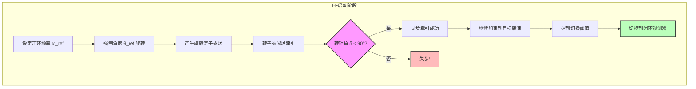

# 开环启动 I-F 方法与切换策略

> **为什么学？**
> 无传感器FOC在零速时没有可靠的位置信息，直接闭环会失败。不理解I-F启动原理，就无法设计从静止到中高速的安全过渡；切换时机或方式不当会造成角度跳变、电流冲击甚至失步。
>
> **在 FOC 中的作用**
> I-F启动是零速/低速区的“兜底”策略：它不依赖位置反馈，强制产生旋转磁场牵引转子，并把电机拖到反电动势观测器可工作的速度，再平滑切换到闭环无传感器控制。

当反电动势太小、HFI又不适用时，FOC不能被动等待电机转起来。I-F控制主动“牵着”转子走：先强制设定电流和频率建立旋转磁场，再按斜坡加速；待反电动势足够大、观测器收敛后，再无缝切换到闭环。

## 1. 数学推导：I-F 控制与开环强制同步

### 1.1 同步旋转磁场的基本原理

**为什么要做这一步**：I-F启动的本质是用强制定子磁场“拉”转子同步；只有明确转矩角$\delta$与电磁转矩的关系，才能判断启动是否会失步。

电机转矩的产生依赖于定子磁场与转子磁场之间的夹角。当定子电流矢量以强制频率旋转时，产生旋转的定子磁动势（MMF）：

$$
\vec{F}_s = \frac{3}{2} N_s \vec{I}_s e^{j\theta_{ref}}
$$

其中 $\theta_{ref} = \int \omega_{ref} dt + \theta_0$ 为强制设定的电角度，$\omega_{ref}$ 为强制电角速度。

如果转子初始位置与定子磁场夹角在适当范围内，电磁转矩会将转子"拉入同步"：

$$
T_e = \frac{3}{2} P \psi_f I_s \sin(\delta)
$$

其中 $\delta = \theta_{ref} - \theta_e$ 为转矩角（负载角）。当 $0 < \delta < 90°$ 时，产生正向加速转矩；当 $\delta > 90°$ 时，转矩变负，电机被减速。稳定运行的条件是：

$$
|\delta| < 90° \quad \text{（即 $\sin\delta > 0$）}
$$

### 1.2 I-F 控制的开环电流方程

**为什么要做这一步**：在同步坐标系中给出$I_d=0$、$I_q=I_{start}$的指令，是为了让电流环能直接执行，而不需要位置反馈。

I-F 控制（Current-Frequency Control）的本质是：在开环条件下强制设定定子电流幅值 $I_{ref}$ 和旋转频率 $\omega_{ref}$，而不依赖任何位置反馈。

在同步旋转坐标系（与强制角度对齐）下，电流指令为：

$$
\begin{cases}
I_{d,ref} = 0 \\[4pt]
I_{q,ref} = I_{start} \quad \text{(或按启动曲线变化)}
\end{cases}
$$

通过逆 Park 变换，得到三相电流指令：

$$
\begin{bmatrix} I_{a,ref} \\ I_{b,ref} \\ I_{c,ref} \end{bmatrix} = I_{q,ref} \begin{bmatrix} -\sin\theta_{ref} \\ -\sin(\theta_{ref} - 120°) \\ -\sin(\theta_{ref} + 120°) \end{bmatrix}
$$

电流环（通常为 PI）强制跟踪这些指令，产生实际的定子电流。由于电流环的带宽足够高（$>1\ \text{kHz}$），电流能迅速跟随指令，形成强制的旋转磁场。

### 1.3 转子动力学与牵引过程

**为什么要做这一步**：转子不是瞬时响应的，它有惯量；建立机械运动方程才能定量判断启动电流和斜坡斜率是否足够。

转子的机械运动方程：

$$
J \frac{d\omega_m}{dt} = T_e - T_L - B \omega_m
$$

在 I-F 启动阶段，$T_e$ 由开环电流和实际的转矩角决定：

$$
T_e = \frac{3}{2} P \psi_f I_{q,ref} \sin(\theta_{ref} - \theta_e)
$$

**关键洞察**：
- 初始时，如果转子位置与强制角度不同（通常如此），$\delta \neq 0$，产生启动转矩。
- 如果启动电流足够大，转矩可以克服负载和惯量，使转子开始旋转。
- 一旦转子开始跟随，转矩角 $\delta$ 稳定在一个较小的值（由负载决定），电机进入**牵引同步**状态。
- 如果电流太小或加速太快，转矩角超过 $90°$，转子会**失步**（pull-out），导致启动失败。

### 1.4 启动曲线的数学设计

**为什么要做这一步**：固定电流和固定频率无法兼顾所有工况；ramps让电机从静止平稳加速到观测器可接管的速度，并避免转矩角越界。

为了可靠地将转子从静止拖动到目标转速，通常采用**斜坡启动**：

**频率斜坡**：

$$
\omega_{ref}(t) = \begin{cases}
\omega_{start} + \alpha_\omega \cdot t & t < t_{ramp} \\[4pt]
\omega_{target} & t \geq t_{ramp}
\end{cases}
$$

其中 $\alpha_\omega = \frac{\omega_{target} - \omega_{start}}{t_{ramp}}$ 为角加速度。

**电流斜坡**：

通常先以较大电流（如额定电流的 50%--100%）产生足够的启动转矩，待切换到闭环后再降为工作电流：

$$
I_{q,ref}(t) = \begin{cases}
I_{breakaway} & t < t_1 \quad \text{(突破静摩擦)} \\[4pt]
I_{run} & t_1 \leq t < t_{switch} \\[4pt]
I_{work} & t \geq t_{switch}
\end{cases}
$$

**角度积分**：

$$
\theta_{ref}(t) = \theta_0 + \int_0^t \omega_{ref}(\tau) d\tau
$$

在数字实现中：

$$
\theta_{ref}^{(k)} = \theta_{ref}^{(k-1)} + \omega_{ref} \cdot T_s
$$

---

## 2. 几何直观：I-F 启动的牵引过程



**ASCII 图：转矩角与稳定运行区域**

```
    电磁转矩 T_e
      |
      |      *  最大转矩点 (δ=90°)
      |     /|
      |    / |
      |   /  |  稳定运行区
      |  /   |  (0 < δ < 90°)
      | /    |
      |/     |
    ──+──────+──────────→ 转矩角 δ
      |     90°   180°
      |      |
      |      |  不稳定区
      |      |  (δ > 90°)
      
    当 δ > 90° 时，转矩反向，转子被减速
    当 δ 接近 90° 时，系统处于失步边缘
    
    I-F 启动时，必须保证 δ 始终不超过 90°
```

**物理直觉**：
1. I-F 启动就像用一根无形的"橡皮筋"拉着转子走。强制角度 $\theta_{ref}$ 是"手"的位置，转子角度 $\theta_e$ 是"物体"的位置。
2. 如果"手"拉得太快（加速度过大），"橡皮筋"会断裂（转矩角超过 90°，失步）。
3. 如果"手"拉得太慢，虽然安全，但启动时间过长。
4. 加大电流就像用更粗的橡皮筋，可以承受更大的拉力差（更大的负载和加速度）。

---

## 3. 数值示例：I-F 启动与切换过程

**给定参数**：
- PMSM：$P = 4$，$\psi_f = 0.05\ \text{Wb}$，额定电流 $I_{rated} = 5\ \text{A}$
- 转动惯量 $J = 0.001\ \text{kg}\cdot\text{m}^2$，阻尼系数 $B = 0.001\ \text{N}\cdot\text{m}\cdot\text{s}$
- 负载转矩 $T_L = 0.1\ \text{N}\cdot\text{m}$（恒转矩负载）
- 启动电流：$I_{q,ref} = 3.0\ \text{A}$（60% 额定电流）
- 目标转速：$n_{target} = 1000\ \text{rpm}$，$\omega_{e,target} = 418.9\ \text{rad/s}$
- 启动初始频率：$f_{start} = 2\ \text{Hz}$（$\omega_{e,start} = 12.57\ \text{rad/s}$）
- 频率斜坡时间：$t_{ramp} = 2.0\ \text{s}$
- 采样周期：$T_s = 50\ \mu\text{s}$

**Step 1：计算启动转矩和加速能力**

最大电磁转矩（假设 $\delta = 90°$）：

$$
T_{e,max} = \frac{3}{2} P \psi_f I_{q,ref} = \frac{3}{2} \times 4 \times 0.05 \times 3.0 = 0.9\ \text{N}\cdot\text{m}
$$

可用加速转矩：

$$
T_{acc} = T_e - T_L = 0.9 - 0.1 = 0.8\ \text{N}\cdot\text{m}
$$

最大角加速度：

$$
\alpha_{max} = \frac{T_{acc}}{J} = \frac{0.8}{0.001} = 800\ \text{rad/s}^2
$$

**Step 2：计算频率斜坡斜率**

$$
\alpha_\omega = \frac{\omega_{e,target} - \omega_{e,start}}{t_{ramp}} = \frac{418.9 - 12.57}{2.0} = 203.2\ \text{rad/s}^2
$$

对应机械角加速度：

$$
\alpha_m = \frac{\alpha_\omega}{P} = \frac{203.2}{4} = 50.8\ \text{rad/s}^2
$$

需要加速转矩：

$$
T_{acc,needed} = J \cdot \alpha_m = 0.001 \times 50.8 = 0.0508\ \text{N}\cdot\text{m}
$$

由于 $T_{acc,needed} = 0.0508 < T_{acc} = 0.8\ \text{N}\cdot\text{m}$，启动裕量充足，不会失步。

**Step 3：切换条件设计**

切换到闭环无传感器控制的判据通常基于**反电动势幅值**：

$$
|E| = \omega_e \psi_f > E_{threshold}
$$

取阈值 $E_{threshold} = 5\ \text{V}$（约为最大反电动势的 10%，确保观测器有足够的信噪比）：

$$
\omega_{e,sw} = \frac{E_{threshold}}{\psi_f} = \frac{5}{0.05} = 100\ \text{rad/s}
$$

对应机械转速：

$$
n_{sw} = \frac{\omega_{e,sw}}{P} \times \frac{60}{2\pi} = \frac{100}{4} \times 9.55 = 239\ \text{rpm}
$$

**Step 4：切换时序计算**

从 $12.57\ \text{rad/s}$  ramp 到 $100\ \text{rad/s}$：

$$
t_{sw} = \frac{100 - 12.57}{203.2} = 0.43\ \text{s}
$$

即启动后约 0.43 秒，反电动势达到阈值，可以切换。

**Step 5：切换时的角度差补偿**

切换瞬间，开环角度 $\theta_{ref}$ 与观测器估计角度 $\hat{\theta}_e$ 可能存在偏差 $\Delta\theta = \theta_{ref} - \hat{\theta}_e$。直接切换会导致电流矢量瞬间跳转，产生冲击转矩。

**软切换策略**：在切换前数个周期，将角度参考逐渐向观测器角度靠拢：

$$
\theta_{ref}^{(k)} = \alpha \cdot \hat{\theta}_e^{(k)} + (1-\alpha) \cdot \theta_{ref}^{(k-1)}, \quad \alpha \in [0,1]
$$

或等效地，检测两者偏差小于阈值（如 $5°$）后再切换。

---

## 4. 代码实现：I-F 启动与切换逻辑

### C 语言完整框架

```c
#include <math.h>

#define PI 3.14159265359f
#define TWO_PI 6.28318530718f

// 电机参数
#define POLE_PAIRS 4
#define PSIF 0.05f
#define RS 0.5f
#define LS 0.0012f
#define TS 50.0e-6f

// 启动参数
#define I_START 3.0f          // 启动电流 (A)
#define F_START_HZ 2.0f       // 初始频率 (Hz)
#define F_TARGET_HZ 66.67f    // 目标频率对应 1000rpm / 60 * 4 = 66.67 Hz
#define T_RAMP 2.0f           // 斜坡时间 (s)
#define E_SWITCH_THRESHOLD 5.0f // 切换反电动势阈值 (V)

// 启动状态机
typedef enum {
    STATE_IDLE = 0,
    STATE_OPEN_LOOP_START,
    STATE_RAMP_UP,
    STATE_SWITCHING,
    STATE_CLOSED_LOOP
} StartState;

static StartState state = STATE_IDLE;
static float theta_ref = 0.0f;      // 开环强制角度
static float omega_ref = 0.0f;      // 开环强制电角速度
static float time_elapsed = 0.0f;
static float Iq_ref = 0.0f;

// 外部观测器接口（SMO/Luenberger/EKF）
extern float SMO_get_theta(void);
extern float SMO_get_omega(void);
extern float SMO_get_e_alpha(void);
extern float SMO_get_e_beta(void);

// 启动控制主函数
void SensorlessStart_update(float *Id_cmd, float *Iq_cmd, float *theta_cmd) {
    float e_mag;  // 反电动势幅值
    float theta_obs;
    
    switch (state) {
        case STATE_IDLE:
            *Id_cmd = 0.0f;
            *Iq_cmd = 0.0f;
            theta_ref = 0.0f;
            omega_ref = 0.0f;
            time_elapsed = 0.0f;
            break;
            
        case STATE_OPEN_LOOP_START:
            // 初始保持小频率，建立磁场
            omega_ref = TWO_PI * F_START_HZ;  // 电角速度
            Iq_ref = I_START;
            
            // 角度积分
            theta_ref += omega_ref * TS;
            if (theta_ref >= TWO_PI) theta_ref -= TWO_PI;
            
            *Id_cmd = 0.0f;
            *Iq_cmd = Iq_ref;
            *theta_cmd = theta_ref;
            
            // 延时一小段时间后进入 ramp
            time_elapsed += TS;
            if (time_elapsed > 0.2f) {  // 200ms 预励磁
                time_elapsed = 0.0f;
                state = STATE_RAMP_UP;
            }
            break;
            
        case STATE_RAMP_UP:
            // 频率斜坡
            time_elapsed += TS;
            float omega_target = TWO_PI * F_TARGET_HZ;
            float omega_start = TWO_PI * F_START_HZ;
            
            if (time_elapsed < T_RAMP) {
                omega_ref = omega_start + (omega_target - omega_start) * (time_elapsed / T_RAMP);
            } else {
                omega_ref = omega_target;
            }
            
            theta_ref += omega_ref * TS;
            if (theta_ref >= TWO_PI) theta_ref -= TWO_PI;
            
            *Id_cmd = 0.0f;
            *Iq_cmd = Iq_ref;
            *theta_cmd = theta_ref;
            
            // 检查反电动势是否达到切换阈值
            e_mag = sqrtf(SMO_get_e_alpha() * SMO_get_e_alpha() + 
                          SMO_get_e_beta() * SMO_get_e_beta());
            
            if (e_mag > E_SWITCH_THRESHOLD && time_elapsed > 0.5f) {
                // 额外条件：确保已运行足够时间，观测器已收敛
                state = STATE_SWITCHING;
                time_elapsed = 0.0f;
            }
            break;
            
        case STATE_SWITCHING:
            // 软切换：逐渐将角度参考从 open-loop 过渡到 observer
            theta_obs = SMO_get_theta();
            
            // 角度差处理（考虑跨周期问题）
            float dtheta = theta_obs - theta_ref;
            while (dtheta > PI) dtheta -= TWO_PI;
            while (dtheta < -PI) dtheta += TWO_PI;
            
            // 一阶过渡
            theta_ref += 0.1f * dtheta;  // 每周期靠拢 10%
            if (theta_ref >= TWO_PI) theta_ref -= TWO_PI;
            if (theta_ref < 0.0f) theta_ref += TWO_PI;
            
            *Id_cmd = 0.0f;
            *Iq_cmd = Iq_ref;
            *theta_cmd = theta_ref;
            
            // 切换完成判断
            if (fabsf(dtheta) < 0.05f) {  // 角度差 < 3°
                state = STATE_CLOSED_LOOP;
            }
            break;
            
        case STATE_CLOSED_LOOP:
            // 完全使用观测器输出
            *Id_cmd = 0.0f;  // 或 MTPA 策略
            *Iq_cmd = speed_PI_controller(SMO_get_omega());  // 速度环输出
            *theta_cmd = SMO_get_theta();
            break;
    }
}

// 启动触发函数
void SensorlessStart_trigger(void) {
    state = STATE_OPEN_LOOP_START;
    time_elapsed = 0.0f;
    theta_ref = 0.0f;
}
```

---

## 5. 常见错误与纠正

### 错误 1：启动电流过小或频率斜坡过陡导致失步

**问题描述**：I-F 启动失败的最常见原因是加速度过大。转子有转动惯量，不能瞬时跟上定子磁场的旋转。如果频率斜坡斜率 $\alpha_\omega$ 过大，转矩角 $\delta$ 会迅速增大并超过 $90°$，导致转矩反向，转子被"甩脱"。

**错误表现**：
- 电机发出嗡嗡声但转子不转或抖动。
- 电流幅值飙升（电流环饱和），因为转子无法跟上，实际转矩角不稳定。
- 启动过程在几秒后电流突然归零，说明电机已失步，控制逻辑可能触发了保护。

**纠正方法**：

**加速度设计公式**（保守设计）：

$$
\alpha_\omega < \frac{3 P \psi_f I_{start} - T_{L,max}}{J \cdot P}
$$

例如，给定参数下：

$$
\alpha_\omega < \frac{0.9 - 0.1}{0.001 \times 4} = \frac{0.8}{0.004} = 200\ \text{rad/s}^2
$$

取 $\alpha_\omega = 150\ \text{rad/s}^2$ 作为设计值，留出 25% 的裕量。

**经验法则**：
- 对于风扇/泵类轻负载，启动时间 $1\text{--}3\ \text{s}$ 通常足够。
- 对于高惯量或重负载系统，可能需要 $5\text{--}10\ \text{s}$ 的启动时间。
- 电流取额定电流的 50%--100%。

### 错误 2：切换判据不当导致切换冲击或失败

**问题描述**：切换判据过于简单（如仅检查速度 > 某阈值）会导致：
- 在速度达到阈值但观测器尚未收敛时切换，角度估计偏差大，产生巨大转矩冲击，电机抖动甚至失步。
- 在观测器已经收敛但速度短暂波动低于阈值时，系统反复切换，造成不稳定。

**纠正方法**：

**多重判据切换策略**（必须同时满足）：

1. **速度判据**：$\omega_{obs} > \omega_{min}$（如 $> 50\ \text{rad/s}$）。
2. **反电动势判据**：$|e_{obs}| > E_{threshold}$（确保信噪比）。
3. **观测器收敛判据**：$|\tilde{i}| = |\hat{i} - i| < I_{threshold}$（如 $< 0.5\ \text{A}$），持续 $N$ 个周期。
4. **角度一致性判据**：$|\theta_{ref} - \theta_{obs}| < \theta_{threshold}$（如 $< 10°$），持续 $N$ 个周期。
5. **时间判据**：开环运行时间 $> t_{min}$（如 $> 0.3\ \text{s}$），确保系统已稳定。

```c
// 多重判据切换检查
bool check_switch_ready(void) {
    static uint16_t consistent_count = 0;
    bool speed_ok = SMO_get_omega() > 50.0f;
    bool emf_ok = e_mag > 5.0f;
    bool obs_ok = current_error < 0.5f;
    bool angle_ok = angle_diff < 0.17f;  // 10° in rad
    bool time_ok = time_elapsed > 0.3f;
    
    if (speed_ok && emf_ok && obs_ok && angle_ok && time_ok) {
        consistent_count++;
        if (consistent_count > 100) return true;  // 连续 100 个周期 (5ms)
    } else {
        consistent_count = 0;
    }
    return false;
}
```

---

## 6. 自测习题

### 习题 1：I-F 启动参数设计

一台 PMSM，$P = 4$，$\psi_f = 0.08\ \text{Wb}$，$J = 0.002\ \text{kg}\cdot\text{m}^2$。负载转矩 $T_L = 0.2\ \text{N}\cdot\text{m}$。启动电流 $I_{start} = 4\ \text{A}$。

**问题**：
(1) 计算最大电磁转矩和可用加速转矩。
(2) 若目标转速为 $1500\ \text{rpm}$，设计最大允许的频率斜坡斜率（电角加速度），要求至少保留 30% 的转矩裕量。
(3) 计算对应的启动时间（从 $0\ \text{rpm}$ 到 $1500\ \text{rpm}$）。

**答案**：

(1) 最大电磁转矩：
$$
T_{e,max} = \frac{3}{2} \times 4 \times 0.08 \times 4 = 1.92\ \text{N}\cdot\text{m}
$$

可用加速转矩：
$$
T_{acc} = 1.92 - 0.2 = 1.72\ \text{N}\cdot\text{m}
$$

(2) 保留 30% 裕量，即使用 $T_{acc,design} = 1.72 \times 0.7 = 1.204\ \text{N}\cdot\text{m}$。

最大机械角加速度：
$$
\alpha_{m,max} = \frac{T_{acc,design}}{J} = \frac{1.204}{0.002} = 602\ \text{rad/s}^2
$$

电角加速度：
$$
\alpha_\omega = P \times \alpha_{m,max} = 4 \times 602 = 2408\ \text{rad/s}^2
$$

(3) 目标电角速度：
$$
\omega_{e,target} = 4 \times \frac{2\pi \times 1500}{60} = 628.3\ \text{rad/s}
$$

启动时间：
$$
t_{ramp} = \frac{628.3}{2408} = 0.261\ \text{s}
$$

取约 0.26 秒，保守设计可取 0.3--0.5 秒。

### 习题 2：切换策略设计

某无传感器系统使用 SMO 观测器，参数为 $\psi_f = 0.05\ \text{Wb}$，PWM 频率 $20\ \text{kHz}$，ADC 为 12 位，输入范围 ±10 A，电流采样分辨率为 $20/4096 = 4.88\ \text{mA}$。观测器低通滤波截止频率 $2\ \text{kHz}$。

**问题**：
(1) 若要求切换后反电动势的信噪比至少为 20dB（即幅值比为 10:1），计算最小切换反电动势幅值和对应转速。
(2) 说明为什么在切换时需要"软过渡"（角度渐变）而非直接切换。
(3) 如果切换瞬间开环角度与观测器角度相差 $30°$，直接切换会产生多大的转矩冲击？（假设电流为 $3\ \text{A}$）

**答案**：

(1) 噪声等效反电动势（粗略估计，由电流噪声经过观测器传递）：

电流噪声约为 $4.88\ \text{mA}$，经过 LPF 后等效噪声在反电动势上的传递与观测器增益有关。简化处理：假设噪声引起的反电动势波动约 $0.1\text{--}0.5\ \text{V}$。取 $E_{noise} = 0.2\ \text{V}$。

SNR = 20dB = 20\log_{10}(E_{signal}/E_{noise})$，所以 $E_{signal}/E_{noise} = 10$。

$$
E_{switch} = 10 \times 0.2 = 2\ \text{V}
$$

对应电角速度：
$$
\omega_{e,min} = \frac{2}{0.05} = 40\ \text{rad/s}
$$

对应转速：
$$
n_{min} = \frac{40}{4} \times \frac{60}{2\pi} = 95.5\ \text{rpm}
$$

(2) **软过渡的必要性**：

直接切换时，如果开环角度 $\theta_{ref}$ 与观测器角度 $\hat{\theta}_e$ 存在偏差 $\Delta\theta$，Park 变换的参考系瞬间跳转，导致 dq 轴电流指令发生阶跃变化。具体地：

- 切换前，电流在 $\theta_{ref}$ 坐标系中为 $(I_d, I_q)$。
- 切换后，同一物理电流在新的坐标系 $\hat{\theta}_e$ 中变为 $(I_d', I_q')$，两者关系：

$$
\begin{bmatrix} I_d' \\ I_q' \end{bmatrix} = \begin{bmatrix} \cos\Delta\theta & \sin\Delta\theta \\ -\sin\Delta\theta & \cos\Delta\theta \end{bmatrix} \begin{bmatrix} I_d \\ I_q \end{bmatrix}
$$

如果 $I_d = 0, I_q = I_{ref}$，则：

$$
I_d' = I_{ref} \sin\Delta\theta, \quad I_q' = I_{ref} \cos\Delta\theta
$$

角度突变导致 d 轴电流瞬间从 0 变为非零，q 轴电流也发生变化。电流环试图在一瞬间纠正这一"伪误差"，产生大的电压输出，导致转矩冲击和电流过冲。

(3) 切换前转矩（假设 $\delta = 0$，即开环角度等于实际角度）：

$$
T_{e,before} = \frac{3}{2} P \psi_f I_q \sin(90°) = 1.5 \times 4 \times 0.05 \times 3 = 0.9\ \text{N}\cdot\text{m}
$$

切换后，实际电流在空间固定，但坐标系转了 $30°$。等效地，实际的电流矢量相对于新的 d 轴有 $30°$ 的偏差，即 $I_d = I_{ref} \sin(30°) = 1.5\ \text{A}$，$I_q = I_{ref} \cos(30°) = 2.6\ \text{A}$。

转矩变为：

$$
T_{e,after} = \frac{3}{2} P \psi_f I_q = 1.5 \times 4 \times 0.05 \times 2.6 = 0.78\ \text{N}\cdot\text{m}
$$

转矩变化：

$$
\Delta T = 0.9 - 0.78 = 0.12\ \text{N}\cdot\text{m}
$$

同时 d 轴电流从 0 突变为 1.5 A，这会产生额外的磁阻转矩（对于 IPMSM）或无功分量。如果电流环试图立即将 $I_d$ 拉回 0，将产生更大的电压输出和转矩脉动。这就是为什么要用软过渡将角度偏差逐步消除。

---

## 7. 小结与展望

I-F 开环启动是无传感器 FOC 最基础、最可靠的低速策略。它不依赖电机凸极性，对 SPMSM 和 IPMSM 都适用，实现简单，工程上被广泛采用。

**I-F 启动的核心要点**：
1. 强制设定电流幅值和频率，产生旋转磁场牵引转子。
2. 启动电流必须足够大（通常 50%--100% 额定），频率斜坡必须足够平缓。
3. 稳定运行的关键是保持转矩角 $\delta < 90°$。
4. 切换到闭环必须满足多重判据（速度、反电动势、观测器收敛、角度一致性）。
5. 切换时需软过渡，避免角度突变引起的电流冲击。

**I-F 启动的局限性**：
- 启动时间固定，不能瞬时启动。
- 大启动电流导致额外损耗和发热。
- 对于大惯量或重负载系统，启动时间可能很长。
- 无法用于需要精确定位或零速力矩控制的场景（如伺服）。

**与 HFI 的对比**：

| 特性 | I-F 启动 | HFI |
|------|---------|-----|
| 适用电机 | SPMSM / IPMSM | 主要 IPMSM |
| 零速力矩 | 不能（无位置信息） | 可以（有位置信息） |
| 启动时间 | 较长（秒级） | 瞬时 |
| 额外损耗 | 无（仅正常铜损） | 有（高频注入损耗） |
| 算法复杂度 | 低 | 高 |
| 噪声/振动 | 较大（开环牵引） | 较大（高频转矩脉动） |

在实际工程中，SPMSM 系统通常采用 I-F 启动 + 反电动势观测器；IPMSM 系统可以采用 I-F 启动或 HFI，视成本和性能要求而定。对于需要零速力矩的伺服应用，HFI 或附加传感器（如霍尔、旋转变压器）是更好的选择。
