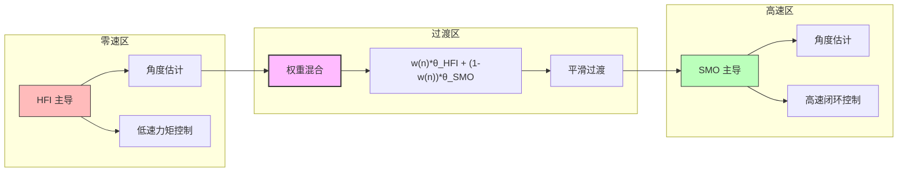

# 混合式无传感器策略

> **为什么学？**
> 单一无传感器技术无法覆盖全速度域：反电动势法低速失效，HFI高速不适用，I-F不能提供连续位置。不理解如何把它们组合起来，就无法设计出从静止到最高速都能稳定运行的FOC系统。
>
> **在 FOC 中的作用**
> 混合策略是无传感器FOC的“顶层架构”。它根据速度在不同算法之间切换或加权融合，向Park变换和速度环持续提供可信的转子角度与速度，覆盖完整运行范围。

反电动势观测器负责中高速，HFI负责零速/低速，I-F作为故障安全；单独看它们都有盲区，但组合起来就能覆盖全速域。混合策略的核心不是选择某一个算法，而是设计好速度边界、切换判据和软过渡，让FOC在不同工况下都能拿到可靠的位置。

## 1. 数学推导：混合策略的切换逻辑与过渡区设计

### 1.1 全速度域的技术适用性分析

**为什么要做这一步**：只有先按速度把运行范围分区，才能明确每个区段该用哪种算法、什么时候进入切换、什么时候彻底退出。

将电机速度域划分为三个区域：

| 速度区域 | 范围 | 适用技术 | 原因 |
|---------|------|---------|------|
| 零速/极低速 | $0 \sim n_1$ (约 0--5% 额定) | HFI 或 I-F 启动 | 反电动势 ≈ 0，观测器不可观测 |
| 中速过渡区 | $n_1 \sim n_2$ (约 5%--20% 额定) | 混合/过渡逻辑 | HFI 和观测器都可用，但都不完美 |
| 中高速 | $n_2 \sim n_{max}$ (约 20%--100% 额定) | 反电动势观测器 | 反电动势信噪比足够，观测器收敛 |

典型速度阈值（以 $3000\ \text{rpm}$ 额定电机为例）：
- $n_1 \approx 150\ \text{rpm}$（HFI 退出 / 观测器勉强可用）
- $n_2 \approx 600\ \text{rpm}$（观测器完全可靠，HFI 完全退出）

### 1.2 切换的数学模型：双观测器并行运行

**为什么要做这一步**：过渡区不能只靠硬切；让两个观测器并行运行并加权融合，可以在切换过程中平滑地降低对HFI的依赖、增加对SMO的信任。

在过渡区，可以设计两个观测器同时运行：

**低速观测器（HFI-based）**：

$$
\hat{\theta}_{HFI} = f_{HFI}(v_{\alpha\beta}, i_{\alpha\beta}, \omega_h)
$$

**高速观测器（SMO-based）**：

$$
\hat{\theta}_{SMO} = f_{SMO}(v_{\alpha\beta}, i_{\alpha\beta}, R_s, L_s, \psi_f)
$$

混合输出采用**加权融合**：

$$
\hat{\theta}_{mix} = w(n) \cdot \hat{\theta}_{HFI} + (1 - w(n)) \cdot \hat{\theta}_{SMO}
$$

其中 $w(n) \in [0, 1]$ 为速度相关的权重函数，通常采用**Sigmoid 型过渡**：

$$
w(n) = \frac{1}{1 + e^{k(n - n_{mid})/n_{band}}}
$$

或更简单的**线性过渡**：

$$
w(n) = \begin{cases}
1 & n \leq n_{low} \\[4pt]
\frac{n_{high} - n}{n_{high} - n_{low}} & n_{low} < n < n_{high} \\[4pt]
0 & n \geq n_{high}
\end{cases}
$$

### 1.3 切换冲击的数学分析

**为什么要做这一步**：两个观测器估计的角度不可能完全相同；直接切换会让Park变换参考系跳变，造成电流环看到阶跃误差；必须先量化冲击再设计补偿。

当从低速模式切换到高速模式时，如果两个观测器估计的角度存在偏差：

$$
\Delta\theta = \hat{\theta}_{HFI} - \hat{\theta}_{SMO}
$$

直接切换会导致 Park 变换的参考系瞬间变化 $\Delta\theta$。在同步坐标系中，电流表现为：

$$
\begin{bmatrix} i_d' \\ i_q' \end{bmatrix} = \begin{bmatrix} \cos\Delta\theta & \sin\Delta\theta \\ -\sin\Delta\theta & \cos\Delta\theta \end{bmatrix} \begin{bmatrix} i_d \\ i_q \end{bmatrix}
$$

转矩变化为：

$$
\Delta T_e = \frac{3}{2} P \left[\psi_f(i_q' - i_q) + (L_d - L_q)i_d' i_q' - (L_d - L_q)i_d i_q\right]
$$

对于 SPMSM（$L_d = L_q$）且 $i_d = 0$：

$$
\Delta T_e \approx \frac{3}{2} P \psi_f i_q (\cos\Delta\theta - 1) \approx -\frac{3}{4} P \psi_f i_q \Delta\theta^2
$$

虽然转矩变化是二阶小量，但 d 轴电流的突变：

$$
i_d' = i_q \sin\Delta\theta \approx i_q \Delta\theta
$$

是一阶量，会导致电流环产生大的纠正动作，引起电压饱和和转矩脉动。

### 1.4 角度连续性约束：软切换的数学设计

**为什么要做这一步**：即使加权融合，角度变化率突变也会引起转矩脉动；用多项式软过渡保证角度、角速度甚至角加速度连续，是工程上消除切换冲击的关键。

为了避免切换冲击，引入**角度平滑过渡**：在切换窗口期间，强制输出角度按多项式过渡：

$$
\hat{\theta}(t) = \hat{\theta}_{HFI}(t) + (\hat{\theta}_{SMO}(t) - \hat{\theta}_{HFI}(t)) \cdot s(\tau)
$$

其中 $\tau = \frac{t - t_{start}}{t_{window}} \in [0, 1]$ 为归一化时间，$s(\tau)$ 为平滑过渡函数：

**三次多项式（S-curve）**：

$$
s(\tau) = 3\tau^2 - 2\tau^3
$$

满足 $s(0)=0, s(1)=1, s'(0)=0, s'(1)=0$，保证切换开始和结束时刻的角速度连续。

**五次多项式**（更高阶连续性）：

$$
s(\tau) = 10\tau^3 - 15\tau^4 + 6\tau^5
$$

满足角加速度也连续，进一步减小冲击。

---

## 2. 几何直观：混合策略的速度域切换



**ASCII 图：权重函数随速度的变化**

```
    HFI 权重 w(n)
      |
    1 |******
      |      \
      |       \
      |        \
    0.5|        +---- 过渡区
      |          \
      |           \
    0 |            \******** SMO 权重
      +──────────────→ 转速 n
         n_low  n_mid  n_high
         
    过渡区设计：n_low ≈ 150rpm, n_high ≈ 600rpm
    在过渡区内，两个观测器并行运行，输出加权融合
```

**过渡区物理直觉**：
1. 低速区就像在大雾中开车（HFI = 雷达），虽然能看到但分辨率不高。
2. 高速区就像在晴天开车（SMO = 目视），清晰可靠。
3. 过渡区就像雾逐渐散去，需要同时参考雷达和目视，并逐渐信赖目视。
4. 直接"切换"就像突然摘掉眼镜，会眩晕；软过渡就像慢慢适应，平滑自然。

---

## 3. 数值示例：混合策略的切换过程设计

**给定参数**：
- IPMSM：$P = 4$，$\psi_f = 0.05\ \text{Wb}$，$L_d = 3\ \text{mH}$，$L_q = 5\ \text{mH}$
- 额定转速：$n_{rated} = 3000\ \text{rpm}$
- HFI 退出转速：$n_{low} = 200\ \text{rpm}$（$\omega_{e,low} = 83.8\ \text{rad/s}$）
- SMO 完全接管转速：$n_{high} = 800\ \text{rpm}$（$\omega_{e,high} = 335.1\ \text{rad/s}$）
- 过渡窗口时间：$t_{window} = 0.5\ \text{s}$（在过渡速度区内完成）
- 当前运行速度：$n = 500\ \text{rpm}$（$\omega_e = 209.4\ \text{rad/s}$）
- HFI 估计角度：$\hat{\theta}_{HFI} = 60°$
- SMO 估计角度：$\hat{\theta}_{SMO} = 58°$（存在 2° 偏差）
- 工作电流：$I_d = -0.5\ \text{A}$（弱磁），$I_q = 3.0\ \text{A}$

**Step 1：计算线性权重**

$$
w = \frac{n_{high} - n}{n_{high} - n_{low}} = \frac{800 - 500}{800 - 200} = \frac{300}{600} = 0.5
$$

即 HFI 和 SMO 各占 50% 权重。

**Step 2：直接加权融合的角度输出**

$$
\hat{\theta}_{mix} = 0.5 \times 60° + 0.5 \times 58° = 59°
$$

**Step 3：分析切换窗口内的角度偏差影响**

假设在过渡开始时（$n = 200\ \text{rpm}$），偏差为 $\Delta\theta_{start} = 5°$；在过渡结束时（$n = 800\ \text{rpm}$），偏差缩小到 $\Delta\theta_{end} = 1°$（通过 SMO 的收敛和同步机制）。

使用五次多项式过渡：

$$
\hat{\theta}(\tau) = \hat{\theta}_{HFI}(\tau) + \Delta\theta(\tau) \cdot s(\tau)
$$

其中 $\Delta\theta(\tau) = \hat{\theta}_{SMO} - \hat{\theta}_{HFI}$。

在 $\tau = 0.5$（过渡中点）：

$$
s(0.5) = 10 \times 0.125 - 15 \times 0.0625 + 6 \times 0.03125 = 1.25 - 0.9375 + 0.1875 = 0.5
$$

（五次多项式在中点确实为 0.5，与线性相同，但导数为零，更平滑。）

**Step 4：计算直接切换 vs 软切换的转矩冲击**

直接切换（在 $n = 500\ \text{rpm}$ 时从 HFI 切到 SMO，角度跳变 $2°$）：

对于 IPMSM：

$$
T_e = \frac{3}{2} P \left[\psi_f I_q + (L_d - L_q) I_d I_q\right]
$$

切换前（HFI 坐标系，假设角度准确）：

$$
T_{e,before} = 1.5 \times 4 \times \left[0.05 \times 3.0 + (-0.002) \times (-0.5) \times 3.0\right] = 6 \times [0.15 + 0.003] = 0.918\ \text{N}\cdot\text{m}
$$

切换后（SMO 坐标系，偏差 $2°$）：

电流在新坐标系中：

$$
i_d' = i_d \cos(2°) + i_q \sin(2°) = -0.5 \times 0.999 + 3.0 \times 0.0349 = -0.5 + 0.105 = -0.395\ \text{A}
$$
$$
i_q' = -i_d \sin(2°) + i_q \cos(2°) = 0.5 \times 0.0349 + 3.0 \times 0.999 = 0.017 + 2.997 = 3.014\ \text{A}
$$

$$
T_{e,after} = 6 \times \left[0.05 \times 3.014 + (-0.002) \times (-0.395) \times 3.014\right] = 6 \times [0.1507 + 0.00238] = 0.9185\ \text{N}\cdot\text{m}
$$

转矩变化很小（约 0.06%），但 d 轴电流从 -0.5 A 突变到 -0.395 A（虽然转矩变化小，但电流环要纠正这个"误差"，会产生电压波动）。实际上，控制器看到 d 轴电流指令是 -0.5 A，但测量值（在新的坐标系下）变成了 -0.395 A，所以控制器会输出额外电压来"拉回" d 轴电流，这个过程引起转矩脉动。

软切换时，角度逐渐过渡，电流在新旧坐标系中的投影连续变化，电流环不会看到突变，因此没有纠正动作，运行更平滑。

---

## 4. 代码实现：混合策略状态机与软切换

### C 语言完整框架

```c
#include <math.h>

#define PI 3.14159265359f
#define TWO_PI 6.28318530718f

// 速度阈值
#define N_LOW_RPM 200.0f     // HFI 主导区上限
#define N_HIGH_RPM 800.0f    // SMO 主导区下限
#define OMEGA_LOW (N_LOW_RPM * 2.0f * PI / 60.0f * POLE_PAIRS)
#define OMEGA_HIGH (N_HIGH_RPM * 2.0f * PI / 60.0f * POLE_PAIRS)

// 状态定义
typedef enum {
    MODE_HFI = 0,      // HFI 主导（零速/低速）
    MODE_TRANSITION,   // 过渡区（加权融合）
    MODE_SMO,          // SMO 主导（中高速）
    MODE_FAILSAFE      // 故障安全（I-F 启动或停机）
} SensorlessMode;

static SensorlessMode mode = MODE_HFI;
static float theta_output = 0.0f;    // 最终输出的角度
static float omega_output = 0.0f;    // 最终输出的速度
static float transition_progress = 0.0f;  // 过渡进度 [0,1]

// 外部观测器接口
extern float HFI_get_theta(void);
extern float HFI_get_omega(void);
extern float SMO_get_theta(void);
extern float SMO_get_omega(void);
extern float SMO_get_e_mag(void);     // 反电动势幅值

// 五次多项式平滑函数
float smooth_transition(float tau) {
    if (tau <= 0.0f) return 0.0f;
    if (tau >= 1.0f) return 1.0f;
    return tau * tau * tau * (10.0f - 15.0f * tau + 6.0f * tau * tau);
}

// 角度差处理（考虑 2π 周期性）
float angle_diff(float a, float b) {
    float d = a - b;
    while (d > PI) d -= TWO_PI;
    while (d < -PI) d += TWO_PI;
    return d;
}

// 混合策略主函数
void HybridSensorless_update(float n_mech_rpm) {
    float omega_e = n_mech_rpm * 2.0f * PI / 60.0f * POLE_PAIRS;
    float theta_hfi = HFI_get_theta();
    float omega_hfi = HFI_get_omega();
    float theta_smo = SMO_get_theta();
    float omega_smo = SMO_get_omega();
    float e_mag = SMO_get_e_mag();
    
    // 模式切换逻辑
    switch (mode) {
        case MODE_HFI:
            theta_output = theta_hfi;
            omega_output = omega_hfi;
            
            // 进入过渡区条件：速度达到 n_low 且 SMO 反电动势足够
            if (omega_e > OMEGA_LOW && e_mag > 5.0f) {
                mode = MODE_TRANSITION;
                transition_progress = 0.0f;
            }
            break;
            
        case MODE_TRANSITION:
            // 更新过渡进度（基于速度或时间）
            // 方法1：基于速度
            transition_progress = (omega_e - OMEGA_LOW) / (OMEGA_HIGH - OMEGA_LOW);
            if (transition_progress > 1.0f) transition_progress = 1.0f;
            
            // 平滑过渡函数
            float s = smooth_transition(transition_progress);
            
            // 角度融合：使用 S-curve 过渡，但注意角度周期性
            float dtheta = angle_diff(theta_smo, theta_hfi);
            theta_output = theta_hfi + s * dtheta;
            if (theta_output >= TWO_PI) theta_output -= TWO_PI;
            if (theta_output < 0.0f) theta_output += TWO_PI;
            
            // 速度融合（可以简单线性）
            omega_output = (1.0f - s) * omega_hfi + s * omega_smo;
            
            // 退出过渡区
            if (transition_progress >= 1.0f) {
                mode = MODE_SMO;
            }
            // 回退条件：速度回落或 SMO 失效
            if (omega_e < OMEGA_LOW * 0.8f || e_mag < 3.0f) {
                mode = MODE_HFI;
            }
            break;
            
        case MODE_SMO:
            theta_output = theta_smo;
            omega_output = omega_smo;
            
            // 回退到过渡区条件
            if (omega_e < OMEGA_HIGH * 0.9f) {
                mode = MODE_TRANSITION;
                transition_progress = 1.0f;  // 从 SMO 侧开始回退
            }
            // 故障检测：反电动势突然消失
            if (e_mag < 2.0f) {
                mode = MODE_FAILSAFE;
            }
            break;
            
        case MODE_FAILSAFE:
            // 故障安全：触发 I-F 重启或停机
            theta_output = 0.0f;  // 由 I-F 模块接管
            omega_output = 0.0f;
            // 可触发外部停机或重启序列
            break;
    }
}

// 外部接口
float Hybrid_get_theta(void) { return theta_output; }
float Hybrid_get_omega(void) { return omega_output; }
SensorlessMode Hybrid_get_mode(void) { return mode; }

// 故障检测与切换
void Hybrid_check_fault(void) {
    // 检测速度突变（打滑/失步）
    static float omega_prev = 0.0f;
    float domega = fabsf(omega_output - omega_prev);
    if (domega > 5000.0f) {  // 电角速度突变 > 5000 rad/s² 等价
        // 可能的失步事件
        mode = MODE_FAILSAFE;
    }
    omega_prev = omega_output;
}
```

---

## 5. 常见错误与纠正

### 错误 1：过渡区窗口设计过窄导致切换振荡

**问题描述**：过渡区宽度 $\Delta n = n_{high} - n_{low}$ 过小（如仅 50 rpm），或切换判据仅使用速度阈值（无滞环），导致电机在临界速度附近反复进出切换状态，产生"乒乓切换"。这会造成角度输出的抖动，电流环频繁响应，电机产生可闻噪声和振动。

**错误表现**：
- 速度在 200 rpm 附近波动时，系统每秒在 HFI 和 SMO 之间切换多次。
- 示波器显示电流波形出现周期性扰动，频率与速度波动相关。

**纠正方法**：

1. **设置足够的过渡区宽度**：通常取额定转速的 10%--20%。对于 3000 rpm 电机，$n_{low} = 200\ \text{rpm}$，$n_{high} = 600\ \text{rpm}$，宽度 400 rpm。

2. **引入滞环（Hysteresis）**：切换判据具有不同的进入和退出阈值。

```c
// 带滞环的切换判据
#define OMEGA_ENTER_TRANSITION 100.0f  // 进入过渡区
#define OMEGA_EXIT_HFI 80.0f          // 退回 HFI（更低）
#define OMEGA_ENTER_SMO 300.0f        // 进入 SMO
#define OMEGA_EXIT_TRANSITION 250.0f  // 退回过渡区（更低）

// 这样避免了在临界速度附近的乒乓切换
```

3. **状态保持时间**：要求在新状态下稳定运行至少 $N$ 个周期（如 100 ms），才允许再次切换。

### 错误 2：过渡区内两个观测器角度偏差过大导致融合失败

**问题描述**：在过渡区中，如果 HFI 和 SMO 的角度估计存在系统性偏差（如超过 $10°$），加权融合会产生一个"错误"的角度，既不在 HFI 的估计上，也不在 SMO 的估计上，而是位于两者之间的某个位置。这个"折中"角度可能既不是正确的物理角度，又同时损害了两个子系统的优势。

**根本原因**：
- HFI 存在 $180°$ 的极性模糊（由于 $2\theta_e$ 的歧义性）。
- SMO 在低速时存在较大的相位滞后（低通滤波引起）。
- 电机参数（$L_d, L_q$）标定不准，导致 HFI 估计偏移。
- 逆变器非线性补偿不完善，导致 SMO 反电动势计算偏差。

**纠正方法**：

1. **极性检测与对齐**：在 HFI 阶段通过短脉冲法（或基于初始电感的极性检测）消除 $180°$ 模糊，确保 HFI 和 SMO 的极性一致。

2. **偏差补偿**：在过渡区开始前，计算两个观测器的角度差，并对其中一个进行补偿：

```c
// 启动时校准 HFI 与 SMO 的偏差
static float theta_offset = 0.0f;

void calibrate_hfi_smo(void) {
    // 在过渡区前，当两个观测器都可用时，记录偏差
    theta_offset = angle_diff(SMO_get_theta(), HFI_get_theta());
}

// 融合时校准 HFI 输出
float theta_hfi_calib = HFI_get_theta() + theta_offset;
```

3. **监控融合质量**：如果两个观测器的偏差超过阈值（如 $15°$），不执行融合，而是保持在更可信的模式（通常是 HFI），并触发报警或自校准。

---

## 6. 自测习题

### 习题 1：过渡区权重设计

一台 3000 rpm 电机，设计混合策略：HFI 在 0--300 rpm 主导，SMO 在 700 rpm 以上主导，过渡区为 300--700 rpm。当前运行速度为 500 rpm。

**问题**：
(1) 使用线性权重函数，计算此时 HFI 和 SMO 的权重。
(2) 若 HFI 估计角度为 $45°$，SMO 估计角度为 $43°$，计算融合后的输出角度。
(3) 如果使用 Sigmoid 权重函数 $w = \frac{1}{1+e^{(n-500)/50}}$，计算 $n = 500$ rpm 时的权重，并与线性权重对比。

**答案**：

(1) 线性权重：

$$
w_{HFI} = \frac{700 - 500}{700 - 300} = \frac{200}{400} = 0.5
$$
$$
w_{SMO} = 1 - 0.5 = 0.5
$$

(2) 融合角度：

$$
\hat{\theta} = 0.5 \times 45° + 0.5 \times 43° = 44°
$$

(3) Sigmoid 权重：

$$
w = \frac{1}{1 + e^{(500-500)/50}} = \frac{1}{1 + e^0} = \frac{1}{2} = 0.5
$$

在 $n = 500$ rpm（正好是 Sigmoid 中点）时，Sigmoid 和线性权重结果相同。但在 $n = 400$ rpm：
- 线性：$w = (700-400)/400 = 0.75$
- Sigmoid：$w = 1/(1+e^{-2}) = 1/(1+0.135) = 0.88$

Sigmoid 在过渡区两端更"保守"，更长时间停留在可靠模式，仅在中间快速过渡。

### 习题 2：切换冲击分析

一台 SPMSM，$P = 4$，$\psi_f = 0.06\ \text{Wb}$，运行在 $I_d = 0$，$I_q = 4\ \text{A}$。从 HFI 切换到 SMO 时，两个观测器角度偏差为 $5°$。

**问题**：
(1) 计算切换前后的电磁转矩（SPMSM，$L_d = L_q$）。
(2) 计算 d 轴电流在切换前后的变化量。
(3) 如果电流环带宽为 $1\ \text{kHz}$，估算电流环将 d 轴电流拉回零需要多长时间（按一阶响应 $3\tau$ 估算）。

**答案**：

(1) 切换前：

$$
T_{e,before} = \frac{3}{2} P \psi_f I_q = 1.5 \times 4 \times 0.06 \times 4 = 1.44\ \text{N}\cdot\text{m}
$$

切换后，新坐标系中：

$$
i_q' = I_q \cos(5°) = 4 \times 0.996 = 3.986\ \text{A}
$$

$$
T_{e,after} = 1.5 \times 4 \times 0.06 \times 3.986 = 1.435\ \text{N}\cdot\text{m}
$$

转矩变化：$\Delta T = 1.44 - 1.435 = 0.005\ \text{N}\cdot\text{m}$（约 0.35%），很小。

(2) d 轴电流变化：

$$
i_d' = I_q \sin(5°) = 4 \times 0.0872 = 0.349\ \text{A}
$$

切换前 $i_d = 0$，切换后 $i_d' = 0.349\ \text{A}$，突变 $0.349\ \text{A}$。

(3) 电流环带宽 $f_{bw} = 1\ \text{kHz}$，时间常数 $\tau = \frac{1}{2\pi f_{bw}} = \frac{1}{6283} = 0.159\ \text{ms}$。

按一阶响应到 95%（约 $3\tau$）：

$$
t_{settle} = 3\tau = 0.477\ \text{ms}
$$

即约 0.5 ms 内电流环会将 d 轴电流拉回零。虽然时间短，但在这 0.5 ms 内电流环会输出额外的 d 轴电压来纠正，这会导致 q 轴电压可用裕量变化（在电压极限附近尤为敏感），间接影响转矩控制。

---

## 7. 小结与展望

混合式无传感器策略是现代高性能电机驱动系统的标配。它将 HFI（零速/低速）、反电动势观测器（中高速）和 I-F 启动（故障安全）有机结合起来，通过智能切换和软过渡实现全速度域的无传感器运行。

**混合策略的核心要点**：
1. **速度域划分**：明确低速（HFI）、过渡区、高速（SMO）的边界，边界设计需考虑电机参数和运行工况。
2. **双模式并行**：过渡区内两个观测器同时运行，输出加权融合。
3. **软过渡设计**：使用 S-curve（多项式过渡函数）保证角度、速度、甚至加速度的连续性。
4. **滞环与状态保持**：避免乒乓切换，确保切换的稳定性。
5. **故障安全**：任何模式下检测到异常（如反电动势消失、角度偏差过大），立即进入安全模式（I-F 重启或停机）。

**未来发展方向**：
- **自适应切换**：根据负载、温度、速度动态调整切换边界和权重。
- **模型参考自适应（MRAS）**：作为第三种观测器，与 SMO/HFI 形成冗余，提高容错性。
- **深度学习辅助**：利用神经网络从电流波形中提取位置信息，作为传统观测器的补充，尤其在参数不确定时。
- **全速度域统一观测器**：研究不依赖切换的单一观测器框架（如基于非线性滤波的全速度域观测器），从根本上消除切换问题。

无传感器控制是 FOC 技术皇冠上的明珠。从反电动势模型到滑模观测器，从高频注入到混合策略，每一层技术的深入都带来更接近"理想传感器"的性能。然而，在精密伺服、航天航空等绝对不容失步的场景中，物理传感器（如旋转变压器、光学编码器）仍然是不可替代的。无传感器与有传感器的融合，也是当前研究的热点之一。
