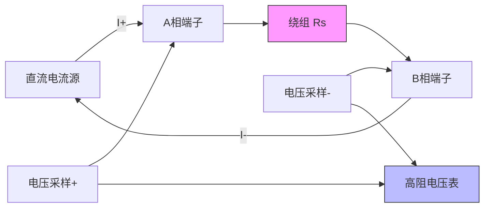

# 直流电阻离线测量

> **为什么学？**
> 定子电阻 $R_s$ 是电流环 PI 参数、铜损与温升计算的“源头”。如果测错 $R_s$，电流环的 $K_p$、$K_i$ 会偏离设计带宽，稳态电流出现静差，逆变器输出电压中的电阻压降补偿也会出错，最终表现为电流响应慢或发热估算严重偏低。
>
> **在 FOC 中的作用**
> 这一节辨识出的 $R_s$ 直接供给电流环 PI 整定、前馈/解耦中的电阻项补偿，以及功率损耗和热模型；它是 FOC 参数辨识链条的第一步。

下面这张图把“接线方式判断 → 注入直流 → 电压/电流采样 → 温度折算”串成一条离线测量流水线，先看整体流程，再深入星形/三角形与四线法的细节。


*图：直流电阻离线测量整体流程*

电机参数辨识通常从电阻开始：只有先把准确的单相电阻拿到手，后续电感、反电动势和机械参数的测量才有统一的基准，电流环设计也才不会在电阻这一环就偏离实际对象。

## 1. 测量原理与数学推导

永磁同步电机（PMSM）的定子绕组直流电阻 $R_s$ 是电流环 PI 控制器设计、铜损计算以及热管理的基础参数。从欧姆定律出发，当向定子绕组注入直流电流 $I_{dc}$ 并测量其端电压 $U_{dc}$ 时，相电阻满足：

$$R_s = \frac{U_{ph}}{I_{ph}}$$

其中 $U_{ph}$ 为单相绕组两端电压，$I_{ph}$ 为流过该相的电流。对于三相绕组，星形（Y）连接与三角形（$\Delta$）连接的总等效电阻不同。

### 星形连接（Y）

为什么要做这一步：电机实际接线多为星形，线—线测量得到的是两相电阻串联，若不按接线方式换算，会把 $R_s$ 算错一倍以上。

三相绕组中性点可引出或不可引出。若中性点引出，可直接测量相—中性点电压：

$$R_s = \frac{U_{an}}{I_a}$$

若中性点未引出，通常采用线—线测量法，向两相绕组（如 A、B）注入直流，第三相（C）悬空：

$$U_{ab} = I_{dc}(R_a + R_b) = 2I_{dc}R_s \quad (\text{假设 } R_a=R_b=R_c=R_s)$$

$$R_s = \frac{U_{ab}}{2I_{dc}}$$

### 三角形连接（$\Delta$）

为什么要做这一步：三角形接法的等效电路与星形不同，必须按 $2/3$ 倍关系还原单相电阻，否则会导致 PI 参数和铜损估算出现系统性偏差。

向两相端子注入直流，第三端悬空，此时等效为两相串联再与第三相并联：

$$R_{eq} = \frac{2R_s \cdot R_s}{2R_s + R_s} = \frac{2}{3}R_s$$

$$R_s = \frac{3}{2} \cdot \frac{U_{ab}}{I_{dc}}$$

### 温度补偿

为什么要做这一步：绕组温度每升高 $10^{\circ}\text{C}$，铜阻约增加 $4\%$；若把热态电阻直接用于电流环设计，会低估带宽并造成响应迟缓。

铜绕组电阻随温度变化显著，温度系数 $\alpha_{Cu} \approx 0.00393 \ /^{\circ}\text{C}$。换算到标准温度 $T_0 = 20^{\circ}\text{C}$：

$$R_{20} = \frac{R_T}{1 + \alpha_{Cu}(T - 20)}$$

或反推工作温度：

$$T = 20 + \frac{R_T - R_{20}}{R_{20}\cdot\alpha_{Cu}}$$

### 四线法（开尔文接法）的推导

为什么要做这一步：小功率电机的 $R_s$ 往往只有几十到几百毫欧，测试线电阻和接触电阻会严重污染测量结果，四线法能把这部分误差排除。

两线法测量时，测试引线电阻 $R_{lead}$ 与接触电阻 $R_{contact}$ 串联进入测量回路：

$$R_{meas} = R_s + 2R_{lead} + 2R_{contact}$$

四线法将电流回路与电压采样回路分离，电压采样回路输入阻抗极高（$R_{in} \gg R_s$），因此：

$$R_{meas} = \frac{U_{sense}}{I_{source}} = R_s$$

引线电阻与接触电阻仅影响电流源输出能力，不进入电压测量。

## 2. 几何直观



**四线法原理**：电流源驱动回路（红色）承载全部电流，因此引线压降不影响结果；电压采样回路（蓝色）为高阻输入，几乎无电流流过，其引线压降可忽略，因此电压表读数精确等于绕组两端电势差。

**等效电路**：

```
两线法：
  I_source ----[R_lead]----[R_contact]----[Rs]----[R_contact]----[R_lead]---- return
                                                      |
                                              V_meter (跨在整个回路上)
  测得：V = I_source × (2R_lead + 2R_contact + Rs)

四线法：
  I_source ----[R_lead]----[R_contact]----[Rs]----[R_contact]----[R_lead]---- return
                                              |
  V_sense+ -----------------------------------+ (高阻输入，电流≈0)
  V_sense- -----------------------------------+
  测得：V = I_source × Rs
```

## 3. 数值示例

**已知**：某 PMSM 额定功率 $P_N = 400\ \text{W}$，额定电流 $I_N = 2.5\ \text{A}$。使用直流电源向 A、B 相注入 $I_{dc} = 1.0\ \text{A}$，测得线电压 $U_{ab} = 0.92\ \text{V}$。环境温度 $T = 25^{\circ}\text{C}$。电桥测得线—线电阻（含引线）为 $0.55\ \Omega$。

**求**：
1. 相电阻 $R_s$；
2. 温度折算到 $20^{\circ}\text{C}$ 的电阻；
3. 若使用两线法，估算引线+接触电阻总量。

**解**：

1. 星形接法，线—线测量：
   $$R_s = \frac{U_{ab}}{2I_{dc}} = \frac{0.92}{2 \times 1.0} = 0.46\ \Omega$$

2. 温度折算：
   $$R_{20} = \frac{0.46}{1 + 0.00393 \times (25 - 20)} = \frac{0.46}{1.01965} \approx 0.451\ \Omega$$

3. 两线法测量值 $R_{meas} = 0.55\ \Omega$，则：
   $$R_{lead+contact} = \frac{R_{meas} - R_s}{2} = \frac{0.55 - 0.46}{2} = 0.045\ \Omega$$
   即每根引线加接触电阻约 $45\ \text{m}\Omega$。

**进一步验证**：铜损 $P_{cu} = 3I_N^2 R_s = 3 \times 2.5^2 \times 0.46 = 8.625\ \text{W}$，占额定功率 $2.16\%$，符合小型永磁电机典型范围。

## 4. 代码实现

```c
#include <stdint.h>

#define ALPHA_CU  0.00393f   // 铜温度系数 /°C
#define T_REF     20.0f      // 参考温度 °C

/**
 * @brief 测量相电阻（星形接线，线-线法）
 * @param U_line_line 线间电压，单位 V
 * @param I_dc 注入直流电流，单位 A
 * @return 相电阻 Rs，单位 Ω
 */
float MeasurePhaseResistance_VLL(float U_line_line, float I_dc)
{
    if (I_dc < 0.01f) return -1.0f; // 防止除零
    return (U_line_line / (2.0f * I_dc));
}

/**
 * @brief 温度补偿到标准温度
 * @param Rs_T 当前温度下测得的电阻
 * @param T 当前绕组温度 °C
 * @return 20°C 下的电阻
 */
float Resistance_TempCompensation(float Rs_T, float T)
{
    return Rs_T / (1.0f + ALPHA_CU * (T - T_REF));
}

/**
 * @brief 四线法测量流程（伪代码框架）
 */
float FourWire_Measure_Rs(void)
{
    // 1. 设置电流源输出
    float I_test = 1.0f;          // A
    SetCurrentSource(I_test);
    
    // 2. 等待电流稳定（至少 3-5 个 RL 时间常数）
    Delay_ms(100);                 // 实际应根据 L/R 调整
    
    // 3. 高阻电压采样（多次平均消除噪声）
    float U_sum = 0.0f;
    for (int i = 0; i < 64; i++) {
        U_sum += ReadVoltageSense();
    }
    float U_sense = U_sum / 64.0f;
    
    // 4. 关闭电流源
    DisableCurrentSource();
    
    // 5. 计算
    return U_sense / I_test;
}
```

## 5. 常见错误

### 错误一：将线—线测量值直接当作相电阻

**现象**：测得 $U_{ab} = 0.92\ \text{V}$，$I = 1.0\ \text{A}$，直接计算 $R = 0.92/1.0 = 0.92\ \Omega$，导致电阻高估 2 倍（Y 接）或 1.5 倍（$\Delta$ 接）。

**纠正**：明确电机接线方式。星形接线时线—线电阻对应 **两相串联**，因此 $R_s = U_{ab}/(2I)$；三角形接线时 $R_s = 3U_{ab}/(2I)$。

### 错误二：忽略温度补偿，将热态电阻直接用于电流环设计

**现象**：电机运行后绕组温度升至 $80^{\circ}\text{C}$，此时在线测得 $R_s=0.55\ \Omega$。若把该数值与冷态电感混用，或与控制器原先采用的参考温度不一致，会使电机极点 $-R_s/L$ 与 PI 零点错配。按带宽法整定时通常有 $K_p=L\omega_c$、$K_i=R_s\omega_c$；温度变化主要直接影响 $K_i$ 和零点位置，而不是简单地令 $K_p\propto L/R_s$。

**纠正**：统一折算到 $20^{\circ}\text{C}$ 或 $75^{\circ}\text{C}$ 标准温度。或更优做法：在电机典型工作温度下测量，直接记录该温度下的 $R_s$ 并标注工况。

### 错误三：注入电流过大导致发热，测量过程中电阻漂移

**现象**：为获得足够信噪比而长时间注入接近额定值的直流，会在测量过程中改变被测量。例：若参与发热的铜质量约 $80\ \text{g}$、铜比热容取 $0.385\ \text{J/(g·K)}$、铜损为 $8\ \text{W}$，忽略散热时连续 10 秒的温升约为 $80/(80\times0.385)\approx2.6^{\circ}\text{C}$，铜阻已变化约 $1\%$。

**纠正**：在满足测量信噪比的前提下减小注入电流，并采用短脉冲、多次平均。脉冲宽度至少要覆盖电流建立与采样稳定时间，同时应远短于显著热时间常数；具体上限由绕组热容量、允许温升和仪器精度决定，不宜套用固定的额定电流比例或 200 ms 阈值。

## 6. 自测习题

**习题 1**
一台三角形接法的 PMSM，向 AB 端子注入直流 $I_{dc} = 2.0\ \text{A}$，测得 $U_{ab} = 0.60\ \text{V}$。求：
1. 相电阻 $R_s$；
2. 若电机额定电流 $I_N = 3.0\ \text{A}$，额定转速 $n_N = 3000\ \text{r/min}$，估算额定铜损（忽略温度变化）。

**答案**：
1. 三角形接线，线—线法：
   $$R_{eq} = \frac{U_{ab}}{I_{dc}} = \frac{0.60}{2.0} = 0.30\ \Omega$$
   由于两相串联与第三相并联：
   $$R_s = \frac{3}{2} R_{eq} = \frac{3}{2} \times 0.30 = 0.45\ \Omega$$

2. 三角形接法时，相电流 $I_{ph} = I_{line}/\sqrt{3} = 3.0/\sqrt{3} \approx 1.732\ \text{A}$。铜损：
   $$P_{cu} = 3 I_{ph}^2 R_s = 3 \times (1.732)^2 \times 0.45 \approx 4.05\ \text{W}$$

**习题 2**
使用四线法测量某电机，电流源输出 $I = 1.5\ \text{A}$，电压采样平均值为 $U = 0.675\ \text{V}$。但事后发现电流源回路存在 $50\ \text{m}\Omega$ 的接触电阻。该接触电阻是否影响最终测得的 $R_s$？说明理由。

**答案**：
不影响。四线法中电流回路的接触电阻仅改变电流源的实际负载，只要电流源仍稳定输出 $1.5\ \text{A}$，且电压采样回路具有高输入阻抗（电流 $\approx 0$），电压采样引线上的压降即可忽略。测得的 $U$ 精确对应绕组两端电压，因此 $R_s = U/I = 0.675/1.5 = 0.45\ \Omega$ 不受电流回路接触电阻影响。
