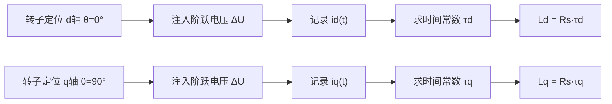
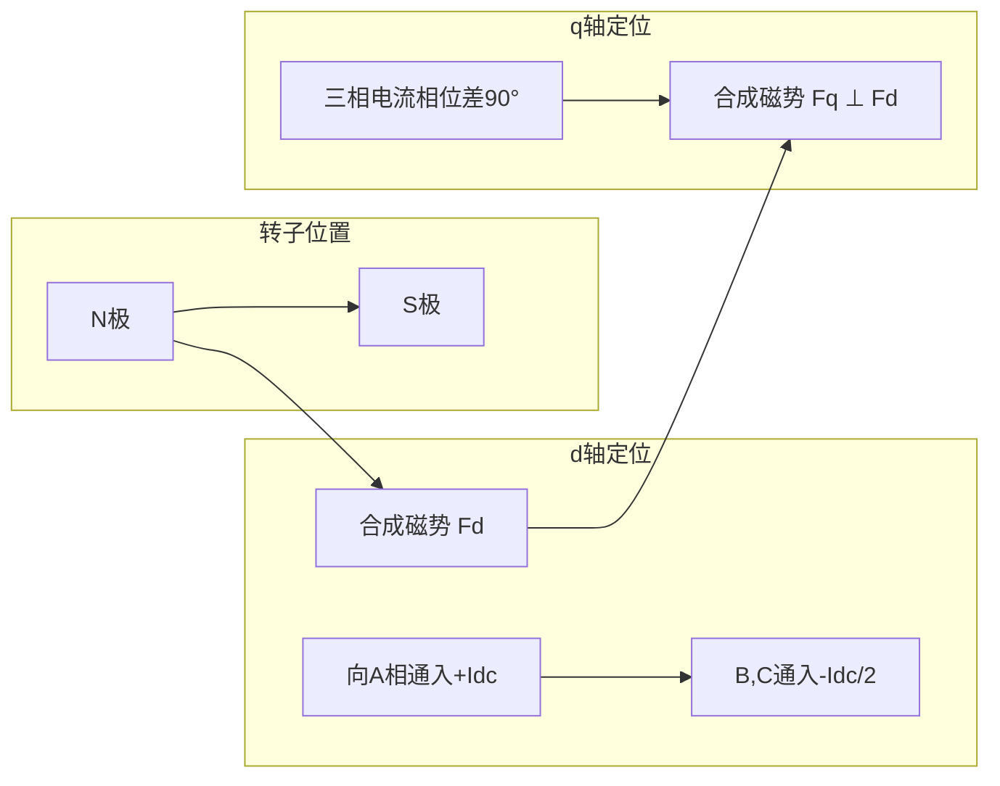

# dq轴电感测量

> **为什么学？**
> $L_d$、$L_q$ 决定了电流环 PI 增益、dq 轴解耦补偿强度，以及 MTPA/弱磁控制的依据。如果测错或没有区分 d/q 轴，解耦项会相互串扰，电流环会出现超调或振荡，转矩控制精度也会下降。
>
> **在 FOC 中的作用**
> 这一节辨识出的 $L_d$、$L_q$ 用于电流环极点配置、反电动势/磁链观测器建模，以及 IPMSM 的 MTPA 角度计算，是旋转坐标系下电流控制器设计的核心输入。

这张图给出 dq 轴电感离线测量的“定位—注入—采样—计算”四步，把抽象的电压方程和后面的数值示例串成一条可执行的流程。



*图：增量电感法测量 dq 轴电感流程*

dq 轴电感把静止绕组的电磁惯性映射到转子坐标系。只有先把它测准，电流环才能正确设计带宽、解耦前馈才能把 d、q 轴电流“拆开”，FOC 也才能在做转矩控制时知道该往哪个方向分配电流。

## 1. 测量原理与数学推导

永磁同步电机的 dq 轴电感 $L_d$ 和 $L_q$ 是电流环解耦控制与 MTPA 设计的核心参数。在旋转坐标系下，定子电压方程为：

$$u_d = R_s i_d + L_d \frac{di_d}{dt} - \omega_e L_q i_q$$

$$u_q = R_s i_q + L_q \frac{di_q}{dt} + \omega_e L_d i_d + \omega_e \psi_f$$

当电机静止（$\omega_e = 0$）且某一轴电流保持恒定时，瞬态电压方程简化为：

$$u_d = R_s i_d + L_d \frac{di_d}{dt}, \quad u_q = R_s i_q + L_q \frac{di_q}{dt}$$

### 增量电感法（瞬态响应法）

为什么要做这一步：在 d/q 轴定位后施加阶跃电压，通过电流上升斜率反推出该轴电感，是离线自整定中最常用、对驱动器要求最低的方法。

向 d 轴或 q 轴注入一个阶跃电压 $\Delta U$，记录电流响应 $\Delta i(t)$。忽略电阻压降（或在计算中扣除），电感满足：

$$L = \frac{\int_0^{t_1} (u(t) - R_s i(t))\,dt}{\Delta i(t_1)}$$

对于理想阶跃且忽略电阻的简化情况：

$$L = \frac{\Delta U \cdot \Delta t}{\Delta i}$$

更精确地，通过 RL 电路的指数响应：

$$i(t) = \frac{U}{R_s}\left(1 - e^{-t/\tau}\right), \quad \tau = \frac{L}{R_s}$$

取电流从 $0$ 上升到 $0.632I_{ss}$ 的时间即为时间常数 $\tau$，从而：

$$L = R_s \cdot \tau$$

### 交流阻抗法（LCR 表法）

为什么要做这一步：用电桥或 LCR 表测交流阻抗，可以在不依赖大功率驱动器的情况下快速估算电感，但测试频率会直接影响等效阻抗中的铁损和趋肤效应分量。

在转子锁定的位置，向定子绕组注入单相正弦交流电压：

$$u(t) = U_m \sin(\omega t)$$

稳态电流响应：

$$i(t) = \frac{U_m}{\sqrt{R_s^2 + (\omega L)^2}} \sin(\omega t - \varphi)$$

测量电压与电流的有效值及相位差，阻抗模 $|Z| = U_{rms}/I_{rms}$，则：

$$L = \frac{\sqrt{|Z|^2 - R_s^2}}{\omega}$$

其中 $\omega = 2\pi f_{test}$。

### d 轴与 q 轴的分离

为什么要做这一步：IPMSM 的凸极效应使 d、q 轴磁路磁阻不同，必须分别把转子定位到 d 轴和 q 轴测量，否则得到的是某个中间角度的混合电感，无法用于解耦。

对于内置式永磁同步电机（IPMSM），转子凸极性导致 $L_d \neq L_q$。测量时需将转子定位到特定角度：

- **d 轴定位**：向 A 相通入正方向直流，B、C 相并联通入反向直流（或 B、C 悬空），产生与永磁体 N 极对齐的定子磁场。此时：
  $$\theta_{elec} = 0^\circ, \quad L = L_d$$

- **q 轴定位**：将电流矢量旋转 $90^\circ$（电角度），即：
  $$\theta_{elec} = 90^\circ, \quad L = L_q$$

对于表贴式永磁同步电机（SPMSM），$L_d \approx L_q \approx L_s$，任意角度测量均可。

### 饱和特性与交叉耦合

为什么要做这一步：大电流下铁心饱和会让 $L_d$、$L_q$ 明显下降，高速/大负载 FOC 若仍用小电流测得的电感，会高估动态响应并引入转矩误差。

当电流增大时，磁路饱和导致电感下降。定义增量电感：

$$L_d(i_d, i_q) = \frac{\partial \psi_d}{\partial i_d}, \quad L_q(i_d, i_q) = \frac{\partial \psi_q}{\partial i_q}$$

交叉耦合项：

$$L_{dq} = \frac{\partial \psi_d}{\partial i_q}, \quad L_{qd} = \frac{\partial \psi_q}{\partial i_d}$$

在常规 FOC 中通常忽略 $L_{dq}$ 和 $L_{qd}$，但在高精度模型中需考虑。

## 2. 几何直观



**电感随转子角度变化**（IPMSM）：

```
电感 L(θ)
  |
Lq|        /\        /\        /\
  |       /  \      /  \      /  \
  |      /    \    /    \    /    \
Ld|_____/      \__/      \__/      \_____
  |    0°    90°   180°   270°   360°
  +-------------------------------------> θ (电角度)
       |d轴|      |q轴|      |d轴|
```

d 轴对应磁阻最小路径（永磁体磁导率低，近似空气），故 $L_d < L_q$；q 轴对应磁阻最大路径（铁心磁导率高），故 $L_q > L_d$。

## 3. 数值示例

**已知**：某 IPMSM 相电阻 $R_s = 0.5\ \Omega$。使用增量电感法测量：

- d 轴定位后，注入阶跃电压 $\Delta U = 10\ \text{V}$，电流在 $t = 2.0\ \text{ms}$ 时达到稳态值 $I_{ss} = 2.0\ \text{A}$；
- q 轴定位后，相同阶跃电压下，电流在 $t = 3.5\ \text{ms}$ 时达到稳态值 $I_{ss} = 2.0\ \text{A}$。

**求**：$L_d$ 和 $L_q$。

**解**：

首先验证是否可用指数近似。稳态电流 $I_{ss} = 2.0\ \text{A}$，说明电流被限制（驱动器限流），不能直接套用 $I_{ss} = U/R_s$。

改用 $0.632$ 时间常数法：
- d 轴：$\tau_d = 2.0\ \text{ms}$，则 $L_d = R_s \cdot \tau_d = 0.5 \times 0.002 = 1.0\ \text{mH}$
- q 轴：$\tau_q = 3.5\ \text{ms}$，则 $L_q = R_s \cdot \tau_q = 0.5 \times 0.0035 = 1.75\ \text{mH}$

**验证凸极比**：

$$\rho = \frac{L_q}{L_d} = \frac{1.75}{1.0} = 1.75$$

该值在 IPMSM 典型范围（1.5–3.0）内，合理。

**再验证交流阻抗法**：

假设 LCR 表在 d 轴位置测得 $|Z| = 3.14\ \Omega$（$f_{test} = 1\ \text{kHz}$），则：

$$L_d = \frac{\sqrt{3.14^2 - 0.5^2}}{2\pi \times 1000} = \frac{\sqrt{9.86 - 0.25}}{6283} = \frac{3.10}{6283} \approx 0.493\ \text{mH}$$

该结果与增量法不一致，原因在于 **1 kHz 下趋肤效应和铁损** 使等效阻抗增大。因此离线测量建议采用 **低频（50–200 Hz）或直流阶跃法**。

## 4. 代码实现

```c
#include <stdint.h>
#include <math.h>

#define PI 3.1415926535f

/**
 * @brief 增量电感测量（阶跃电压法）
 * @param Rs 相电阻，单位 Ω
 * @param U_step 注入阶跃电压，单位 V
 * @param i_samples 电流采样数组（等间隔）
 * @param dt 采样间隔，单位 s
 * @param n 采样点数
 * @return 电感 L，单位 H
 */
float MeasureInductance_Incremental(float Rs, float U_step, 
                                    float* i_samples, float dt, int n)
{
    // 找到 0.632 * I_ss 的索引
    float I_ss = i_samples[n-1];  // 假设最后一点为稳态
    float target = 0.632f * I_ss;
    
    int idx = 0;
    for (int i = 0; i < n; i++) {
        if (i_samples[i] >= target) {
            idx = i;
            break;
        }
    }
    
    float tau = idx * dt;   // 时间常数 τ = L/R
    return Rs * tau;
}

/**
 * @brief 交流阻抗法计算电感
 * @param U_rms 电压有效值，V
 * @param I_rms 电流有效值，A
 * @param Rs 相电阻，Ω
 * @param f_test 测试频率，Hz
 * @return 电感 L，H
 */
float MeasureInductance_LCR(float U_rms, float I_rms, float Rs, float f_test)
{
    float Z = U_rms / I_rms;
    float omega = 2.0f * PI * f_test;
    
    if (Z <= Rs) return 0.0f; // 无效测量
    
    return sqrtf(Z*Z - Rs*Rs) / omega;
}

/**
 * @brief 转子定位到d轴（伪代码）
 */
void AlignRotorToDaxis(void)
{
    // 生成 α = 1.0, β = 0.0 的电压矢量
    float Ua = 1.0f, Ub = -0.5f, Uc = -0.5f;
    
    // 输出固定电压矢量 1-2 秒，等待转子机械稳定
    SetPWM_Voltages(Ua, Ub, Uc);
    Delay_ms(1500);
    DisablePWM();
}
```

## 5. 常见错误

### 错误一：未锁定转子位置，在任意角度测量电感

**现象**：用手转动转子后未进行 d/q 轴定位，直接注入阶跃电压。由于电感随角度变化 $L(\theta) = L_{avg} - L_{delta}\cos(2\theta)$，测得值介于 $L_d$ 和 $L_q$ 之间，无法用于 FOC 解耦。

**纠正**：测量前必须通过直流定位法将转子固定在 d 轴（$\theta=0^\circ$）和 q 轴（$\theta=90^\circ$）位置。定位后保持至少 $500\ \text{ms}$，等待机械振荡衰减。

### 错误二：测试频率过高，未考虑铁损和趋肤效应

**现象**：使用 LCR 表默认 1 kHz 档测量电感，得到 $L_d = 0.49\ \text{mH}$，而增量法得到 $1.0\ \text{mH}$。差异源于铁损等效电阻 $R_{fe}$ 与频率成正比，使阻抗虚部被压缩。

**纠正**：低频测量（$50\sim200\ \text{Hz}$），或采用增量电感法（本质为直流/低频激励）。若必须用 LCR 表，应选择最低频率档并在结果中标注测试条件。

### 错误三：注入电流过大导致磁饱和，测得增量电感偏低

**现象**：注入阶跃电压 $\Delta U = 20\ \text{V}$，电流峰值达 $8\ \text{A}$，测得 $L_d = 0.6\ \text{mH}$；但用 $\Delta U = 5\ \text{V}$（峰值 $2\ \text{A}$）测得 $L_d = 1.0\ \text{mH}$。

**纠正**：在电机额定电流范围内，选取多个电流点（如 $0.1I_N, 0.3I_N, 0.5I_N, 0.8I_N, 1.0I_N$）测量电感，绘制 $L_d(i_d)$ 和 $L_q(i_q)$ 曲线。FOC 设计时根据工作电流选取对应的电感值。

## 6. 自测习题

**习题 1**
某 SPMSM 相电阻 $R_s = 0.8\ \Omega$。向 d 轴注入阶跃电压 $U = 12\ \text{V}$，电流采样数据如下（间隔 $0.2\ \text{ms}$）：

| 时间点(ms) | 0   | 0.2 | 0.4 | 0.6 | 0.8 | 1.0 | 1.2 | 1.4 |
|------------|-----|-----|-----|-----|-----|-----|-----|-----|
| 电流(A)    | 0   | 0.52| 0.98| 1.38| 1.72| 2.02| 2.28| 2.50|

求电感 $L_s$（提示：用时间常数法）。

**答案**：
稳态电流 $I_{ss} = 2.5\ \text{A}$（最后一点）。
$0.632 \times 2.5 = 1.58\ \text{A}$。
查表，1.72 A 在 $t = 0.8\ \text{ms}$ 处最接近 1.58 A（线性插值：0.72 与 0.38 差 0.34；0.72/0.34 ≈ 0.47，因此约 $t = 0.8 - 0.2 \times 0.41 = 0.72\ \text{ms}$）。
取近似 $\tau \approx 0.75\ \text{ms}$：

$$L_s = R_s \cdot \tau = 0.8 \times 0.75 \times 10^{-3} = 0.60\ \text{mH}$$

**习题 2**
某 IPMSM 的 d 轴电感 $L_d = 1.2\ \text{mH}$，q 轴电感 $L_q = 2.4\ \text{mH}$。若测量时转子未锁定，恰好停在 $45^\circ$（电角度）位置，问：此时测得的等效电感是多少？与 $L_d$ 和 $L_q$ 的关系是什么？

**答案**：
电感随角度的变化规律为：

$$L(\theta) = \frac{L_d + L_q}{2} + \frac{L_d - L_q}{2}\cos(2\theta)$$

代入 $\theta = 45^\circ$（即 $\pi/4$），$\cos(2\theta) = \cos(90^\circ) = 0$：

$$L(45^\circ) = \frac{L_d + L_q}{2} = \frac{1.2 + 2.4}{2} = 1.8\ \text{mH}$$

此值为 d 轴和 q 轴电感的算术平均值，不能单独代表 $L_d$ 或 $L_q$。
