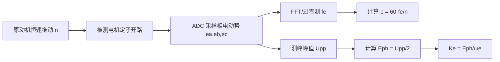
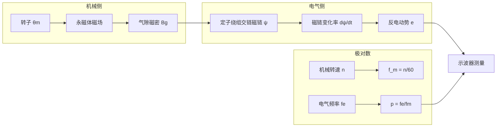

# 反电动势常数与极对数标定

> **为什么学？**
> $K_e$ 和极对数 $p$ 把机械转速/位置翻译成电气量。如果搞错 $K_e$ 的单位或极对数，速度环增益会偏差数倍，转矩指令换算错误，编码器电角度刻度也会错，导致 Park 变换、换相和观测器全部失准。
>
> **在 FOC 中的作用**
> 这一节辨识出的 $K_e$ 用于转矩常数计算、速度观测和电压前馈；极对数 $p$ 用于把机械角度/速度转换为电角度/电角速度，是坐标变换与霍尔/编码器接口的基础。

这张图把反拖法测 $K_e$ 和极对数的“机械拖动—电气采样—频率/幅值提取—参数输出”链路画出来，便于理解机械侧与电气侧如何对应。



*图：反拖法标定反电动势常数与极对数*

反电动势是转子永磁体在定子绕组中“切割”出来的电压，它把机械运动与电气量联系起来。准确标定 $K_e$ 和 $p$，FOC 才能正确理解当前转速对应多少反电动势、转子转一圈对应多少个电周期。

## 1. 测量原理与数学推导

永磁同步电机旋转时，永磁体磁场在定子绕组中感应出反电动势（Back-EMF）。反电动势常数 $K_e$ 与电机转矩常数 $K_t$ 是 FOC 控制中计算速度环增益、观测器设计和转矩前馈的关键参数。

### 反电动势模型

为什么要做这一步：只有把反电动势写成转子磁链随电角度的变化率，才能建立 $K_e$ 与永磁磁链 $\psi_f$ 之间的关系，也才能解释为什么线电压幅值比相电压高 $\sqrt{3}$ 倍。

三相定子绕组的反电动势由磁链变化率产生：

$$e_a = -\frac{d\psi_a}{dt}, \quad e_b = -\frac{d\psi_b}{dt}, \quad e_c = -\frac{d\psi_c}{dt}$$

对于理想正弦分布的永磁体磁场，a 相磁链：

$$\psi_a = \psi_f \cos(\theta_e)$$

其中 $\theta_e = p \cdot \theta_m$ 为电角度，$p$ 为极对数，$\theta_m$ 为机械角度。求导得：

$$e_a = \psi_f \cdot p \cdot \omega_m \sin(\theta_e) = \omega_e \psi_f \sin(\theta_e)$$

定义电角速度 $\omega_e = p \omega_m$。令 $E_{ph} = \omega_e \psi_f$ 为相电压幅值，则：

$$e_a = E_{ph} \sin(\omega_e t)$$

$$e_b = E_{ph} \sin(\omega_e t - \frac{2\pi}{3})$$

$$e_c = E_{ph} \sin(\omega_e t + \frac{2\pi}{3})$$

### 反电动势常数 $K_e$ 的定义与单位换算

为什么要做这一步：$K_e$ 在电机手册、论文和驱动器参数表中的定义（相/线、幅值/有效值、电角速度/机械转速/1000 rpm）并不统一，必须先明确单位，否则转矩、速度环和电压前馈都会差几倍。

$K_e$ 有多种定义方式，需特别注意单位：

**定义 A（相电压幅值 per 电角速度）**：

$$E_{ph} = K_e \cdot \omega_e \quad \Rightarrow \quad K_e = \psi_f \quad [\text{V/(rad/s)}]$$

**定义 B（线电压有效值 per 机械角速度）**：

$$E_{line,rms} = \frac{\sqrt{3}}{\sqrt{2}} E_{ph} = \sqrt{\frac{3}{2}} K_e \omega_e = \sqrt{\frac{3}{2}} K_e \cdot p \cdot \omega_m$$

$$K_{e(line)} = \sqrt{\frac{3}{2}} \cdot p \cdot K_e \quad [\text{V/(rad/s)}]$$

**定义 C（线电压有效值 per 1000 rpm）**：

工业电机中常用 $K_e = \frac{E_{line,rms}}{n/1000}$，单位 $[\text{V/(krpm)}]$。换算关系：

$$K_e[\text{V/(krpm)}] = \frac{1000 \cdot \sqrt{3} \cdot E_{ph}}{\sqrt{2} \cdot \frac{2\pi}{60} \cdot n \cdot p} = \frac{1000 \cdot 60 \cdot \sqrt{3} \cdot E_{ph}}{\sqrt{2} \cdot 2\pi \cdot n \cdot p}$$

为消除混淆，本文统一采用 **定义 A**：$K_e = \psi_f$，即相电压幅值与电角速度之比。

### 转矩常数 $K_t$ 与 $K_e$ 的关系

为什么要做这一步：知道了 $K_e$ 和极对数，就能把电流指令直接换算成电磁转矩，这是转矩模式、速度环前馈和负载观测器设计的基础。

电磁转矩：

$$T_e = \frac{3}{2} p \left[ \psi_f i_q + (L_d - L_q) i_d i_q \right]$$

对于表贴式电机（$L_d = L_q$），$T_e = \frac{3}{2} p \psi_f i_q = \frac{3}{2} p K_e i_q$。

定义转矩常数 $K_t = T_e / i_q$（单位 $[\text{Nm/A}]$）：

$$K_t = \frac{3}{2} p K_e$$

注意：某些厂商定义 $K_t = T_e / I_{line,rms}$，此时需乘以 $\sqrt{3}$ 或 $\sqrt{2/3}$ 进行换算。

### 极对数 $p$ 的测定

为什么要做这一步：极对数错了，机械角度对应的电角度就会错配，导致 Park 变换、编码器分频、霍尔换相和 SVPWM 扇区判断全部出错。

极对数可由电气频率与机械频率的关系确定：

$$p = \frac{f_e}{f_m} = \frac{\omega_e}{\omega_m}$$

**反拖法**：用另一台电机以已知机械转速 $n$（r/min）拖动被测电机，测量某相反电动势的频率 $f_e$：

$$p = \frac{60 \cdot f_e}{n}$$

**开环恒速法**：驱动器以固定频率 $f_{drive}$ 开环运行（无负载），测量实际机械转速 $n$：

$$p = \frac{60 \cdot f_{drive}}{n}$$

## 2. 几何直观



**三相反电动势波形与电角度**：

```
  e
  |    /\
  |   /  \        /\
  |  /    \      /  \        /\
  | /      \    /    \      /  \
  |/        \  /      \    /    \
  +-----\----\/---------\--/------\-----> t
  a      \    /\         \/        \
          \  /  \       /\        /
           \/    \     /  \      /
            b     \   /    \    /
                   \ /      \  /
                    c        \/
                            
        |<---- Te ---->|  电周期 = 1/fe
        机械周期 Tm = p * Te
```

**线电压 $u_{ab} = e_a - e_b$ 的波形**比相电压幅值高 $\sqrt{3}$ 倍，且相位超前 $30^\circ$。

## 3. 数值示例

**已知**：某 SPMSM 用另一台电机以 $n = 1200\ \text{r/min}$ 恒速反拖。示波器显示 a 相反电动势为正弦波，峰峰值 $U_{pp} = 24.0\ \text{V}$，频率 $f_e = 80\ \text{Hz}$。

**求**：
1. 极对数 $p$；
2. 相电压幅值 $E_{ph}$ 和有效值 $E_{ph,rms}$；
3. 反电动势常数 $K_e$（定义 A，单位 V/(rad/s)）；
4. 转矩常数 $K_t$（$L_d = L_q$）。

**解**：

1. **极对数**：

   $$f_m = \frac{n}{60} = \frac{1200}{60} = 20\ \text{Hz}$$
   
   $$p = \frac{f_e}{f_m} = \frac{80}{20} = 4$$

2. **相电压**：
   
   峰峰值 $U_{pp} = 24.0\ \text{V}$，则幅值：
   
   $$E_{ph} = \frac{U_{pp}}{2} = 12.0\ \text{V}$$
   
   有效值：
   
   $$E_{ph,rms} = \frac{E_{ph}}{\sqrt{2}} = \frac{12.0}{1.414} \approx 8.49\ \text{V}$$

3. **反电动势常数**：
   
   电角速度：
   
   $$\omega_e = 2\pi f_e = 2\pi \times 80 = 502.65\ \text{rad/s}$$
   
   或 $\omega_e = p \cdot \frac{2\pi n}{60} = 4 \times \frac{2\pi \times 1200}{60} = 502.65\ \text{rad/s}$。

   定义 A：
   
   $$K_e = \frac{E_{ph}}{\omega_e} = \frac{12.0}{502.65} \approx 0.02387\ \text{V/(rad/s)} = 23.87\ \text{mV/(rad/s)}$$

   **换算到 V/(krpm)**：
   
   $$\omega_m = \frac{2\pi \times 1000}{60} = 104.72\ \text{rad/s}$$
   
   $$\omega_e = p \omega_m = 4 \times 104.72 = 418.88\ \text{rad/s}$$
   
   $$E_{line,rms} = \sqrt{3} \times 8.49 = 14.70\ \text{V}$$
   
   $$K_{e,krpm} = \frac{14.70}{1} = 14.70\ \text{V/(krpm)}$$

4. **转矩常数**：
   
   $$K_t = \frac{3}{2} p K_e = \frac{3}{2} \times 4 \times 0.02387 = 0.1432\ \text{Nm/A}$$
   
   验证：若 $i_q = 2.0\ \text{A}$，则 $T_e = K_t \cdot i_q = 0.286\ \text{Nm}$。

## 4. 代码实现

```c
#include <stdint.h>
#include <math.h>

#define PI          3.1415926535f
#define SQRT2       1.41421356f
#define SQRT3       1.73205080f

/**
 * @brief 反拖法测量 Ke 与极对数
 * @param n_rpm 机械转速，r/min
 * @param e_pp 反电动势峰峰值，V
 * @param f_e 电气频率，Hz
 * @param Ke 输出：反电动势常数 V/(rad/s)
 * @return 极对数 p
 */
int MeasureKe_BackEMF(float n_rpm, float e_pp, float f_e, float* Ke)
{
    // 1. 计算极对数
    float f_m = n_rpm / 60.0f;
    int p = (int)(f_e / f_m + 0.5f);  // 四舍五入
    
    // 2. 相电压幅值
    float E_ph = e_pp / 2.0f;
    
    // 3. 电角速度
    float omega_e = 2.0f * PI * f_e;
    
    // 4. Ke（定义A：相电压幅值 / 电角速度）
    *Ke = E_ph / omega_e;
    
    return p;
}

/**
 * @brief 计算转矩常数 Kt
 * @param Ke 反电动势常数 V/(rad/s)
 * @param p 极对数
 * @return Kt 单位 Nm/A
 */
float CalculateKt(float Ke, int p)
{
    return 1.5f * p * Ke;  // 3/2 * p * Ke
}

/**
 * @brief 线电压有效值转 Ke（V/(krpm) 定义）
 * @param E_line_rms 线电压有效值，V
 * @param n_rpm 机械转速，r/min
 * @param p 极对数
 * @return Ke_Vkrpm
 */
float ConvertToKe_Vkrpm(float E_line_rms, float n_rpm, int p)
{
    // E_line_rms / (n_rpm / 1000) = V/(krpm)
    return E_line_rms / (n_rpm / 1000.0f);
}

/**
 * @brief 开环恒速法测极对数（驱动器已知输出频率）
 * @param f_drive 驱动器输出频率，Hz
 * @param n_rpm 实际测得机械转速，r/min
 * @return 极对数
 */
int MeasurePolePairs_OpenLoop(float f_drive, float n_rpm)
{
    float f_m = n_rpm / 60.0f;
    return (int)(f_drive / f_m + 0.5f);
}
```

## 5. 常见错误

### 错误一：混淆峰峰值、峰值和有效值

**现象**：示波器测得 $U_{pp} = 24\ \text{V}$，误当作峰值 $E_{ph} = 24\ \text{V}$ 计算 $K_e$，导致结果翻倍。

**纠正**：明确标注每个量的类型：
- 峰峰值（Peak-to-Peak）：$U_{pp}$，从波谷到波峰
- 峰值/幅值（Peak/Amplitude）：$E_{ph} = U_{pp}/2$
- 有效值（RMS）：$E_{rms} = E_{ph}/\sqrt{2} = U_{pp}/(2\sqrt{2})$

### 错误二：混淆线电压与相电压，导致 Ke 单位混乱

**现象**：用线电压有效值 $14.7\ \text{V}$ 除以 $\omega_m = 125.7\ \text{rad/s}$ 得到 $K_e = 0.117\ \text{V/(rad/s)}$，与相电压法结果相差 $\sqrt{3} \cdot p = 6.928$ 倍。

**纠正**：在公式中严格标注下标：
- $K_{e,ph}$ 基于相电压与电角速度
- $K_{e,line}$ 基于线电压与机械角速度
- 两种定义换算时，务必引入 $p$ 和 $\sqrt{3}$ 系数。

### 错误三：极对数测定中频率测量不准

**现象**：使用示波器光标手动测量周期，因波形畸变读得 $T_e = 12.8\ \text{ms}$，算出 $f_e = 78.1\ \text{Hz}$，进而 $p = 3.9$（四舍五入为 4），但若误差方向不同，可能误取 $p = 3$ 或 $p = 5$。

**纠正**：使用示波器的 **频率计功能** 或 **FFT 精确测量基波频率**。对于 $p=4$ 的电机，转速误差 $\pm 3\%$ 就可能导致极对数误判，建议采用 **多种转速点交叉验证**（如 600、1200、1800 r/min）。

## 6. 自测习题

**习题 1**
某 PMSM 以 $n = 1500\ \text{r/min}$ 被反拖，测得线电压有效值 $U_{ab,rms} = 20.0\ \text{V}$，频率 $f_e = 100\ \text{Hz}$。求：
1. 极对数 $p$；
2. 按定义 A（相电压幅值/电角速度）的 $K_e$；
3. 转矩常数 $K_t$（SPMSM）。

**答案**：
1. $f_m = 1500/60 = 25\ \text{Hz}$，$p = 100/25 = 4$。

2. 相电压幅值：
   $$E_{ph} = \sqrt{2} \cdot \frac{U_{ab,rms}}{\sqrt{3}} = \frac{1.414 \times 20.0}{1.732} = 16.33\ \text{V}$$
   电角速度：
   $$\omega_e = 2\pi \times 100 = 628.3\ \text{rad/s}$$
   $$K_e = \frac{16.33}{628.3} = 0.0260\ \text{V/(rad/s)} = 26.0\ \text{mV/(rad/s)}$$

3. $K_t = \frac{3}{2} \times 4 \times 0.0260 = 0.156\ \text{Nm/A}$。

**习题 2**
某电机铭牌标注 $K_e = 12.5\ \text{V/(krpm)}$（线电压有效值，机械转速）。将其换算为 $K_e$（定义 A：相电压幅值/电角速度，单位 V/(rad/s)）。

**答案**：
1. 先求 $n = 1000\ \text{r/min}$ 时的线电压有效值 $U_{line,rms} = 12.5\ \text{V}$。
2. 相电压幅值：
   $$E_{ph} = \sqrt{2} \cdot \frac{U_{line,rms}}{\sqrt{3}} = \frac{1.414 \times 12.5}{1.732} = 10.21\ \text{V}$$
3. 电角速度需知道极对数 $p$。若未给出，假设 $p=4$（常见值）：
   $$\omega_e = p \cdot \frac{2\pi \times 1000}{60} = 4 \times 104.72 = 418.9\ \text{rad/s}$$
   $$K_e = \frac{10.21}{418.9} = 0.0244\ \text{V/(rad/s)}$$

   **注意**：若 $p$ 未知，则无法唯一换算。此题说明铭牌参数必须同时标注极对数或明确测试条件。
